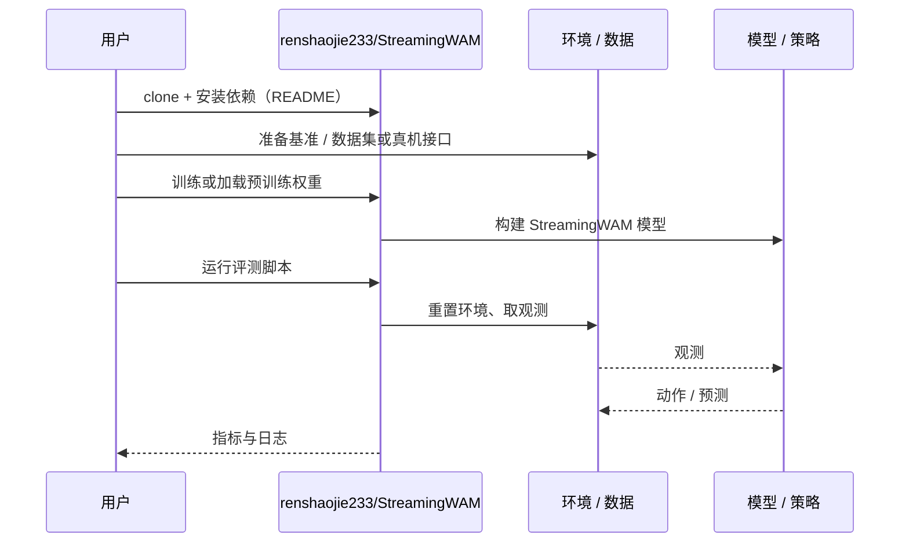

# StreamingWAM（arXiv:2610.15585）

**StreamingWAM**（*StreamingWAM: Streaming World Action Modeling via Chunk-Wise Staircase Flow Matching*，[arXiv:2610.15585](https://arxiv.org/abs/2610.15585)，[项目页](https://renshaojie233.github.io/StreamingWAM/)，[代码](https://github.com/renshaojie233/StreamingWAM)）来自 [具身智能小站 2026-10-14 盘点](../../sources/blogs/wechat_embodied_station_41_papers_streamingwam_2026-10-14.md)，属「VLA 与动作生成」组。

## 一句话定义

**把整块生成改为滚动动作缓冲 + 阶梯式分块噪声 + 历史条件，新观察到达后持续细化未来动作，同时压低响应延迟与跨块顿挫。**

## 英文缩写速查

| 缩写 | 英文全称 | 简要说明 |
|------|----------|----------|
| WAM | World Action Model | 世界预测与动作联合建模 |
| FM | Flow Matching | 流匹配生成 |
| LIBERO | Lifelong Robot Learning Benchmark | 操作基准套件 |
| RTC | Real-Time Chunking | 实时动作块执行 |

## 为什么重要

- 世界动作模型部署时单次预测快还不够，相邻动作块接不上仍让机器人顿挫；首次暖启动与稳态更新的延迟须分开衡量。
- 开源结论：**已开源**（步骤 2.5，2026-10-14）。仓库可达；公众号称当前实现范围主要是 LIBERO-Plus，真机与其它基准以后续更新为准。
- 同期同组工作见 [流式动作块与世界模型记忆：具身智能小站 10-14 期 41 篇阅读坐标](../overview/embodied-station-2026-10-14-41-papers-technology-map.md)。

## 核心机制

| 项 | 内容 |
|----|------|
| **arXiv** | [2610.15585](https://arxiv.org/abs/2610.15585) |
| **开源** | **已开源** |
| **要点** | 滚动缓冲中的动作按时间距离分配不同噪声层级（staircase），前缀延续已承诺动作，历史记忆作为条件；每来一帧新观察即对缓冲做一次流匹配细化。 |
| **文内指标** | 作者报告覆盖 LIBERO、LIBERO-Plus、RoboTwin 与真机；公众号未核验表格，本页不引用具体数字。 |

## 源码运行时序图

以下为按仓库入口（`renshaojie233/StreamingWAM`）推断的通用运行链路；入库日仅核实仓库可达，未逐文件阅读，具体脚本名以 README 为准。

## 实验与评测

- 作者报告覆盖 LIBERO、LIBERO-Plus、RoboTwin 与真机；公众号未核验表格，本页不引用具体数字。
- **读法：** 本页为索引级摘要，依据公众号转述的官方摘要与仓库信息整理；逐项数字与 baseline 以原文 PDF 为准。

## 与其他工作对比

- 横向索引见 [流式动作块与世界模型记忆：具身智能小站 10-14 期 41 篇阅读坐标](../overview/embodied-station-2026-10-14-41-papers-technology-map.md)；同 arXiv 不重复造页。

## 结论

**流式 WAM 的关键不是更快的一步生成，而是把分块噪声、前缀延续与历史条件放进同一更新流程，使延迟与连续性可同时评估。**

1. 开源边界：**已开源** — 仓库可达；公众号称当前实现范围主要是 LIBERO-Plus，真机与其它基准以后续更新为准。
2. 核心机制：滚动缓冲中的动作按时间距离分配不同噪声层级（staircase），前缀延续已承诺动作，历史记忆作为条件；每来一帧新观察即对缓冲做一次流匹配细化。
3. 复现与选型前核对任务协议、硬件与基准口径，勿直接横比公众号摘录数字。

## 关联页面

- [world-action-models](../concepts/world-action-models.md)
- [flow-matching-embodied-policy](../concepts/flow-matching-embodied-policy.md)
- [action-chunking](../methods/action-chunking.md)
- [manipulation](../tasks/manipulation.md)
- [embodied-station-2026-10-14-41-papers-technology-map](../overview/embodied-station-2026-10-14-41-papers-technology-map.md)

## 参考来源

- [streamingwam_arxiv_2610_15585.md](../../sources/papers/streamingwam_arxiv_2610_15585.md)
- [wechat_embodied_station_41_papers_streamingwam_2026-10-14.md](../../sources/blogs/wechat_embodied_station_41_papers_streamingwam_2026-10-14.md)
- [arXiv:2610.15585](https://arxiv.org/abs/2610.15585)

## 推荐继续阅读

- [arXiv PDF](https://arxiv.org/pdf/2610.15585)
- [项目页](https://renshaojie233.github.io/StreamingWAM/)
- [https://github.com/renshaojie233/StreamingWAM](https://github.com/renshaojie233/StreamingWAM)
