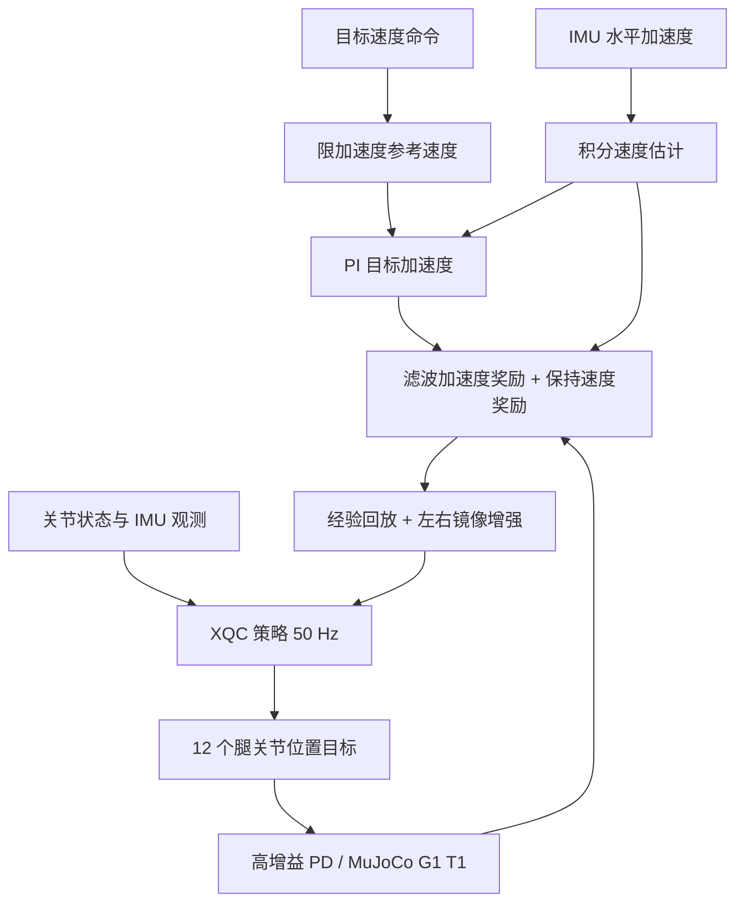

# STRIDE：基于加速度奖励的分钟级人形行走学习（STRIDE: Learning Humanoid Locomotion in Minutes with Acceleration-Based Rewards）

**机构：** 达姆施塔特工业大学（Technical University of Darmstadt）  
**论文：** [arXiv:2611.08857](https://arxiv.org/abs/2611.08857)

## 一句话定义

STRIDE 使用 IMU 加速度目标和积分速度保持奖励替代外部基座速度监督，以 XQC、高增益 PD 及左右对称增强在 MuJoCo 单机器人仿真中用约 13–14 分钟样本训练 G1/T1 行走；目前没有真机学习实验证据。

## 英文缩写速查

| 缩写 | 英文全称 | 简要说明 |
|---|---|---|
| IMU | Inertial Measurement Unit | 提供机体加速度、角速度及重力方向 |
| XQC | Well-Conditioned Optimization Accelerates Deep Reinforcement Learning | 用于样本高效的离策略 actor-critic 优化 |
| PI | Proportional–Integral | 由参考速度与积分速度误差产生加速度目标 |
| PD | Proportional–Derivative | 执行腿关节目标位置的低层伺服 |
| UTD | Update-to-Data Ratio | 每份新数据的网络更新次数 |

## 为什么重要

常规 locomotion 奖励需要基座线速度，真机通常要依赖动作捕捉或带延迟与漂移的状态估计。STRIDE 研究的是能否从机载 IMU 构造更容易落地的奖励，但其真机验证仍待完成。

## 核心原理

先将目标速度变为有加速度上界的参考速度，积分 IMU 水平加速度得到速度估计；PI 控制器产生目标加速度。用低通加速度跟踪奖励加速度为零时的保持速度奖励，配合摔倒与动作正则；XQC 离策略训练并以 0.5 概率镜像经验。策略 50 Hz 输出 12 个腿关节位置目标，高增益 PD（Kp=60、Kd=3）追踪。

### 流程总览

以下是论文方法的**概念流程**，不是未经核查的源代码调用关系。

## 实验与评测

MuJoCo 的 G1/T1、单机器人采样、每轮最多 250k transitions（83 分钟）；两机各 2/2 次在约 13 分钟学会行走，正文称全部 12–14 分钟。无对称增强 G1/T1 平均为 21/18 分钟；低增益配置 G1/T1 为 22/66 分钟。低增益且无镜像时总跌倒超过 2000 次，STRIDE 约 440 次。表 1 的跌倒计数是**仿真跌倒**，不可当实体硬件摔倒次数。

## 与其他工作对比

相较速度跟踪奖励需要测量基座线速度，STRIDE 的训练反馈来自机载 IMU；与同文低增益/无镜像消融相比，它减少样本量与跌倒；但与需要真机部署验证的 [Sim2Real](../concepts/sim2real.md) 问题不等价。

## 结论

**STRIDE 使用 IMU 加速度目标和积分速度保持奖励替代外部基座速度监督，以 XQC、高增益 PD 及左右对称增强在 MuJoCo 单机器人仿真中用约 13–14 分钟样本训练 G1/T1 行走；目前没有真机学习实验证据。**

1. 优先核对 **IMU 偏置与重力补偿**，否则积分速度保持项会随时间漂移。
2. 14 分钟是采样时长而非墙钟训练耗时，更不是实体 G1 实机在线学习成绩。
3. 高增益 PD 和对称增强是必要消融因素，未证明仅替换奖励即可在真机稳定学习。
4. 单一共享策略未在 T1 预算内学会走路，不应声称已展示跨机体正迁移。

## 工程实践

若复现，先在 MuJoCo 验证奖励中的加速度滤波、积分速度重置与关节动作映射；记录 reward_acc、reward_hold、episode_length、跌倒次数及实际速度（速度仅评估用）。再评估真机 IMU 的重力/偏置、动作安全限幅与摔倒保护。

### 源码运行时序图

**不适用（未取得可核实的官方研究代码运行入口）。** 不能由论文框架图推断真实函数调用或部署数据流。

## 局限与风险

原文第 5 节明确限定实验为仿真：模拟 IMU 无噪声和偏置，现实中重力及积分漂移可能导致奖励失效。尚未完成作者提出的 G1/T1 真机在线学习与全向速度命令实验。

## 关联页面

- [人形运动控制](../tasks/humanoid-locomotion.md)
- [Sim2Real](../concepts/sim2real.md)
- [PPO：与离策略 XQC 对照](../methods/ppo.md)
- [11.09–11.13 人形／四足 29 篇周报](../overview/humanoid_quadruped_2026_11_09_13_29_papers.md)

## 参考来源

- [arXiv v1 原文通读归档](../../sources/papers/stride_acceleration_locomotion_arxiv_2611_08857.md)
- [论文 HTML 全文](https://arxiv.org/html/2611.08857v1)

## 推荐继续阅读

- [论文 arXiv HTML 全文](https://arxiv.org/html/2611.08857v1)
- [论文 PDF](https://arxiv.org/pdf/2611.08857v1)
