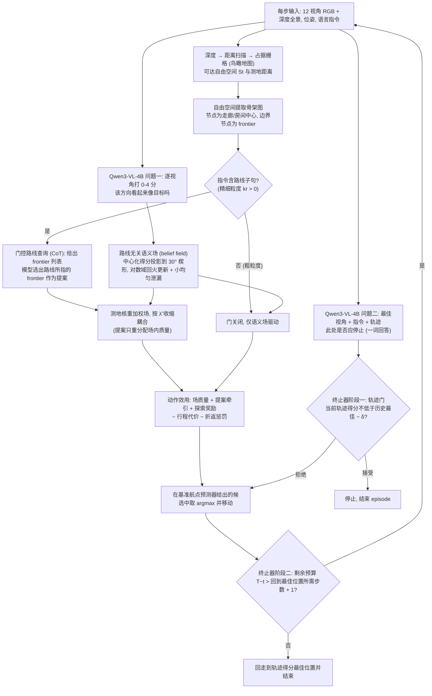

# Structure over Reasoning（arXiv:2610.25130）

**Structure over Reasoning**（*Structure over Reasoning: Unified Zero-Shot Navigation with a Small Vision-Language Model*，[arXiv:2610.25130](https://arxiv.org/abs/2610.25130)，[项目页](https://anonymous.4open.science/r/structure-over-reasoning-PAGE)）来自 [具身智能小站 2026-11-01 盘点](../../sources/blogs/wechat_embodied_station_56_papers_libero_dynamic_latency_eval_2026-11-01.md)，属「具身智能体与导航」组。

## 一句话定义

**把小VLM的方向判断累积到语义地图，再用图搜索和停止门控决定行动；统一预算仿真对照支持结构化设计，最强粗粒度基线差异的区间仍包含零。**

## 英文缩写速查

| 缩写 | 英文全称 | 简要说明 |
|------|----------|----------|
| Structure over Reasoning | Structure over Reasoning: Unified Zero-Shot Navigation with a Small Vision-Language Model | 本文方法 / 基准的简称 |

## 为什么重要

- 小模型导航，把感知证据交给结构处理。
- 开源结论：**项目页未列 GitHub**（步骤 2.5，2026-11-01）。项目页为 anonymous.4open.science 匿名链接，curl 返回 HTTP 401，无法核查代码。
- 同期同组工作见 [动态评测、技能编译与环境潜变量适配：具身智能小站 11-01 期 56 篇阅读坐标](../overview/embodied-station-2026-11-01-56-papers-technology-map.md)。

## 流程总览

图依据：论文 §III Method (A-D) / Fig.1 / 式(1)-(9)

## 核心机制

| 项 | 内容 |
|----|------|
| **arXiv** | [2610.25130](https://arxiv.org/abs/2610.25130) |
| **开源** | **项目页未列 GitHub** |
| **要点** | 把小VLM的方向判断累积到语义地图，再用图搜索和停止门控决定行动；统一预算仿真对照支持结构化设计，最强粗粒度基线差异的区间仍包含零。 |
| **文内指标** | 公众号未给具体数字，本页不引用。 |

## 源码运行时序图

**不适用（项目页未列 GitHub）** — 项目页为 anonymous.4open.science 匿名链接，curl 返回 HTTP 401，无法核查代码。 不编造运行脚本；代码公开后再补。

## 实验与评测

- 公众号未给具体数字，本页不引用。
- **读法：** 本页为索引级摘要，依据公众号转述的官方摘要与仓库信息整理；逐项数字与 baseline 以原文 PDF 为准。

## 与其他工作对比

- 横向索引见 [动态评测、技能编译与环境潜变量适配：具身智能小站 11-01 期 56 篇阅读坐标](../overview/embodied-station-2026-11-01-56-papers-technology-map.md)；同 arXiv 不重复造页。

## 结论

**小模型导航，把感知证据交给结构处理：把小VLM的方向判断累积到语义地图，再用图搜索和停止门控决定行动；统一预算仿真对照支持结构化设计，最强粗粒度基线差异的区间仍包含零。**

1. 开源边界：**项目页未列 GitHub** — 项目页为 anonymous.4open.science 匿名链接，curl 返回 HTTP 401，无法核查代码。
2. 核心机制：把小VLM的方向判断累积到语义地图，再用图搜索和停止门控决定行动；统一预算仿真对照支持结构化设计，最强粗粒度基线差异的区间仍包含零。
3. 复现与选型前核对任务协议、硬件与基准口径，勿直接横比公众号摘录数字。

## 关联页面

- [llm-robotics-control-interfaces](../concepts/llm-robotics-control-interfaces.md)
- [vision-language-navigation](../tasks/vision-language-navigation.md)
- [manipulation](../tasks/manipulation.md)
- [vision-language-navigation](../tasks/vision-language-navigation.md)
- [embodied-station-2026-11-01-56-papers-technology-map](../overview/embodied-station-2026-11-01-56-papers-technology-map.md)

## 参考来源

- [structure_over_reasoning_arxiv_2610_25130.md](../../sources/papers/structure_over_reasoning_arxiv_2610_25130.md)
- [wechat_embodied_station_56_papers_libero_dynamic_latency_eval_2026-11-01.md](../../sources/blogs/wechat_embodied_station_56_papers_libero_dynamic_latency_eval_2026-11-01.md)
- [arXiv:2610.25130](https://arxiv.org/abs/2610.25130)
- [arXiv PDF](https://arxiv.org/pdf/2610.25130)：已通读方法部分（实验与附录以略读为准）：§III 方法（鸟瞰图与骨架图、路线无关语义场、路线通道与门控耦合、两阶段终止器），§IV 实验与消融

## 推荐继续阅读

- [arXiv PDF](https://arxiv.org/pdf/2610.25130)
- [项目页](https://anonymous.4open.science/r/structure-over-reasoning-PAGE)
