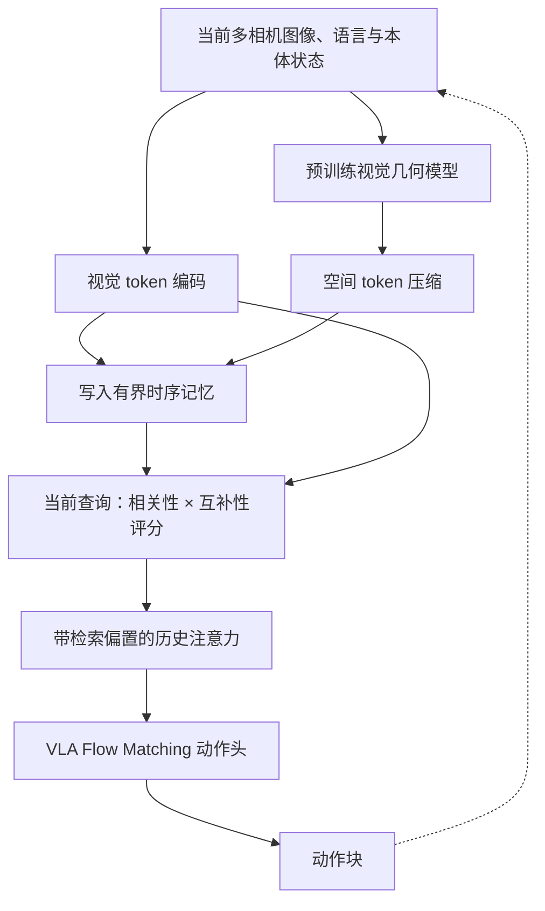

# STVLA：融合空间几何与时序记忆的视觉语言动作模型
*STVLA: Spatial-aware and Temporal-memory for Vision-Language-Action Models*

## 一句话定义

**STVLA**：将预训练视觉几何基础模型的空间特征与视觉 token 一起写入有界时序记忆，按相关性和互补性选取历史证据来条件化 VLA 动作。

## 英文缩写速查

| 缩写 | 英文全称 | 简要说明 |
|---|---|---|
| STVLA | Spatial-aware and Temporal-memory VLA | 几何增强的时序记忆策略 |
| VLA | Vision-Language-Action | 视觉语言动作模型 |
| KL | Kullback-Leibler Divergence | 潜变量约束损失 |
| RGB | Red Green Blue | 输入彩色图像 |

## 为什么重要

仅当前帧不能区分重复画面对应的不同任务阶段；只缓存外观又容易受遮挡和视角变化干扰。

## 核心信息

| 维度 | 核对信息 |
|---|---|
| 原始论文 | [arXiv:2611.16589v1](https://arxiv.org/html/2611.16589v1) |
| 机构 | 智元机器人（AgiBot） |
| 论文作者 | Zhuo Han、Yeqiang Wang、Xinran Wang 等 |
| 官方项目 | [项目页](https://stvla.github.io/) |
| 开源状态（2026-11-16） | 项目站点未提供可运行源码仓库链接。 |

## 核心原理

当前图像同时经过视觉编码和预训练几何 backbone，空间信息经压缩后与图像 token 组成记忆条目；有界 memory bank 保留历史。读取时以当前 query 与历史条目的余弦相似度评估 relevance，并利用差异项奖励非冗余信息，标准化后给 token attention 加偏置，形成条件上下文；用 flow-matching 动作目标并配合空间重建、KL 损失训练。

### 流程总览

> 图示基于论文的方法和监督流向；训练与部署路径应区分，图中模块不代表源码调用关系。

## 实验与评测

论文报告 LIBERO、LIBERO-Mem、MIKASA-Robo、SimplerEnv Bridge 仿真与 AGIBOT G2 真机。真机堆块、物体归置、手机包装三项任务，较 π0.5 成功率分别高 58.33、30.00、35.00 **百分点**（不是相对百分比）。SimplerEnv Bridge 平均 74.0% 对 MemoryVLA 的 71.9%。

## 与其他工作对比

| 工作 | 关键接口与训练阶段 | 边界与取舍 |
|---|---|---|
| 本文 | 将预训练视觉几何基础模型的空间特征与视觉 token 一起写入有界时序记忆，按相关性和互补性选取历史证据来条件化 VLA 动作。 | 几何模型及记忆检索会引入附加计算与存储，结果主要在论文指定基准和 G2 双臂上验证；项目页未发现官方可运行训练/评测代码。 |
| [SALA](./paper-sala-latent-actions.md) | 同领域相关研究，侧重不同的学习或动作接口 | 不能把不同基准、度量或硬件结果直接横比 |
| [EgoX](./paper-egox-mxt-plus.md) | 从另一维度处理学习、记忆或控制问题 | 验收须按论文各自协议建立独立基线 |

## 结论

**将预训练视觉几何基础模型的空间特征与视觉 token 一起写入有界时序记忆，按相关性和互补性选取历史证据来条件化 VLA 动作。 但必须按论文的实验协议和开源边界解读其效果。**

1. 记忆补足的是任务**状态与几何历史**，不能直接当成少样本 ICL 的新映射学习。
2. 相关性和非冗余性共同打分，不能简单等同最相似帧检索。
3. 真实试验给的是对 π0.5 的百分点增量，要核对基线与任务口径。

## 源码运行时序图

**不适用。** 项目站点未提供可运行源码仓库链接。 目前只有原论文方法流程可核验，不能把未开放的代码调用关系画成运行时序图。

## 工程实践

| 项目 | 实施与检查点 |
|---|---|
| 接入输入 | 核实论文定义的观察模态、坐标系、动作/控制接口，不能照搬其他本体 |
| 基线与指标 | 复用论文评测协议；另外记录成功率、任务进度、执行耗时和失败分布各自口径 |
| 训练/执行成本 | 区分模型预训练成本、开发期调用次数、在线决策延迟及实际通信开销 |
| 代码可得性 | 项目站点未提供可运行源码仓库链接。 |
| 复现路径 | 以[官方论文](https://arxiv.org/html/2611.16589v1)与[项目页](https://stvla.github.io/)为准，缺失的数据/权重/控制接口需要单列阻塞 |

## 局限与风险

几何模型及记忆检索会引入附加计算与存储，结果主要在论文指定基准和 G2 双臂上验证；项目页未发现官方可运行训练/评测代码。

- **跨实验不可直接排名：** 论文分别使用跨本体进度、VLA 成功率、真机 episode 成功率或 RoboDojo 子集得分，不具备共同分母。
- **工程安全边界：** 真机动作链需另行评估碰撞、限位、通信中断与异常恢复；论文实验成绩不构成部署安全保证。

## 关联页面

- [2026-11-16 具身前沿 29 篇论文阅读地图](../overview/embodied-frontier-29-papers-2026-11-16.md)

- [SALA](./paper-sala-latent-actions.md)
- [EgoX](./paper-egox-mxt-plus.md)
- [VLA 学习纵深路线](../../roadmap/depth-vla.md)
- [跨本体迁移纵深路线](../../roadmap/depth-cross-embodiment.md)

## 参考来源

- [论文原文与核对归档](../../sources/papers/stvla-arxiv-2611-16589.md)
- [官方项目页核对](../../sources/sites/stvla-project-20261116.md)
- [arXiv HTML v1（包含实验与局限）](https://arxiv.org/html/2611.16589v1)

## 推荐继续阅读

- [官方项目页](https://stvla.github.io/)
- [论文 PDF](https://arxiv.org/pdf/2611.16589)
