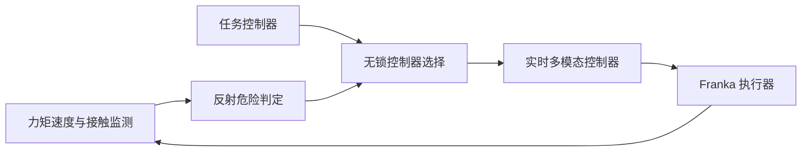
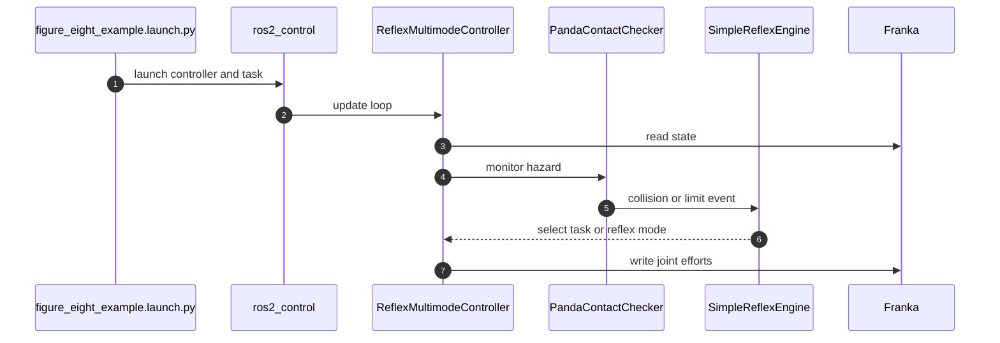

# 亚毫秒反射：连续人机物理交互的无锁控制切换

## 一句话定义

**以可并存的多控制器与无锁切换机制，在连续控制中快速切换运动、柔顺与安全反射控制行为。**

## 英文缩写速查

| 缩写 | 英文全称 | 简要说明 |
|------|----------|----------|
| pHRI | Physical Human-Robot Interaction | 物理人机交互 |
| ROS 2 | Robot Operating System 2 | 机器人中间件 |
| Jerk | Rate of Change of Acceleration | 加速度变化率 |

## 为什么重要

ROS 2 兼容的亚毫秒反射引擎，关注现有控制、数据或机器人学习方法在复杂任务中的失效点。这里单独建论文实体，避免与其他论文共用详情页；已通读原始论文 HTML 的可用正文和附录；源码执行效果仍需复现。

## 核心机制

ROS 2 兼容 multimode controller 将控制行为预备于实时循环中；危险接触、关节极限和速度阈值触发 reflex 状态机，通过无锁指针切换活跃控制器而非停机重启。

## 方法流程

该流程依据原文方法描述，不等价于源码调用时序。

## 源码运行时序图

依据官方仓库 README 与实际执行入口静态核查，尚未部署运行：

## 实验与评测

Franka Panda 的控制模式切换延迟低于 0.1 ms；多阶段任务执行耗时降低 3.5%，峰值 jerk 下降超过三倍。0.1 ms 是控制模式切换耗时，非接触后机械系统卸力的总时延。

## 局限与工程实践

- 结果针对所测 Franka 与控制软件栈；实际安全性能仍取决于传感、驱动、执行器动态与设备安全机制。
- **源码状态：** 公开 ROS 2 / Franka reflex engine，README 说明依赖 multipanda_ros2；实际部署需核对硬件/版本。
- **原文状态：** 已通读 arXiv HTML 的可用正文和附录；具体复现及跑通情况尚未独立验证。

## 结论

**反射切换可以优化控制软件实时路径，但不能把软件切换时延当作完整机械安全响应时间。**

1. 使用与论文一致的任务、硬件和评测协议复验，不跨实验口径比较数据。
2. 把方法改善的指标与额外的数据、计算或控制成本分开记录。
3. 对未经独立核查的复现入口，暂不声称完成验证。

## 与相关方法对比

| 对照方法 | 关键区别 | 局限或适用条件 |
|---|---|---|
| 重配置 ROS 2 控制器 | 切换可能涉及控制器生命周期管理 | 论文的多模态架构让子控制器驻留在实时路径 |
| 固定停机反射 | 只提供停止行为 | 实现 zero-g、admittance、retraction 和 stop |

不同基准和硬件的结果不能直接排序。

## 关联页面

- [CarryOn：具备记忆、安全与失败恢复的双循环机器人 Harness](./paper-carryon-dual-loop.md)
- [TRACE：具有参考保持约束的对话式人形动作编辑](./paper-trace-conversational-humanoid-motion.md)

## 参考来源

- [论文归档](../../sources/papers/submillisecond-reflex-engine_arxiv_2610_21913.md)
- [官方仓库归档](../../sources/repos/submillisecond-reflex-engine.md)

## 推荐继续阅读

- [arXiv 原文](https://arxiv.org/abs/2610.21913)
- [公开仓库](https://github.com/RoboRef/franka_reflex_engine)
