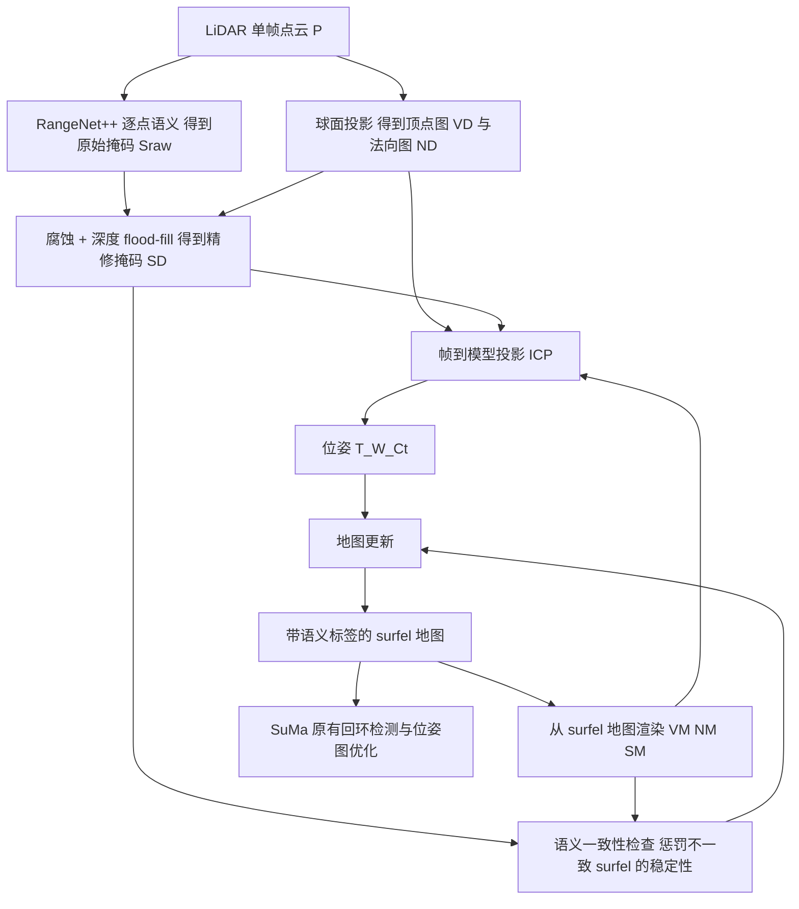

# SuMa++：高效的基于激光雷达的语义 SLAM

## 一句话定义

**SuMa++**（Chen 等，IROS 2019）是在 surfel 激光 SLAM「SuMa」上叠加语义的方案：用 RangeNet++ 给每个激光点打语义标签，借语义一致性判断并移除运动物体留下的 surfel，同时在帧到模型 ICP 里按语义是否相容给残差加权，只用 LiDAR 就得到带标签的 surfel 地图和更稳的里程计（摘要、§III）。

## 英文缩写速查

| 缩写 | 英文全称 | 简要说明 |
|------|----------|----------|
| SuMa | Surfel-based Mapping | 论文的基础系统：球面投影 + 帧到模型投影 ICP + 回环位姿图（§III-B） |
| SuMa++ | SuMa with semantics | 本文方案，加入语义精修、动态滤除、语义 ICP |
| SuMa nomovable | SuMa removing all movable classes | 论文对照基线：按类别一律移除可移动物体（§IV） |
| RangeNet++ | Range-image network, version ++ | 对距离图像做逐点语义分割的 FCN，DarkNet53 主干（§III-C） |
| FCN | Fully Convolutional Network | 全卷积网络，见 [FCN 语义分割](../methods/fcn-semantic-segmentation.md) |
| ICP | Iterative Closest Point | 迭代最近点配准；此处为帧到模型的投影式 ICP |
| surfel | Surface element | 带位置、法向、半径的面元，地图基本单元（§III-B） |
| SemanticKITTI | Semantic KITTI dataset | KITTI 点云的逐点语义标注，用于训练 RangeNet++（§I） |
| KITTI | Karlsruhe Institute of Technology and Toyota Technological Institute dataset | 自动驾驶数据集，本文评测平台（§IV） |
| IROS | IEEE/RSJ International Conference on Intelligent Robots and Systems | 发表会议，2019 |
| SLAM | Simultaneous Localization and Mapping | 同步定位与建图 |

## 为什么重要

- **作者要解决的问题：** 车载激光 SLAM 常处在动态场景，移动车辆会让几何配准锁到「一起运动的车」上，导致位姿和地图不一致；在 KITTI 高速公路序列上静态结构稀少、移动车辆很多，纯几何方法更容易失败（§I、§IV-A，Fig. 6）。
- **作者的做法：** 不是粗暴按类别删除，而是只在「观测语义与地图语义不一致」时让 surfel 变得不稳定，再移除；停着的车保留，仍可作为配准特征（§III-E，Fig. 4）。
- **对本库的意义（判断）：** 它是激光 SLAM 里「用学习得到的语义改善几何估计」的早期、完整、开源的范例，可对照 [LeGO-LOAM](lego-loam.md) 一类纯几何方法理解语义能补什么、代价是什么（需要 GPU 与带标注训练数据）。

## 核心原理

### 方法栈与流程总览

说明：图依据论文 Fig. 2 与 §III 绘制；回环部分沿用 SuMa，论文没有把语义用于回环（§III-B、§IV-C 展望）。

### 关键机制

1. **语义分割（§III-C）：** RangeNet++ 在距离图像上分类，输出逐点标签与概率；每个 surfel 另存推断标签 y 与其概率。
2. **掩码精修（§III-D，Alg. 1）：** 网络输出因投影和内部下采样呈「块状」，反投影有伪影。先腐蚀，去掉边界（邻域有不同标签）的像素；再用顶点图的深度，把空像素填成相邻标签，条件是两点距离小于 θ 倍的距离尺度。
3. **动态滤除（§III-E，式 (1)）：** 沿用 SuMa 的 surfel 稳定性二元贝叶斯滤波（对数几率 l_s）；当新观测标签与地图 surfel 标签不一致时，额外减去 odds(p_penalty)，多次观测后不稳定 surfel 被移除。只对可移动类惩罚，植被不惩罚（§IV-C）。
4. **语义 ICP（§III-F，式 (2)–(8)）：** 权重 w = Huber 权重 × C_semantic × I{l_s ≥ l_stable}。标签相同时 C_semantic 取该点标签概率 P(y)，不同取 1−P(y)。Gauss-Newton 求解增量。

## 工程实践

- **运行条件（论文 §IV）：** 实验机为 Intel Xeon W-2123 + Nvidia Quadro P4000（8 GB）；RangeNet++ 平均 75 ms/帧，建图平均 48 ms/帧，回环整合最多 190 ms（序列 00）。KITTI 的 Velodyne HDL-64E 为 10 Hz，即每帧预算 100 ms；两项均值相加约 123 ms，是否能在线满帧率取决于流水线并行方式，**论文没有给出端到端实时结论，此处为我的推断，未验证**。
- **仓库（README，2026-11-11 核对，未运行）：** 依赖 catkin、Qt5、OpenGL ≥ 4.0、Eigen、gtsam ≥ 4.0，需先构建 rangenet_lib（TensorRT C++ 接口），下载预训练 darknet53 模型，在 `config/` 配置模型路径；首次运行需数分钟生成 `.trt`。以 GUI `visualizer` 打开 KITTI Velodyne 的 `.bin` 播放。MIT 许可。
- **泛化（README）：** 仓库自述目前只能用于 KITTI，因为语义分割在别的环境可能泛化不好；自己的数据需微调或重训分割网络。
- **选型提示（判断）：** 要在含大量动态车辆的道路上做纯 LiDAR 里程计并想要语义地图，可参考；没有 GPU、传感器非机械旋转式 64 线，或场景与 SemanticKITTI 类别差异大时，需另行评估。

## 实验与评测

均取自论文 §IV。指标为相对旋转误差（度/100 m）/ 相对平移误差（%）。

| 实验 | 设置 | 结果 |
|------|------|------|
| KITTI Road（Table I） | 原始数据 road 类 12 条（重命名为序列 30–41），多为高速公路与乡村，无语义标注，不属于分割训练集 | 平均：SuMa 1.35/6.13；SuMa nomovable 1.17/1.46；SuMa++ 1.04/1.46。序列 35：SuMa 5.11/26.8，SuMa++ 2.90/1.11 |
| KITTI Odometry 训练序列（Table II） | 序列 00–10，距离区间 100–800 m | 平均：SuMa 0.36/0.83；SuMa++ 0.29/0.70；IMLS-SLAM 平移 0.55；LOAM 平移 0.84 |
| SuMa nomovable（Table II） | 一律删可移动类 | 在城市序列（如 00、02、05、08、09）上发散，平移误差达数十个百分点；作者归因于误删静态 surfel 与删掉停放车辆使地图变稀疏 |
| KITTI 测试集（§IV-B） | 服务器端评测，不可调参 | SuMa++ 平移 1.06%，对比 SuMa 1.39%；旋转两者文中均写 0.0032 deg/m |

读表要点（我的判断）：

- 在 Table I 上，SuMa++ 与 SuMa nomovable 的平均平移误差相同（均 1.46%），差别体现在旋转误差平均与个别序列；作者也承认二者「相近」，这类场景的主要收益来自去掉真正运动的物体（§IV-A）。
- Table II 中 SuMa++ 平均平移误差 0.70%，**不是**表中最优：IMLS-SLAM 为 0.55%。
- Table II 中 SuMa nomovable 的平均栏写作 23.3/9.24，与逐序列数字（旋转列为十几到二十几）的格式不一致，疑为论文排版问题，引用时应只用逐序列数值。

## 局限

**论文自己承认（§IV-C）：**

- 无法滤除第一次观测里的动态物体；第一帧就有大量运动物体时方法会失败，因为无法估计合适的初始速度或位姿。论文的解法是在初始化期移除所有潜在可移动类，并建议未来做回溯修改地图。
- 只惩罚可移动类，植被叶片随视角与反射变化的影响未处理。
- 简单删除某些类别会恶化定位，但可移动物体仍可能需要从长期地图中去除，论文留作后续。
- 计划把语义用于回环检测（即当前版本没有）。

**我看到的未验证之处：**

- 评测集中在 KITTI 一种传感器（Velodyne HDL-64E）与驾驶场景；分割网络训练集与评测序列同源（里程计序列 00–10 用于训练），Table II 的训练序列结果带有分割网络见过这些场景的前提；论文用 Table I 的 road 序列（无标注）与服务器端测试集来缓解，但测试集只给了汇总数字。
- 未与同期带 IMU 的紧耦合系统（如 [LIO-SAM](lio-sam.md)）比较；对比对象是 SuMa、IMLS-SLAM、LOAM。
- 方法依赖 GPU 上的深度网络，论文未给出换传感器线数或雨雾等条件的结果。
- 本页只读了论文与 README，未审阅仓库源码，实现细节与论文公式是否完全一致未核实。

## 与「激光雷达 SLAM 综述」文章说法的核对

文章（刘铭哲等，陆军工程大学，2.2.3 节）写：基于激光雷达的语义 SLAM，用 RangeNet++ 做语义分割，根据语义信息剔除动态目标，再把语义与几何一起建立约束。

- **对得上：** 仅用 LiDAR、RangeNet++ 分割、依语义处理动态目标、语义加入约束（ICP 权重），均与论文 §III 一致。
- **需要补充：** 文章没有说明「剔除」不是按类别一刀切，而是语义一致性 + 稳定性惩罚；论文的实验恰恰证明一刀切（SuMa nomovable）在城市序列发散（Table II）。语义约束的具体形式是权重，而不是新增几何残差。
- **文章没提：** 它建立在 SuMa（surfel 地图）之上，回环仍是几何的；文章把它与语义回环方法写在同一段，容易让读者误以为 SuMa++ 有语义回环；论文把它列为未来工作。
- **「提高定位和建图精度」：** 有数据支持（Table I、II），但幅度主要出现在动态车辆多的序列，Table II 平均平移误差也不及 IMLS-SLAM。
- 文章未给出年份、机构与耗时；本页据论文补齐为 IROS 2019、波恩大学、需 GPU（RangeNet++ 平均 75 ms/帧）。

## 关联页面

- [LeGO-LOAM](lego-loam.md)：典型纯几何激光里程计，可对照语义能带来什么
- [LIO-SAM](lio-sam.md)、[LVI-SAM](paper-lvi-sam.md)、[FAST-LIO](fast-lio.md)、[Point-LIO](point-lio-unilidar.md)：同属激光 SLAM 谱系，多为 IMU 紧耦合，不使用语义
- [Cartographer](cartographer.md)：另一类以扫描匹配加位姿图的激光 SLAM
- [DCReg](paper-dcreg-degenerate-lidar-registration.md)：同样处理 LiDAR 配准中的病态观测，思路为几何退化而非语义
- [里程计与激光雷达融合定位](../methods/lidar-odometry-fusion.md)
- [FCN 语义分割](../methods/fcn-semantic-segmentation.md)：RangeNet++ 的网络范式背景
- [状态估计](../concepts/state-estimation.md)、[激光雷达感知](../concepts/lidar-sensing.md)

## 参考来源

- [sources/papers/suma-plus-plus_iros_2019_chen2019iros.md](../../sources/papers/suma-plus-plus_iros_2019_chen2019iros.md)
- 论文 PDF：<https://www.ipb.uni-bonn.de/wp-content/papercite-data/pdf/chen2019iros.pdf>
- 官方仓库：<https://github.com/PRBonn/semantic_suma>（README 核对）

## 继续阅读

- 基础系统 SuMa：<https://github.com/jbehley/SuMa>；RangeNet++：<https://github.com/PRBonn/lidar-bonnetal>（均见官方 README 指向）
- 同组后续的回环工作 OverlapNet（README「More Related Work」）：<https://github.com/PRBonn/OverlapNet>
- [LIO 与 VIO 选型对比](../comparisons/lidar-slam-lio-vio-selection.md)
