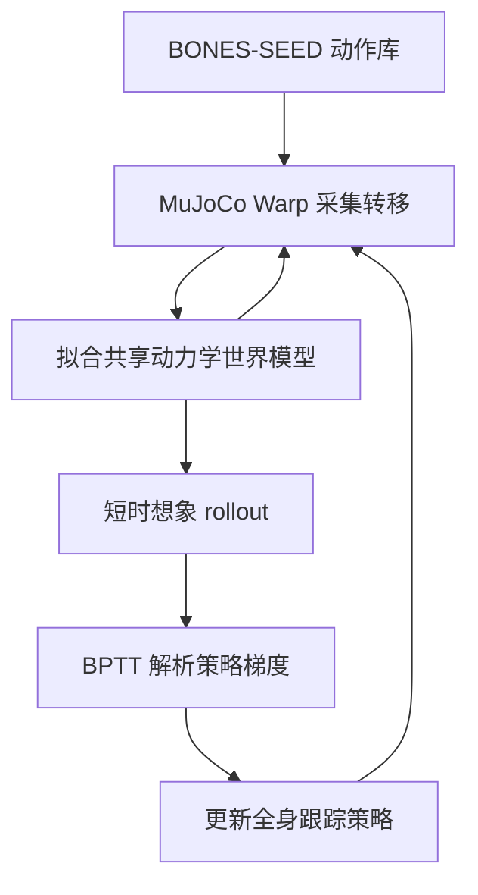

# SuperMimic：用一个可微世界模型扩展人形全身控制

**SuperMimic**（*Scaling Humanoid Whole-Body Control with One Differentiable World Model*，arXiv:2610.28480，CoRL 2026 Oral）由加州大学伯克利分校提出：将一个可微人形动力学世界模型与全身动作跟踪策略放进同一训练循环，以短时想象轨迹上的反向传播替代大量昂贵的模型无关仿真 rollout。

## 英文缩写速查

| 缩写 | 英文全称 | 简要说明 |
|---|---|---|
| WBC | Whole-Body Control | 将多关节协调作为整体处理的人形控制任务 |
| WM | World Model | 从仿真转移数据学习状态演化的动力学模型 |
| BPTT | Backpropagation Through Time | 沿想象 rollout 时间步反传以计算策略梯度 |
| PPO | Proximal Policy Optimization | SONIC 等模型无关强化学习策略的对照算法 |
| GPU | Graphics Processing Unit | 项目报告训练计算量时使用的硬件单位 |

## 为什么重要

人形动作跟踪可以把多样人体动作转化为统一的控制目标，但把单一策略扩展到大量动作时，常见的模型无关强化学习会消耗大量仿真采样与算力。SuperMimic 的价值在于先用仿真器产生的转移数据拟合共享动力学，再在该可微模型中并行想象策略后果；它保留标准刚体仿真器和非光滑接触仿真，同时让策略更新能直接利用梯度。

## 核心原理

### 一个循环中的两个学习器

世界模型和动作跟踪策略交替更新：仿真器提供状态转移样本，世界模型学习预测下一状态；策略在世界模型中执行短时想象 rollout，并通过时间反向传播计算解析梯度。每轮策略更新期间世界模型保持固定，更新完成后再共同进入下一轮训练。梯度不经过 MuJoCo Warp，因此不要求仿真器本身可微。

### 世界模型如何分摊训练成本

传统模型无关训练需要频繁在仿真器中采样策略行为。这里，真实仿真转移主要用于校准世界模型，策略可在学习到的动力学中快速评估动作序列，并沿想象轨迹反传。论文还使用 critic 对短 rollout 之外的回报进行 bootstrap；官方项目页报告 16 步想象 horizon 加 critic 可匹配 32 步、无 critic 的训练效果，且短时预测误差随训练数据规模扩大保持稳定。

## 实验与评测

| 评测项 | 项目页 / 论文报告 | 读法 |
|---|---|---|
| 基线回报 | 1 张 H100 训练 3 小时，超过 SONIC 已发布 checkpoint 的归一化回报 0.90 | 计入采集、世界模型拟合和策略更新；不含训练后的 checkpoint 评估 |
| 计算对比 | SONIC：128 张 L40 × 7 天；SuperMimic：1 张 H100 × 3 小时；作者保守表述 GPU-hours 减少超过 1000 倍；项目页另称 wall-clock 减少超过 50 倍（2026-10-22 核查） | 页面脚注按报告 GPU-hour 计算约为 21,000 对 3；不同硬件与数据规模需一并考虑 |
| 运动覆盖 | 129,514 条 BONES-SEED 训练动作：SONIC 失败 179 条；SuperMimic 单卡 3 小时失败 25 条、双卡 9.8 小时失败 0 条 | 这是训练动作覆盖评测，不是未见动作泛化结果 |
| 数据规模 | 使用 BONES-SEED 公开子集 264.56 小时；SONIC 使用 611 小时 | SuperMimic 数据量更少，仍须注意方法与硬件并非完全相同条件 |
| 真机 | Unitree G1 展示多种动态动作，项目页称所有片段用同一策略且无按动作调参 | 展示 sim-to-real 可行性，不等于论文已提供开源部署栈 |

## 独立复现与工程入口

官方项目页截至 2026-10-22 仍未发布论文作者维护的源码；以下两个公开仓库是社区独立复现，不能视为论文官方实现，也不能据其结果推断官方代码已开放。

| 仓库 | 实现路线 | 可复现入口与边界 |
|---|---|---|
| [Uni-SuperMimic](../../sources/repos/supermimic-unilab.md) | Motphys 基于 UniLab 独立实现，面向 Unitree G1 与 LAFAN1，支持 mjwarp、MuJoCo、Motrix 后端；提供训练、续训、整段动作评测、渲染与 Sim2Sim 检查。 | README 提供资产准备和运行命令；动作 CSV 与机器人网格需从 Hugging Face 数据集下载，mjwarp 训练需要 CUDA GPU。 |
| [supermimic_vibed](../../sources/repos/supermimic-vibed.md) | 基于 Isaac Lab 3 kit-less 与 MuJoCo-Warp 的单卡 G1/LAFAN1 复现，公开训练、评测、渲染脚本。 | 作者报告在 RTX PRO 6000 上 1.47 小时得到 0.829 评测回报、40 段动作零失败；README 同时说明代码由 AI 助手快速生成且未经审查，结果尚未独立复核。 |

两者让读者可以检查不同仿真栈下的独立实现细节；论文方法的权威描述仍以论文和官方项目页为准，复现指标需结合各自硬件、配置和 README 的声明解读。

## 与其他工作对比

与 [SONIC](./nvidia-sonic.md) 的关键差异在训练范式：SONIC 依赖模型无关 PPO 与大规模并行仿真扩展 motion-tracking；SuperMimic 先从标准仿真数据学习动力学，再对策略做模型内解析梯度更新。两者都追求单一策略覆盖大量全身动作，且都在 Unitree G1 上展示动态行为。项目页中的 GPU-hour 和动作失败数使用各自报告配置，应视为论文所设基准下的结果，不应直接外推为所有机器人、数据集或硬件条件下的固定加速比。

## 源码运行时序图

**官方实现不适用：** 截至 2026-10-22，论文官方项目页没有公开训练、推理或部署源码入口。现在有两个社区独立复现（见上表），但它们并非论文作者的官方代码，因此本图不将任何一个复现仓库当成论文源码运行时序。

## 结论

**一句话总判：** SuperMimic 的主要贡献是让一个由仿真数据拟合的可微动力学模型替代部分昂贵的训练期仿真 rollout，从而以较低报告算力达到强动作覆盖，同时不依赖可微仿真器。

1. **先看完整训练环节：** 报告的 3 小时包含采集、世界模型拟合和策略更新，不含 checkpoint 评估。
2. **正确解读加速比：** 作者以“超过 1000×”概括 GPU-hour 节省；页面列出的 21,000 与 3 GPU-hours 算术比值约 7,000×，硬件和数据规模也不同。
3. **不要把覆盖率当泛化：** 129,514 个测试动作来自双方训练动作集；结果说明训练动作覆盖，不证明未见动作泛化。
4. **真机结果仍需复现入口：** G1 视频支持迁移可行性，但目前项目页未提供训练/部署代码、权重或可核验的开放流程。

## 局限与风险

- **评测边界：** 动作失败统计基于过滤后的 BONES-SEED 训练集、固定摩擦与确定性仿真设置，和带噪观测、域随机化或未见动作的泛化问题不同。
- **模型误差：** 策略优化会利用世界模型；若模型在接触切换或训练分布外状态预测失准，想象轨迹上的梯度可能带来错误更新。迁移时仍需检查模型误差与真机动作安全性。
- **开源状态：** 截至 2026-10-22，论文官方项目页未列作者维护的代码、数据或权重入口；社区已有 UniLab 与 Isaac Lab 两种独立代码复现，但实现和实验结论需分别核对，不能等同于官方发布。
- **基线可比性：** SONIC 与 SuperMimic 的 GPU、训练数据时长和实验管线不同，不能把单一比例当成跨硬件普适规律。

## 关联页面

- [SONIC：大规模自然人形全身控制](./nvidia-sonic.md) — 论文采用的高算力 motion-tracking 对照基线。
- [TWIST2](./paper-twist2.md) — 人形全身数据采集、跟踪控制与学习系统案例。
- [全身控制（WBC）](../concepts/whole-body-control.md) — 人形整体协调控制任务背景。
- [模仿学习](../methods/imitation-learning.md) — 从参考动作学习跟踪策略的相关方法。

## 参考来源

- [SuperMimic arXiv 论文](../../sources/papers/supermimic_arxiv_2610_28480.md)
- [SuperMimic 官方项目页](../../sources/sites/supermimic-project.md)
- [Uni-SuperMimic 独立复现](../../sources/repos/supermimic-unilab.md)
- [supermimic_vibed 独立复现](../../sources/repos/supermimic-vibed.md)

## 推荐继续阅读

- [SuperMimic 官方项目页与浏览器演示](https://supermimic.github.io/)
- [SONIC 项目页](https://nvlabs.github.io/GEAR-SONIC/) — 对照理解模型无关大规模 motion-tracking 的算力路线。
