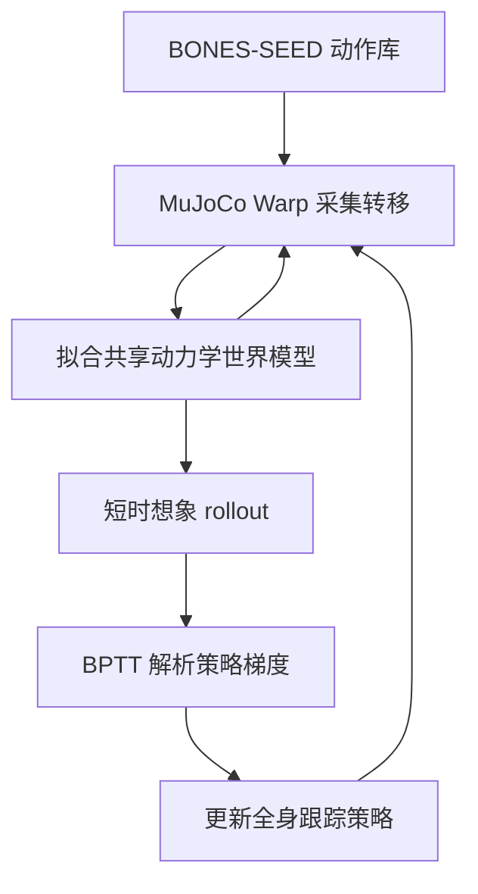
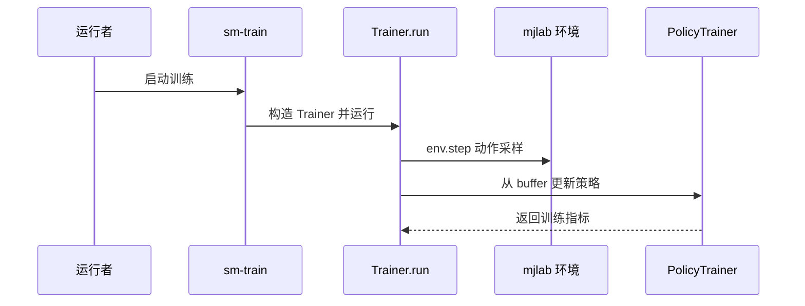

# SuperMimic：用一个可微世界模型扩展人形全身控制

**SuperMimic**（*Scaling Humanoid Whole-Body Control with One Differentiable World Model*，arXiv:2610.28480，CoRL 2026 Oral）由加州大学伯克利分校提出：将一个可微人形动力学世界模型与全身动作跟踪策略放进同一训练循环，以短时想象轨迹上的反向传播替代大量昂贵的模型无关仿真 rollout。

## 英文缩写速查

| 缩写 | 英文全称 | 简要说明 |
|---|---|---|
| WBC | Whole-Body Control | 将多关节协调作为整体处理的人形控制任务 |
| WM | World Model | 从仿真转移数据学习状态演化的动力学模型 |
| BPTT | Backpropagation Through Time | 沿想象 rollout 时间步反传以计算策略梯度 |
| PPO | Proximal Policy Optimization | SONIC 等模型无关强化学习策略的对照算法 |
| GPU | Graphics Processing Unit | 项目报告训练计算量时使用的硬件单位 |

## 为什么重要

人形动作跟踪可以把多样人体动作转化为统一的控制目标，但把单一策略扩展到大量动作时，常见的模型无关强化学习会消耗大量仿真采样与算力。SuperMimic 的价值在于先用仿真器产生的转移数据拟合共享动力学，再在该可微模型中并行想象策略后果；它保留标准刚体仿真器和非光滑接触仿真，同时让策略更新能直接利用梯度。

## 流程总览

世界模型和动作跟踪策略交替更新：仿真器提供状态转移样本，世界模型学习预测下一状态；策略在世界模型中执行短时想象 rollout，并通过时间反向传播计算解析梯度。每轮策略更新期间世界模型保持固定，更新完成后再共同进入下一轮训练。梯度不经过 MuJoCo Warp，因此不要求仿真器本身可微。

图依据：论文摘要与官方项目页「How it works」；两个学习器交替：仿真器供数据、世界模型拟合、策略在模型内用 BPTT 更新。

## 研究团队开源实现与 CoRL 议程（2026-11-11 核对）

- **代码：** [HybridRobotics/supermimic](../../sources/repos/supermimic-hybridrobotics.md) 已公开 mjlab 基础的世界模型 + 策略训练及回放实现，仓库 README 自称 SuperTrack implementation；本页复用原有论文实体，不另建同名 repo 项目节点。
- **代码身份边界：** `supermimic.github.io` 论文项目页至本次核对仍未直接链出该仓库，不能断言它包含论文 CoRL 全部训练配置、BONES-SEED 动作资产、checkpoint 和 G1 真机部署代码。以下社区独立实现依然不是研究团队仓库。
- **训练入口：** `src/supermimic/scripts/train.py` 可选择 `SuperMimic-GenCoord-G1` 或 `SuperMimic-MaxCoord-G1`，从 W&B Registry 或显式 `--motion-file` 获取动作；经 `SuperMimicRunner` 循环采样、缓存、世界模型更新及策略想象更新。
- **回放入口：** `src/supermimic/scripts/play.py` 从 W&B 取得训练配置与 `actor.pt` / `world_model.pt`，在 native/Viser viewer 中播放；尚未实测。
- **CoRL 直播/录像：** [CoRL 2026 官方 Program](../../sources/sites/corl-2026-program.md) 是大会公布的直播入口。**本次未找到可核实归属 SuperMimic 单场 Oral 的录像直链**，因此不捏造单场视频地址。

源码默认的世界模型采样 horizon=8、策略想象 horizon=32，属于当前开源配置；与论文实验的全部超参/模型权重对应关系还需独立比对。

## 核心原理

### 世界模型如何分摊训练成本

传统模型无关训练需要频繁在仿真器中采样策略行为。这里，真实仿真转移主要用于校准世界模型，策略可在学习到的动力学中快速评估动作序列，并沿想象轨迹反传。论文还使用 critic 对短 rollout 之外的回报进行 bootstrap；官方项目页报告 16 步想象 horizon 加 critic 可匹配 32 步、无 critic 的训练效果，且短时预测误差随训练数据规模扩大保持稳定。

## 实验与评测

| 评测项 | 项目页 / 论文报告 | 读法 |
|---|---|---|
| 基线回报 | 1 张 H100 训练 3 小时，超过 SONIC 已发布 checkpoint 的归一化回报 0.90 | 计入采集、世界模型拟合和策略更新；不含训练后的 checkpoint 评估 |
| 计算对比 | SONIC：128 张 L40 × 7 天；SuperMimic：1 张 H100 × 3 小时；作者保守表述 GPU-hours 减少超过 1000 倍；项目页另称 wall-clock 减少超过 50 倍（2026-10-22 核查） | 页面脚注按报告 GPU-hour 计算约为 21,000 对 3；不同硬件与数据规模需一并考虑 |
| 运动覆盖 | 129,514 条 BONES-SEED 训练动作：SONIC 失败 179 条；SuperMimic 单卡 3 小时失败 25 条、双卡 9.8 小时失败 0 条 | 这是训练动作覆盖评测，不是未见动作泛化结果 |
| 数据规模 | 使用 BONES-SEED 公开子集 264.56 小时；SONIC 使用 611 小时 | SuperMimic 数据量更少，仍须注意方法与硬件并非完全相同条件 |
| 真机 | Unitree G1 展示多种动态动作，项目页称所有片段用同一策略且无按动作调参 | 展示 sim-to-real 可行性，不等于论文已提供开源部署栈 |

## 独立复现与工程入口

社区维护的 [awesome-supermimic 索引](../../sources/repos/awesome-supermimic.md) 汇总了多种实现、扩展、演示与数据资源；它是导航入口，不是官方代码或对各项目指标的独立验证。

2026-11-11 已发现 [HybridRobotics/supermimic](../../sources/repos/supermimic-hybridrobotics.md) 研究团队公开实现（上文），并非下面的社区复现。但项目页尚无该仓库外链、完整训练资产与实验逐项对应关系也未得到证实。以下两个仓库是**独立复现**，不能将其结果算作论文官方实测。

| 仓库 | 实现路线 | 可复现入口与边界 |
|---|---|---|
| [Uni-SuperMimic](../../sources/repos/supermimic-unilab.md) | Motphys 基于 UniLab 独立实现，面向 Unitree G1 与 LAFAN1，支持 mjwarp、MuJoCo、Motrix 后端；提供训练、续训、整段动作评测、渲染与 Sim2Sim 检查。 | README 提供资产准备和运行命令；动作 CSV 与机器人网格需从 Hugging Face 数据集下载，mjwarp 训练需要 CUDA GPU。 |
| [supermimic_vibed](../../sources/repos/supermimic-vibed.md) | 基于 Isaac Lab 3 kit-less 与 MuJoCo-Warp 的单卡 G1/LAFAN1 复现，公开训练、评测、渲染脚本。 | 作者报告在 RTX PRO 6000 上 1.47 小时得到 0.829 评测回报、40 段动作零失败；README 同时说明代码由 AI 助手快速生成且未经审查，结果尚未独立复核。 |

两者让读者可以检查不同仿真栈下的独立实现细节；论文方法的权威描述仍以论文和官方项目页为准，复现指标需结合各自硬件、配置和 README 的声明解读。

### G1 社区复现与真机部署（待完整核验）

[SuperMimic-Repro-Sim2Real](../../sources/repos/supermimic-repro-sim2real.md) 基于社区复现扩展 mjlab 训练、ONNX 导出、Sim2Sim 和 G1 真机部署，并公开部分模型。作者自报严格论文观测的 LAFAN1 归一化回报为 0.56，增加 anchor 相对位姿后为 0.904；后者不能直接用于该真机部署。仓库还报告 46 秒串联舞蹈与特定动作模型的两次真机成功；这些是社区复现结果，不是原论文实验。数据须另行下载并遵守条款。

下面的时序仅覆盖已检查的入口与关键调用；论文全文、实现细节及完整部署链仍待核实。

### 社区复现与扩展生态（2026-10-29 公众号盘点）

[具身智能研究室的盘点](../../sources/blogs/wechat_yuanxq_supermimic_42_community_projects_2026-10-30.md)列出 42 个相关项目（截至 2026-10-29），分为基础复现 7、方法改进 5、本体与硬件 8、感知与地形 4、操作与灵巧手 4、肌肉与交互 3、框架集成 6、真机与部署 2、相关探索 3。已有 wiki 节点的有 [HoloMotion](./holomotion.md)、[MorphMimic](./paper-morphmimic.md)、[muscle-supermimic](./muscle-supermimic.md)、[Project Instinct](./project-instinct.md)（InstinctMJ 分支）。该清单为转述自文章的检索结果，我未逐个核查仓库；均属社区实现，不能据此认为论文官方代码已开放。

### 上游集成草案（2026-10-29）

[LeRobot #5119](../../sources/repos/supermimic-integration-drafts.md) 集成 Uni-SuperMimic 导出 actor，针对 29 DoF G1 以 50 Hz 输出关节目标；PR 作者仅报告 MuJoCo 仿真验证，真机尚待验证，actor 与参考动作不随 PR 提供。策略跟踪动作片段，不接受速度指令。

[Isaac Lab #8867](../../sources/repos/supermimic-integration-drafts.md) 提议添加 RSL-RL SuperMimic 支持、可微速度任务与 G1 配置；依赖上游 #8866 和包含 SuperMimic 的 RSL-RL 版本。两项均为未合并草案，不能视作正式版本功能或原论文官方实现。

## 与其他工作对比

与 [SONIC](./nvidia-sonic.md) 的关键差异在训练范式：SONIC 依赖模型无关 PPO 与大规模并行仿真扩展 motion-tracking；SuperMimic 先从标准仿真数据学习动力学，再对策略做模型内解析梯度更新。两者都追求单一策略覆盖大量全身动作，且都在 Unitree G1 上展示动态行为。项目页中的 GPU-hour 和动作失败数使用各自报告配置，应视为论文所设基准下的结果，不应直接外推为所有机器人、数据集或硬件条件下的固定加速比。

[MorphMimic](./paper-morphmimic.md) 将这一路线扩展到跨人形形态共享，加入规范化关节/刚体接口、形态条件化和动作 latent 对齐，覆盖 G1、X2 Ultra 与 T2。MorphMimic README 说明其 SuperMimic 基础算法由作者独立实现，并非原论文团队代码或背书。

## 源码运行时序图

下图逐项对照研究团队代码的入口和调用链：`scripts/train.py`、`runners/supermimic_runner.py`、`learners/wm_learner.py`、`learners/policy_learner.py` 与 `envs/world_model_env.py`。这是**代码静态分析**，不是已运行验证。

```mermaid
sequenceDiagram
  autonumber
  actor User as 运行者
  participant CLI as train.py
  participant Registry as mjlab Tasks
  participant Sim as ManagerBasedRlEnv
  participant Runner as SuperMimicRunner
  participant Buffer as ReplayBuffer
  participant WM as WorldModelLearner
  participant Policy as ActorCriticPolicyLearner
  participant Imagination as WorldModelEnv
  User->>CLI: 选择 GenCoord 或 MaxCoord G1 任务
  CLI->>Registry: load_env_cfg(task_id)
  CLI->>CLI: 解析本地动作或 W&B Registry artifact
  CLI->>Sim: create_env(cfg, num_envs, device)
  CLI->>Runner: SuperMimicRunner(env, cfg)
  Runner->>Sim: reset()
  loop 每次训练迭代
    Runner->>Sim: get_observations() + step(actions)
    Runner->>Buffer: insert(state, action, sim_ctx, ...)
    opt 回放数据已足够
      Runner->>Buffer: sample(horizon, batch_size)
      Buffer-->>Runner: 序列样本
      Runner->>WM: update(data)
      WM->>WM: Dynamics rollout + 状态损失优化
      Runner->>Policy: update()
      Policy->>Imagination: sample_initial_states()
      Imagination->>Buffer: sample cached states
      Buffer-->>Imagination: 初始状态
      loop 想象 horizon
        Policy->>Imagination: step(actor(obs))
        Imagination-->>Policy: next obs, reward, termination
      end
      Policy->>Policy: BPTT 更新 actor + GAE 更新 critic
    end
  end
  Runner->>Runner: 保存 world_model.pt / actor.pt / critic.pt
```

其中 `WorldModelLearner.update` 用缓存的真实仿真轨迹训练模型；`ActorCriticPolicyLearner.update` 冻结 Dynamics 参数，通过可微 WorldModelEnv 回传 actor 梯度，critic 由 GAE 监督。保存和 W&B 上传由 Runner 控制；不代表真机部署代码已经公开。

## 结论

**一句话总判：** SuperMimic 的主要贡献是让一个由仿真数据拟合的可微动力学模型替代部分昂贵的训练期仿真 rollout，从而以较低报告算力达到强动作覆盖，同时不依赖可微仿真器。

1. **先看完整训练环节：** 报告的 3 小时包含采集、世界模型拟合和策略更新，不含 checkpoint 评估。
2. **正确解读加速比：** 作者以“超过 1000×”概括 GPU-hour 节省；页面列出的 21,000 与 3 GPU-hours 算术比值约 7,000×，硬件和数据规模也不同。
3. **不要把覆盖率当泛化：** 129,514 个测试动作来自双方训练动作集；结果说明训练动作覆盖，不证明未见动作泛化。
4. **研究团队实现已公开，但资产边界仍需核验：** HybridRobotics 仓库提供训练与回放源码；当前不能据此确认论文全部训练数据、权重、精确基准配置与 G1 实机部署链已经完整开放。

## 局限与风险

- **评测边界：** 动作失败统计基于过滤后的 BONES-SEED 训练集、固定摩擦与确定性仿真设置，和带噪观测、域随机化或未见动作的泛化问题不同。
- **模型误差：** 策略优化会利用世界模型；若模型在接触切换或训练分布外状态预测失准，想象轨迹上的梯度可能带来错误更新。迁移时仍需检查模型误差与真机动作安全性。
- **开源状态（2026-11-11）：** 研究团队的 HybridRobotics 仓库已公开训练/回放实现，但论文项目页仍未直接链接它，完整实验资产、权重及真机部署不可直接假定已提供；UniLab 与 Isaac Lab 仓库仍属社区独立复现。
- **基线可比性：** SONIC 与 SuperMimic 的 GPU、训练数据时长和实验管线不同，不能把单一比例当成跨硬件普适规律。

## 关联页面
- [Qiayuan Liao](./qiayuan-liao.md) — 第一作者的研究与软件入口。
- [SuperMimic Parkour](./supermimic-parkour.md) — PHP 跑酷数据上的社区实现。
- [InstantTrack](./instanttrack.md) — 基于社区复现的训练加速与足部接触优化。
- [BPTT](../concepts/bptt.md) / [MBPO](../methods/mbpo.md) / [Model-Based RL](../methods/model-based-rl.md) — 背景复习
- [SONIC：大规模自然人形全身控制](./nvidia-sonic.md) — 论文采用的高算力 motion-tracking 对照基线。
- [TWIST2](./paper-twist2.md) — 人形全身数据采集、跟踪控制与学习系统案例。
- [全身控制（WBC）](../concepts/whole-body-control.md) — 人形整体协调控制任务背景。
- [模仿学习](../methods/imitation-learning.md) — 从参考动作学习跟踪策略的相关方法。

## 参考来源
- [HybridRobotics/supermimic 研究团队开源代码及源码核查](../../sources/repos/supermimic-hybridrobotics.md)
- [CoRL 2026 官方 Program 直播/议程入口](../../sources/sites/corl-2026-program.md)
- [SuperMimic-Repro-Sim2Real 社区复现](../../sources/repos/supermimic-repro-sim2real.md)
- [senlanke 复习文章：借着 SuperMimic 复习 Model-Based、可微世界模型、BPTT](../../sources/blogs/wechat_senlanke_supermimic_model_based_bptt_review_2026-10-29.md)

- [SuperMimic arXiv 论文](../../sources/papers/supermimic_arxiv_2610_28480.md)
- [SuperMimic 官方项目页](../../sources/sites/supermimic-project.md)
- [Uni-SuperMimic 独立复现](../../sources/repos/supermimic-unilab.md)
- [supermimic_vibed 独立复现](../../sources/repos/supermimic-vibed.md)
- [awesome-supermimic 社区资源索引](../../sources/repos/awesome-supermimic.md)

- [LeRobot 与 Isaac Lab 集成草案](../../sources/repos/supermimic-integration-drafts.md)
- [具身智能研究室：SuperMimic 42 个复现与扩展项目盘点](../../sources/blogs/wechat_yuanxq_supermimic_42_community_projects_2026-10-30.md)

## 推荐继续阅读
- [CoRL 2026 官方 Program（直播与议程）](https://2026.corl.org/program) — 尚未核验到 SuperMimic 单场录像直链。

- [SuperMimic 官方项目页与浏览器演示](https://supermimic.github.io/)
- [SONIC 项目页](https://nvlabs.github.io/GEAR-SONIC/) — 对照理解模型无关大规模 motion-tracking 的算力路线。
