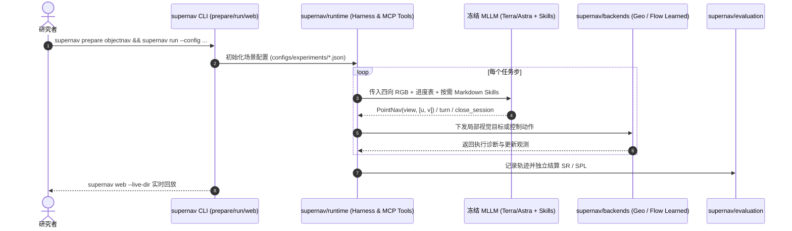
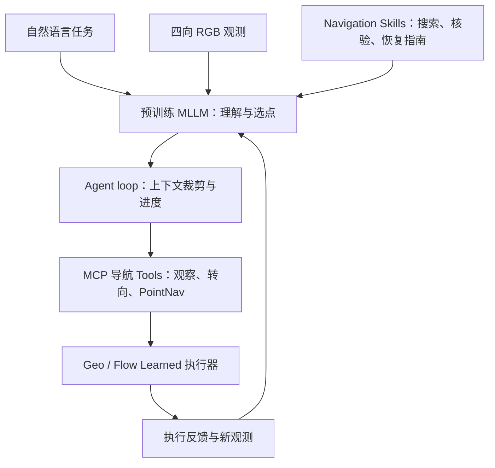

# SuperNav：面向任意任务与场景的 Agentic 导航系统

**SuperNav**（*An Agentic Navigation System for Any Task in Any Scene*，arXiv:[2610.12126](https://arxiv.org/abs/2610.12126)，[项目页](https://zju3dv.github.io/SuperNav/)，[代码](https://github.com/zju3dv/SuperNav)）将预训练 MLLM 用作导航任务的语义理解与高层决策器，通过 agent harness 管理持续交互，再把视觉目标点交给运动执行器。作者不对 MLLM 做导航专用微调，重点研究的是工具接口、运行循环、任务状态和 Skills 如何帮助它把通用能力用于具身导航。

## 一句话定义

**MLLM 决定“该看哪里、接下来去哪里、是否完成”，harness 维护任务与上下文，执行器负责把图像上的目标点变成运动。**

## 英文缩写速查

| 缩写 | 英文全称 | 简要说明 |
|------|----------|----------|
| MLLM | Multimodal Large Language Model | 多模态大语言模型；本系统的高层决策器 |
| RGB | Red-Green-Blue | 彩色图像观测；Agent 每轮接收四向 RGB |
| PointNav | Point-goal Navigation | 点目标导航；此处目标是图像上的归一化像素点 |
| VLN | Vision-Language Navigation | 视觉–语言导航任务族 |
| SR | Success Rate | 成功率 |
| SPL | Success weighted by Path Length | 按路径长度加权的成功率 |
| HM3D | Habitat-Matterport 3D | Habitat 室内场景数据集 |
| OVON | Open-Vocabulary Object Navigation | 开放词汇物体导航基准 |

## 核心术语

| 术语 | 含义 |
|------|------|
| Agent harness | 为模型组织工具调用、上下文和任务状态的运行层 |
| Visual-point interface | 模型在观测图像中选择方向视图和归一化像素点，作为移动目标 |
| Navigation Skills | 可按需读取的过程指南，覆盖搜索、核验、恢复 |
| Geo-based Executor | 将像素目标结合深度、相机标定和位姿映射为几何目标并规划路径 |
| Learned Executor | 根据目标点和近期 RGB 历史预测局部位移增量与停止信号 |
| SR / SPL | 成功率 / 按路径长度加权的成功率 |

## 为什么重要

- **证明不改权重仅靠 Agent Harness 就能横跨五类导航基准：** 实验主力采用冻结预训练 MLLM（GPT-5.6 Terra / GPT-6 Astra）经 Codex CLI + MCP 工具编排，在 Habitat-GS 单物体达 **78.00% SR**（显著高于 UniNaVid 的 34.00%）、AI2-THOR 需求驱动达 **59.50% SR**、HM3D-OVON `@1m` 达 **73.33% SR**（Astra **79.17%**）。
- **视觉点目标解耦通用推理与运动后端：** 四向 `PointNav(view, [u, v])` 既可对接深度+NavMesh 几何规划，也可对接 NoMaD 风格的 DINOv2 ViT-S/14 + 4 步 Flow Matching 学习执行器，更换机器人平台时不必重训高层决策模型。
- **上下文裁剪 + 按需 Skills 支撑长程任务：** 通过 Search/Recheck/Recover/Complete Markdown 指南与仅媒体保留的上下文裁剪机制，避免纯文本与旧观测撑爆长程导航窗口。

## 核心机制与方法栈

### 1. Agent loop：Codex CLI + MCP 长程状态管理

Agent 通过 Codex CLI + MCP 工具（`hab_init_scene`、`hab_panorama`、`hab_turn`、`hab_visual_point_navigate` / `hab_local_navigate`、`hab_close_session`）与环境持续交互，辅以仅保留关键媒体观测的上下文裁剪策略（media-only context pruning）维持长程记忆。结构化目标记录区分已完成与待办项目，但高层结束声明由评测器独立核验。

### 2. 视觉点导航：把语言决策接到运动

一次观测包含相对当前朝向的前、右、后、左四幅 RGB 图。模型选择一个视图及归一化坐标 `(u,v)∈[0,1]^2`，执行器尝试到达该像素点对应的可通行位置，并返回新图像、执行状态和简短诊断。

### 3. 互换式运动后端

- **Geo-based Executor（几何执行器）**：仿真中用深度与 NavMesh 把像素目标投到环境几何规划路径；Go2 真机使用 4 路 RGB + Hesai LiDAR 构筑体素地图与 `ReplanningAStar`。
- **Learned Executor（Flow 学习执行器）**：借鉴 NoMaD 设计，由 DINOv2 ViT-S/14 编码器 + 年龄感知（age-aware）≤12 帧历史 Transformer + 4 步 1D UNet Flow Matching 输出短时动作块与停止头。

### 4. Navigation Skills

Search / Recheck / Recover / Complete 等 Skills 以按需读取的 Markdown 指南形式进入上下文，指导模型在遮挡或受阻时如何复核与脱困，但不强制硬编码工具顺序。

## 评测结果

| 基准 | SuperNav 结果 | 口径 |
|------|---------------|------|
| Habitat-GS 单物体 | SR 78.00%，SPL 0.4127 | 150 项任务 |
| Habitat-GS 有序多物体 | SR 34.00%，SPL 0.1388 | 150 项任务 |
| AI2-THOR 需求驱动 | SR 59.50%，SPL 0.1801 | 200 项任务 |
| HM3D-OVON 未见验证 | SR 68.33% / 73.33%；SPL 0.3837 / 0.4105 | 0.25 m / 1 m 成功阈值 |
| HM3Dv2 验证 | SR 80.30% / 86.50%；SPL 0.3338 / 0.3638 | 0.2 m / 1 m 成功阈值 |

不同基准的任务构成、成功阈值与协议不同，数字只适合在同一行对应的设置内理解。项目页展示 Unitree Go2 实机视频；官方仓库另提供 Go2 部署指南，详见下方复现状态。

## 开源与复现状态

截至 **2026-10-26**，[官方仓库](https://github.com/zju3dv/SuperNav)提供 agent runtime、导航 Tools 与 Skills、仿真实验配置和评测工具，并公开了 Learned Executor 权重和 Habitat-GS 测试任务。HabitatGS-Benchmark 的 ObjectNav 与有序 Multi-ObjectNav 测试任务于 2026-10-13 发布；Unitree Go2 部署指南于 2026-10-21 发布。该指南面向 Jetson aarch64，使用四路 GoPro HERO8 USB 网络相机和 LiDAR 地图支持的 PixelGoal 导航，并通过固定版本的公开 DimOS 子模块、补丁与部署脚本组装运行环境。运行仿真仍需自行准备场景数据、模型访问与相应服务配置。

## 阅读判断

- **贡献在 harness 与接口**：不是把某个导航动作头做得更大，而是让通用 MLLM 通过视觉目标点、执行反馈和任务记录持续完成不同请求。
- **运动后端可替换**：几何规划更依赖深度/地图等几何输入；学习执行器更依赖训练数据与权重，二者不应被误认为同一控制器。
- **结果有跨任务证据，但边界需按基准读**：单物体、多物体、需求驱动及 HM3D 类别导航协议不同；SR 不宜混成一个总体指标。
- **真机演示与复现条件分开**：页面有 Go2 演示，仓库现已提供部署指南；实际运行仍要求对应 Jetson、相机、LiDAR 地图和机器人环境。

## 与其他工作对比

| 工作 | 高层决策 | 是否导航专用训练 | 动作接口 | 与 SuperNav 的差异 |
|------|----------|------------------|----------|--------------------|
| SuperNav | 预训练 MLLM + agent harness | 否（不微调 MLLM） | 图像上的视觉目标点 → 可替换执行器 | — |
| [Qwen-RobotNav](./qwen-robot-nav.md) | 导航专用 Qwen3-VL 模型 | 是（15.6M 样本单权重） | 任务模式 + 可控观测参数 | 把多任务能力训进权重；SuperNav 把能力放在 Tools / Skills / 任务记录上 |
| [Uni-LaViRA](./paper-uni-lavira.md) | MLLM 分层翻译 | 否（training-free） | Language→Vision→Robot 三层翻译 | 同属免训练路线；Uni-LaViRA 强调多本体真机，SuperNav 强调长程 agent loop 与执行反馈 |
| [NavWAM](./paper-navwam-goal-conditioned-visual-navigation-wam.md) | 世界动作模型 | 是 | 目标图像条件下直接输出 action chunk | 端到端学习控制；SuperNav 的 Learned Executor 只负责短程到点 |

对比的关键轴是「导航能力在模型权重里还是在 harness 里」：SuperNav 的结果说明后者能覆盖多类任务，但其成功率仍受 MLLM 选点、终止判断与执行器可达性共同限制。

## 结论

**SuperNav 的主要贡献是证明：不做导航专用微调，仅靠 agent harness、视觉点接口与可替换执行器，也能让通用 MLLM 完成多类具身导航任务。**

- 复用时优先迁移的是接口设计：视觉目标点 + 执行反馈 + 结构化任务进度，而不是某个具体模型。
- 各基准协议与成功阈值不同，SR / SPL 只能在同一基准行内比较；有序多物体任务 SR 34% 说明长程状态跟踪仍是瓶颈。
- 几何执行器与学习执行器依赖的输入和权重不同，复现时要分别准备深度/定位或 Learned Executor 权重。
- 截至 2026-10-26，仿真运行与 Habitat-GS 测试任务可从公开仓库/数据集获取；Go2 部署指南已发布，但部署仍依赖指定硬件、相机与机器人环境。

## 源码运行时序图

[zju3dv/SuperNav](https://github.com/zju3dv/SuperNav) 提供统一 `supernav` CLI（`src/supernav/cli.py`）与可视化服务，按任务准备 → Harness 闭环调度 → 运动执行后端 → 评测输出运行：

## 工程实践

- **快速跑通仿真：** 要求 Python 3.12；先通过 `supernav prepare objectnav` 生成任务与实验配置，再执行 `supernav run --config ... --dry-run` 校验配置后实跑，并可用 `supernav web --live-dir "$SUPERNAV_LIVE_DIR"` 同步观察工具调用与观测流。
- **数据与权重准备：** 几何/学习执行器权重（`the0xka1/SuperNav-Learned-Executor`）与 Habitat-GS 测试集（`yyh929/HabitatGS-Benchmark`）分别托管于 Hugging Face；AI2-THOR 设定当前评测模式为 `withheld`（仅记轨迹与动作）。
- **Unitree Go2 部署与许可注意：** `docs/release/en/go2.md` 覆盖 Jetson aarch64 + 4 路 GoPro HERO8 USB + LiDAR 体素建图部署（基于固定 DimOS 子模块与补丁）。源码采用 PRL v1.0 许可，学术研究免注册，**机构/组织项目使用前需先登记**。

## 常见误区或局限

- **误区：Agent 调用 `close_session` 就代表导航成功** — MLLM 的结束声明仅代表模型自我判停，最终 SR/SPL 由环境评测器独立按成功半径与目标顺序核算。
- **长程多目标仍是明显瓶颈：** 有序多物体任务（Habitat-GS）SR 从单物体的 78.00% 降至 **34.00%**，长程进度追踪与错误判停仍是主要失分项。
- **闭源推理依赖与成本：** 实验主力依赖 GPT-5.6 Terra / GPT-6 Astra 等云端强 MLLM，API 延迟、调用成本与可重复性受外部模型版本演进影响。

## 流程总览

## 参考来源

- [arXiv v1 原文](https://arxiv.org/html/2610.12126v1)
- [SuperNav 官方项目页](https://zju3dv.github.io/SuperNav/)
- [官方实现](https://github.com/zju3dv/SuperNav)
- [SuperNav 论文摘录（原文通读）](../../sources/papers/supernav_arxiv_2610_12126.md)
- [项目页归档](../../sources/sites/zju3dv-supernav.md)
- [仓库归档](../../sources/repos/zju3dv-supernav-code.md)

## 关联页面

- [视觉–语言导航](../tasks/vision-language-navigation.md)
- [Qwen-RobotNav](./qwen-robot-nav.md) — 多任务导航模型及可控观测协议。
- [Uni-LaViRA](./paper-uni-lavira.md) — 零样本统一导航的分层翻译与多本体方案。
- [NavVerse](./paper-navverse.md) — 场景与跨区域具身导航基准。
- [NavWAM](./paper-navwam-goal-conditioned-visual-navigation-wam.md) — 目标图像条件的导航世界动作模型。

- [机器人智能体执行框架](../methods/robot-agent-harness.md)：了解导航工具、技能与任务编排。

## 推荐继续阅读

- [SuperNav GitHub 官方仓库与 Go2 部署指南](https://github.com/zju3dv/SuperNav/blob/main/docs/release/en/go2.md)
- [SuperNav-Learned-Executor 权重](https://huggingface.co/the0xka1/SuperNav-Learned-Executor)
- [HabitatGS-Benchmark 数据集](https://huggingface.co/datasets/yyh929/HabitatGS-Benchmark)
