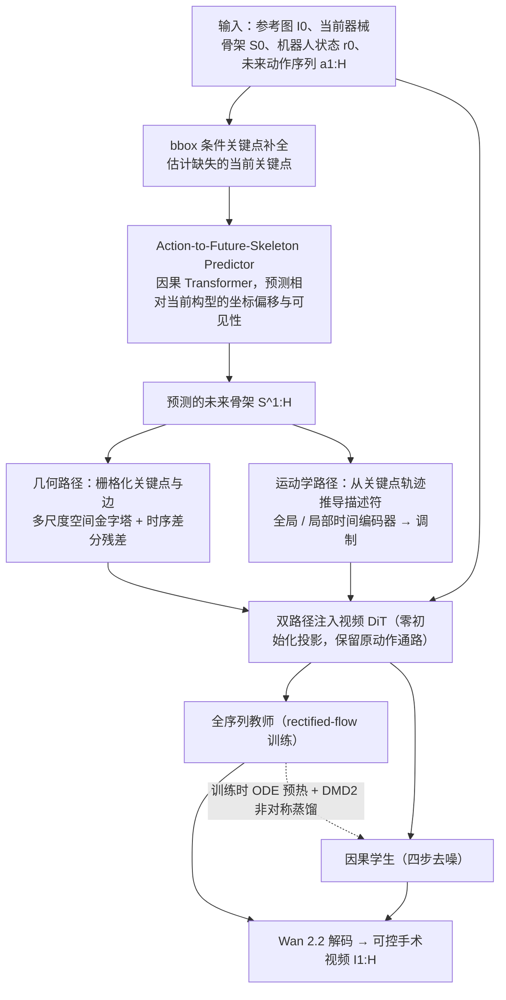

# SurgCast（arXiv:2610.15645）

**SurgCast**（*SurgCast: Action-Conditioned Future Skeletons for Controllable Surgical World Models*，[arXiv:2610.15645](https://arxiv.org/abs/2610.15645)，[项目页](https://surgcast.netlify.app/)）来自 [具身智能小站 2026-10-14 盘点](../../sources/blogs/wechat_embodied_station_41_papers_streamingwam_2026-10-14.md)，属「感知与 4D 世界」组。

## 一句话定义

**先由机器人状态与未来动作预测器械骨架，再把几何与运动描述注入视频生成器，提升手术视频预测的结构一致性。**

## 英文缩写速查

| 缩写 | 英文全称 | 简要说明 |
|------|----------|----------|
| WM | World Model | 世界模型 |
| dVRK | da Vinci Research Kit | 手术机器人平台 |
| Skeleton | Instrument Skeleton | 器械骨架 |

## 为什么重要

- 手术世界模型需要可控结构，不能只靠像素生成。
- 开源结论：**项目页未列 GitHub**（步骤 2.5，2026-10-14）。项目页入库日未列 GitHub。
- 同期同组工作见 [流式动作块与世界模型记忆：具身智能小站 10-14 期 41 篇阅读坐标](../overview/embodied-station-2026-10-14-41-papers-technology-map.md)。

## 流程总览

图依据：论文 §III-A/B/C/D 与 Fig. 2（教师与学生是可替换的两种视频生成器，教师到学生的箭头仅表示训练期蒸馏）。

## 核心机制

| 项 | 内容 |
|----|------|
| **arXiv** | [2610.15645](https://arxiv.org/abs/2610.15645) |
| **开源** | **项目页未列 GitHub** |
| **要点** | 两套手术数据；不能解释为临床操作能力。 |
| **文内指标** | 以原文为准。 |

## 源码运行时序图

**不适用（项目页未列 GitHub）** — 项目页入库日未列 GitHub。 不编造运行脚本；代码公开后再补。

## 实验与评测

- 以原文为准。
- **读法：** 本页为索引级摘要，依据公众号转述的官方摘要与仓库信息整理；逐项数字与 baseline 以原文 PDF 为准。

## 与其他工作对比

- 横向索引见 [流式动作块与世界模型记忆：具身智能小站 10-14 期 41 篇阅读坐标](../overview/embodied-station-2026-10-14-41-papers-technology-map.md)；同 arXiv 不重复造页。

## 结论

**骨架作为中间表示是让视频世界模型可控的通用技巧。**

1. 开源边界：**项目页未列 GitHub** — 项目页入库日未列 GitHub。
2. 核心机制：两套手术数据；不能解释为临床操作能力。
3. 复现与选型前核对任务协议、硬件与基准口径，勿直接横比公众号摘录数字。

## 关联页面

- [generative-world-models](../methods/generative-world-models.md)
- [world-action-models](../concepts/world-action-models.md)
- [embodied-station-2026-10-14-41-papers-technology-map](../overview/embodied-station-2026-10-14-41-papers-technology-map.md)

## 参考来源

- [surgcast_surgical_world_model_skeletons_arxiv_2610_15645.md](../../sources/papers/surgcast_surgical_world_model_skeletons_arxiv_2610_15645.md)
- [wechat_embodied_station_41_papers_streamingwam_2026-10-14.md](../../sources/blogs/wechat_embodied_station_41_papers_streamingwam_2026-10-14.md)
- [arXiv:2610.15645](https://arxiv.org/abs/2610.15645)
- [arXiv PDF](https://arxiv.org/pdf/2610.15645)：已通读方法部分（实验与附录以略读为准）：§I Introduction、§III Method（A–D）、§IV-A 实验设定

## 推荐继续阅读

- [arXiv PDF](https://arxiv.org/pdf/2610.15645)
- [项目页](https://surgcast.netlify.app/)
