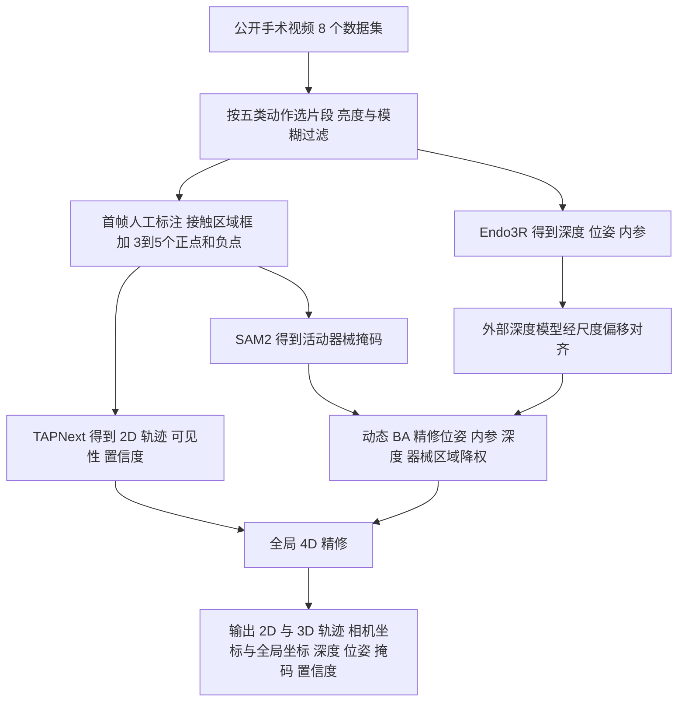

# SurgTAP-3D（arXiv:2611.11697）

**SurgTAP-3D**（*SurgTAP-3D: A Large-Scale Cross-Surgery Video Dataset with Contact-Aware 3D Motion Tracking*，[arXiv:2611.11697](https://arxiv.org/abs/2611.11697)，香港中文大学团队，项目页称已被 IEEE T-RO 接收）是一篇**数据集 + 标注流水线 + 基准**论文，不是新的策略或控制方法。本页依据论文 v1 全文整理，归档见 [sources/papers/surgtap-3d_arxiv_2611_11697.md](../../sources/papers/surgtap-3d_arxiv_2611_11697.md)。

## 一句话定义

**把公开的机器人 / 手动微创手术视频，以「每段只在首帧标一个接触区域」为人工成本，自动生成伪尺度的相机位姿、深度、器械掩码与 1,376,987 条 2D/3D 点轨迹（覆盖器械和组织），并附 3D 点跟踪基准。**

## 英文缩写速查

| 缩写 | 英文全称 | 简要说明 |
|------|----------|----------|
| MIS | Minimally Invasive Surgery | 微创手术（腹腔镜 / 机器人） |
| TAP | Tracking Any Point | 跟踪任意点（2D 点轨迹估计任务） |
| BA | Bundle Adjustment | 光束法平差，联合优化相机位姿 / 内参 / 深度 |
| ARAP | As-Rigid-As-Possible | 尽可能刚性约束；论文用「关节式」变体（Sec. III-C5，式 14–16） |
| dVRK | da Vinci Research Kit | 研究用达芬奇机器人平台（应用实验 Sec. V-A） |
| AJ / APD / OA | Average Jaccard / Avg. Points within Distance / Occlusion Accuracy | TAP-Vid 与 TAPVid-3D 的跟踪指标（Sec. IV-A3） |
| SR / IMC / TCR / TSR | Survival Ratio / Instrument Mask Consistency / Tracking Confidence Ratio / Temporal Smoothness Ratio | 论文自定义的标注内部一致性指标（Sec. III-D5） |
| ATE / RPE | Absolute Trajectory Error / Relative Pose Error | 轨迹 / 位姿误差 |
| 4DGS | 4D Gaussian Splatting | 动态场景高斯泼溅，下游重建应用用（Sec. V-B） |
| VLA | Vision-Language-Action | 视觉语言动作模型，论文把它列为数据的潜在下游（仅动机，未实验） |

## 为什么重要

- **动机（作者自述，Sec. I）：** 公开手术数据多为离体 / 仿真，或只标器械、只标组织；带运动学的数据（SRT-H 用 31 个猪胆囊，SutureBot 1,890 条 dVRK 示范）规模小。作者想从海量手术视频里恢复 3D 动作轨迹，给 VLA / 世界模型一类需要大规模 3D 监督的方向备料。
- **我的判断：** 它的价值在于「用很低的人工成本把已有手术视频变成带几何的运动数据」这条流水线，而不是某个精确度量。数据本身是伪尺度伪标签（见「局限」），目前离直接训练手术策略还差运动学 / 动作信号：论文只提供视觉轨迹，没有机器人动作或力。
- **与机器人学习的接口：** 把相机运动与场景运动分开（全局坐标，Sec. III-D2）这件事，对模仿学习里的「运动先验」有用，见 [模仿学习](../methods/imitation-learning.md)、[机器人数据监督信号类型](../concepts/robot-data-supervision-signal-types.md)。
- 机构：香港中文大学（`cuhk`）。

## 核心原理与流程总览

输入：公开手术数据集中按五类动作筛出的片段（5–30 秒，20–300 帧）。人工只在首帧做**一次性提示**，之后全自动（Sec. III-C）。

要点（均出自论文）：

1. **数据**（Sec. III-A、Tab. II）：机器人 = GraSP、SAR-RARP50（均前列腺切除）；手动 = SLAM、SurgicalActions160、AutoLaparo、HeiCo 两个子集、CholecT50（2,031 段，最大来源）、MultiBypass140。合计 4,549 段、519,642 帧。五类动作：dissection、tissue retraction、needle grasping、vessel clipping、coagulation。
2. **「接触感知」的口径**（Sec. I）：显式标出可见的工具—组织交互区域并用来初始化轨迹，**不涉及力传感或接触物理建模**。
3. **动态 BA**（Sec. III-C4，式 3–5）：以 Endo3R 结果初始化，借 DROID-SLAM 的预训练更新模块，在重投影残差里对低置信度、强非刚性、器械掩码区域降权，联合修正相机位姿、内参、深度。
4. **全局 4D 精修**（Sec. III-C5，式 8–19）：光流一致（Lflow）、器械点贴合分割表面（Lsurf，Chamfer）、关节式 ARAP（Larap，刚性杆件保持、关节放开）、时序加速度平滑（Ldyn）、对初始 2D 轨迹的正则（Lreg）；Adam，lr 0.05，λ 取 0.1 / 0.1 / 10 / 100 / 0.001。
5. **基准结果**（Tab. IV，三数据集平均）：2D AJ 53.13（TAPNext 51.41），3D AJ 56.57 / APD 64.77 / OA 97.47（TAPNext 55.69 / 62.88 / 97.43）。注意这是自家流水线与各基线的比较，**3D 上领先幅度较小**；SurgPose 器械的 3D AJ 为 44.16，STIR 仅 33.79，绝对水平并不高。
6. **消融**（Tab. VII、VIII）：动态 BA 使 SCARED 上 ATE 0.112 → 0.103；去掉 Lreg 对跟踪伤害最大（AJ3D 56.57 → 55.41）。

## 数据集规格与基准结果

**数据集规格（摘要、Sec. III、来源归档）：**

| 维度 | 内容 |
|------|------|
| 规模 | 4,549 段动作片段、519,642 帧、1,376,987 条 2D/3D 点轨迹；8 个公开数据集，CholecT50 2,031 段为最大来源（Sec. III-A、Tab. II） |
| 模态 | 单目内镜 RGB 视频，附 2D/3D 轨迹（相机与全局坐标）、深度、相机位姿、器械掩码、置信度与可见性（Sec. III-D6）；无机器人运动学、动作或力 |
| 许可证 | 论文与项目页均未给许可证与下载方式，数据与代码截至 2026-11-11 未放出；源数据来自各公开数据集，二次使用须分别遵守其原许可（推测，论文未说明） |
| 重定向就绪度 | 低：几何为伪尺度，只适合相对 3D 运动分析，度量级使用需额外标定（Sec. VI）；没有动作标签，不能直接作策略训练输入；与 dVRK 运动学对比也需逐条 Sim(3) 对齐（Sec. V-A） |

**基准与下游评测：**

| 评测 | 指标 | 结果 | 出处 |
|------|------|------|------|
| 3D 点跟踪（SurgPose / SurgT / STIR 平均） | AJ3D / APD / OA | 56.57 / 64.77 / 97.47，次优 TAPNext 55.69 / 62.88 / 97.43；STIR 上 AJ3D 仅 33.79 | Tab. IV |
| 2D 点跟踪（同上） | AJ2D | 53.13，TAPNext 51.41 | Tab. IV |
| 深度（SCARED / Hamlyn） | Abs Rel | 0.124 → 0.103 / 0.170 → 0.156（Endo3R → 全流程） | Tab. V、VI |
| 标注质量（内部一致性，非几何精度） | SR / IMC / TCR / TSR | 88.41 / 95.98 / 98.33 / 94.08（%） | Tab. III |
| 器械位移（50 段 dVRK，Sim(3) 对齐后） | ATE / RPEt | 0.0022 m / 0.0005 m | Tab. IX |
| 微调跟踪器（CoTrackerv3 / DELTAv2） | AJ2D | SurgT、SurgPose 上提升约 0.8–1.6 点 | Tab. XI |

3D 参考轨迹由双目导出，不是完美物理真值（Sec. IV-A1）。

## 与其他工作对比

| 工作 | 关注点 | 与本文的区别 |
|------|--------|--------------|
| 本文 SurgTAP-3D | 从公开手术视频自动恢复伪尺度 2D/3D 点轨迹的数据集与基准 | 规模大、跨术式，但只有视觉轨迹，无动作与力 |
| SRT-H / SutureBot（论文 Sec. I 引用） | 带机器人运动学的手术示范数据 | 有动作信号但规模小（31 个猪胆囊、1,890 条 dVRK 示范）；本仓库暂无对应页面 |
| [Surgical WAM](./paper-rcl-2608-11204-surgical-wam-a-world-action-model-for-data-effic.md) | 联合预测内镜画面与可执行动作块的手术世界-动作模型 | 消费动作数据训练策略；SurgTAP-3D 提供的是可能的运动先验，不含动作 |
| [SAM2](./paper-sam2.md) | 可提示的视频分割基础模型 | 是本文标注流水线中的器械掩码构件，不是对标方法 |

## 结论

**SurgTAP-3D 用「首帧一次提示 + 基础模型 + 动态 BA + 全局 4D 优化」的低人工成本流水线，把 4,549 段手术视频变成 137.7 万条伪尺度 3D 轨迹，价值在流水线与规模而非度量精度。**

1. 3D 跟踪基准上平均 AJ3D 56.57，只比次优 TAPNext 高约 0.9 点，STIR 上绝对水平仍低（Tab. IV）。
2. 动态 BA 与全局 4D 精修主要改善深度与位姿（SCARED Abs Rel 0.124 → 0.103，Tab. V、VII）。
3. 下游微调跟踪器只有约 1 点量级的同域增益（Tab. XI）。
4. 局限：伪尺度伪标签、无动作与力、质量指标只是内部一致性，数据与代码尚未放出（Sec. III-D5、VI）。

## 工程实践

- **能直接复用的思路：** 「首帧框 + 点提示 → SAM2 + TAPNext → 基础模型几何初始化 → BA / 全局优化」是一条低人工成本伪标注模板；可对照 [SAM2](./paper-sam2.md)（提示式分割）与 [VGGT](./paper-vggt-visual-geometry-grounded-transformer.md)（前馈几何）理解其构件。
- **可用的过滤信号：** 论文随数据发布每条轨迹的置信度与可见性（Sec. III-D6），建议下游先滤低置信轨迹；这与 [具身数据清洗](../concepts/embodied-data-cleaning.md) 思路一致。
- **训练示范：** 在其训练划分上微调 CoTrackerv3 / DELTAv2，SurgT 与 SurgPose 上 AJ2D 提升约 0.8–1.6 点（Tab. XI），属于小幅、同域增益。
- **位移估计的设置细节（Sec. V-A）：** 50 段自采 dVRK 视频，用运动学做参考，但需对每条轨迹各自做 Sim(3) 对齐（因为伪尺度），且没有相机—机器人外参；ATE 0.0022 m、RPEt 0.0005 m（Tab. IX）。这里的米是**对齐后**的数，不是单目直接得到的度量。
- **获取：** 截至 2026-11-11，项目页 Code / Dataset 按钮无有效链接，写着 “Release links will be added when available”，论文也未给地址，故本页无 `code:`，数据 / 代码可用性**以后续发布为准**。
- 相关的手术世界模型与数据路线可对照：[手术视觉世界模型](./paper-sa-2503-02904-surgical-vision-world-model.md)、[SurgLAT](./paper-surglat.md)、[生成式世界模型](../methods/generative-world-models.md)。

## 与文章说法的核对

文章（公众号《机器人动作块太长，什么时候该重新规划？》2026-11-11，第 31 条）原话：「从手术视频中恢复接触感知三维轨迹，把二维跟踪、几何优化与时序一致性结合起来。数据适合研究运动表征；恢复结果属于伪标签，不能当作临床精度的度量真值。」标题为「手术视频三维追踪，先把接触关系保留下来」。

| 文章说法 | 论文核对 | 结论 |
|----------|----------|------|
| 恢复接触感知三维轨迹 | 成立（摘要、Sec. III）；但「接触感知」仅指标出可见交互区域并以此初始化轨迹，不含力 / 接触物理（Sec. I） | 成立，但标题「保留接触关系」易被读成建模了接触，论文没有 |
| 结合二维跟踪、几何优化与时序一致性 | 成立：TAPNext 2D 跟踪、动态 BA 与全局 4D 精修、Ldyn 时序平滑（Sec. III-C） | 成立 |
| 数据适合研究运动表征 | 论文有支持：PCA 显示五类动作轨迹聚类（Fig. 5，仅每类随机 10 段）；但这是定性展示，且论文自己说适合**相对** 3D 运动分析（Sec. VI） | 基本成立，需带「相对运动」限定 |
| 属于伪标签 | 成立：论文自称 pseudo-annotated / pseudo-3D / pseudo-scale（摘要、Sec. III-D6、VI） | 成立 |
| 不能当作临床精度的度量真值 | 与论文一致：伪尺度、度量级需额外标定（Sec. VI）；质量指标只是内部一致性，「不是几何精度的直接度量」（Sec. III-D5）。论文**没有**做临床精度评估，所以「临床精度」是文章的延伸表述，不是论文的 | 方向一致，措辞是文章自己的 |
| （文章未提）数据可用性 | 项目页未放出数据 / 代码链接（静态读取） | 文章写「数据适合……」，读者可能误以为可下载；应补「尚未放出」 |
| （文章未提）真机 / 仿真 | 数据全是真实手术视频（体内），非仿真；基准评测用 SurgPose（离体）/ SurgT / STIR，3D 参考为双目导出而非完美真值（Sec. IV-A1）；只有位移估计用到 50 段自采 dVRK 真机视频 | 文章没有写错，但缺这些限定 |

## 局限

**论文自己承认的：**

- 单目标注得到的几何是**伪尺度**，仅适合相对 3D 运动分析，度量级机器人工作空间推理需额外标定（Sec. VI）。
- 伪标签可能有噪，长期器械消失（> 10 秒）、大遮挡、快速运动下轨迹可能丢失、漂移或不稳定；这些更常出现在 tissue retraction、needle grasping、coagulation 类（Sec. III-D6、Fig. 8）。
- 3D 基准参考是双目导出的评测轨迹，不是完美物理真值，其准确度受双目标定与人工标注限制（Sec. IV-A1）。
- 质量指标 SR / IMC / TCR / TSR 只反映内部一致性，并受跟踪器自带可见性 / 置信度、分割质量与阈值影响（Sec. III-D5）。

**我看到的未验证之处（判断，非论文原话）：**

- 数据集本体（4,549 段）没有独立的逐点精度核查，也没有临床专家评估；「高质量」主要由内部指标与下游小实验支撑。
- 基准是自家流水线（用了 Endo3R、TAPNext 等强先验）对各基线的比较；3D 平均优势相对次优方法只有 1 到 2 点，STIR 上绝对数值很低（AJ3D 33.79）。
- 微调实验增益小（约 1 点量级）且只在 SurgT / SurgPose 评测；训练划分规模、与基准数据的是否同源，论文没给细节（推测：SurgT 与 SurgPose 来自不同于训练数据的来源，但文中未明说）。
- 数据只有视觉轨迹，没有机器人动作、运动学或力，因此对手术 VLA / 策略学习的直接可用性（Sec. I 动机）论文没有实验验证。
- 位移估计只有 50 段、且每条轨迹各自做 Sim(3) 对齐后算误差，可能高估「度量」可用性。
- 项目页显示数据 / 代码尚未放出，复现与二次使用暂不可核。
- 性质说明：本页描述的是数据集与标注方法论文，不是控制或学习算法。

## 关联页面

- [VLA（视觉语言动作模型）](../methods/vla.md)
- [模仿学习](../methods/imitation-learning.md)
- [生成式世界模型](../methods/generative-world-models.md)
- [数据飞轮](../concepts/data-flywheel.md)
- [具身数据清洗](../concepts/embodied-data-cleaning.md)
- [机器人数据监督信号类型](../concepts/robot-data-supervision-signal-types.md)
- [SAM2](./paper-sam2.md)
- [VGGT](./paper-vggt-visual-geometry-grounded-transformer.md)
- [SurgLAT](./paper-surglat.md)
- [手术视觉世界模型（2503.02904）](./paper-sa-2503-02904-surgical-vision-world-model.md)

## 参考来源

- [surgtap-3d_arxiv_2611_11697.md](../../sources/papers/surgtap-3d_arxiv_2611_11697.md)
- [arXiv:2611.11697](https://arxiv.org/abs/2611.11697)
- [项目页](https://wrld.github.io/surgtap-3d/)（静态读取，数据与代码链接尚未放出）

## 继续阅读

- [arXiv PDF](https://arxiv.org/pdf/2611.11697)
- [手术世界动作模型（Surgical WAM）](./paper-rcl-2608-11204-surgical-wam-a-world-action-model-for-data-effic.md)
- [人形机器人活体腹腔镜手术](./paper-humanoid-surgeon-in-vivo-laparoscopy.md)
