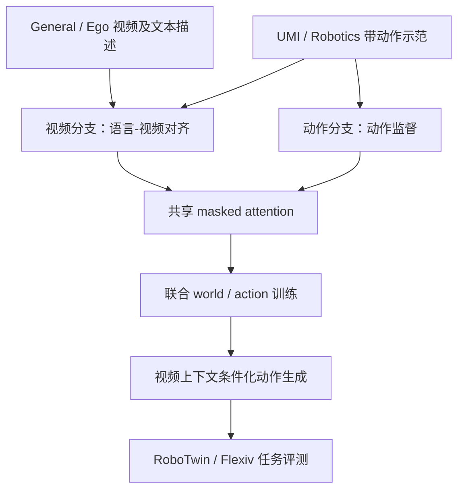
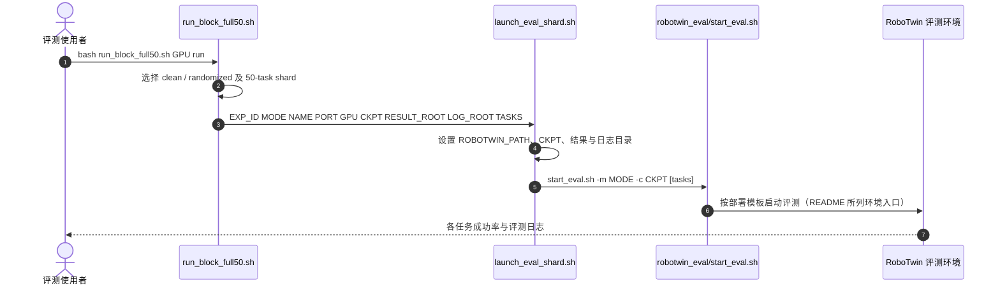

# SWAM: Scaling World Action Models with Cross-Modal Alignment（用跨模态对齐规模化世界动作模型）

## 一句话定义

**SWAM** 将一般视频、第一视角视频、UMI 与机器人示范共同用于世界-动作模型训练，通过保持语言-视频对齐并在有动作标签数据上学习动作分支，提高机器人操作泛化。

## 英文缩写速查

| 缩写 | 英文全称 | 简要说明 |
|---|---|---|
| WAM | World Action Model | 联合建模世界视频及动作的模型 |
| UMI | Universal Manipulation Interface | 人类操作演示采集来源 |
| SR | Success Rate | 任务完整成功率 |
| PSR | Partial Success Rate | 预定义子任务完成比例 |

## 为什么重要

海量视频缺少机器人动作标签，SWAM 研究如何保留视频预训练学到的语义与动力学线索，并让有限具身示范教会模型输出机器人动作。

## 流程总览（依据论文方法和官方模型说明）

仅带动作标注的样本提供动作监督；一般视频样本不能视作具有机器人动作真值。

## 核心原理

视频分支由 Wan2.2-TI2V-5B 初始化，动作分支随机初始化并保持独立残差流；通过视频到动作的单向 masked attention 传输条件，动作分支不直接对文本 cross-attend。各来源视频样本优化视频 flow matching，仅具有效动作标签的示范样本优化动作 flow matching。数据混合、语言注释质量、模型扩展共同影响结果；训练与评测资源按官方 SETUP.md 配置。

## 实验与评测（作者报告）

| 场景 | 评测口径 | 成绩 |
|---|---|---:|
| RoboTwin Easy | Clean-to-Clean | 88.10% |
| RoboTwin Hard | Clean-to-Randomized | 61.56% |
| Flexiv 真机 3 任务 | Hard，完整成功率 SR | 40.00% |
| Flexiv 真机 3 任务 | Hard，子任务完成 PSR | 50.36% |

不能以 RoboTwin easy 仿真成功率预测真机成功率。

## 结论

**最有价值的是跨模态监督配方而非单一成功率数字，复现需要核对训练数据可得性。**

1. 一般视频为视觉世界建模服务，不直接提供动作监督。
2. Easy/Hard/真机指标各自依赖任务设置与观察分布。
3. 源码已发布，论文约 47k 小时数据不等于完整数据已公开。
4. 复现需分别配置 RLinf/DreamZero 和 RoboTwin 模拟器环境。

## 与其他工作对比

与[WICL](./paper-world-in-context-learning-roboscript.md) 的“冻结模型 + 试演写入上下文”不同，SWAM 通过大规模离线联合训练改变模型参数；与[Compass 1](./paper-compass-1-navigation.md)的导航记忆目标也不同。

## 源码运行时序图（官方 RoboTwin 评测入口）

前三段与官方 shell 文件一致；后两段仅依 README 的评测分层描述，底层启动脚本内部实现尚待完整查阅。

## 工程实践

- 参阅 [SETUP.md](https://github.com/shaaaaron/SWAM/blob/main/SETUP.md) 将主训练与 RoboTwin simulator 放在独立环境。
- 训练使用 `examples/sft/train_dreamzero.sh`，要求配置 Ray 节点、GPU、基础模型和本地数据路径。
- 评测入口 `dreamzero/robotwin_eval/run_block_full50.sh`；通过 `describe` 模式预检分片，再按真实 checkpoint 启动。
- 公开 SWAM-Pretrain 不包含 Panda70M、Ego4D、EgoSuite、UMI；遵循上游数据许可。
- 论文附录给出 Flexiv 真机 10 个固定布局、每布局 3 次，30Hz，同设定允许最多 5 次自主重规划；需依此解释 40.00% SR。

## 局限与风险

- 47k 小时是作者完整研究的数据池，不是当前 Hugging Face 公共包容量。
- 多节点训练预算与机器配置较高；公开脚本存在不可直接替代的外部 checkpoint、统计文件和依赖。
- 当前未独立跑通 RoboTwin 或 Flexiv 真机 benchmark；数值均来自原作者。

## 关联页面

- [WICL / RoboScript](./paper-world-in-context-learning-roboscript.md)
- [Compass 1 持久导航](./paper-compass-1-navigation.md)

## 参考来源

- [SWAM 论文摘录](../../sources/papers/swam-2611-12870.md)
- [官方主页](../../sources/sites/swam-official.md)
- [官方源码入口](../../sources/repos/swam-official.md)

## 推荐继续阅读

- [arXiv:2611.12870](https://arxiv.org/abs/2611.12870)
- [SWAM GitHub](https://github.com/shaaaaron/SWAM)
