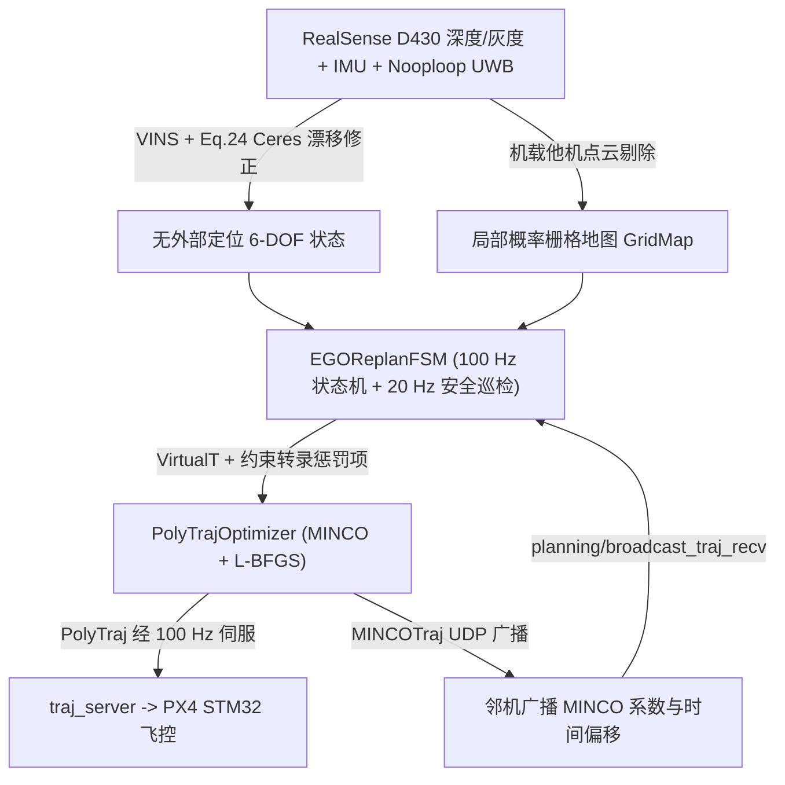
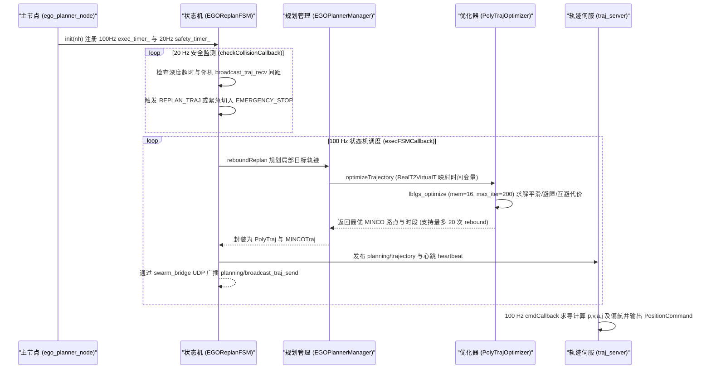

# Swarm of Micro Flying Robots in the Wild（Science Robotics 2022 / EGO-Planner-v2）

## 一句话定义

**Swarm of Micro Flying Robots in the Wild**（[Science Robotics 2022](https://www.science.org/doi/10.1126/scirobotics.abm5954)，开源代号 **EGO-Planner-v2**，浙江大学高飞/许超团队 FAST-Lab）是一套面向无 GPS、无动捕野外强杂波环境的分布式全自主微型空中集群系统：借助基于微分平坦性的 **MINCO** 分段五次多项式时空联合表示与无 ESDF 约束转录 **L-BFGS** 求解器，让轴距 114 mm、全重不足 300 g 的掌上无人机在毫秒级实时重规划空间形状与每段飞行时间，成功实现 10 机野生密集竹林穿飞、编队自适应变形、遮挡目标跟随及无锚点密集互避。

## 英文缩写速查

| 缩写 | 英文全称 | 简要说明 |
| --- | --- | --- |
| MINCO | Minimum Control | 面向微分平坦系统的分段多项式轨迹表达，可用 $O(M)$ 带状 PLU 分解联立优化路点 $q$ 与时长 $T$ |
| TEEM | Trajectory optimality, Extensibility, Economical computing, Miniature size | 论文提出的野外集群四维耦合系统设计指标 |
| VIO | Visual-Inertial Odometry | 视觉惯性里程计（本系统基于 VINS + UWB 相对测距去中心化消除漂移） |
| ESDF | Euclidean Signed Distance Field | 欧氏有向距离场，本规划器通过单平面推斥距离替代全局 ESDF 建图 |
| L-BFGS | Limited-memory Broyden-Fletcher-Goldfarb-Shanno | 有限内存拟牛顿无约束优化器，实时求解约束转录后的时空代价函数 |

## 为什么重要

在强杂波未知森林中同时满足轨迹最优性、任务可扩展性、嵌入式算力经济性与微小体积（**TEEM** 矛盾）长期是空中集群的瓶颈：依赖 GNSS 与集中式调度的编队无法进入遮挡林区；基于人工势场或反应式避障的轻量化方案缺少时间协同与平滑性，狭窄缝隙易产生剧烈急刹甚至卡死；而 MADER（MINVO）与早期 EGO-Swarm（固定时间分配 B 样条）未能在毫秒内同时联合优化轨迹几何形状与每段持续时间 $T$，导致多机争道窄门时后续机被迫大迂回绕路。该论文打通了 **MINCO 时空一体化解耦算法 + 300 g 级机载视觉硬件 + 分布式 UWB 漂移抑制** 全栈开源工程，成为无人机集群野外自主飞行的里程碑工作。

## 核心原理

### 1. 掌上全自主硬件平台（114 mm / < 300 g）

- **机体构型**：轴距仅 **114 mm**，含 100 g 电池（双节 3000 mAh 7.4 V LiPo 串联）总重 **< 300 g**；4 颗 1404 6000 kV 无刷电机配 3 寸三叶桨倒置下吹布置（防旋翼下洗流吹拂机盖，推重比 **2.4**，悬停功耗约 **120 W**，单次续航 **11 min**）。
- **传感器与算力分配**：机载传感器精简至 Intel RealSense **D430**（输出深度图建图 + 双目灰度定位）、PX4 纳米飞控（STM32 H7 + BMI088 IMU，移除气压计/磁力计/GPS）、**Nooploop LTPS UWB**（DW1000 芯片）及 **NVIDIA Xavier NX**（6 核 CPU / 384 核 GPU / 8 GB RAM）；普通飞行场景 CPU 与 GPU 负载均 **< 40%**，给 YOLOv5 等额外感知留出充裕算力。

### 2. MINCO 时空联合优化与约束转录（Eq. 1–24）

- **线性复杂度参数化**：利用多旋翼 3 阶积分器微分平坦性（$s=3$），MINCO 将分段五次多项式轨迹 $p(t) = \mathcal{M}_{q, T}(t)$ 压缩为自由路点 $q \in \mathbb{R}^{3 \times (M-1)}$ 与各段时长 $T \in \mathbb{R}^M$；通过带状矩阵方程 $M(T)c = b(q)$ 的 PLU 分解，把系数的空间-时间梯度的求解与回传降为 **$O(M)$ 线性复杂度**（单段转化仅耗时约 **1 μs**）。
- **无 ESDF 约束转录与通用惩罚项（GPPs）**：将总飞行时间 $J_t$、平滑度（加加速度平方积分 $J_s$）、动力学极值 $J_d$（$v_m, a_m, j_m$）、单切平面障碍距离 $J_o$（$d_o = (p-s)^T v$，平面构造 ~0.1 ms）、$z$ 轴降权椭球形机间避碰 $J_w$（降低上下穿行下洗流干扰）以及扩展编队 $J_f$ / 视角锁定跟踪 $J_v$ 统一转化为三次方/二次方连续时间采样积分惩罚，配合对数/平方根虚实时间映射（`RealT2VirtualT`）送入无约束 **L-BFGS** 求解器。

### 3. 去中心化漂移校正与异步安全兜底

- **UWB + VIO 去中心化定位（Eq. 24）**：各机通过彼此轨迹参数计算他机位置并融合 UWB 测距误差 $r_{u,k}$，由 Ceres Solver 加正则锚项联合最小化全局漂移；此外用他机轨迹包围盒在自身深度图中**剔除邻机像素**（Drone Removal），防止队友点云污染局部占据地图。
- **异步分级安全保护**：优化后执行二次精细碰撞检验（最多重触发 20 次 rebound）；后台 **20 Hz** 巡检持续核验局部栅格与邻机轨迹最小间距，若重规划失败且即将撞击，立即切入 `EMERGENCY_STOP` 制动悬停并 10 ms 后尝试恢复。

## 实验与对比评测

基于论文野外实飞与仿真对比实验结果：

| 实验场景 / 基准对比 | 实验配置 | 关键实测表现 / 对比优势 |
| --- | --- | --- |
| **野生竹林集群穿飞** | 10 架掌上机，目标距起点 65 m，无 GPS/MoCap | 自动调节速度时间剖面排队穿行 **< 30 cm** 窄缝，成功克服倾斜竹干、灌木与落叶遮挡 |
| **野外林间编队飞行** | 保持指定局部坐标系刚体队形穿越林木障碍 | 遇树绕行时个体主动降速并引发队形自适应平滑收放，绕过后自动加速复原队形 |
| **抗遮挡多机目标追踪** | 4 机挂载 CSI RGB + YOLOv5(TensorRT) + KF | 实时共享目标检测消除树干遮挡丢失，人机交互中主动避让林木与邻机 |
| **3 m 半径随机换位密集互避** | 10 机（7 cm 安全球模型），3 min 连续运行 | 中途人工新增柱状障碍、手动扰动单机并**关停所有地面定位锚点**，全程零碰撞完成目标送达 |
| **仿真基准对比（vs MADER / EGO-Swarm）** | 1–3 m/s 期望速度、1–2 m 障碍间距（i7-10700K 多线程） | 因直接联合优化时间分布避免让行大迂回，控制力积分（jerk $S_m$）最低且耗时显著低于 MINVO/B-Spline 方案 |
| **Swarm Playground 交互规模** | 单机 CPU 多线程 ROS1 仿真 | 支持 **40 机**无碰自由集群、7 机六边形队形及多 Xbox 手柄实时充当动态障碍物避让 |

### 与其他工作对比

- **对比经典分散式规划器（[EGO-Swarm](./ego-planner-swarm.md) 与 MADER）**：[EGO-Swarm](./ego-planner-swarm.md) 基于固定时间分配 B 样条且依赖顺序重规划约束，MADER 基于 MINVO 多面体求解时常出现多机窄道让行大迂回与较高计算延迟；本作以 MINCO 时空联合优化同步开放自由路点 $q$ 与段时长 $T$，单段求解降至微秒级且以线性复杂度 $O(M)$ 实现自发让行加速穿行。
- **对比室内集中式编队与纯端到端集群学习（[Crazyswarm2](./crazyswarm2.md) / [QuadSwarmRL](./quad-swarm-rl.md)）**：[Crazyswarm2](./crazyswarm2.md) 强依赖外部动捕与离线集中轨迹调度，而 [QuadSwarmRL](./quad-swarm-rl.md) 专注强化学习密集反应式策略；本作在完全无外部定位基站下完成机载 VIO + UWB + 无 ESDF 梯度优化的户外林区长程实飞闭环。

## 结论

1. **一句话总判**：该工作将 MINCO 线性复杂度时空联合参数化、无 ESDF 梯度优化与轻量 UWB+VIO 协同融于不足 300 g 的掌上集群，首次系统验证了脱离外部定位的野外密集林间全自主多机飞行。
2. **时间维度自由度是集群破局关键**：相比只变形路径形状的上一代 [EGO-Swarm](./ego-planner-swarm.md)，开放时长 $T$ 的无约束梯度优化能以微秒级每段代价让多机自发实现“快慢让行排队过窄门”，避免冗余大绕飞。
3. **软约束必须配强制 post-check 与独立安全线程**：约束转录把安全边际转进惩罚函数，无法单次确保零违约；代码中以 100 Hz 状态机 + 20 Hz 独立碰撞巡检 + 心跳超时制动组成硬安全网是实飞不炸机的工程核心。
4. **跨项目延伸参考**：当任务需更高密度动态异构协调或集中式全局任务分派时，可将其作为底层局部协同层接入上层分配系统（对比室内高精度集中脚本体系 [Crazyswarm2](./crazyswarm2.md) 与学习型方案 [QuadSwarmRL](./quad-swarm-rl.md)）。

## 源码运行时序图

以下时序严格对齐 `ZJU-FAST-Lab/ego-planner-v2` 仓库 `swarm-playground/main_ws` 中 `ego_planner_node.cpp`、`ego_replan_fsm.cpp`、`planner_manager.cpp`、`poly_traj_optimizer.cpp` 与 `traj_server.cpp`：

## 工程实践

1. **多拓扑路径搜索与 L-BFGS 参数调优**：在 `planner_manager.cpp` 中，规划器可同时生成多组绕障方向（`distinctiveTrajs`）并行优化再择优切入执行；工程上应重点平衡时间权重 $\lambda_t$ 与平滑/动力学权重，避免单机极限激进机动拉穿局部栅格安全边际。
2. **他机视觉遮挡污染防护**：集群近距相向飞行时深度相机会把队友机身写入局部占用栅格触发虚警急刹；必须确保 `swarm_bridge` 广播端口通畅与时间同步准确，以便节点利用广播轨迹外推 3D 包围盒过滤队友点云。
3. **仿真与实飞通信拓扑切换**：在多机数量扩大（>10 架）后，单接入点 WiFi 星型拓扑会遇到广播丢包与带宽拥塞；论文对比表明大型集群应切换为对等 Ad-hoc 无线自组网，且 `traj_server` 内置 `> 0.5 s` 心跳失联保护，实机务必保留。

## 常见误区与局限

- **误区 1：误以为 MINCO 优化等价于全局最优且单次即绝对安全**：MINCO + L-BFGS 仍是局部无约束拟牛顿求解，遇到极端狭长死路（如长管道）或惩罚权重失配时仍需多拓扑探索、post-check 重试或退回急停状态。
- **误区 2：误把“无 ESDF”理解成不需要建图**：系统虽省去了计算昂贵的全局 ESDF 更新，但仍强依赖局部概率占据栅格 `GridMap` 来提取碰撞排斥超平面与进行 20 Hz 后验安全性检查。
- **系统边界**：多机协同假定无线轨迹广播可达；在完全静默或强无线干扰环境下缺乏纯视觉被动预测协调，且 D430 前向视场限制了高速倒飞与盲区强侧飞表现。

## 关联页面

- [轨迹优化（Trajectory Optimization）](../methods/trajectory-optimization.md) — 微分平坦性与连续/离散时空参数化方法体系
- [L-BFGS 优化器](../methods/l-bfgs.md) — 本规划器用于无约束时空惩罚求解的核心拟牛顿算法
- [自主探索（Autonomous Exploration）](../tasks/autonomous-exploration.md) — 无先验未知复杂环境中局部感知与在线重规划主线
- [碰撞距离优化（Collision Distance Optimization）](../concepts/collision-distance-optimization.md) — 无 ESDF 单平面排斥与椭球机间互避约束模型
- [运动学可行性与动力学可行性](../concepts/kinematic-vs-dynamic-feasibility.md) — 速度、加速度与加加速度边界在平坦空间的约束转录
- [EGO-Swarm（前代分布式集群规划器）](./ego-planner-swarm.md) — 本代 EGO-Planner-v2 引入 MINCO 时间优化前的 B 样条基础版本
- [Crazyswarm2（ROS 2 集中式微小型无人机集群栈）](./crazyswarm2.md) — 对比室外部署高精集中调度 vs 机载分布式自主飞行
- [QuadSwarmRL（空中集群多智能体强化学习）](./quad-swarm-rl.md) — 对比端到端 RL 集群策略与本工作数值轨迹优化范式

## 参考来源

- 论文通读归档：[Swarm of Micro Flying Robots in the Wild 论文通读归档](../../sources/papers/swarm_micro_flying_robots_scirobotics_2022.md)（Science Robotics 2022 全文核对）
- 仓库源码归档：[ZJU-FAST-Lab/ego-planner-v2 源码核查](../../sources/repos/ego_planner_v2.md)
- 原始来源：https://www.science.org/doi/10.1126/scirobotics.abm5954 | https://github.com/ZJU-FAST-Lab/ego-planner-v2

## 推荐继续阅读

- [EGO-Swarm（前代分布式集群规划器）](./ego-planner-swarm.md) — 对照 B 样条纯空间变形与 MINCO 时空联合优化的演进差异。
- [L-BFGS 优化器](../methods/l-bfgs.md) — 深入理解 `poly_traj_optimizer.cpp` 中历史梯度窗口（`mem_size=16`）与线搜索对规划实时性的影响。
