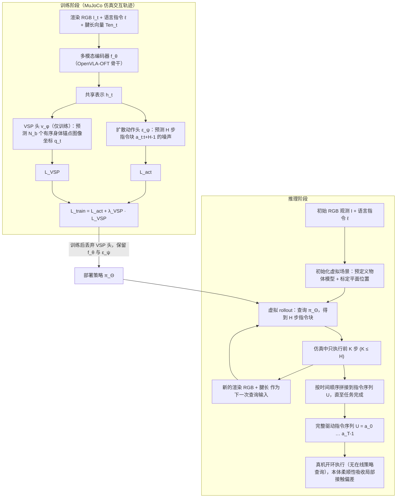

# SWIM（arXiv:2609.17035）

**SWIM**（*SWIM: Vision-Language-Grounded Soft Whole-Body Interactive Manipulation*，[arXiv:2609.17035](https://arxiv.org/abs/2609.17035)）来自 [senlanke 具身运控lab 周更盘点](../../sources/blogs/wechat_senlanke_weekly_manipulation_2026-09-14_18.md)（2026-09-14–18）。

## 一句话定义

**RGB+语言+tendon state → Diffusion Action Head 整段 tendon chunk；Visual Soft Proprioception 保留身体几何；仿真 packing/reaching/grasping 100%/96%/88% + 真机。**

## 英文缩写速查

| 缩写 | 英文全称 | 简要说明 |
|------|----------|----------|
| VLA | Vision-Language-Action | 视觉–语言–动作 |
| DoF | Degrees of Freedom | 自由度 |
| BC | Behavior Cloning | 行为克隆 |

## 为什么重要

- 软体操作需 tendon 状态与视觉本体融合；刚性 VLA 假设不适用。

## 流程总览

图依据：论文 §III（Fig. 2、式 2–10）

## 核心机制

| 项 | 内容 |
|----|------|
| **arXiv** | [2609.17035](https://arxiv.org/abs/2609.17035) |
| **开源** | **待发布**（步骤 2.5，2026-09-20） |
| **方法摘要** | SWIM-VLA unified encoding + diffusion tendon chunks + visual soft proprioception. |

## 源码运行时序图

**不适用**（截至 2026-09-20 未发布可运行官方代码或待核实）。

## 实验与评测

- Sim 100%/96%/88%; real robot validation（作者报告）。
- 读法：先对齐任务设定、传感器与成功定义，再解读 headline 数字。

## 与其他工作对比

| 维度 | 读法 |
|------|------|
| **同周对照** | 见对应 [周更盘点](../../sources/blogs/wechat_senlanke_weekly_manipulation_2026-09-14_18.md) 映射表，勿跨任务直接比 SR |
| **开源状态** | **待发布** — 部署前以项目页/arXiv 为准 |

## 结论

**SWIM 把 VLA 扩展到软体全身交互，tendon 与视觉软本体是关键输入。**

1. 开源：**待发布**；勿凭公众号摘要臆断可复现性。
2. 指标须连同实验条件解读（仿真/真机、平台、成功阈值）。
3. 关注 arXiv 版本更新与代码发布。

## 关联页面

- [vla](../methods/vla.md)
- [manipulation](../tasks/manipulation.md)
- [robot-simulation-three-layers](../concepts/robot-simulation-three-layers.md)

## 参考来源

- [swim-vla_arxiv_2609_17035.md](../../sources/papers/swim-vla_arxiv_2609_17035.md)
- [wechat_senlanke_weekly_manipulation_2026-09-14_18.md](../../sources/blogs/wechat_senlanke_weekly_manipulation_2026-09-14_18.md)
- [arXiv:2609.17035](https://arxiv.org/abs/2609.17035)
- [arXiv PDF](https://arxiv.org/pdf/2609.17035)：已通读方法部分（实验与附录以略读为准）：§II 问题定义，§III-A 训练（共享表示、扩散目标、VSP、联合目标），§III-B 虚拟 rollout 推理，附录实现细节表

## 推荐继续阅读

- [arXiv PDF](https://arxiv.org/pdf/2609.17035)
