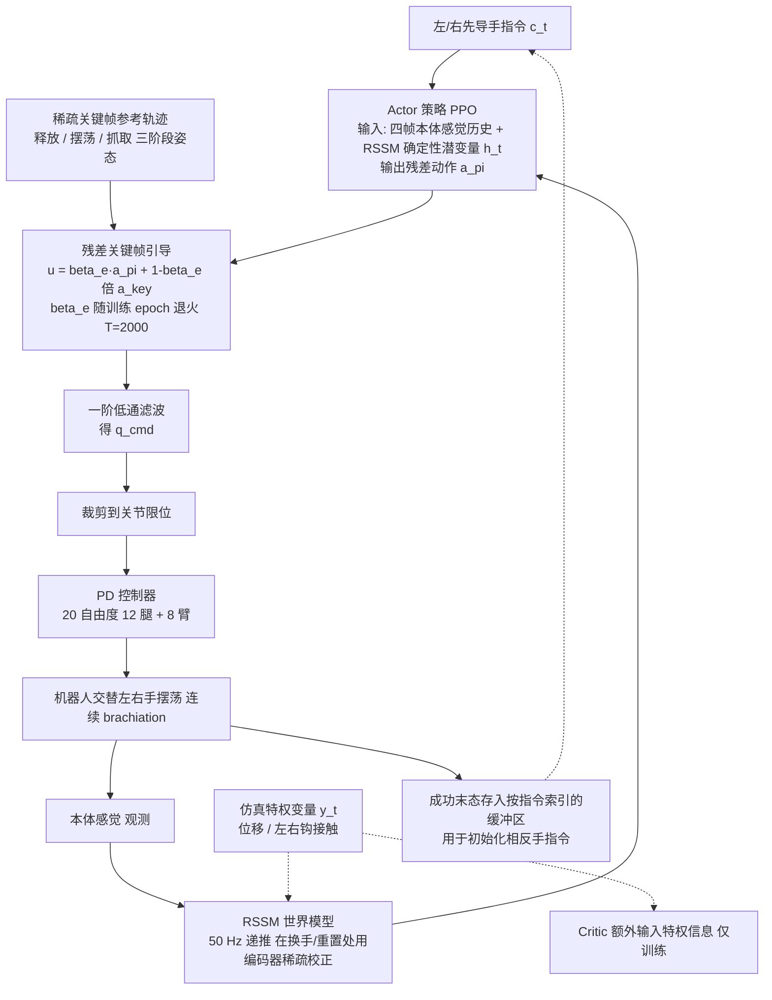

# SwingBot（arXiv:2609.10283）

**SwingBot**（[SwingBot: Learning Whole-Body Brachiation for Humanoid Robots](https://arxiv.org/abs/2609.10283)）来自 [具身智能小站 11 篇盘点](../../sources/blogs/wechat_embodied_station_11_papers_vlm_manipulation_2026-09-10.md)。人形全身荡杠：生物启发关键帧 + privileged transition；单次摆动成功率约 88–94%，连续八次 40–60%。

## 一句话定义

**真机单次摆动 88.0%–94.1%；连续八次完成率 40%–60%。**

## 英文缩写速查

| 缩写 | 英文全称 | 简要说明 |
|------|----------|----------|
| IL | Imitation Learning | 从专家示范学习策略 |
| VLM | Vision-Language Model | 视觉-语言多模态模型 |
| WM | World Model | 预测未来观测或表征的动力学模型 |
| RL | Reinforcement Learning | 强化学习 |
| CEM | Cross-Entropy Method | 采样优化动作/轨迹的规划器 |
| DoF | Degrees of Freedom | 自由度 |

## 为什么重要

- 纳入本期 **VLM 控制 / 世界模型 / 灵巧操作 / 规划 / 评测** 主线之一。
- 开源状态：**待发布**（步骤 2.5 核查，2026-09-10）。
- 与 [11 篇技术地图](../overview/vlm-manipulation-11-papers-technology-map.md) 中同类工作可横向对照。

## 流程总览

图依据：论文 §3.1–§3.4 / Fig. 2（SwingBot framework）。

## 核心机制

| 项 | 内容 |
|----|------|
| **arXiv** | [2609.10283](https://arxiv.org/abs/2609.10283) |
| **项目页** | https://ttbray.github.io/SwingBot/ |
| **代码** | https://github.com/TTBray/SwingBot |
| **开源** | **待发布** |
| **文内指标** | 真机单次摆动 88.0%–94.1%；连续八次完成率 40%–60%。 |

## 源码运行时序图

**不适用**（项目页已上线；GitHub 仓截至入库日无可运行 README/训练入口。）。

## 实验与评测

| 项 | 文内口径 |
|----|----------|
| 单次摆动成功率 | **88.0% – 94.1%**（真机） |
| 连续八次完成率 | **40% – 60%** |
| 机制 | 生物启发 **关键帧** + **privileged transition** |

- **单次 vs 连续的落差是重点：** 约 90% 的单次成功率经八次串联后掉到 40–60%，与独立失败复合（$0.9^8 \approx 43\%$）的量级一致；读表时应把连续完成率理解为 **单次成功率的复合结果**，引用时不要只报单次数字。是否另有衔接相位的额外失效，需看原文逐次分解。
- **读法：** 本页为清单摘要，上表取自 [公众号盘点](../../sources/blogs/wechat_embodied_station_11_papers_vlm_manipulation_2026-09-10.md) 与项目页；本体、杠距设定与消融以 **原文 PDF** 为准（[参考来源](#参考来源)）。

## 与其他工作对比

| 对照路线 | 差异 |
|----------|------|
| 人形 [locomotion](../tasks/locomotion.md) / 动作跟踪 | 依赖持续地面接触、近准静态平衡；brachiation 是 **欠驱动摆荡**，支撑点离散、相位间不可停顿。 |
| 纯参考动作跟踪 | 没有可直接跟踪的人类荡杠参考库；本文用 **生物启发关键帧** 给稀疏目标，再由 RL 补相位间动力学。 |
| 无 privileged 的端到端 RL | 摆荡的关键状态（速度、抓握时机）观测受限；privileged transition 提供训练期特权信息，部署期不可用。 |
| [InstantMimic](./paper-instantmimic.md) | 同属 physics-based 技能学习，但那篇优化的是 **训练系统吞吐**，本篇优化的是 **能不能学会这个技能**，两者正交。 |

## 结论

**SwingBot 值得按「待发布」边界阅读：先核对仓库是否可跑，再引用文内成功率数字。**

1. 索引来源为公众号导读，实验细节以 arXiv PDF 为准。
2. 开源结论：**待发布** — 项目页已上线；GitHub 仓截至入库日无可运行 README/训练入口。。
3. 选型时对照 [11 篇地图](../overview/vlm-manipulation-11-papers-technology-map.md) 中相邻节点，避免重复造页。

## 关联页面

- [VLM 与操作 11 篇技术地图](../overview/vlm-manipulation-11-papers-technology-map.md)
- [模仿学习 (Imitation Learning)](../methods/imitation-learning.md)
- [Generative World Models](../methods/generative-world-models.md)
- [Manipulation](../tasks/manipulation.md)

## 参考来源

- [swingbot_arxiv_2609_10283.md](../../sources/papers/swingbot_arxiv_2609_10283.md)
- [wechat 11篇盘点](../../sources/blogs/wechat_embodied_station_11_papers_vlm_manipulation_2026-09-10.md)
- [arXiv:2609.10283](https://arxiv.org/abs/2609.10283)
- [arXiv PDF](https://arxiv.org/pdf/2609.10283)：已通读方法部分（实验与附录以略读为准）：§3.1 问题表述、§3.2 残差关键帧引导、§3.3 世界模型、§3.4 训练细节

## 推荐继续阅读

- [arXiv PDF](https://arxiv.org/pdf/2609.10283)
- [项目页](https://ttbray.github.io/SwingBot/)
- [GitHub](https://github.com/TTBray/SwingBot)
