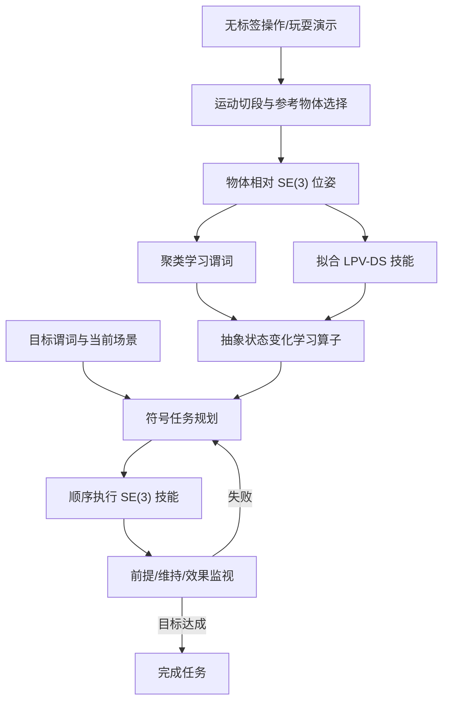
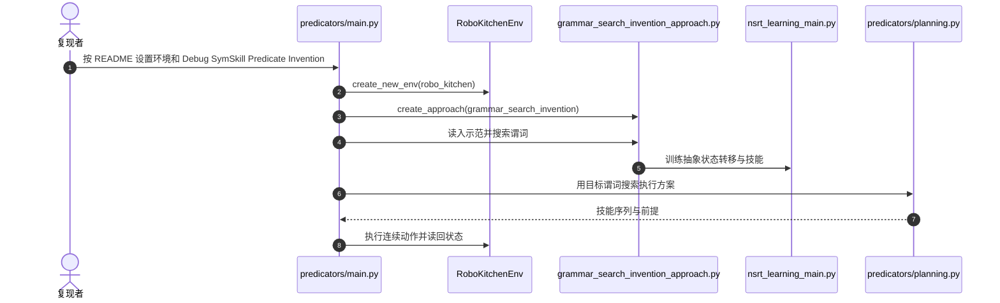

# SymSkill：低数据量下符号与技能共发明的可反应长程操作

**英文：** SymSkill: Symbol and Skill Co-Invention for Data-Efficient and Reactive Long-Horizon Manipulation · [原论文](https://arxiv.org/abs/2510.01661) · [官方项目](https://symskill.github.io/) · [官方代码](https://github.com/shaoyifei96/Symskill)

## 一句话定义

从少量无标签、未切段的操作演示同时学出相对位姿谓词、符号操作算子与 SE(3) 动力系统技能，让机器人在失败或场景变化时重新规划并继续执行。

## 英文缩写速查

| 缩写 | 英文全称 | 简要说明 |
|---|---|---|
| TAMP | Task and Motion Planning | 符号任务规划与连续运动执行的结合 |
| LPV-DS | Linear Parameter-Varying Dynamical System | 局部稳定连续技能表示 |
| SE(3) | Special Euclidean Group in 3D | 抓手位姿所在的刚体运动群 |
| VLM | Vision-Language Model | 辅助选择动作参考物体的视觉语言模型 |
| NSRT | Neuro-Symbolic Relational Transition | 学习的符号状态转移模型 |

## 为什么重要

一次演示里的动作顺序不等于任何场景都适用的计划。SymSkill 显式学习每个技能的前提、效果及执行期间应维持的条件，因而可以根据当前符号状态重新编排技能；连续控制使用相对物体坐标系，提高换位姿后的可执行性。

## 核心信息

| 维度 | 内容 |
|---|---|
| 论文身份 | arXiv:2510.01661（v3（2026-06-08）） |
| 奖项 | ICRA 2026 Best Conference Paper / Best Paper on Planning and Control（[2026 四大顶会策展索引](../../sources/blogs/wechat_shenlan_four_robotics_conferences_12_awards_2026_11_17.md)） |
| 源码/数据 | 已开源：Predicators 实现、RoboCasa/robosuite 依赖和调试配置（依赖需逐一配置） |
| 研究定位 | SymSkill：低数据量下符号与技能共发明的可反应长程操作 |

## 流程总览

## 核心原理与方法

离线先按末端运动与物体运动分割演示；通过运动物体或 VLM 选择参考帧，在相对 SE(3) 坐标中聚类动作起止位姿，形成姿态谓词。比较演示抽象状态变化提炼算子的 pre/effect/maintain 条件，使用 LPV-DS 拟合吸引子技能。在线根据目标谓词规划算子序列、执行低层控制，监视 maintain/effect，并在失败后重采样或全局重规划。

## 源码运行时序图

官方 README 指向 `.vscode/launch.json` 的 Debug SymSkill Predicate Invention 配置，依赖 robosuite、robocasa、ds_policy 和 MOSEK license。`predicators/main.py` 创建环境及 approach，`grammar_search_invention_approach.py` 候选谓词搜索，`predicators/nsrt_learning/nsrt_learning_main.py` 负责算子学习；复现检查为 `pytest predicators_robocasa/tests/test_sym_skill.py`。此处是源码入口核查，不代表已本地运行。

## 工程实践

官方 README 指向 `.vscode/launch.json` 的 Debug SymSkill Predicate Invention 配置，依赖 robosuite、robocasa、ds_policy 和 MOSEK license。`predicators/main.py` 创建环境及 approach，`grammar_search_invention_approach.py` 候选谓词搜索，`predicators/nsrt_learning/nsrt_learning_main.py` 负责算子学习；复现检查为 `pytest predicators_robocasa/tests/test_sym_skill.py`。此处是源码入口核查，不代表已本地运行。

## 实验与评测

RoboCasa 12 项单步任务各 10 次试验，平均成功率 **85.0%**；去除在线监控为 **65.0%**，少量演示下 Diffusion Policy 对照为 **3.3%**。作者展示在 Franka 上从约 5 分钟 play 数据组合 12 步任务。跨任务组合不需额外示范。

## 结论

**总判：从少量无标签、未切段的操作演示同时学出相对位姿谓词、符号操作算子与 SE(3) 动力系统技能，让机器人在失败或场景变化时重新规划并继续执行。**

1. 分离可组合技能与使用条件，避免将长任务硬编码为固定动作顺序。
2. 用物体相对位姿而非世界系固定路径，让少量演示能跨位置迁移。
3. 检查 85% 单任务结果的实验设定：每任务十次，不能外推为任意长任务成功率。
4. 复现时先配置官方四个相邻仓库、RoboCasa 资源及 MOSEK 授权。

## 与其他工作对比

与端到端 Diffusion Policy 的轨迹模仿相比，强调显式符号前提及状态切换；与传统 TAMP 相比，减少专家手设谓词/技能并以学习的稳定 DS 支持快速反应。

## 局限与风险

依赖识别出操作物体和稳定的相对坐标系；高壁容器等几何约束造成碰撞失败。实时重规划不能等同于任意开放场景通用；MOSEK 和多仓依赖提高复现实操门槛。

## 关联页面

- [Camera Conditioning](./paper-know-your-camera.md)
- [VL-Nav](./paper-vl-nav.md)
- [模仿学习](../methods/imitation-learning.md)
- [操作任务](../tasks/manipulation.md)
- [接触操作纵深路线](../../roadmap/depth-contact-manipulation.md)

## 参考来源

- [原始论文阅读归档](../../sources/papers/symskill_arxiv_2510_01661.md)（v3（2026-06-08）；已标注方法、评测和局限）
- [2026 四大顶会获奖综述（仅用于奖项线索）](../../sources/blogs/wechat_shenlan_four_robotics_conferences_12_awards_2026_11_17.md)
- [官方项目页](https://symskill.github.io/)
- [官方实现](https://github.com/shaoyifei96/Symskill)

## 推荐继续阅读

- [原论文全文（arXiv HTML）](https://arxiv.org/html/2510.01661)
- [官方项目页与实验资源](https://symskill.github.io/)

