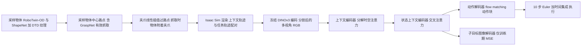

# SynthICL（arXiv:2606.08154）

*SynthICL: Scalable In-context Imitation Learning with Synthetic Data*（Qian, Fan, Ren, Wang, Johns；Imperial College London），[arXiv:2606.08154](https://arxiv.org/abs/2606.08154)，[项目页](https://synth-icl.github.io)。本页依据 arXiv v1 全文整理，核对范围见 [来源归档](../../sources/papers/synthicl_arxiv_2606_08154.md)。

## 一句话定义

**不用深度、不做相机精标定、不用任何真机训练数据，只在渲染出来的 RGB 伪示范上训练一个 flow matching Transformer 策略，测试时给 1 条示范就能执行新任务（上下文模仿学习）；训练时额外预测下一子目标图像作为辅助损失。** 以上为作者自述（Abstract、§1）。

## 英文缩写速查

| 缩写 | 英文全称 | 简要说明 |
|------|----------|----------|
| ICIL | In-Context Imitation Learning | 测试时把示范当条件输入，不更新权重 |
| IP | Instant Policy | 点云 + 图扩散的 ICIL 基线，伪示范思路的来源（论文 [1]） |
| ICRT | In-Context Imitation Learning via Next-Token Prediction | 自回归 RGB ICIL 基线，需大量真机数据（论文 [2]） |
| SP | Subgoal Prediction | 辅助的下一子目标图像预测头 |
| DINOv3 | self-DIstillation with NO labels v3 | 冻结的视觉编码器（ViT-S/16+） |
| SAM | Segment Anything Model | 真机分割用 |
| CUTIE | Putting the object back into video object segmentation | 真机视频分割跟踪用 |
| RLBench | Robot Learning Benchmark | 仿真评测基准 |
| SR | Success Rate | 成功率 |

## 为什么重要

- ICIL 要能一条示范泛化，需要大量多样数据；真机采集太贵（§1）。本文给出的路线是全合成 RGB 训练，并在真机 16 个任务上与点云基线 IP 比较（Table 2）。
- 对比同类的点云方案：作者认为点云有 sim-to-real 差距、依赖深度与标定、丢掉外观信息（§1）。本文用 RGB 保留外观，在「同形状不同纹理」任务（Stack Cups / Stack Bowls）上优势明显（§4.3，Table 2）。
- 这是单篇作者结果，且仿真侧对 IP 的优势很小（见下文核对一节）。

## 核心原理与流程总览

### 数据（§3.2、附录 A）

- 沿用 IP 的伪示范：不跑物理仿真，夹爪依次经过物体中心路点，抓取时物体吸附在夹爪上，释放时脱离；上下文与任务轨迹共享路点序列，但初始物体位姿、光照、纹理、相机位姿各自独立随机（附录 A）。
- 两处改动：渲染由 PyBullet 改为 Isaac Sim；抓取位姿由随机改为 GraspNet 预计算的有效抓取（附录 A 另说明只保留夹爪与地面夹角小于 45 度的抓取，以简化分布）。
- 路点上加 0.5 cm 平移噪声与 5 度旋转噪声，避免腕部相机在同一路点图像几乎相同而学成「图像匹配就开合夹爪」的捷径（附录 C）。
- 同 IP，手工设计了抓放、推、倒等少量轨迹模板并过采样（附录 A）。

### 模型（§3.3、附录 B）

- 输入：多视角分割后的 RGB，不用本体状态（§3.1）；上下文只有图像序列，不含动作（附录 C）。
- 上下文编码器：空间注意力在帧内 patch 间，时间注意力在帧间同位置 patch 间（§3.3）。
- 动作头：条件 flow matching，线性插值 x_t，损失为速度场回归；推理 10 步，动作块 H=8 并做时间集成（§3.3、Table 4）。
- 子目标头：独立 Transformer，预测下一路点的多视角渲染图，MSE，权重 1.0；与动作头不共享注意力层，因此测试时可关闭（§3.3）。

## 工程实践

- 数据规模：仿真评测用 PyBullet 100K 条伪示范（因 RLBench 与 PyBullet 同渲染器，§4.2）；真机用 Isaac Sim 3M 条（§4.3）。
- 训练超参（Table 4）：256 x 256，batch 64，AdamW，学习率 1e-4，2000 epochs，隐藏维 512，8 头。训练算力与时长论文未给出（本页未见相关报告）。
- 真机（§4.3，附录 C）：Franka Research 3，1 个腕部相机加 2 个外部相机（前、侧），用 SAM 与 CUTIE 做分割；真机示范是连续轨迹，用「初始帧 + 夹爪状态变化帧 + 夹爪速度低于阈值的帧」的启发式挑最多 6 帧作上下文。
- 不要冻结改成 LoRA 微调 DINOv3：仿真平均掉到 20.7%（附录 H，Table 5b）；作者推测与三个视角共享同一编码器有关（作者推测）。
- 时间集成对精度类真机任务有帮助：Cube in Shape Sorter 15/20 对直接执行的 11 至 13/20（附录 H，Table 5c，单任务）。
- 摄像头布局：外部两路需大致前视与侧视；仿真侧加了右侧相机（附录 C）。

## 实验结果摘要

| 设置 | IP | ICRT | 无 SP | 完整 | 出处 |
|------|----|------|-------|------|------|
| RLBench 12 任务 x 100 次 | 72.4% | 60.1% | 72.2% | 75.0% | §4.2 Table 1 |
| 真机 16 任务 x 20 次 | 72.5% | 45.0% | 65.3% | 79.1% | §4.3 Table 2 |

- 数据管线消融（真机，Figure 4，§4.4）：IP 管线 9.3%，加 Isaac Sim 渲染 11.7%，加 GraspNet 抓取 64.6%，两者都加 79.1%。有效抓取位姿贡献最大，Isaac Sim 渲染在其上再带来约 14 个百分点。
- 子目标头结构（§4.6，Table 3，仿真）：独立头 75.0%，联合解码器 76.1%，作者因推理更省而选独立头。上下文编码器：分解时空 75.0% 对完整注意力 63.4%。
- 数据规模（§4.5，Figure 5）：两种变体随数据增长而提升；数据很少时无 SP 反而更好，作者推测辅助重建目标在低数据下与动作学习竞争（作者推测）。
- 相机消融（附录 H，Table 5d）：去腕部相机 60.3%，去侧视 64.6%。

## 与清单说法的对比核对

清单（Glen Berseth，My CoRL 2026 Reading List，P2，Imitation Learning & Data Quality，作者称为 LLM 据摘要起草）对该论文的一句话：「In-context imitation policies trained entirely on RGB-only synthetic data, with subgoal prediction.」

| 清单限定 | 论文情况 | 判断 |
|----------|----------|------|
| 完全用合成数据训练 | 训练全部是伪示范（仿真 100K，真机 3M，§4.2、§4.3）；无真机训练数据（§1） | 属实 |
| RGB-only | 输入是**分割后的** RGB，背景被抹黑，真机还需 SAM 加 CUTIE（§3.3、附录 G、§4.3）；作者自列为局限（Conclusion）。无深度、无本体状态 | 基本属实，但需要分割这一点清单未提 |
| with subgoal prediction | 子目标图像预测是**训练期辅助损失**，推理时不使用（§2、§3.3）；真机增益约 13.8 个百分点，仿真约 2.8 个百分点（§4.3） | 属实，但不是推理时的规划模块 |
| 隐含：真机有效 | 真机 16 个未见任务平均 79.1%，测试时 1 条示范（Abstract、Table 2） | 属实 |
| 隐含：优于已有方法 | 对 IP 仿真仅 75.0 对 72.4，12 个任务中 IP 有 6 个更高（Table 1）；真机 79.1 对 72.5，16 个任务中 IP 有 5 个更高、4 个持平（Table 2）；对 ICRT 优势大，但 ICRT 是作者在自己的合成数据上重训的（§4.1） | 方向属实，但对 IP 的优势是几个百分点，未给置信区间或多次种子 |

另：清单摘要没有提到 sim-to-real 的关键因素是抓取位姿采样（Figure 4 中去掉它只有 9% 至 12%）。

## 结论

SynthICL 支持用合成伪示范训练上下文模仿策略，但当前依赖分割输入和短时域任务。

- 部署前核对 RGB 分割、相机视角与动作接口，再提供单条测试示范。
- 分别评估颜色纹理、精确对齐和碰撞避让，不能由几何任务成功推断富接触能力。
- 比较仿真与真机时标明数据量、渲染器和模型差异，并扩大扰动与重复试验。

## 局限

论文自述（Conclusion、附录 F、附录 G）：

- 依赖分割后的 RGB，背景随机化也不足。
- 高精度、富接触任务（紧插入、对齐）仍弱；评测以短时域任务为主。
- 冻结的 DINOv3 可能偏重几何与语义而弱于颜色纹理，RLBench Stack Cups 仍会混淆。
- 放置目标远离外部相机时失败增多；伪示范没有碰撞避让监督。
- 子目标重建图很模糊（MSE、轻量解码器），作者称目的只是表征监督。

我看到的未验证之处（我的判断）：

- 对 IP 的优势较小，且未报告种子数、置信区间；仿真 100 次、真机 20 次，差几个百分点不一定稳。
- 仿真与真机用不同规模、不同渲染器的数据（100K PyBullet 对 3M Isaac Sim），不是同一模型的跨域对比。
- IP 的真机数据来源与训练设置（是否含真机共训练）论文未详述，只说在仿真用已发布权重（§4.1）；真机 IP 如何配置未见说明。
- 仿真一列 Ours 平均（75.0%）与各任务数值平均（约 75.8%）不一致，附录 E 缺 4 个真机任务描述，Table 5c 列名与内容不符（见来源归档「核对中发现的小问题」）。
- 摘要说「extensive」实验，但真机没有任务种类之外的鲁棒性设置（如光照、干扰物），除附录 C 一句「相机轻微扰动仍相近」外无定量。
- 附录 H 里 LoRA 与小模型结论来自单配置、未调参，不宜泛化。

## 关联页面

- [机器人上下文学习](../concepts/robot-in-context-learning.md)
- [Flow Matching 具身策略](../concepts/flow-matching-embodied-policy.md)
- [Sim2Real](../concepts/sim2real.md)
- [域随机化](../concepts/domain-randomization.md)
- [模仿学习](../methods/imitation-learning.md)
- [动作分块](../methods/action-chunking.md)
- [Isaac Sim](isaac-sim.md)
- [RLBench](rlbench.md)
- [RoboTwin](robotwin.md)
- [DINOv3](paper-rcl-2508-10104-dinov3.md)
- [JEDI：ICIL 的示范压缩](paper-jedi-demonstration-compression-in-context-il.md)

## 参考来源

- [synthicl_arxiv_2606_08154.md](../../sources/papers/synthicl_arxiv_2606_08154.md)
- [arXiv:2606.08154](https://arxiv.org/abs/2606.08154)
- [项目页](https://synth-icl.github.io)

## 推荐继续阅读

- [arXiv PDF](https://arxiv.org/pdf/2606.08154)
- [Instant Policy（arXiv:2411.12633）](https://arxiv.org/abs/2411.12633)：伪示范数据思路的来源
