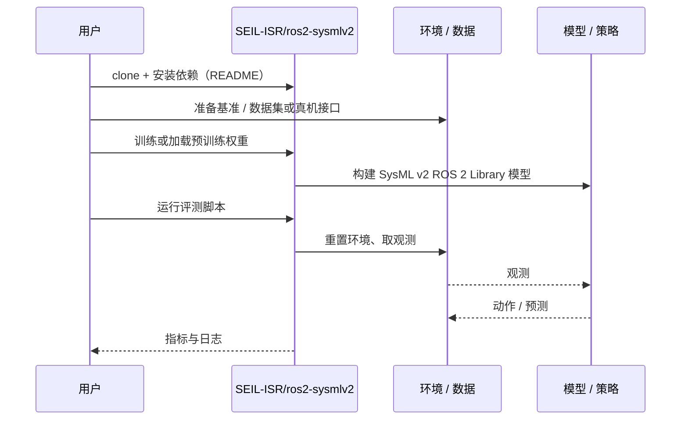

# SysML v2 ROS 2 Library（arXiv:2610.33362）

**SysML v2 ROS 2 Library**（*A SysML v2 Domain Library for ROS 2 Robot Architectures*，[arXiv:2610.33362](https://arxiv.org/abs/2610.33362)，[项目页](https://sysand.com/projects/seil-isr/ros2-sysmlv2/)，[代码](https://github.com/SEIL-ISR/ros2-sysmlv2)）来自 [具身智能小站 2026-10-28 盘点](../../sources/blogs/wechat_embodied_station_59_papers_human_video_to_robot_experience_2026-10-28.md)，属「控制、规划与系统」组。

## 一句话定义

**在 SysML v2 中定义节点、通信、生命周期与坐标等类型，对照 ROS 2 Jazzy 校验。**

## 英文缩写速查

| 缩写 | 英文全称 | 简要说明 |
|------|----------|----------|
| SysML v2 ROS 2 Library | A SysML v2 Domain Library for ROS 2 Robot Architectures | 本文方法 / 基准的简称 |
| SysML | Systems Modeling Language | 系统建模语言 |

## 为什么重要

- 为机器人架构复用 ROS 2 建模词汇。模型生成监测的案例检出人为偏差；公开领域库与完整生成管线需分开理解。
- 开源结论：**已开源**（步骤 2.5，2026-10-28）。仓库可达（git ls-remote）。项目页 HTTP 200。
- 同期同组工作见 [潜在动作、免渲染事件仿真与机器人评测：具身智能小站 10-28 期 59 篇阅读坐标](../overview/embodied-station-2026-10-28-59-papers-technology-map.md)。

## 核心机制

| 项 | 内容 |
|----|------|
| **arXiv** | [2610.33362](https://arxiv.org/abs/2610.33362) |
| **开源** | **已开源** |
| **要点** | 在 SysML v2 中定义节点、通信、生命周期与坐标等类型，对照 ROS 2 Jazzy 校验。 |
| **文内指标** | 公众号转述：模型生成监测的案例检出人为偏差；公开领域库与完整生成管线需分开理解。 |

## 源码运行时序图

以下为按仓库入口（`SEIL-ISR/ros2-sysmlv2`）推断的通用运行链路；入库日仅核实仓库可达，未逐文件阅读，具体脚本名以 README 为准。

## 实验与评测

- 公众号转述：模型生成监测的案例检出人为偏差；公开领域库与完整生成管线需分开理解。
- **读法：** 本页为索引级摘要，依据公众号转述的官方摘要与仓库信息整理；逐项数字与 baseline 以原文 PDF 为准。

## 与其他工作对比

- 横向索引见 [潜在动作、免渲染事件仿真与机器人评测：具身智能小站 10-28 期 59 篇阅读坐标](../overview/embodied-station-2026-10-28-59-papers-technology-map.md)；同 arXiv 不重复造页。

## 结论

**为机器人架构复用 ROS 2 建模词汇：模型生成监测的案例检出人为偏差；公开领域库与完整生成管线需分开理解。**

1. 开源边界：**已开源** — 仓库可达（git ls-remote）。项目页 HTTP 200。
2. 核心机制：在 SysML v2 中定义节点、通信、生命周期与坐标等类型，对照 ROS 2 Jazzy 校验。
3. 复现与选型前核对任务协议、硬件与基准口径，勿直接横比公众号摘录数字。

## 关联页面

- [manipulation](../tasks/manipulation.md)
- [impedance-control](../concepts/impedance-control.md)
- [llm-robotics-control-interfaces](../concepts/llm-robotics-control-interfaces.md)
- [embodied-station-2026-10-28-59-papers-technology-map](../overview/embodied-station-2026-10-28-59-papers-technology-map.md)

## 参考来源

- [sysml_v2_ros_2_library_arxiv_2610_33362.md](../../sources/papers/sysml_v2_ros_2_library_arxiv_2610_33362.md)
- [wechat_embodied_station_59_papers_human_video_to_robot_experience_2026-10-28.md](../../sources/blogs/wechat_embodied_station_59_papers_human_video_to_robot_experience_2026-10-28.md)
- [arXiv:2610.33362](https://arxiv.org/abs/2610.33362)

## 推荐继续阅读

- [arXiv PDF](https://arxiv.org/pdf/2610.33362)
- [项目页](https://sysand.com/projects/seil-isr/ros2-sysmlv2/)
- [https://github.com/SEIL-ISR/ros2-sysmlv2](https://github.com/SEIL-ISR/ros2-sysmlv2)
