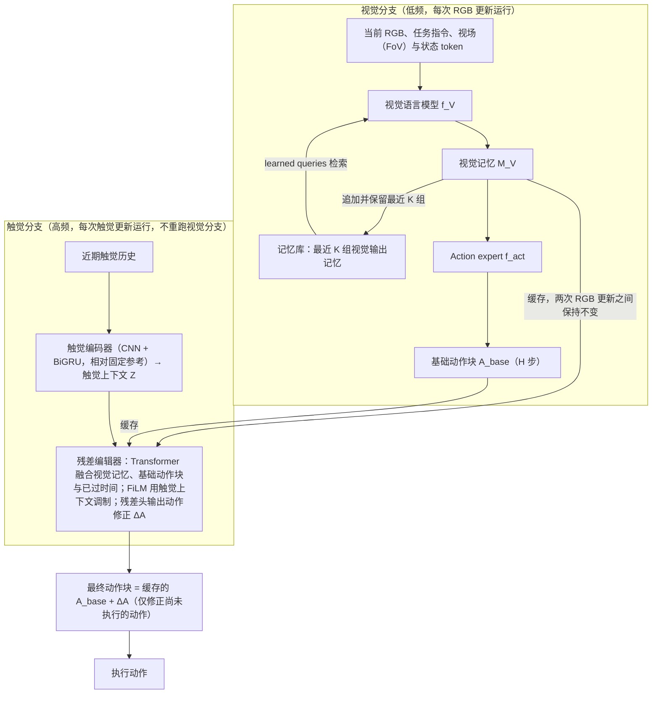

# T-WLA：连接低频视觉与高频触觉

**T-WLA**（*T-WLA: Bridging Slow Vision and Fast Touch*，[arXiv:2610.28814](https://arxiv.org/abs/2610.28814)）收录于 senlanke「具身运控lab」10-19–10-23 前沿论文动态（Manipulation）。本页依据**周报条目 + arXiv 摘要页**整理，流程图依据论文方法部分（见参考来源），未逐页核对实验数字；指标与结论以论文为准。

## 一句话定义

**T-WLA：连接低频视觉与高频触觉——T-WLA 研究低频视觉与高频触觉的联合建模，使机器人在利用视觉进行任务级决策的同时，能够通过快速触觉信息响应接触变化。**

## 英文缩写速查

| 缩写 | 英文全称 | 简要说明 |
|------|----------|----------|
| VLA | Vision-Language-Action | 视觉–语言–动作模型 |
| IL | Imitation Learning | 模仿学习 |

## 为什么重要

- 周报所述待解决的问题：视觉信息适合识别物体和规划操作，但接触发生后的状态变化往往需要更高频率的触觉反馈。两种模态的更新频率不同，增加了实时控制的融合难度。

## 流程总览

图依据：论文 §3.1–§3.3 / Fig.2、Fig.3、Eq.1–3。

## 核心机制

| 项 | 内容 |
|----|------|
| **arXiv** | [2610.28814](https://arxiv.org/abs/2610.28814) · [PDF](https://arxiv.org/pdf/2610.28814) |
| **作者（arXiv）** | Kaichen Zhou, Yuzhen Chen, Hannah Yao, Chonghe Jiang, Rao Fu, Xihang Yu, Wei Dai, Bashar Kabbarah, Haoyu Chen, Ishita Goluguri, Zhiyang Dou, Haonan Chen, Fangneng Zhan, Mengyu Wang, Wojciech Matusik, Antonio Torralba, Paul Pu Liang |
| **机构（周报所述，未逐条核实）** | 待核实（作者：Kaichen Zhou、Wojciech Matusik、Antonio Torralba、Paul Pu Liang 等）。 |
| **arXiv 评论栏** | （无） |
| **开源** | arXiv 摘要页/评论给出项目页或外链（https://anonymous-submission-20.github.io/T-WLA.github.io/）；未发现代码仓库链接（2026-10-26） |
| **周报所述创新点** | T-WLA 研究低频视觉与高频触觉的联合建模，使机器人在利用视觉进行任务级决策的同时，能够通过快速触觉信息响应接触变化。 |

### arXiv 摘要节选（英文原文）

> In contact-rich manipulation, contact conditions can change before a visual policy updates its action plan. Recomputing the plan through the visual policy adds latency, while tactile feedback alone does not specify how the ongoing motion should be revised for the task.

## 源码运行时序图

**不适用**：arXiv 摘要页/评论给出项目页或外链（https://anonymous-submission-20.github.io/T-WLA.github.io/）；未发现代码仓库链接，无可对齐的官方代码流程。

## 实验与评测

- 周报与摘要给出的数字/场景已写入上表「创新点」与摘要节选；其余实验细节、基线与成功率定义请回到论文正文。
- 读法：先对齐任务设定、传感器与成功定义（仿真/真机），再解读 headline 数字，勿跨论文直接比较。

## 与其他工作对比

| 维度 | 读法 |
|------|------|
| **同周对照** | 见 [Manipulation周报技术地图](../overview/senlanke-weekly-2026-10-19-23-manipulation-technology-map.md)，按方向浏览同期论文 |
| **开源状态** | arXiv 摘要页/评论给出项目页或外链（https://anonymous-submission-20.github.io/T-WLA.github.io/）；未发现代码仓库链接 |

## 结论

**T-WLA：连接低频视觉与高频触觉。**

1. 本页是入库级摘要，复现前请核对论文正文、附录与代码仓库。
2. 指标须连同实验条件解读。
3. 关注 arXiv 版本更新与代码发布。

## 关联页面

- [senlanke-weekly-2026-10-19-23-manipulation-technology-map](../overview/senlanke-weekly-2026-10-19-23-manipulation-technology-map.md)
- [manipulation](../tasks/manipulation.md)
- [vla](../methods/vla.md)

## 参考来源

- [t-wla-slow-vision-fast-touch_arxiv_2610_28814.md](../../sources/papers/t-wla-slow-vision-fast-touch_arxiv_2610_28814.md)
- [wechat_senlanke_weekly_manipulation_2026-10-19_23.md](../../sources/blogs/wechat_senlanke_weekly_manipulation_2026-10-19_23.md)
- [arXiv:2610.28814](https://arxiv.org/abs/2610.28814)
- [arXiv PDF](https://arxiv.org/pdf/2610.28814)：已通读方法部分（实验与附录以略读为准）：§3.1–§3.4（含 Fig.2–3）

## 推荐继续阅读

- [arXiv PDF](https://arxiv.org/pdf/2610.28814)
