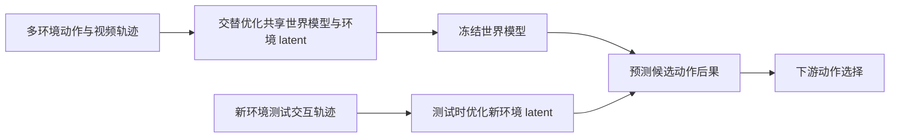
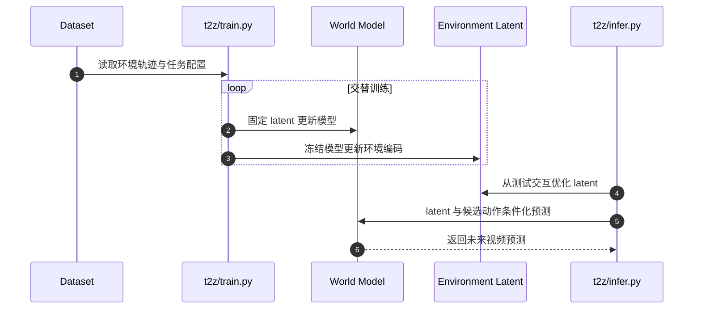

# T2-z：测试时优化环境潜变量以适应机器人世界模型

## 一句话定义

**T2-z 保持世界模型参数冻结，仅用测试环境中的少量交互轨迹优化 32 维环境潜变量，再以该潜变量条件化未来动作的视觉预测。**

## 英文缩写速查

| 缩写 | 英文全称 | 简要说明 |
|------|----------|----------|
| T2-z | Test-Time Optimization of Environment Latents | 测试时优化环境潜变量的方法名 |
| WM | World Model | 预测动作后果与未来观测的模型 |
| VLA | Vision-Language-Action | 视觉、语言与动作策略族 |
| TTT | Test-Time Training | 测试阶段利用当前样本/交互更新适配变量 |

## 为什么重要

同一动作的结果会随摩擦、质量、接触规则等隐含条件改变。若世界模型把这些差异都压进单一平均动力学，预测会偏离当前环境。T2-z 用测试时适配吸收环境差异，目标是避免为每个新环境重训整套视频世界模型。

## 核心机制

- **环境潜变量：** 为训练环境学习紧凑的 32 维向量，不需要为每个维度提供“摩擦/质量”等语义标签。
- **交替训练：** 固定 latent 训练共享动作条件世界模型；冻结世界模型后，再优化每个环境 latent。
- **测试时适配：** 新环境从新初始化 latent 出发，用一条或多条真实/模拟交互轨迹更新 latent；世界模型保持冻结。
- **使用适配结果：** 将 latent 与图像/动作输入联合条件化未来视频预测，供动作选择使用。

## 流程总览

## 源码运行时序图

训练与推理入口依据官方 README（`t2z/train.py`、`t2z/infer.py`）；数据、Wan2.2-TI2V-5B 基座权重、BWM 初始化 checkpoint 和仿真依赖需要另行准备。

## 实验与评测

- 论文覆盖 7 种模拟设置与 4 项真实机器人任务。
- 摘要报告物体预测误差指标从 15.20 降到 7.00，动作成功率从 33.73% 提升到 72.96%；具体基线、误差定义和成功标准应回到论文主表核对。
- 消融报告单条测试交互轨迹可用于环境适配；实际所需交互信息量与任务分布有关。

## 与其他工作对比

| 维度 | T2-z（本文） | [RMA](./paper-rma-rapid-motor-adaptation.md) | [RoboTTT](./paper-robottt-test-time-training-vla-context.md) | [系统辨识](../concepts/system-identification.md) |
|------|------|------|------|------|
| 适配对象 | 视频世界模型的 32 维环境潜变量 | 运动策略的环境 extrinsics | VLA 内 TTT 层的 fast weights | 显式动力学 / 执行器参数 |
| 适配方式 | 测试时用交互轨迹做梯度优化 latent，模型冻结 | adaptation module 从本体–动作历史直接回归，部署时无梯度 | 每步自监督梯度更新 fast weights | 按物理模型拟合参数 |
| 训练监督 | 无语义标签，交替优化模型与每环境 latent | 仿真特权环境参数监督 | 自监督 | 物理模型 + 采集数据 |
| 可解释性 | latent 不保证对应物理量 | extrinsics 为编码向量 | 不面向物理量 | 参数有物理含义 |

- **相对 RMA：** 二者都用低维环境编码吸收隐含物理差异；RMA 依赖仿真中的特权参数且作用于策略，T2-z 无需物理标签、作用于世界模型，代价是测试时需额外优化步骤。
- **相对 RoboTTT：** 同属测试时适配，RoboTTT 更新策略内部 fast weights 扩展上下文，T2-z 只更新一个环境 latent 并保持世界模型参数冻结。
- **相对系统辨识：** T2-z 可视为"隐式系统辨识"，省去建模但失去参数的物理可解释性。
- 各文任务与指标不同，数字不可横比。

## 工程实践与局限

- 该方法在测试时仍需与新环境交互；它降低模型重训需求，但不意味着零样本知道隐藏物理属性。
- 潜变量是预测有用的压缩表示，不保证各维对应可解释或可独立控制的物理参数。
- 官方代码、数据集均已公开；运行还需大体量基座模型与 BWM checkpoint，且 repo 本身不携带它们。
- 论文中的多个任务与环境设定需要对照论文表格复现，摘要指标不能单独用于跨论文排名。

## 结论

**T2-z 把新环境适应转化为冻结世界模型下的 latent 优化，为机器人世界模型提供了比全量微调更轻量的测试时适配变量。**

1. 最关键的工程判断是测试轨迹是否包含足够的环境辨识信息；单条轨迹可行不代表任意轨迹都足够。
2. 环境 latent 有助于预测适配，但不是显式物理参数估计器。
3. 评测同时覆盖模拟与真机，阅读时应拆开预测误差与下游动作成功两类指标。
4. 复现入口已公开，数据与权重需额外下载，显存和仿真依赖是主要准备成本。

## 关联页面

- [VLA](../methods/vla.md)
- [Transformer](../concepts/transformer.md)
- [机器人基础模型因果分析](./paper-robot-foundation-model-causal-analysis.md)

## 参考来源

- [T2-z 论文摘录](../../sources/papers/t2_z_arxiv_2610_22364.md)
- [T2-z 项目页归档](../../sources/sites/t2-z-latent-optimization.md)
- [T2-z 官方仓库](../../sources/repos/t2-z-latent-optimization.md)

## 推荐继续阅读

- [T2-z 项目页](https://t2-z-latent-optimization.github.io/)
- [T2-z 数据集](https://huggingface.co/datasets/huagailuowen/T2-z-datasets)
