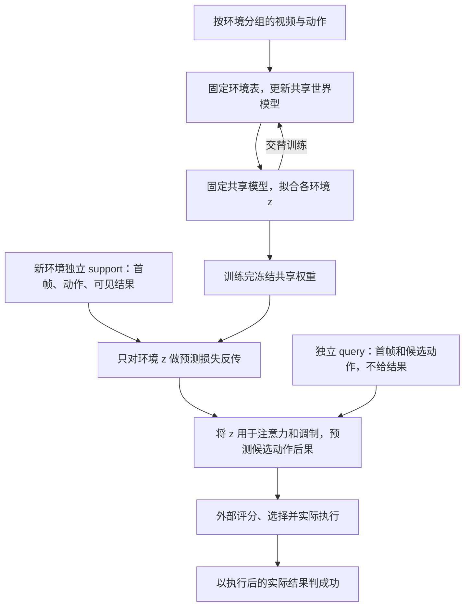
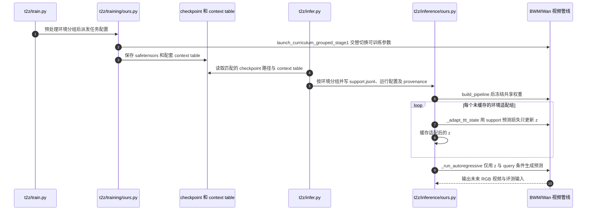

# T2-z：测试时优化环境潜变量 / Test-Time Optimization of Environment Latents for Robotic World Models

## 一句话定义

**T2-z 保持世界模型参数冻结，仅用测试环境中的少量交互轨迹优化 32 维环境潜变量，再以该潜变量条件化未来动作的视觉预测。**

## 英文缩写速查

| 缩写 | 英文全称 | 简要说明 |
|------|----------|----------|
| T2-z | Test-Time Optimization of Environment Latents | 测试时优化环境潜变量的方法名 |
| WM | World Model | 预测动作后果与未来观测的模型 |
| VLA | Vision-Language-Action | 视觉、语言与动作策略族 |
| TTT | Test-Time Training | 测试阶段利用当前样本/交互更新适配变量 |

## 为什么重要

同一动作的结果会随摩擦、质量、接触规则等隐含条件改变。若世界模型把这些差异都压进单一平均动力学，预测会偏离当前环境。T2-z 用测试时适配吸收环境差异，目标是避免为每个新环境重训整套视频世界模型。

| 字段 | 内容 |
|---|---|
| 机构 | 斯坦福大学、卡内基梅隆大学、丰田研究院、南加州大学 |
| 原文 | [arXiv:2610.22364v1 HTML](https://arxiv.org/html/2610.22364v1) · [PDF](https://arxiv.org/pdf/2610.22364v1)，2026-10-15 |
| 输出 | 已给定候选动作的未来 RGB；候选选择器是外部环节，不是联合动作生成头 |

## 核心机制

- **环境潜变量：** 训练时每个环境共享一组 32 维向量；不提供真实摩擦或质量数值。用两套独立的 32→128→3072 投影：一路在视频 DiT 交叉注意力中加入环境 token，另一路加到动作与时间步调制上。初始帧进入视频 VAE 潜空间，动作沿用 BWM 的 14 维输入，关闭文本条件。
- **交替训练：** 用未来视频 flow matching 损失，先做 300 次模型预热，再以 200/200 步交替更新共享模型与环境表。模型段更新 DiT、动作编码器和两个潜变量投影，视频 VAE 冻结；潜变量段反向冻结共享参数。
- **测试时适配：** 冻结世界模型，仅用已观察的 support 结果对新环境的 z 求梯度。主实验 40 次更新，学习率按 3.0 / 1.5 / 0.5 / 0.15 各走 10 步；同一 z 才交给未参与适配的 query，避免把候选执行后的结果泄露给选择器。
- **使用适配结果：** 将 latent 与图像/动作输入联合条件化未来视频预测，供动作选择使用。

## 流程总览

## 源码运行时序图

依据作者仓库 [`c72f051`](https://github.com/T2-z-latent-optimization/T2-z/tree/c72f051f5cffcb1f372a32bc488df273556d39b9) 静态走读。以上是训练和离线视频预测；在线仿真候选筛选另走 [sim_action_selection](https://github.com/T2-z-latent-optimization/T2-z/tree/c72f051f5cffcb1f372a32bc488df273556d39b9/wan_video_action/evaluation/sim_action_selection)，不是同一 CLI。

## 实验与评测

| 口径 | Standard WM → T2-z | 结果边界 |
|---|---|---|
| 仿真 7 项，表 1 | 任务均值动作成功率 37.9% → 74.2%；平均物理误差 12.8575 → 4.7971 | 混合像素、灯分数误差和倾角单位，不称为统一像素误差 |
| 真机 4 项，表 2 | 任务均值动作成功率 26.47% → 70.80%；平均 ADE 19.30 → 10.85 px | native 主相机的任务跟踪；如 Door Close 22.22% → 55.56%，Stick Balance 20.00% → 83.33% |
| 交互条数消融，附录 E.1 | Door Close K=1/2/4：22.2% / 55.6% / 55.6%；Light Switch：50.0% / 87.5% / 87.5% | 适配轨迹条数 K 不等于梯度步数；效果取决于交互是否揭示了任务差异 |
| 计算剖析，附录 E.4 | 单张 H200 中 Friction 的 K=1 加 5 段查询总计 18.09 秒，对比 LoRA TTA 32.73 秒、缓存版 TTT-KQV 37.57 秒 | 25 次生成去噪，排除加载与 MP4 写盘；并非实机端到端控制周期，也非每个候选都重新适配 |

摘要的 33.73% → 72.96% 是从 7 项仿真与 4 项真机结果按任务汇总的口径，不是独立真机结果；摘要误差 15.20 → 7.00 同样是跨任务汇总，指标不能横比。动作成功是**候选集合至少含一个可达标动作**时，选择后真实执行的结果，不等于机器人自行搜索、生成任意控制动作的整体成功率。PCA 只说明特定任务中的环境条件相关结构，不能把 z 的某一维当作经标定的摩擦系数。

## 与其他工作对比

| 维度 | T2-z（本文） | [RMA](./paper-rma-rapid-motor-adaptation.md) | [RoboTTT](./paper-robottt-test-time-training-vla-context.md) | [系统辨识](../concepts/system-identification.md) |
|------|------|------|------|------|
| 适配对象 | 视频世界模型的 32 维环境潜变量 | 运动策略的环境 extrinsics | VLA 内 TTT 层的 fast weights | 显式动力学 / 执行器参数 |
| 适配方式 | 测试时用交互轨迹做梯度优化 latent，模型冻结 | adaptation module 从本体–动作历史直接回归，部署时无梯度 | 每步自监督梯度更新 fast weights | 按物理模型拟合参数 |
| 训练监督 | 无语义标签，交替优化模型与每环境 latent | 仿真特权环境参数监督 | 自监督 | 物理模型 + 采集数据 |
| 可解释性 | latent 不保证对应物理量 | extrinsics 为编码向量 | 不面向物理量 | 参数有物理含义 |

- **相对 RMA：** 二者都用低维环境编码吸收隐含物理差异；RMA 依赖仿真中的特权参数且作用于策略，T2-z 无需物理标签、作用于世界模型，代价是测试时需额外优化步骤。
- **相对 RoboTTT：** 同属测试时适配，RoboTTT 更新策略内部 fast weights 扩展上下文，T2-z 只更新一个环境 latent 并保持世界模型参数冻结。
- **相对系统辨识：** T2-z 可视为"隐式系统辨识"，省去建模但失去参数的物理可解释性。
- 各文任务与指标不同，数字不可横比。

## 工程实践

- 先以 `t2z/train.py --check-data` 检查任务路径和环境 ID，再安排训练；离线预测需成对提供训练后的 checkpoint 和 context table。摩擦配置默认从表均值开始，40 次适配更新与 25 次视频去噪分别计时。只从候选之前独立的完整轨迹采 support，按 episode 而不只是按行号去重。
- 先做成对可辨识性试验：固定外观、初始观测和候选动作，只变隐藏物理条件；分开记录 support 采集成本、一次 latent 优化、每个候选推理、和选中动作执行。换工况后重估 z，别把上一环境 cache 当成新环境事实。

## 局限与风险

- 该方法在测试时仍需与新环境交互；它降低模型重训需求，但不意味着零样本知道隐藏物理属性。
- 潜变量是预测有用的压缩表示，不保证各维对应可解释或可独立控制的物理参数。
- 代码 Apache-2.0；公开数据、Wan2.2-TI2V-5B 与 BWM 初始化权重单独获取。未确认 T2-z 成品权重与 context table 的官方下载，也未核实数据授权。发布清单 Light Switch 为 8 环境／80 条 episode，少于论文表 5 的 12 环境／120 条，不能把发布集直接等同于论文全量训练集。已公开的仿真评测不等于提供真机驱动或复现结果。
- 论文中的多个任务与环境设定需要对照论文表格复现，摘要指标不能单独用于跨论文排名。

## 结论

**T2-z 把新环境适应转化为冻结世界模型下的 latent 优化，为机器人世界模型提供了比全量微调更轻量的测试时适配变量。**

1. 最关键的工程判断是测试轨迹是否包含足够的环境辨识信息；单条轨迹可行不代表任意轨迹都足够。
2. 环境 latent 有助于预测适配，但不是显式物理参数估计器。
3. 评测同时覆盖模拟与真机，阅读时应拆开预测误差与下游动作成功两类指标。
4. 复现入口已公开，数据与权重需额外下载，显存和仿真依赖是主要准备成本。

## 关联页面

- [生成式世界模型](../methods/generative-world-models.md) · [模型式强化学习](../methods/model-based-rl.md)：把适配后的模型用于预测和筛选，不要求学习一个直接生成动作的头。
- [WAM 纵深 Stage 1](../../roadmap/depth-wam.md)：作为可适配的世界侧动力学对照。
- [VLA](../methods/vla.md)
- [Transformer](../concepts/transformer.md)
- [机器人基础模型因果分析](./paper-robot-foundation-model-causal-analysis.md)

## 参考来源

- [T2-z 论文摘录](../../sources/papers/t2_z_arxiv_2610_22364.md)
- [T2-z 项目页归档](../../sources/sites/t2-z-latent-optimization.md)
- [T2-z 官方仓库](../../sources/repos/t2-z-latent-optimization.md)

## 推荐继续阅读

- [T2-z 项目页](https://t2-z-latent-optimization.github.io/)
- [T2-z 数据集](https://huggingface.co/datasets/huagailuowen/T2-z-datasets)
