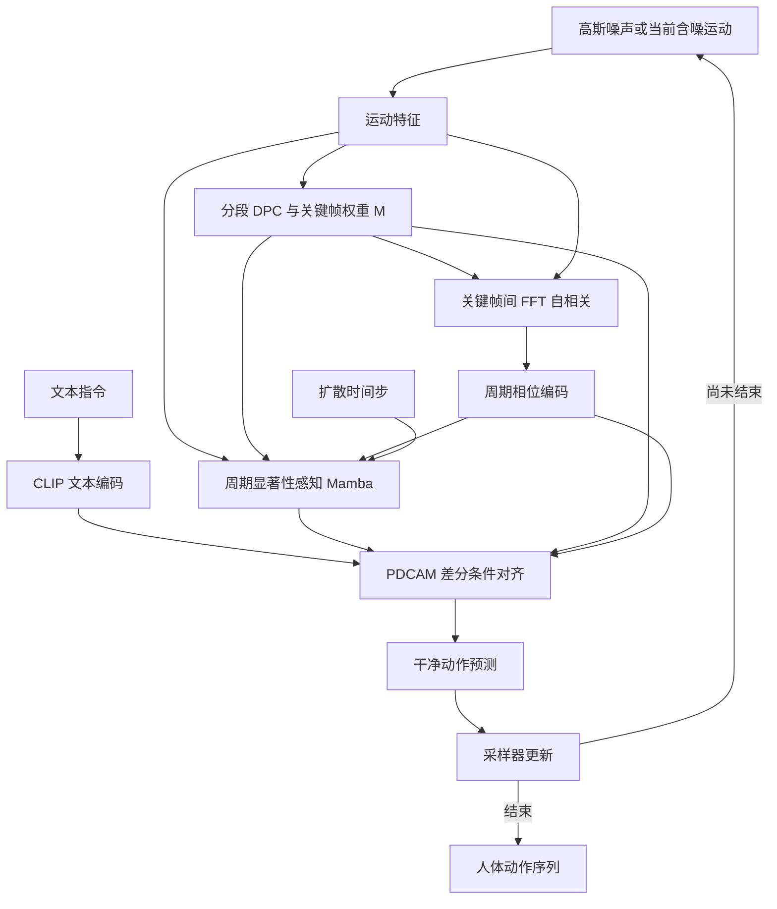
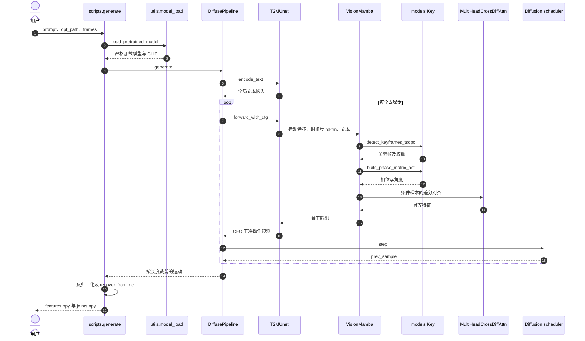

# T2M Mamba：Motion Periodicity-Saliency Coupling Approach for Stable Text-Driven Motion Generation（运动周期性与显著性耦合的稳定文本驱动动作生成）

## 一句话定义

以分段关键帧检测与局部周期估计指导 Mamba 去噪和文本条件对齐，生成更稳定的人体动作序列。

## 英文缩写速查

| 缩写 | 英文全称 | 简要说明 |
|---|---|---|
| T2M | Text-to-Motion | 文本条件人体动作生成 |
| SSM | State Space Model | 时序状态更新骨干 |
| DPC | Density Peaks Clustering | 密度峰值关键帧检测 |
| FFT | Fast Fourier Transform | 加速周期自相关计算 |
| ACF | Autocorrelation Function | 估计动作重复周期 |
| PDCAM | Periodic Differential Cross-modal Alignment Module | 相位与关键帧引导的差分对齐 |
| CLIP | Contrastive Language–Image Pre-training | 冻结文本编码器 |
| CFG | Classifier-Free Guidance | 有条件与无条件预测组合 |
| FID | Fréchet Inception Distance | 生成与真实动作特征分布距离 |

## 为什么重要

长动作中的节奏漂移与关键姿态遗忘会破坏连续性；同义文本改写还可能改变生成结果。相比只做通用时序建模，该工作把关键帧和局部相位同时注入扩散去噪器的状态更新与条件对齐。

## 核心信息

| 项 | 内容 |
|---|---|
| 机构 | 深圳大学（Shenzhen University）、暨南大学（Jinan University） |
| 作者 | Xingzu Zhan、Chen Xie、Honghang Chen、Yixun Lin、Xiaochun Mai |
| 论文 | [arXiv v2](https://arxiv.org/html/2602.01352v2)，ICRA 2026，[DOI](https://doi.org/10.1109/ICRA57385.2026.11696326) |
| 数据 | HumanML3D、KIT-ML |
| 开源 | [官方源码](https://github.com/chorl0229/T2Mmamba) 与 [EMA 权重](https://github.com/chorl0229/T2Mmamba/releases/tag/weights-v1) |

## 核心原理

- **显著性（式 1–3）：** 等长分段，以样本局部密度与到更高密度点的距离乘积选取关键帧；论文用拐点确定数量，形成权重矩阵 M。
- **周期（式 4–7）：** 相邻关键帧间做 FFT 自相关，通过峰值、突出度、谱熵共同判定周期；非周期段以段长作相位尺度，输出正余弦编码及角度。
- **Mamba（式 8）：** 相位投影加到运动特征；M 调制离散状态更新的输入投影 B，使显著信息进入隐状态。
- **PDCAM（式 9–13）：** M 调制运动查询，周期相位旋转两组查询，文本键值保持文本条件；两路线性注意力输出相减，以可学习系数控制抑制强度。
- **扩散：** 输入为含噪运动、扩散步和 CLIP 文本条件，预测干净动作，采样迭代恢复动作。

### 流程总览

## 源码运行时序图

依据官方推理入口及实际模块，展示默认启用 CFG 的路径。

## 工程实践

| 项 | 具体配置 |
|---|---|
| 输入输出 | prompt + 1–196 帧；HumanML3D 263 维 / 22 关节 / 20 FPS，KIT-ML 251 维 / 21 关节 / 12.5 FPS |
| 骨干 | 512 维运动特征、6 个 Mamba block；发布代码使用冻结 CLIP ViT-B/32 全局向量 |
| 论文训练 | 单 RTX 4090，1000 扩散步，140k iterations，AdamW，batch 128；论文推理 UniPC 10 步 |
| 运行 | 下载权重与配置，校验后执行 `python -m scripts.generate --opt_path checkpoints/t2m/t2m_condunet1d/opt.txt --text_prompt "A person walks forward and waves." --frames 196 --output_dir outputs/walk` |
| 复现区别 | CLI 默认 dpmsolver 10 步；HumanML3D 重训命令 300k 步、batch 64；KIT-ML 140k 步、batch 128，按官方配置分别复现 |
| 机器人接口 | 可作为人体运动参考来源，之后需独立重定向、接触修复和跟踪验证；这不是论文已验证的真机方案 |

## 实验与评测

论文表 I、IV（主评测重复 20 次）；非本次实测。

| 配置 | FID ↓ | R-Precision Top3 ↑ |
|---|---:|---:|
| HumanML3D 完整模型 | 0.068 | 0.793 |
| HumanML3D 去相位（表 IV） | 0.098 | 0.782 |
| HumanML3D 去关键帧权重（表 IV） | 0.134 | 0.785 |
| HumanML3D 两者均去除（表 IV） | 0.139 | 0.775 |
| KIT-ML 完整模型 | 0.195 | 0.784 |

HumanML3D 完整模型 MM Dist 3.034；常规 cross-attention 替换 PDCAM 后 R-Top3 0.755、FID 0.131（表 II）。深度消融 6 层最优，继续加深并未改善。改写鲁棒性展示的是定性结果。

## 结论

**在文本动作扩散中显式利用局部周期与关键帧，可改善该论文基准中的动作质量和语义对齐，但不等于获得闭环控制能力。**

1. 关键帧先分出动作段，再估周期，比对整段套单一节拍更有针对性。
2. 两种信号同时注入状态更新和差分对齐；联合去除的 FID 变差说明应保留耦合。
3. 六层结果优于更深的对照，优先核查结构与消融而非盲目扩大骨干。
4. 复现应记录权重、采样器、数据集与公开实现差异，不能直接宣称复现论文指标。
5. 人形落地需另测物理接触、关节限位、重定向和跟踪误差。

## 与其他工作对比

| 工作 | 区别 |
|---|---|
| [MoLingo](./paper-molingo.md) | 连续 latent 自回归 flow 与语义对齐编码；本方法显式建模动作周期与显著性 |
| [Diffusion-based Motion Generation](../methods/diffusion-motion-generation.md) | 通用动作生成谱系；本工作属于文本条件扩散的时序骨干改进 |

## 局限与风险

- 论文评测针对人体运动数据；实时应用列为未来工作，未报告真机执行成功率。
- 官方源码审计指出论文用拐点与归一化权重，发布代码默认均值加标准差阈值、选中帧权重 1+归一化分数；周期信号使用 sig_conv，文本为全局向量，不是逐词注意力。
- 固定分段的两两距离计算并不严格线性；相位和关键帧估计处于 no_grad，不能据此假设所有参数端到端可训练。
- 权重已严格加载并有校验记录；发布方明确未重新验证 CUDA 生成与基准分数。本次亦未运行。

## 关联页面

- [动作扩散生成](../methods/diffusion-motion-generation.md)
- [HumanML3D](./dataset-bfm-humanml3d.md)
- [KIT-ML](./dataset-bfm-kit-ml.md)
- [MoLingo](./paper-molingo.md)
- [动作生成纵深路线](../../roadmap/depth-motion-generation.md)

## 参考来源

- [论文全文归档](../../sources/papers/t2m_mamba_arxiv_2602_01352.md)
- [官方源码归档](../../sources/repos/t2m-mamba.md)

## 推荐继续阅读

- [arXiv v2 全文](https://arxiv.org/html/2602.01352v2)
- [官方架构说明](https://github.com/chorl0229/T2Mmamba/blob/main/docs/ARCHITECTURE.md)
- [官方源码审计](https://github.com/chorl0229/T2Mmamba/blob/main/docs/SOURCE_AUDIT.md)
