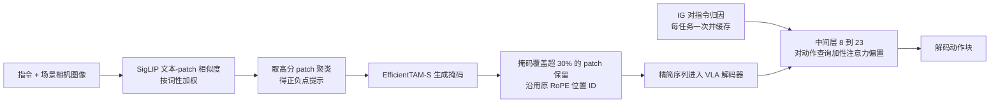

# T3R：免训练两阶段 Token 优化（arXiv:2611.08413）

**T3R**（*T3R: Training-Free Two-Stage Token Refinement Towards Efficient and Robust VLA Models*，[arXiv:2611.08413](https://arxiv.org/abs/2611.08413)）由 UT Austin、Georgia Tech、UIUC、HKUST、UNC Chapel Hill 的作者完成，发表于 ASPDAC '27（见论文首页）。原文归档与通读记录见 [`sources/papers/t3r_arxiv_2611_08413.md`](../../sources/papers/t3r_arxiv_2611_08413.md)。

## 一句话定义

**不改 VLA 权重、不重训：先在送入解码器前用分割掩码剪掉与指令无关的视觉 patch（保留原 RoPE 位置），再用 Integrated Gradients 给中间层动作 token 的注意力加性偏置，补回剪枝损失。**

## 英文缩写速查

| 缩写 | 英文全称 | 简要说明 |
|------|----------|----------|
| VLA | Vision-Language-Action | 视觉-语言-动作策略 |
| T3R | Training-Free Two-Stage Token Refinement | 本文方法名 |
| IG | Integrated Gradients | 沿基线到输入的路径积分梯度，用于归因 |
| RoPE | Rotary Position Embedding | 旋转位置编码，本文剪枝后保留原位置 ID |
| SigLIP | Sigmoid Loss for Language-Image Pre-training | 本文用其文本-patch 相似度做粗定位，也是 OpenVLA-OFT 的视觉编码器 |
| EfficientTAM | Efficient Track Anything Model | 轻量可提示分割模型，本文用 EfficientTAM-S 生成对象掩码 |
| DBSCAN | Density-Based Spatial Clustering of Applications with Noise | 对高分 patch 的二维网格坐标聚类 |
| POS | Part-of-Speech | 词性，用于给指令中名词、形容词加权 |
| OOD | Out-of-Distribution | 分布外，本文指物体摆放位置扰动 |
| SR | Success Rate | 任务成功率 |
| pp | percentage points | 百分点 |

## 为什么重要

- 多相机 VLA 每步要把大量视觉 token 送进大语言模型骨干，推理成本高，作者还认为背景内容在分布偏移下会干扰动作预测（摘要、§1，作者自述）。
- 同类剪枝方法常在解码器内部某层之后才剪（如 FastV），或固定缩减比例较低；T3R 的立场是在解码器入口就剪，使每一层都吃到更短序列（§2、§3）。
- 对机器人落地的含义：免训练，可直接套在已有预训练策略上（结论）；但目前只有仿真证据（见局限）。

## 核心原理

### 流程总览

### 阶段一：分割引导的位置保留剪枝（§3.1）

1. 对 224x224 图像，SigLIP 切成 256 个 patch，按式 1 计算词性加权的文本-patch 余弦相似度，强调名词与形容词，弱化动词与介词。
2. 因相似度几乎均匀时 top-K 提示不稳，采用「过采样-聚类-精修」：取 50 个最高分 patch，DBSCAN（eps=2.0，patch 单位）取最大簇，再取其 8 个最高分作正提示，另取 3 个最低分作负提示，交给 EfficientTAM-S 出掩码。
3. 掩码覆盖某 patch 超过 30% 像素则保留（tau=0.3）。掩码每 5 次 VLA 调用异步更新，动作推理复用最近一次已完成的掩码；在分割有歧义的套件上可选用「相似度并集」规则（保留相似度高于第 75 百分位的 patch）。
4. **位置保留：** 剪枝后各保留 patch 仍用原位置 ID（如 [0, {i+1}, 257–512, 513, ...]）。作者称若重新连续编号，成功率在其测试中塌到接近零。
5. 预算自适应：稀疏场景保留 9–15 个 patch，杂乱场景最多 121 个（§4.1）。

### 阶段二：显著性引导的注意力偏置（§3.2）

- 每个任务开头，在嵌入层对指令 token 做 IG（5 步，pad token 基线），取归一化归因最高的 30% 记为显著，缓存后复用于该任务全部回合。
- 按式 2 在注意力 logit 上加 beta * w_j，作用对象仅为动作 token 查询，作用层仅为中间层 8–23，beta=2.0；偏置位置是显著文本 token（按 IG 权重）与保留视觉 patch（SigLIP 相似度乘 0.5）。作者称之为「两级漏斗」。

### 实验设置要点（§4）

主实验为 OpenVLA-OFT（SigLIP ViT-SO400M + LLaMA-2-7B，LoRA rank 32，动作块长 8，双相机共 512 视觉 token/次调用）在 LIBERO 上，单张 NVIDIA L40S；除非另注，每任务 10 回合（名义种子 7，OOD 种子 42）。泛化实验为 CogACT + SIMPLER（单相机）与 pi0.5 + RoboTwin（三相机）。对比基线：未剪枝、TeamVLA、ADP、FastV。

## 关键结果（均出自论文，仿真）

| 项 | 结果 | 出处 |
|----|------|------|
| LIBERO-Spatial 成功率 | 基线 97%；T3R 96%（85% 场景相机 token 缩减）；TeamVLA 94%（约 15% 缩减） | §4.1 表 1 |
| 同为 85% 缩减 | ADP 66%，FastV 14% | §4.1 表 1 |
| 每次 VLA 调用时延 | 107.5 到 92.5 ms（14%，1.16x） | §4.3 |
| LLM 前向加速 | 分辨率升高时最高 3.3x（768 px） | §4.3 |
| 端到端时延（投影，非实测） | T3R 100/115/132 ms 对基线 144/182/327 ms，768 px 处 2.47x | §4.3 |
| OOD 摆放扰动 | 4 cm 处领先基线最多 7 pp，>=4 cm 平均 +4.8 pp | §4.4 图 4 |
| 消融 | 仅剪枝 90%、仅偏置 98%、完整 96%；中间层偏置 98%，早期 95%、后期 92%、全层 93% | §4.6 |
| 注意力稀疏观察 | 93.9% 视觉 token 各自得到不足 0.2% 的动作查询注意力 | §4.2 图 3 |
| pi0.5 + RoboTwin（三相机，零样本） | 50% 保留率与基线同为 33.3%；62.5% 保留率 38.3%，高出基线 5.0 pp | §4.5 表 2 |
| CogACT + SIMPLER（单相机，零样本） | Google Robot 67.7 对基线 73.2；Bridge 10.4 对 10.4 | §4.5 表 2 |

## 工程实践

- **部署形态：** 不动 VLA 权重，需要额外挂载 SigLIP 文本编码（指令级缓存）、EfficientTAM-S 分割（单次约 54 ms，每 5 次 VLA 调用异步更新一次）和每任务一次的 IG（§3.1、§4.3）。论文给出 IG 一次 1 s 摊到十个 220 步回合约 0.45 ms/环境步的估算。
- **关键细节不可省：** 位置 ID 必须保留；偏置只加在中间层 8–23 的动作查询上（§3.1、§4.6）。
- **超参：** 一组超参用于 LIBERO 全部四个套件，无逐任务调参；扫描偏置强度、层位、显著 top-k 与剪枝阈值使成功率变化 1–6 pp（§4.6）。
- **硬件：** 仅在 L40S 上做了性能剖析，另在致谢中提到 DGX Spark 与 Jetson AGX Thor 的资助，但正文没有边缘设备测试（§4.8）。
- **代码：** 论文未给出代码链接；复现需自行实现（推测，未核查是否另有发布）。

## 结论

**T3R 在 LIBERO-Spatial 上以 85% 场景相机 token 缩减换来与基线相差 1 pp 的成功率，明显优于同缩减率的 ADP 与 FastV；但证据只来自仿真、单套件每任务 10 回合，实测时延收益仅 1.16x。**

1. **真正要看的是同缩减率下的成功率**：85% 缩减时 T3R 96% 对 ADP 66%、FastV 14%（表 1）；不同方法原生工作点的缩减率不同，不能只比成功率。
2. **时延收益要分实测与投影**：每次调用实测 107.5→92.5 ms（1.16x）；768 px 的 2.47x 是投影值（§4.3），部署前需在目标硬件实测。
3. **次要成本**：额外挂载 SigLIP、EfficientTAM-S（单次约 54 ms，异步每 5 次调用更新）与每任务一次 IG（§3.1、§4.3）。
4. **两个细节决定成败**：剪枝后必须保留原 RoPE 位置 ID，偏置只加在中间层 8–23 的动作查询上（§3.1、§4.6）。
5. **适用面有限**：多相机设置收益较明显，单相机零样本（CogACT + SIMPLER Google Robot）反而落后 5.5 pp；LIBERO-Object、Long 等多阶段或分割有歧义的任务存在已知失败模式（§4.5、§4.8）。

## 与其他工作对比

| 对照 | 论文口径下的差异 |
|------|------------------|
| FastV | 在早期解码器层之后剪；同为 85% 缩减时 LIBERO-Spatial 成功率 14%（表 1） |
| ADP | 动作感知动态剪枝；85% 缩减时 66%，原生工作点约 33.5% 缩减时 97%（表 1） |
| TeamVLA（Token Expand-Merge） | 相似度加扩展与合并，约 15% 缩减、94%；LIBERO-Object 上 86% 优于 T3R 的 82%（§4.1） |
| VLA-Cache | 跨帧复用 KV 缓存，作者称与 T3R 互补（空间对时间冗余，§2，未做联合实验） |
| 本库 [FastVLA](paper-fastvla-task-adaptive-token-compression.md) | 同为免训练 token 压缩思路，对照以各自论文设置为准，两文未在同一实验下比较 |

## 局限

**论文自己承认（§4.8）：**

- LIBERO-Object 上 82% 低于 TeamVLA 的 86%：目标物体与醒目的目的地（如篮子）使相似度被分散，分割错区域或掩码过窄。
- LIBERO-Long 等多阶段任务：相似度由整条指令算出，不随阶段更新，可能遮掉之后才关键的区域。
- Stage 1 继承可提示分割的失败模式；IG 是一次性开销，短任务可能摊不平；单相机零样本几乎无收益；全部仿真，实机、真实传感器与执行延迟、能耗、边缘设备均未验证；遮挡与光照的影响及替代分割器未比较。

**本页作者看到的未验证之处（判断，非论文结论）：**

- 85% 缩减指**场景相机** token，不是全部视觉 token：按 §3.1 的序列布局，另一路相机（位置 257–512）看起来被完整保留（推测，论文未逐字说明哪一路是腕部相机）。
- 主结论是 LIBERO-Spatial 一个套件、每任务 10 回合，基线 97 与 T3R 96 相差 1 pp，在 100 回合量级上是否显著论文未给置信区间。
- 时延的 7.8 ms 余量来自两组不同口径数值相减，作者自己说明未分离部件；768 px 的 2.47x 为投影而非实测（§4.3）。
- 跨骨干实验为零样本且绝对成功率低（§4.5），单相机上 T3R 落后基线 5.5 pp，「多相机更有利」是跨系统趋势推断（作者用语为 suggests）。
- 仿真结果的数据与随机种子数少，未见多种子方差报告。

## 关联页面

- [VLA 方法页](../methods/vla.md)
- [操作任务](../tasks/manipulation.md)
- [FastVLA：任务自适应 token 压缩](paper-fastvla-task-adaptive-token-compression.md)
- [SAFE-Pruner](paper-safe-pruner.md)
- [OpenVLA](paper-openvla.md)
- [CogACT](paper-cogact.md)
- [pi0.5](paper-pi05-open-world-vla.md)
- [LIBERO 基准](libero-benchmark.md)
- [RoboTwin](robotwin.md)
- [SimplerEnv](paper-simplerenv-real2sim-eval.md)
- [具身基础模型的时延与泛化权衡](../concepts/embodied-fm-latency-generalization-tradeoff.md)

## 参考来源

- [sources/papers/t3r_arxiv_2611_08413.md](../../sources/papers/t3r_arxiv_2611_08413.md)
- [arXiv:2611.08413](https://arxiv.org/abs/2611.08413)
- 周报条目（二手，仅作线索，已与论文逐条核对）：具身运控lab 周报 04 号

## 继续阅读

- [arXiv PDF（v1）](https://arxiv.org/pdf/2611.08413v1)
- 论文所引 FastV（arXiv:2403.06764）、ADP（arXiv:2509.22093）、VLA-Cache（arXiv:2502.02175）、Token Expand-Merge（arXiv:2512.09927）
- [VLA 方法页](../methods/vla.md)
