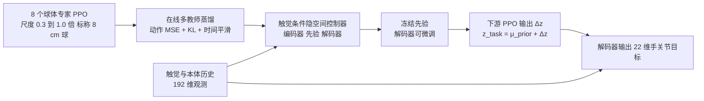

# TacBPM：触觉条件的行为先验，用于灵巧手内重定向

**TacBPM**（*TacBPM: A Tactile-conditioned Behavior Prior Model for Dexterous Reorientation*，[arXiv:2609.18174](https://arxiv.org/abs/2609.18174)，[项目页](https://tacbpm.github.io/)）由 Sharpa Robotics 的研究者完成（文章转述“作者全部来自 Sharpa”）：22 自由度灵巧手的原始动作空间太大，下游任务从零用 PPO 探索几乎学不会；TacBPM 先在仿真里为 8 个不同尺寸的球体各训一个手内重定向专家，再把它们蒸馏进一个**以触觉与本体历史为条件的隐空间控制器**，下游任务**冻结先验、只在隐空间里学残差动作**。

## 一句话定义

**TacBPM = 8 个球体专家蒸馏成“触觉条件的隐空间行为先验”；下游策略只输出隐空间残差 Δz（z_task = μ_prior + Δz），由解码器还原成 22 维手关节目标，探索被限制在稳定接触行为附近。**

## 英文缩写速查

| 缩写 | 英文全称 | 简要说明 |
|------|----------|----------|
| TacBPM | Tactile-conditioned Behavior Prior Model | 本文方法：触觉条件的行为先验模型 |
| BPM | Behavior Prior Model | 从多个专家行为里蒸馏出的可复用先验；下游在其隐空间里做残差学习 |
| PPO | Proximal Policy Optimization | 球体专家与下游残差策略所用的 RL 算法；“原始动作 PPO”是主要对照 |
| DAgger | Dataset Aggregation | 蒸馏阶段按 DAgger 风格在线由教师给当前状态标注动作 |
| KL | Kullback–Leibler divergence | 蒸馏损失里约束后验编码器与先验接近的项 |
| MSE | Mean Squared Error | 蒸馏损失里学生与教师动作的回归项 |
| DoF | Degrees of Freedom | 自由度；Sharpa Wave 手为 22，臂-手任务动作为 22 + 7 = 29 |

## 核心信息

| 项 | 内容 |
|----|------|
| **机构** | Sharpa Robotics（文章转述；arXiv v1 HTML 署名同为 Sharpa Robotics，通讯作者 Jie Yin） |
| **arXiv** | [2609.18174](https://arxiv.org/abs/2609.18174)，仅 v1，2026-09-16 |
| **平台** | Sharpa Wave 22-DoF 手；臂-手任务用 Sharpa North 臂 + 同一只手；Isaac Sim / Isaac Lab 训练 |
| **项目页** | <https://tacbpm.github.io/>（匿名投稿样式，Paper 与 Code 均标 “(Soon)”） |
| **开源** | **未开源 / 待发布**（2026-10-16 核查；arXiv 摘要页与项目页均无代码或数据入口） |

## 为什么重要

- **在 Sharpa 叙事里是“隐空间接口”的代表。** 文章把运动与交互之间的接口分为踏板（MoDE-VLA）、点云（[Dex-X](./paper-dex-x.md)）和隐空间（TacBPM）三种；隐空间属于“自下而上”路线：在仿真里训练大量原子技能，再蒸馏进统一的底层控制器，也就是文中的 System 0（交互脑，约 100 Hz，实时触觉）。
- **直击高 DoF 灵巧手的探索难题。** 原始动作 PPO 在复杂物体多任务上只有 1.00%（自报），换成冻结先验 + 隐空间残差后为 70.00%；说明难点不在奖励，而在 22 维动作空间里“从哪里开始探索”。
- **触觉被放进了先验，而不是下游。** 先验以接触幅值与 3D 接触位置为条件，使接触状态成为“选哪种行为”的依据；消融里无触觉先验在未见物体上明显更差（见评测）。
- **同一先验服务多个下游。** 文章转述论文显示该先验可较快适配新物体形状、新任务和新本体；本页能核实的下游包括各向异性物体、指定轴旋转与臂-手 Grasp-to-AnyPose。

## 流程总览

## 核心机制

### 1）球体专家（论文自报）

8 个 PPO 球体专家，尺度因子 0.3 到 1.0（步长 0.1），标称 8 cm 球（项目页：约 2.4 到 8 cm 抓取直径）；Isaac Sim / Isaac Lab 训练，教师观测含特权物体信息。用球体做专家的原因是形状各向同性，重定向只剩“尺度”这一个变量，便于覆盖从小到大的抓握构型。

### 2）在线多教师蒸馏

环境按步幅布局分配给各教师，被指派的教师为每一步动作打标；损失为动作 MSE + β·KL（后验‖先验）+ λ·编码器均值的时间平滑，蒸馏用 8192 个环境。

### 3）隐空间控制器结构

| 模块 | 设置（论文自报） |
|------|------------------|
| 编码器 q(z\|x, g) | 带任务目标 g；蒸馏时额外接收物体最长边提示 |
| 先验 p(z\|x) | 不含目标；部署与下游使用 |
| 解码器 π(h, z) | 输出确定性 22 维手关节位置目标 |
| 隐变量 | 16 维高斯；MLP 隐层 (512, 256, 128) |
| 观测（192 维） | 3 帧历史，每帧 22 个归一化关节位置 + 22 个上一步目标 + 5 个平滑接触幅值 + 5 个 3D 接触位置 |

触觉传感器型号论文未命名，仅在硬件部分提到“calibrated tactile forces and contact points”。

### 4）下游残差隐动作

下游 PPO 策略输出 Δz，先验与状态归一化冻结；主设置同时微调解码器与输出头，“冻结解码器”作为消融。与 [残差策略学习](../methods/residual-policy-learning.md) 的区别在于残差作用在**隐码**而不是动作上，与 [多专家蒸馏](../methods/multi-expert-distillation.md) 的区别在于蒸馏目标是带触觉条件的**隐空间先验**而非直接部署的单一策略。

## 工程实践

| 项 | 内容（论文自报） |
|----|------------------|
| 评测协议 | Sharpa Wave，每行 1000 次随机化尝试（另注除外）；成功为超时或掉落前达到目标朝向 0.2 rad 内 |
| 真机回路 | 本体与触觉反馈 20 Hz；关节增益按 1 Hz 正弦响应匹配；手内回路不使用物体位姿 |
| 臂-手任务 | 29 维动作（22 手 + 7 臂）；橡胶锤教师，尺度随机 0.9 到 1.1；下游 8192 环境；真机用 FoundationPose + 正运动学取关键点 |
| 源码运行时序图 | **不适用**（无官方代码仓库，见复现边界） |

## 实验与评测

以下数字除注明外均为**论文自报**（arXiv v1），文章转述的数字已与之对照一致。

### 球体尺度外推（Table I，成功率 %）

| 情形 | 从零训练 | 无触觉 | TacBPM |
|------|----------|--------|--------|
| 已见尺度均值 | 26.03 | 93.67 | 95.62 |
| 未见均值 | 11.47 | 40.05 | 60.38 |
| sphere 1.1 | 4.90 | 55.50 | 62.00 |
| sphere 1.2 | 3.30 | 1.70 | 13.30 |
| block_01 | 18.30 | 58.20 | 79.50 |
| trash_can_01 | 11.70 | 14.60 | 79.52 |
| switch_01 | 13.80 | 28.70 | 47.10 |
| box_01 | 13.50 | 29.00 | 41.80 |
| bottle_03 | 11.80 | 57.70 | 77.80 |
| strawberry | 14.50 | 75.00 | 82.00 |

已见尺度上触觉增益很小（93.67 到 95.62，区间重叠）；增益集中在未见物体与尺度外推上。

### 复杂物体手内迁移（Table II，成功率 %）

| 方法 | block_03 | block_05 | bottle_01 | fruit_02 | trash_can_02 | 多物体 Multi |
|------|----------|----------|-----------|----------|--------------|--------------|
| 从零 RL | 1.40 | 2.10 | 1.70 | 0.80 | 0.90 | 1.00 |
| 预训练 actor 的 RL | 70.40 | 54.60 | 60.70 | 73.00 | 44.10 | 40.00 |
| 动作空间残差 | 73.20 | 52.20 | 60.40 | 82.40 | 47.80 | 8.80 |
| 单尺度先验 | 73.70 | 59.50 | 65.20 | 72.20 | 67.20 | 65.80 |
| TacBPM 冻结解码器 | 72.80 | 61.40 | 67.40 | 72.70 | 72.00 | 73.30 |
| **TacBPM 主设置** | **78.60** | **68.10** | **70.10** | 75.20 | **73.80** | 70.00 |

文章转述的“PPO 1%、TacBPM 70%”即多物体列（1.00 对 70.00）。fruit_02 上动作空间残差（82.40）高于 TacBPM（75.20），冻结解码器的多物体成功率（73.30）也高于主设置（70.00）。

### 指定轴旋转与臂-手 Grasp-to-AnyPose

- **真机指定轴旋转（Table IV）：** 每物体 6 个方向各 10 次，需沿指令方向转过 180° 以上且 20 s 内；按表中分项求和，TacBPM 约 181/240（75.4%），从零训练约 69/240（28.8%），无触觉约 61/240（25.4%）；TacBPM 在未见多面体上为 51/60。分项由 arXiv HTML 抓取摘要求和得到，引用前应以 PDF 为准。项目页另报 block_03 沿 z 轴连续指令旋转 342.39 度（项目页自报）。
- **臂-手仿真（Table V，每物体 1024 次确定性评测，从零 / TacBPM）：** 小锤 77.73 / 97.56；蓝刷 27.44 / 95.70；订书钉标记笔 0.49 / 97.36；木槌 91.31 / 96.29；四物体平均约 49.24 / 96.73（均值为项目页自报）。文章转述的“不足 1% 到 97%”对应订书钉标记笔。
- **臂-手真机：** 仅给出一次抓取、抬升到位的定性演示，无数值基准。

## 与其他工作对比

| 工作 | 接口 | 低层如何处理接触 | 开源 |
|------|------|------------------|------|
| **TacBPM** | 隐空间：先验 + 残差 Δz | 触觉条件的行为先验，自下而上蒸馏 | 未开源（Code: Soon） |
| [Dex-X](./paper-dex-x.md) | 点云：视频参考 + 仿真教师 | 仿真补全触觉，点云学生 | 教程版已开源 |
| [MoDE-VLA](./paper-sa-2603-08122-mode-vla-mixture-of-dexterous-experts-vla.md) | 踏板：操作员触发 IMCopilot | RL 手内技能作低层原语（文章转述） | 见其页 |
| [TeleDexter](./paper-teledexter.md) | 指尖 + 物体位姿目标 | 单阶段 RL co-tracking 控制器 | 未开源（截至其页） |
| [ArtManip](./paper-artmanip.md) | 无（单策略） | 特权教师 + 历史潜表示学生 | 已开源 |

- 与 [WM-Craftnet](./paper-wm-craftnet.md) 同为 Sharpa 手内重定向方向：后者用世界模型给 PPO 提供上下文，TacBPM 用行为先验约束探索。
- 文章把 Stanford 团队的 [SimToolReal](./simtoolreal.md) 与 [Play2Perfect](./paper-play2perfect.md) 归为与这条自下而上路线呼应的工作，TacBPM 的特点是显式把触觉放进先验。
- 与 [Tacmap](./paper-tacmap.md) 互补：Tacmap 把仿真与真实触觉统一到同一几何表示，TacBPM 的先验依赖接触幅值与 3D 接触位置；论文是否采用 Tacmap 表示，本页未核实。

## 结论

**TacBPM 的核心贡献是把“探索”搬进触觉条件的隐空间：冻结先验 + 隐码残差让 22-DoF 手内重定向从几乎学不会变成可学，触觉的价值主要体现在外推而非已见分布。**

1. **残差放哪里很关键** — 复杂物体多任务上，从零 RL 为 1.00%，动作空间残差仅 8.80%，隐空间残差（TacBPM）为 70.00%；同样叫残差，放在隐码里才有效。
2. **触觉增益在外推** — 未见均值 40.05% 到 60.38%（约 +20 点），已见尺度只有 93.67% 到 95.62% 且区间重叠；不要把触觉先验读成“处处更强”。
3. **多尺度专家只带来温和增益** — 单尺度先验 65.80%，多尺度主设置 70.00%；覆盖更多尺度有用，但不是决定性因素。
4. **微调解码器是取舍** — 五个单物体列都高于冻结解码器（+1.8 到 +6.7 点），但多物体列冻结更高（73.30% 对 70.00%）；多任务共享时过度微调可能损失通用性。
5. **外推有边界** — sphere 1.2 只有 13.30%，若干新形状仍弱；先验不是万能起点。
6. **真机证据较窄** — 指定轴旋转约 181/240 对 69/240 与 61/240，每个物体-轴对只有 10 次；臂-手真机仅一次定性演示。
7. **目前不可复现** — 项目页 Code 为 Soon、无数据与权重，只能对照方法自行实现。

## 常见误区与局限

- **误区：“隐空间先验等于预训练 actor。”** 表 II 中预训练 actor 做 RL 微调的多物体成功率仅 40.00%，与冻结先验 + 隐码残差的 70.00% 差距明显。
- **作者自陈局限：** 从球体先验外推有限；已见尺度触觉增益小；指令切换瞬态会掉物（如角块从 −x 切到 +z）；真机失败含接触漂移、偏轴、卡楔与分布外构型；臂-手教师与先验与手内先验分开训练。
- **摘要与正文口径：** 摘要称训练更快，正文以训练曲线展示，未给数值化样本效率指标（据 arXiv HTML 抓取摘要）。
- **未核实：** 触觉传感器型号与规格论文未命名；arXiv 摘要页未列代码或项目页链接（项目页地址取自 v1 全文）；项目页作者栏为 “Anonymous Authors”，与 arXiv 署名不一致，说明页面仍是投稿期样式，后续可能更新。

## 复现边界

| 项 | 状态（2026-10-16 核查） |
|----|--------------------------|
| arXiv 摘要页 | 未列代码、数据或项目页链接；全文指向项目页 |
| 项目页 | [tacbpm.github.io](https://tacbpm.github.io/)：匿名投稿样式，Paper 与 Code 均标 “(Soon)”，页脚 “TBD”，无 GitHub 与数据集 |
| 代码 / 权重 / 数据 | **均未发布**；本库未建 `sources/repos/` 归档 |
| 自行复现所需 | Isaac Lab、Sharpa Wave 与能给出接触幅值和 3D 接触位置的指尖触觉、8 个球体专家的训练、8192 环境的蒸馏；臂-手实验另需 Sharpa North 臂与 FoundationPose |

## 关联页面

- [Sharpa Robotics（夏帕机器人）](./sharpa-robotics.md) — 公司学术线与 System 0/1/2 叙事
- [Dex-X](./paper-dex-x.md) — “点云接口”对照
- [MoDE-VLA](./paper-sa-2603-08122-mode-vla-mixture-of-dexterous-experts-vla.md) — “踏板接口”对照
- [TeleDexter](./paper-teledexter.md) / [ArtManip](./paper-artmanip.md) / [WM-Craftnet](./paper-wm-craftnet.md) / [SimToolReal](./simtoolreal.md) — 同平台的手内操作与低层控制工作
- [Play2Perfect](./paper-play2perfect.md) — 文章中与自下而上路线呼应的仿真预训练工作
- [Tacmap](./paper-tacmap.md) — 仿真与真实触觉的统一几何表示
- [In-hand Reorientation](../methods/in-hand-reorientation.md) — 手内重定向方法谱系
- [多专家蒸馏](../methods/multi-expert-distillation.md) / [残差策略学习](../methods/residual-policy-learning.md) / [DAgger](../methods/dagger.md) / [PPO](../methods/ppo.md) / [强化学习](../methods/reinforcement-learning.md) — 方法背景
- [Manipulation](../tasks/manipulation.md) — 任务背景
- [触觉感知](../concepts/tactile-sensing.md) / [Contact-Rich Manipulation](../concepts/contact-rich-manipulation.md) / [Sim2Real](../concepts/sim2real.md) / [特权训练](../concepts/privileged-training.md) — 概念背景

## 参考来源

- [tacbpm_arxiv_2609_18174.md](../../sources/papers/tacbpm_arxiv_2609_18174.md) — arXiv 摘要、项目页与 v1 全文摘录
- [wechat_sharpa_dexterous_manipulation_2026-10-16.md](../../sources/blogs/wechat_sharpa_dexterous_manipulation_2026-10-16.md) — 机器之心文章来源页
- [arXiv:2609.18174](https://arxiv.org/abs/2609.18174)

## 推荐继续阅读

- [arXiv PDF](https://arxiv.org/pdf/2609.18174) 与 [v1 HTML 全文](https://arxiv.org/html/2609.18174v1)
- [项目页](https://tacbpm.github.io/)（关注 Code 状态变化）
- [Dex-X 项目页](https://dexx-code.github.io/dexx-code/) — 同一文章里的点云接口对照
