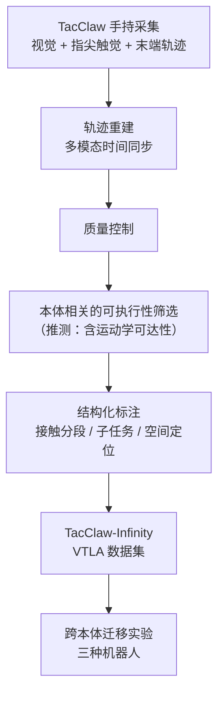
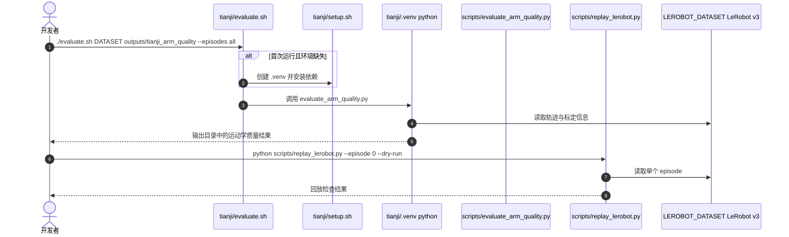

# TacClaw-Infinity：面向灵巧操作的大规模视触觉语言动作数据集

**TacClaw-Infinity 是面向接触丰富灵巧操作的视觉-触觉-语言-动作（VTLA）数据集：用无需目标机器人的手持触觉接口采集同步的视觉、指尖触觉与末端轨迹，再经质量控制、可执行性筛选与结构化标注形成数据管线。**

论文 *TacClaw-Infinity: A Large-Scale Vision-Tactile-Language-Action Dataset for Dexterous Manipulation*（[arXiv:2610.20320](https://arxiv.org/abs/2610.20320)，[仓库](https://github.com/daimon-robotics/TacClaw-Infinity)，[项目页](https://daimon-robotics.github.io/tacclaw-infinity-page/)）。

## 英文缩写速查

| 缩写 | 英文全称 | 简要说明 |
|------|----------|----------|
| VTLA | Vision-Tactile-Language-Action | 本数据集的模态组合：视觉、触觉、语言指令与动作 |
| VLA | Vision-Language-Action | 下游策略常见形式；论文称在无专属示范下做跨本体迁移 |
| IK | Inverse Kinematics | 逆运动学；仓库中运动学可达性与可操纵度评测的核心计算 |
| TCP | Tool Center Point | 工具中心点；仓库要求回放与评测前核对的标定项 |
| LeRobot v3 | LeRobot dataset format v3 | 仓库回放与评测工具读取的数据格式 |

## 为什么重要

- 接触操作的数据瓶颈不只在数量，还在视觉、触觉与动作的时间同步与质量控制。
- 手持采集不依赖目标机器人，同一批数据可以面向不同本体复用（论文报告三种机器人上的迁移实验）。
- 采集覆盖家庭、实验室、工业、零售与户外等场景，有利于研究分布多样性。

## 核心信息

| 项 | 内容 |
|----|------|
| **机构** | 发布方 Daimon Robotics；项目页列出 16 个合作单位（转述，未核 PDF） |
| **平台** | TacClaw 手持触觉接口；LeRobot v3 数据格式；仓库内 Tianji、DM-Sparky、RealMan RM75-B 的回放与运动学评测工具 |
| **数据** | 项目页称：10,000+ 小时、1 百万+ 回合、10 亿+ 帧、1,000+ 任务类型（200+ 设备、20+ 机构、50+ 地点）；公开子集为 HF / ModelScope 的 `Daimon-Infinity`，README 称首批约 1,000 小时 |
| **重定向就绪度** | 动作以手持接口的**末端轨迹**记录（采集时无目标机器人），非机器人关节轨迹；喂给具体本体前需核对 TCP / 场景标定，并按本体做逆运动学可达性与可操纵度筛选——官方仅给出 Tianji、DM-Sparky、RealMan RM75-B 三种本体的回放与运动学检查工具 |
| **开源** | **部分开源**（2026-10-15 核查）：数据子集与机器人回放 / 运动学评测工具已公开；数据加载与预处理工具、策略训练与任务级评测代码仍未发布 |

## 核心原理

### 流程总览

手持接口同步采集三类信号，之后经过轨迹重建、质量控制与本体相关的可执行性筛选，再做结构化标注，形成可检索的 VTLA 数据集。论文用跨本体迁移实验检验数据的可用性。

- 可执行性筛选的具体判据论文摘要未展开；上图中的「运动学可达性」为依据仓库评测工具的推测。

## 源码运行时序图

仓库可运行部分是机器人回放与运动学评测工具（非策略训练）。以 Tianji 目录为例，时序对齐 `evaluate.sh` 与 `scripts/` 入口。

- **复现路径（README）：** 进入 `robot_executability_checks/tianji/` → `./setup.sh` → `source .venv/bin/activate` → 设置 `LEROBOT_DATASET` → `./evaluate.sh "$LEROBOT_DATASET" ...`。
- DM-Sparky 与 RealMan 目录有各自的 `evaluate.sh` 或 `scripts/evaluate_*.py`，入口与依赖相互隔离。

## 工程实践

| 项 | 建议 |
|----|------|
| 获取数据 | 公开子集见 HF / ModelScope `Daimon-Infinity`；HF 页面（转述）标注 CC BY-NC-SA 4.0 |
| 评测工具 | 在对应机器人目录内建独立环境；工具仅做仿真与运动学分析，不评测策略成功率或真机安全（README 明示） |
| 复现前检查 | 核对坐标系、TCP 与场景注册；LeRobot v3 格式不保证标定帧一致（README 要求） |
| 训练与任务评测 | 代码未发布（To-do）；需要等待官方更新或自行搭建 |
| 调试指标 | 逆运动学可达性与可操纵度（由评测脚本输出） |

## 实验与评测

- **数据层验证：** 摘要称在数据层面做了验证；具体指标未在本页核实。
- **跨本体迁移：** 在三种机器人上检验无专属机器人示范的迁移（摘要）；具体成功率未核实（未读到 PDF 实验表）。
- **仓库工具：** 提供回放与运动学可达性评测，用于数据可执行性检查，不代表策略效果。

## 结论

**TacClaw-Infinity 的主要价值是一条触觉接触数据的规模与质量管线，而非已可直接复现的策略结果。**

1. **规模数字指向完整语料，公开的是子集** — 10,000+ 小时对比首批约 1,000 小时公开。
2. **手持采集的核心主张是跨本体复用** — 论文报告三种机器人的迁移，但具体数字本页未核实。
3. **可执行性筛选决定数据可用性** — 不可执行的示范需要按本体过滤（筛选判据论文未展开）。
4. **复现先做标定核对** — TCP 与场景注册不一致会使回放与评测失真，仓库明确要求先核对。
5. **许可限制需先看清** — HF 页面（转述）为 CC BY-NC-SA 4.0，商用前需另行确认。

## 与其他工作对比

| 对照 | 差异读法 |
|------|----------|
| [触觉感知](../concepts/tactile-sensing.md) | 概念层；本页给出一个大规模触觉数据来源 |
| [视触觉融合](../concepts/visuo-tactile-fusion.md) | 模型与表示层；本页偏数据与采集 |
| [四层数据采集分类](../concepts/embodied-data-collection-four-layers-taxonomy.md) | 可用来定位本页手持采集在数据层级中的位置 |
| [LeRobot 数据集 v3](../concepts/lerobot-dataset-v3.md) | 仓库工具读取的数据格式 |

## 局限与风险

- **公开范围有限：** 训练与任务级评测代码未发布，策略层面的结论无法独立复现。
- **工具边界：** 运动学与回放工具不代表策略成功率或真机安全（README 明示）。
- **本体差异：** 手持接口与目标机器人之间存在标定与运动学差异，错误标定会引入系统误差。
- **许可：** 公开子集为非商用许可（转述）。
- **文档不一致：** 项目页 "Coming soon" 与仓库已有工具、HF 公开子集并存，以仓库与门户为准。
- **未核实项：** 论文实验数字、质量指标与作者单位未核 PDF。

## 关联页面

- [触觉感知](../concepts/tactile-sensing.md) — 数据中的触觉模态背景
- [视触觉融合](../concepts/visuo-tactile-fusion.md) — 视觉与触觉表示的对照
- [接触丰富操作](../concepts/contact-rich-manipulation.md) — 任务场景
- [LeRobot 数据集 v3](../concepts/lerobot-dataset-v3.md) — 数据格式
- [VLA](../methods/vla.md) — 常见下游策略形式

## 参考来源

- [tacclaw_infinity_arxiv_2610_20320.md](../../sources/papers/tacclaw_infinity_arxiv_2610_20320.md) — 论文摘录与开源核查
- [arXiv:2610.20320](https://arxiv.org/abs/2610.20320) — 原文
- [daimon-robotics/TacClaw-Infinity](https://github.com/daimon-robotics/TacClaw-Infinity) — 官方仓库（回放与评测工具）

## 推荐继续阅读

- [TacClaw-Infinity 项目页](https://daimon-robotics.github.io/tacclaw-infinity-page/)
- [Daimon-Infinity 数据集（Hugging Face）](https://huggingface.co/datasets/daimonrobotics/Daimon-Infinity)
- [Daimon-Infinity 数据集（ModelScope）](https://modelscope.cn/datasets/daimonrobotics/Daimon-Infinity)
