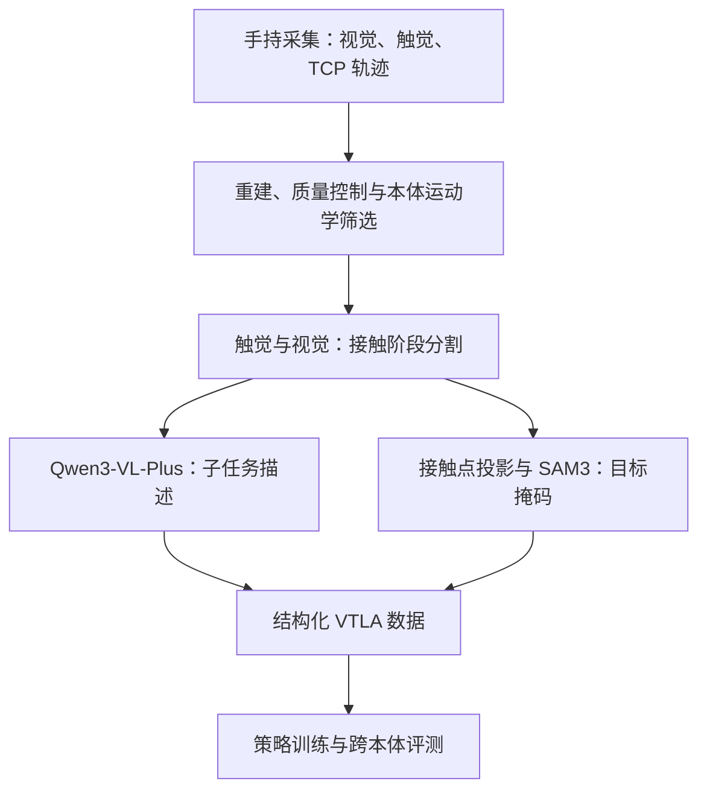
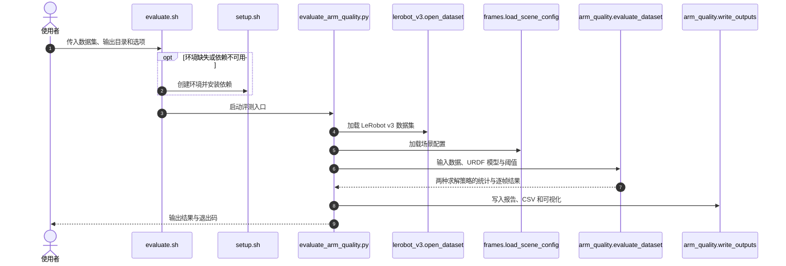

# TacClaw-Infinity：面向灵巧操作的大规模视触觉语言动作数据集

**TacClaw-Infinity 是面向接触丰富灵巧操作的视觉-触觉-语言-动作（VTLA）数据集：用无需目标机器人的手持触觉接口采集同步的视觉、指尖触觉与末端轨迹，再经质量控制、可执行性筛选与结构化标注形成数据管线。**

论文 *TacClaw-Infinity: A Large-Scale Vision-Tactile-Language-Action Dataset for Dexterous Manipulation*（[arXiv:2610.20320](https://arxiv.org/abs/2610.20320)，[仓库](https://github.com/tacclaw-infinity/TacClaw-Infinity)，[项目页](https://tacclaw-infinity.github.io/)）。

## 英文缩写速查

| 缩写 | 英文全称 | 简要说明 |
|------|----------|----------|
| VTLA | Vision-Tactile-Language-Action | 本数据集的模态组合：视觉、触觉、语言指令与动作 |
| VLA | Vision-Language-Action | 下游策略常见形式；论文称在无专属示范下做跨本体迁移 |
| IK | Inverse Kinematics | 逆运动学；仓库中运动学可达性与可操纵度评测的核心计算 |
| TCP | Tool Center Point | 工具中心点；仓库要求回放与评测前核对的标定项 |
| LeRobot v3 | LeRobot dataset format v3 | 仓库回放与评测工具读取的数据格式 |

## 为什么重要

- 接触操作的数据瓶颈不只在数量，还在视觉、触觉与动作的时间同步与质量控制。
- 手持采集不依赖目标机器人，同一批数据可以面向不同本体复用（论文报告三种机器人上的迁移实验）。
- 采集覆盖家庭、实验室、工业、零售与户外等场景，有利于研究分布多样性。

## 核心信息

| 项 | 内容 |
|----|------|
| **机构** | 发布方 Daimon Robotics；项目页列出 16 个合作单位（项目页列示） |
| **平台** | TacClaw 手持触觉接口；LeRobot v3 数据格式；仓库内 Tianji、DM-Sparky、RealMan RM75-B 的回放与运动学评测工具 |
| **数据** | 项目页称：10,000+ 小时、1 百万+ 回合、10 亿+ 帧、1,000+ 任务类型（200+ 设备、20+ 机构、50+ 地点）；公开子集为 HF / ModelScope 的 `Daimon-Infinity`，README 称首批约 1,000 小时 |
| **重定向就绪度** | 动作以手持接口的**末端轨迹**记录（采集时无目标机器人），非机器人关节轨迹；喂给具体本体前需核对 TCP / 场景标定，并按本体做逆运动学可达性与可操纵度筛选——官方仅给出 Tianji、DM-Sparky、RealMan RM75-B 三种本体的回放与运动学检查工具 |
| **开源** | **部分开源**（2026-11-05 核查）：数据子集与机器人回放 / 运动学评测工具已公开；数据加载与预处理工具、策略训练与任务级评测代码仍未发布 |

## 核心原理

### 流程总览

论文 v2 第 III 节：左右手持设备与头戴视角同步；触觉事件同时作为时序和空间标注的锚点。筛选在目标本体动作空间中进行。

- **采集与配准：** 指尖直接驱动夹爪，腕部 RGB、触觉和末端轨迹以 30 Hz 同步；双手与头戴相机通过可见标记配准。
- **可执行性：** TCP 转换至机器人基座系，IK/FK 重建的位置误差小于 5 mm、姿态误差小于 3° 判为可达；双臂须同时满足。加权雅可比的最小与最大奇异值之比低于 0.04 为低可操纵度。
- **时空标注：** 每臂两指尖深度图压缩为 8 维描述，与视觉及本体状态输入 ASFormer，区分自由运动、初始接触、接触操作、释放；边界分数过滤短段。Qwen3-VL-Plus 生成子任务文本；接触时指间 3D 点投影到各视角，结合夹爪负掩码提示 SAM3 分割目标。

## 源码运行时序图

已核对 Tianji 的 `evaluate.sh`、`scripts/evaluate_arm_quality.py` 与 `src/tianji_lerobot_replay/arm_quality.py`；这是数据运动学检查，而非策略训练或任务成功率评估。

默认单进程路径比较独立逐帧和连续求解策略；`--jobs` 大于 1 时按 episode 分区并合并结果。入口默认读取 `observation.state`，坐标系和 TCP 必须按实测配置。

## 工程实践

| 项 | 建议 |
|----|------|
| 获取数据 | 公开子集见 HF / ModelScope `Daimon-Infinity`；HF 页面（转述）标注 CC BY-NC-SA 4.0 |
| 评测工具 | 在对应机器人目录内建独立环境；工具仅做仿真与运动学分析，不评测策略成功率或真机安全（README 明示） |
| 复现前检查 | 核对坐标系、TCP 与场景注册；LeRobot v3 格式不保证标定帧一致（README 要求） |
| 训练与任务评测 | 代码未发布（To-do）；需要等待官方更新或自行搭建 |
| 调试指标 | 逆运动学可达性与可操纵度（由评测脚本输出） |

## 实验与评测

以下均来自 [论文 v2](https://arxiv.org/html/2610.20320v2) 第 V 节；运动学可达率与真实任务成功率是不同指标。

- **接触感知：** 9 名参与者盲测，TacClaw 首次感知接触的平均阈值为 11.6 ± 3.3 gf；UMI 为 49.8 ± 12.0 gf，指环滑轨为 204.0 ± 58.2 gf。
- **双臂可达率：** Tianji 97.23%，RealMan 95.15%，DM-Sparky 全身控制 100%；均按论文所述位姿误差准则计算，并非任务成功率。
- **接触分段：** 在 15 条双臂测试演示形成的 30 条单臂序列上，加入触觉使 ASFormer 的 F1@25 从 57.6 提升至 63.9；接触起始召回从 58.6% 升至 68.0%。
- **标注质量：** 指定协议数据的标注窗口 98.5% 帧有掩码，论文明确指出覆盖率不等于掩码准确率；随机抽查 5% 的语言描述，约 83% 通过动作与物体核查。
- **跨本体迁移：** 每任务 1,600 条训练示范、每任务 50 次评测，选第 3–5 epoch 的最佳 checkpoint；在叠杯、瓶子分类、擦花瓶及三种本体上，加入触觉后 π₀.₅ 总平均成功率由 50.0% 升至 74.0%，StarVLA 由 46.0% 升至 72.7%。该结果限定于论文设置，不代表所有任务均有提升。

## 结论

**TacClaw-Infinity 将手持视触觉采集、接触标注和跨本体运动学筛选结合，论文实验支持触觉对所测接触任务的作用。**

1. 完整采集规模与实际可下载子集要分开核对。
2. 末端轨迹迁移前应检查场景配准、TCP 和目标本体的可达性。
3. 触觉消融收益集中在分类与持续接触任务；不应外推为所有任务均改善。
4. 掩码覆盖不等于标注精度；语言抽检也不能保证全部样本正确。
5. 训练及任务评测代码尚未发布，公开工具不验证真机安全。

## 与其他工作对比

| 对照 | 差异读法 |
|------|----------|
| [触觉感知](../concepts/tactile-sensing.md) | 概念层；本页给出一个大规模触觉数据来源 |
| [视触觉融合](../concepts/visuo-tactile-fusion.md) | 模型与表示层；本页偏数据与采集 |
| [四层数据采集分类](../concepts/embodied-data-collection-four-layers-taxonomy.md) | 可用来定位本页手持采集在数据层级中的位置 |
| [LeRobot 数据集 v3](../concepts/lerobot-dataset-v3.md) | 仓库工具读取的数据格式 |

## 局限与风险

- **公开范围有限：** 训练与任务级评测代码未发布，策略层面的结论无法独立复现。
- **工具边界：** 运动学与回放工具不代表策略成功率或真机安全（README 明示）。
- **本体差异：** 手持接口与目标机器人之间存在标定与运动学差异，错误标定会引入系统误差。
- **许可：** 公开子集为非商用许可（转述）。
- **版本与开放范围：** 论文为 arXiv v2；公开规模随数据门户更新，以实际可下载文件为准。
- **标注局限：** 掩码精度及其对下游策略的影响尚待评测；语言检查是抽样，未抽中的样本仍可能存在错误。

## 关联页面

- [触觉感知](../concepts/tactile-sensing.md) — 数据中的触觉模态背景
- [视触觉融合](../concepts/visuo-tactile-fusion.md) — 视觉与触觉表示的对照
- [接触丰富操作](../concepts/contact-rich-manipulation.md) — 任务场景
- [LeRobot 数据集 v3](../concepts/lerobot-dataset-v3.md) — 数据格式
- [VLA](../methods/vla.md) — 常见下游策略形式

## 参考来源

- [tacclaw_infinity_arxiv_2610_20320.md](../../sources/papers/tacclaw_infinity_arxiv_2610_20320.md) — 论文摘录与开源核查
- [项目页归档](../../sources/sites/tacclaw_infinity.md)；[源码归档](../../sources/repos/tacclaw_infinity.md)
- [arXiv:2610.20320](https://arxiv.org/abs/2610.20320) — 原文
- [daimon-robotics/TacClaw-Infinity](https://github.com/tacclaw-infinity/TacClaw-Infinity) — 官方仓库（回放与评测工具）

## 推荐继续阅读

- [TacClaw-Infinity 项目页](https://tacclaw-infinity.github.io/)
- [Daimon-Infinity 数据集（Hugging Face）](https://huggingface.co/datasets/daimonrobotics/Daimon-Infinity)
- [Daimon-Infinity 数据集（ModelScope）](https://modelscope.cn/datasets/daimonrobotics/Daimon-Infinity)
