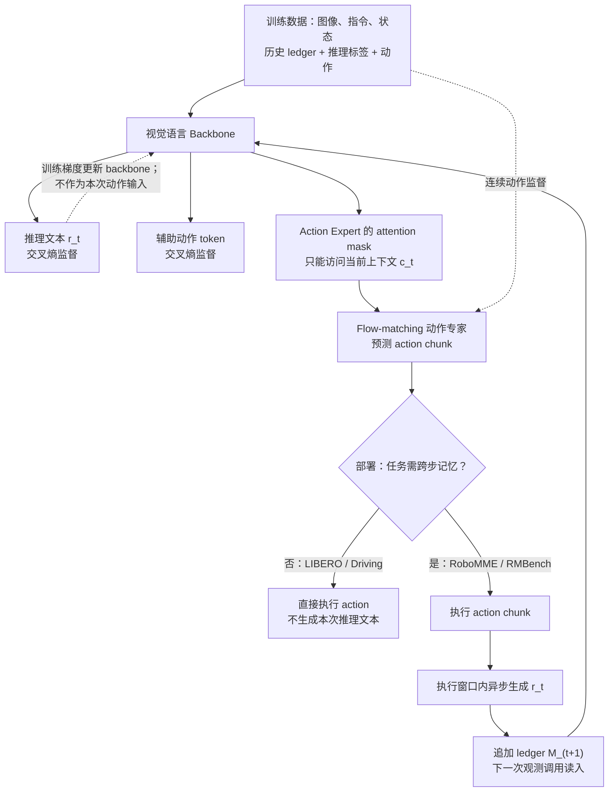

# TacitVLA：不等推理文本也能行动 / Reasoning VLA Without Reasoning Latency

**TacitVLA**（*TacitVLA: Reasoning Vision-Language-Action Models Without Reasoning Latency*，[arXiv:2610.17540v1](https://arxiv.org/html/2610.17540v1)，[项目页](https://tacitvla.github.io/)）由英伟达（NVIDIA）牵头，联合纽约大学、加州大学伯克利分校、约翰斯·霍普金斯大学与斯坦福大学作者提出（Jack Lu 等，2026-10-13）。

## 一句话定义

**训练时仍让视觉语言主干学习生成推理文本，动作专家却看不到本次推理 token：动作无需等待自回归推理；需要跨步记忆时，文本在动作执行期间异步写入下次调用使用的 ledger。**

## 英文缩写速查

| 缩写 | 英文全称 | 简要说明 |
|---|---|---|
| TacitVLA | Tacit Vision-Language-Action | 本文以推理监督塑造主干、但不把当前文本送入动作专家的策略 |
| VLA | Vision-Language-Action | 视觉、语言条件下生成机器人/车辆动作的策略 |
| CoT | Chain-of-Thought | 显式自回归推理文本；TacitVLA 将其与当次动作路径解耦 |
| FM | Flow Matching | 动作专家去噪生成连续动作块的训练目标 |
| LIBERO | Lifelong Robot Learning | 机器人操作基准；Plus 版含分布扰动 |
| AV | Autonomous Vehicle | 本文 PhysicalAI-AV 闭环驾驶评测类别 |

## 为什么重要

- **把训练价值与在线代价拆开：** 推理监督改进 backbone 表征，但“先把整段推理写完再行动”不是这四组受控实验中获取收益的必要条件。
- **明确两类部署：** 无状态记忆的任务直接省掉文本生成；需要计数与历史子任务的任务不丢记忆，而是将 ledger 更新移动到执行窗口。
- **可对齐对照实验：** 同架构、同训练数据/序列/prompt/optimizer，对比 No Reasoning、Explicit Reasoning、TacitVLA，排除直接改模型规模带来的混淆。

## 核心信息

| 项目 | 论文核实值 |
|---|---|
| 论文版本 | arXiv:2610.17540v1，2026-10-13；全文 §1–7、附录 A–D |
| 机构 | 英伟达（NVIDIA）；纽约大学（NYU）；加州大学伯克利分校（UC Berkeley）；约翰斯·霍普金斯大学（JHU）；斯坦福大学（Stanford） |
| 结构 | Mixture-of-Transformers：视觉语言 backbone + flow-matching action expert |
| RoboMME | PaliGemma / π0.5 风格，约 3.7B；带记忆 |
| RMBench 与 LIBERO | RynnBrain-2B 风格，约 2.6B / 2.5B；前者带记忆 |
| PhysicalAI-AV | Qwen3-VL-2B 风格主干、约 3.9B；无任务 ledger |
| 开源情况 | **代码待发布**：2026-11-11 项目页显示 Code soon；无可运行官方入口 |

## 核心原理

### 1. 用一个 attention mask 解开「推理监督 ≠ 动作前生成」

- **输入：** 上下文 c_t，含视觉、指令与本体状态；带记忆任务还含此前子任务账本 M_t。
- **训练目标：** backbone 用交叉熵预测本次推理文本 r_t 与辅助 tokenized actions；动作专家用 flow matching 去噪连续 action chunk。
- **Explicit Reasoning：** 动作专家同时读取 c_t 和刚生成的 r_t；要等完整文本自回归解码。
- **TacitVLA：** 动作专家只读取 c_t（历史 ledger 可在 c_t 内），不 attend 本次 r_t；推理监督仍通过 backbone 参数与表征影响动作输出。
- **No Reasoning：** 同架构但不使用推理监督，也不维护推理 ledger，作为低延迟对照。

因此“去掉的”是**本次动作对当前推理 token 的条件依赖**，不是丢弃训练期推理监督，也不是删除全部历史信息。

### 2. 流程总览（基于论文 Fig. 2、§3–4）

注：图中回边表示**下一次调用**读取新 ledger，不表示当前 action expert 使用刚生成的文本。原文的 tokenized actions 仅为训练辅助目标，不是部署时实际控制输出。

### 3. 时延与调度条件

- **无记忆任务：** TacitVLA 不生成 r_t，动作就绪延迟约为 T_action。
- **记忆任务：** 先完成动作预测、在执行期间生成 ledger。下一次调用的延迟可表示为 **T_action + max(0, T_reason − T_exec)**。
- 因此“无推理等待”**有适用条件**：如果生成的记忆条目耗时超过动作执行窗口，依然会在下一次调用处等待。
- RoboMME Counting 的 T_action = 127 ms，T_reason = 93 ms，T_exec = 800 ms；与 Explicit Reasoning 的 **220 ms** 相比，动作就绪为 **127 ms**。

## 源码运行时序图

**不适用（官方代码待发布）**。截至 **2026-11-11**，[官方项目页](https://tacitvla.github.io/)资源区标注 **Code soon**，尚无 TacitVLA 官方可运行训练/推理仓库或明确入口；上图仅是依据论文原文绘制的**算法数据流**，不是源码运行时序图。待发布后应核对 attention mask、共享 KV cache、ledger 更新时机及部署控制环。

## 工程实践

| 工程问题 | 论文内可落地的核对点 |
|---|---|
| 训练实现 | 保留 reasoning CE 和辅助动作 token CE；只对 action-expert → 本次 reasoning token 的 attention 做屏蔽（论文 §4.1、Fig. 2） |
| 非记忆 VLA | 部署不生成本次推理文本；若需要审计，可以在动作已计算后另行生成，但不作为动作输入 |
| 记忆 VLA | ledger 仅在 chunk 执行完成后成为后续调用的上下文；与当前生成文本区分 |
| 性能评测 | 同时记录成功率、动作就绪时延、T_reason、T_exec、ledger 正确率；不能只报一项加速比 |
| 推理算力 | 论文单 H100 80GB、bf16、CUDA graph 计时，其他显卡/运行时需单独测量 |
| 复现入口 | **尚不可直接复现**：项目尚无官方实现；不能把 WLA、π0.5、DeepThinkVLA 的公开代码说成 TacitVLA 源码 |

## 实验与评测

| Benchmark | No Reasoning | Explicit Reasoning | **TacitVLA** | 备注 |
|---|---:|---:|---:|---|
| RoboMME Counting | 79.2% | 81.5% | **82.7%** | 训练含全部 16 任务，计数子集 |
| RoboMME 全 16 任务 | 46.5% | 45.8% | **48.1%** | 同上，800 cases |
| RMBench 4-task | 60.4% | 77.0% | **77.5%** | 各任务 100 cases |
| LIBERO 标准四套件 | 98.5% | 98.1% | **98.6%** | 2,000 cases |
| LIBERO-Plus | 67.6% | **73.5%** | 72.9% | 10,030 扰动 cases |
| PhysicalAI-AV minADE ↓ | 1.166 m | 1.140 m | **1.116 m** | 开环，1,434 segments |
| PhysicalAI-AV scene score | 46.4% | 52.3% | **52.5%** | 闭环，441 scenes |

**额外消融：** 单独在 RoboMME Counting 4 任务训练时 TacitVLA **89.5%**（联合 16 任务训练时是 **82.7%**，勿混用）。RMBench Press Button 中带 ledger 的 TacitVLA **74.3%**、无推理 **7.7%**；ledger 最终正确率 **99.7%**（论文 Appendix B）。

**延迟（H100 单卡，均值）：** RoboMME Counting **127 vs 220 ms**；LIBERO **147 vs 495 ms**；PhysicalAI-AV **127 vs 269 ms**（TacitVLA vs Explicit）。上限 **3.4×** 表示动作就绪延迟对比，不是实际整项任务时间缩短三倍。RMBench 77.5% − 60.4% = **+17.1 个百分点**。

## 与其他工作对比

| 对照路线 | 不同点 |
|---|---|
| [ECoT](./paper-ecot.md) | 显式自回归具身 CoT，再输出动作；TacitVLA 训练仍学推理、执行时不依赖当次推理文本 |
| [Fast ECoT](./paper-fast-ecot.md) | 通过缓存、复用、并行和异步调度加速**已存在**的推理链；TacitVLA 在训练期改变 attention mask，使本次动作无需读取文本 |
| [Hi Robot](./paper-hi-robot.md) | 高层 VLM 单独生成语言子任务、低层 π0 执行，可响应用户插话；TacitVLA 是一套共享主干 + 动作专家，并区分有/无 episodic ledger |
| No Reasoning 对照 | 同架构但不训练推理目标；TacitVLA 无记忆任务可与其有相同部署时延，但效果更好 |

## 结论

**本论文的关键不是把推理变快，而是验证：推理的主要收益可以在训练期沉淀到 backbone 表征，未必需要阻塞每次动作的文本生成。**

1. **不要把“训练时推理监督”与“每次行动前输出推理文本”绑死。** TacitVLA 和 Explicit 保持相同监督，仅屏蔽动作专家对当前 r_t 的 attention。
2. **非记忆任务可直接省掉在线文本生成。** LIBERO-Plus 由无推理 67.6% 提升至 72.9%，单次动作就绪 147 ms。
3. **计数和长程任务保留历史 ledger。** RMBench 四任务由 60.4% 提升至 77.5%，说明不能简单将所有文本状态删掉。
4. **异步有边界。** 只有 T_reason 不超出动作执行窗口，才真正不延误下一次策略调用。
5. **部署指标按任务区分。** PhysicalAI-AV 的 127 ms 动作路径大于其 100 ms 重规划步长；不能把论文平均延迟直接当作已满足车端实时安全要求。
6. **复现仍有缺口。** 官方项目页代码待发布，驾驶训练还有非公开 380 万条事件数据。

## 局限与风险

- **研究结论的范围：** 四类规定基准上的三组受控实验，不等价于所有 VLA、真机控制环或开放世界安全性证明。
- **对推理标签质量敏感：** 监督的收益不能与低质量 reasoning 语料划等号。
- **异步 ledger 可能超窗：** 动作 chunk 更短、文本更长或 GPU 更慢时，下一调用仍可能等待生成。
- **驾驶复现受限：** 训练于非公开事件语料；闭环评分不能代替真车安全验证。公开的 PhysicalAI-AV 是评测切分，不是完整训练来源。
- **代码尚不可用：** 不提供未核验的可运行命令或伪源码时序图。

## 关联页面

- [ECoT：具身思维链](./paper-ecot.md) — 显式先推理再行动
- [Fast ECoT](./paper-fast-ecot.md) — 以推理缓存/并行来降延迟
- [Hi Robot](./paper-hi-robot.md) — 双层语言子任务调度
- [VLA 方法](../methods/vla.md) — 动作专家与端到端策略背景
- [Action Chunking](../methods/action-chunking.md) — 控制节拍与时延窗口
- [Manipulation](../tasks/manipulation.md) — 操作任务与评价口径

## 参考来源

- [TacitVLA 论文全文核对归档](../../sources/papers/tacitvla_arxiv_2610_17540.md)
- [TacitVLA 官方项目页核对](../../sources/sites/tacitvla.md)
- [arXiv HTML v1（含附录）](https://arxiv.org/html/2610.17540v1)
- [官方项目](https://tacitvla.github.io/)

## 推荐继续阅读

- [TacitVLA 原论文 PDF](https://arxiv.org/pdf/2610.17540)
- [TacitVLA Project Page](https://tacitvla.github.io/)
- [Hi Robot：分层 VLA 的另一路组织方式](./paper-hi-robot.md)
