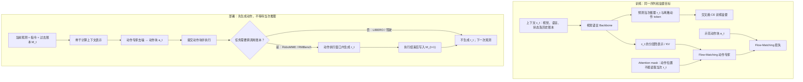

# TacitVLA：无需等待推理文本的 VLA（Reasoning Vision-Language-Action Models Without Reasoning Latency）

**论文：** [TacitVLA: Reasoning Vision-Language-Action Models Without Reasoning Latency](https://arxiv.org/abs/2610.17540)（Jack Lu 等，2026-10-13，arXiv v1）
**项目：** [tacitvla.github.io](https://tacitvla.github.io/) · **源码：** 截至 2026-11-11 项目页仍为“Code soon”，暂无官方可运行仓库入口。

## 一句话定义

**TacitVLA** 让动作专家仅依赖当前观测和历史上下文，不读取**本次调用刚生成的推理文本**；推理文本继续作为训练监督，记忆任务的文本账本则在动作执行期间生成，从而保留推理收益并缩短动作就绪时延。

## 英文缩写速查

| 缩写 | 英文全称 | 简要说明 |
|------|----------|----------|
| VLA | Vision-Language-Action | 从视觉、语言和机器人状态产生动作的模型 |
| VLM | Vision-Language Model | 接收视觉与语言上下文并学习推理的骨干 |
| MoT | Mixture-of-Transformers | 视觉语言骨干与独立动作 Transformer 共用分层注意力的架构 |
| FM | Flow Matching | 动作专家训练与迭代去噪采用的生成目标 |
| CE | Cross-Entropy | 训练时对推理文本和离散动作 token 的监督损失 |
| ADE | Average Displacement Error | 驾驶规划轨迹位移误差；越小越好 |

## 为什么重要

- **把推理作为监督而不是推理前置步骤。** 显式链式推理需要先自回归输出文本再生成动作；TacitVLA 在训练中仍学习推理，却不让动作等待文本。
- **对长程操作保留真正的跨步记忆。** RoboMME、RMBench 的子任务账本用于记录当前画面不可见的历史事件，不能简单删去；作者将文本生成移入当前动作块的物理执行窗口。
- **受控对比而非堆模型。** Explicit Reasoning 与 TacitVLA 的训练序列、提示词、优化器、损失和数据保持一致，关键差异是动作专家对当前推理 token 的 attention mask（论文 §4.1）。
- **部署指标需看动作就绪时延。** 本文测量 observation→action-ready，不能直接当作硬件总控制环路延迟。

## 核心原理

### 三种策略与注意力掩码

设 c_t 为图像、机器人状态、语言指令及必要历史；记忆任务还包括过去子任务账本 M_t。设 r_t 是当前推理文本，a_t 是流匹配动作块。三者的差异：

| 策略 | 动作专家读取的上下文 | 训练推理文本目标 | 运行时安排 |
|------|--------------------|-----------------|------------|
| No Reasoning | c_t | 无 | 直接生成动作，不维护文本账本 |
| Explicit Reasoning | c_t 与本次 r_t | 有 | 先解码 r_t，再生成动作 |
| **TacitVLA** | **仅 c_t，不读取本次 r_t** | **有** | 非记忆任务不生成文本；记忆任务边执行动作边生成账本条目 |

- **共享训练目标**（论文式 (1)）：流匹配动作损失 + λ × 推理文本和离散化动作 token 的 CE 损失。离散动作 token 是辅助训练目标；最终动作由 FM action expert 产生。
- **单格 mask 的作用**（论文式 (2)、(3)）：仅屏蔽 action expert → 本次 r_t 的注意力；reasoning CE 仍将梯度送入骨干，动作专家继续读取骨干在 c_t 上形成的表示。不能误读为“模型没有训练推理”。
- **历史与当前分离**：在记忆任务里，动作专家读取 M_t（**过去**条目），但不读取 r_t（**当前**条目）。动作块完成后再把 r_t 写入 M_(t+1)。
- **不加新双模型调度器**：作者沿用一个 VLM backbone + 一个 action expert；变化集中在注意力和文本生成的时序。

## 流程总览

图依据：论文 §3–§4、Fig.1–2、Appendix A（Ledger semantics / Deployment）。图中的训练/部署分区是对作者机制的概括，不是尚未公开的程序调用图。

### 时延方程与适用条件

- 显式推理：动作就绪时间 = T_action + T_reason。
- TacitVLA 无记忆任务：动作就绪时间 = T_action。
- TacitVLA 有记忆任务：若必须等待下一次调用读取完成的账本，则有效等待为 **T_action + max(0, T_reason − T_exec)**（论文式 (4)）。T_exec 是当前动作块实际执行时间。
- 因此“without reasoning latency”是**同次动作不等待文本**的条件性结论，不等于文本生成零算力、毫无记忆调度负担或系统零延迟。

## 实验与评测

| 基准（评价指标） | No Reasoning | Explicit Reasoning | TacitVLA |
|---|---:|---:|---:|
| RoboMME Counting（16 任务联合训练；成功率） | 79.2% | 81.5% | **82.7%** |
| RoboMME 全 16 任务（成功率） | 46.5% | 45.8% | **48.1%** |
| RMBench 四任务（成功率） | 60.4% | 77.0% | **77.5%** |
| LIBERO 四套件（成功率） | 98.5% | 98.1% | **98.6%** |
| LIBERO-Plus（成功率） | 67.6% | **73.5%** | 72.9% |
| PhysicalAI-AV（闭环 scene score） | 46.4% | 52.3% | **52.5%** |
| PhysicalAI-AV（开环 minADE，米） | 1.166 | 1.140 | **1.116** |

表据：论文 Table 3–6；机器人成功率是作者报告的三次评测 seed 均值。**注意：** RoboMME 只在四个 Counting 任务上单独训练时，TacitVLA 达 89.5%（Explicit 86.7%，No Reasoning 79.0%，Table 2），与上表的“16 任务联合训练”**不是同一实验**。

| 单 H100 平均每次动作就绪时延 | TacitVLA | Explicit | 比率（Explicit / Tacit） |
|---|---:|---:|---:|
| RoboMME Counting | 127 ms | 220 ms | 1.7× |
| LIBERO (+Plus) | 147 ms | 495 ms | 3.4× |
| PhysicalAI-AV 闭环 | 127 ms | 269 ms | 2.1× |

RMBench 四项任务的 TacitVLA 为 169–171 ms，Explicit 为 236–294 ms。LIBERO 的五动作执行窗口是 250 ms，TacitVLA 的 147 ms 满足该时序，而 Explicit 的 495 ms 不满足。论文表 15 在相同单 H100、bf16、CUDA graph 的实现条件下计时，**不能直接外推到 RTX、Jetson 或 ROS 2 实机**。

## 与其他工作对比

- **相对 ECoT / 显式推理 VLA：** 保留文本监督，却切断当次推理文本到动作专家的部署依赖。相关起点见 [Embodied Chain-of-Thought](./paper-ecot.md)。
- **相对 No Reasoning：** 相同动作路径时延；成功率差异体现推理训练目标的价值。但在 RoboMME、RMBench，额外账本也同时改变了信息条件，不能单独把增益归于 CE。
- **相对异步快慢双系统：** 不引入单独低频高层 planner；使用同一个 backbone + action expert 计算动作，必要时才在执行窗口生成记忆条目。
- **相对 latent reasoning：** 不是用隐式 token 替代思维链，而是训练文本目标仍存在、动作分支有意不读本次文本。

## 结论

**该工作的主要收益来自“推理监督塑造表征 + 历史账本”，而不是每次执行前先输出并消费当前推理文本；在论文四组任务中，动作专家可省去这段等待。**

1. **模型改动点**：控制 action expert 对当次 r_t 的注意力权限，保持其余训练配方配对，以便进行公平消融。
2. **带记忆时不能删除文本**：先执行动作，窗口内生成账本条目，下一调用读取历史账本。
3. **先比同硬件同协议时延**：论文最多 3.4× 的加速是相对 Explicit Reasoning 的动作就绪时间，不是电机控制率加速。
4. **不要混用 RoboMME 数字**：联合训练 Counting 82.7%，Counting-only 训练 89.5%，对应训练设置不同。
5. **实际部署先验证窗口裕量**：特别检查 T_reason 是否溢出 T_exec，否则会阻塞下一调用。
6. **复现门槛仍在**：官方未公开完整实现，驾驶训练含私有数据，现阶段只能按论文重建方法，不能称有开箱即用源码。

## 工程实践

| 核查点 | 论文给出的可执行思路 / 参数 | 工程注意事项 |
|-------|----------------------------|--------------|
| 训练样本 | c_t、当次 r_t、离散动作监督及动作块目标 | c_t 的历史条目和 r_t 不应在 mask 中混为一谈 |
| 注意力 | action positions 可见 c_t 与自身动作位置，但不可见当次 r_t | 需验证位置与 mask 行列对应；只在概念上指导重实现 |
| 训练目标 | FM + λ·CE（论文式 1） | RoboMME 扫 λ=0.1/0.01/0.001；其余参数见 Appendix A |
| 动作生成 | 论文 Appendix A 表 8/10：RoboMME 10、RMBench/LIBERO 32、驾驶 10 步 Euler 去噪 | 采样步数与基准、动作维度和执行块长相关，不能无条件复制 |
| 运行时账本 | 动作计算完开始生成，执行完成才添加日志条目 | 保留上一调用的 key/value cache；下一观测到来前检查生成是否结束 |
| 验证 | 同结构对照 No / Explicit / Tacit；计时动作就绪与账本完成 | 机器人成功率与真实端到端延迟分别测，不把异步算力藏在平均值里 |

## 源码运行时序图

**不适用（官方可运行代码待发布）。** 截至 2026-11-11，作者主页资源栏标注“Code soon”，没有官方 GitHub、训练/评测脚本或可核实的执行入口；本页 Mermaid 是**论文概念流程**，不冒充源码的 sequenceDiagram。代码发布后应先通读 README 与实际入口，再补运行时序图。

## 局限与风险

1. **分布与监督依赖**：推理目标的质量影响收益；四个基准结果不意味着所有需要即刻文本条件化的任务都等价。
2. **同步约束**：只有当账本文本在动作执行窗口内生成完成时，记忆任务的额外等待才为零；若动作短、文本长，下一调用被阻塞。
3. **评测边界**：RoboMME 与 RMBench 的 No Reasoning 也移除了账本，不能把它们与 TacitVLA 的差全部归给推理监督；LIBERO 与驾驶对照更接近 isolating supervision。
4. **性能差异不全是正向**：LIBERO-Plus 中 TacitVLA 72.9%，略低于 Explicit 73.5%；“匹配表现”是论文的整体结论，不是逐项完全相等。
5. **数据与算力**：驾驶训练使用 380 万条非公开事件，训练在 8×H100 节点完成；推理平均时延在一张 H100 上测得。
6. **可解释性与审计**：无记忆场景默认不生成文本，不能把其运行日志当作完整推理过程；若要审计需要另设异步文本输出并验证时序。
7. **官方代码状态**：项目主页截至 2026-11-11 仅标“Code soon”，不宣称任何可运行开源实现、复现成功或公开权重。

## 关联页面

- [视觉–语言–动作模型（VLA）](../methods/vla.md)
- [Action Chunking：动作块生成与执行](../methods/action-chunking.md)
- [Flow Matching](../methods/flow-matching.md)
- [Embodied Chain-of-Thought](./paper-ecot.md)
- [机器人操作（Manipulation）](../tasks/manipulation.md)

## 参考来源

- [TacitVLA 论文通读归档（arXiv:2610.17540v1）](../../sources/papers/tacitvla_arxiv_2610_17540.md)
- [TacitVLA 官方项目页核查归档](../../sources/sites/tacitvla.md)
- [作者论文 HTML 全文（含 Appendix A–D）](https://arxiv.org/html/2610.17540v1)

## 推荐继续阅读

- [TacitVLA 原论文 PDF](https://arxiv.org/pdf/2610.17540)
- [作者项目主页及性能对照](https://tacitvla.github.io/)
- [Robotic Control via Embodied Chain-of-Thought Reasoning（CoRL 2024）](https://arxiv.org/abs/2407.08693)
