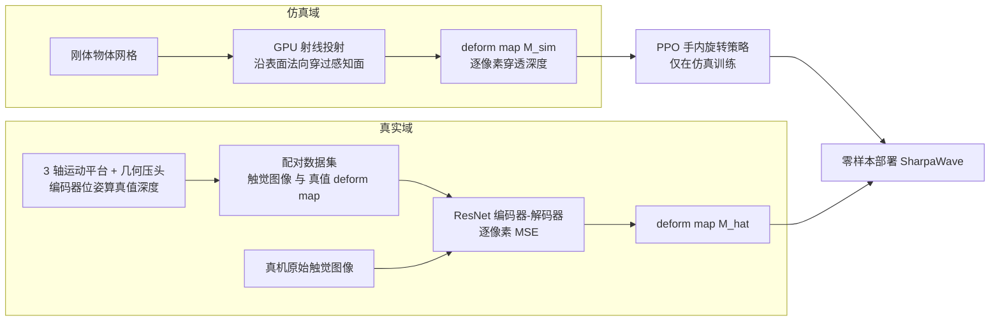
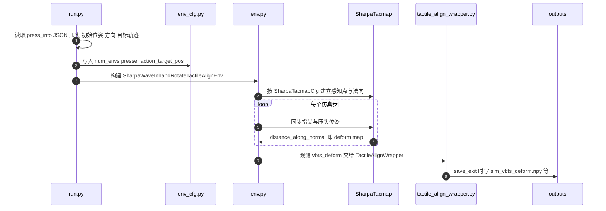

# Tacmap：几何一致的穿透深度图触觉仿真

**Tacmap**（*Tacmap: Bridging the Tactile Sim-to-Real Gap via Geometry-Consistent Penetration Depth Map*，[arXiv:2602.21625](https://arxiv.org/abs/2602.21625)）由 **Sharpa**、**香港科技大学（HKUST）** 与 **英伟达（NVIDIA）** 的作者共同署名（作者名单取自 arXiv 摘要页，机构取自论文 PDF 首页）。它回答的问题是：视触觉传感器（VBTS）的仿真要么太假、要么太慢，怎样才能让纯仿真训练的接触策略直接上真机？答案是不模拟光学，而是让仿真与真实都落到同一张 **穿透深度图（deform map）** 上。

## 一句话定义

**Tacmap = 用「物体侵入指尖弹性体的逐像素深度」作为仿真与真实共享的触觉表示：仿真侧用 GPU 射线投射算它，真实侧用网络从触觉图像回归它，两域在几何空间对齐而非在像素空间对齐。**

## 英文缩写速查

| 缩写 | 英文全称 | 简要说明 |
|------|----------|----------|
| VBTS | Vision-Based Tactile Sensor | 视触觉传感器，靠相机拍弹性体形变（如 GelSight、DIGIT）；本文的指尖传感对象 |
| FEM | Finite Element Method | 有限元法，物理精度高但对大规模 RL 过慢；本文要绕开的高保真路线 |
| Deform Map | Deformation (Penetration Depth) Map | 指尖与物体间逐像素穿透深度图，即 Tacmap 表示本身 |
| IoU | Intersection over Union | 仿真与真实 deform map 接触区域重合度，Table I 的评价指标之一 |
| PPO | Proximal Policy Optimization | 纯仿真训练手内旋转策略所用的 RL 算法 |
| Sim2Real | Simulation to Real | 仿真策略不微调直接部署真机，本文以零样本手内旋转验证 |
| DTC | （论文未展开全称） | 论文用来称呼 SharpaWave 指尖视触觉传感器的型号名 |

## 为什么重要

- **触觉仿真长期卡在两难。** 论文把现有路线分三类：经验法（如 Taxim）依赖真实数据分布、对新几何泛化差；解析法（如 TACTO）只是深度缓冲渲染，丢掉弹性体体积守恒；物理法（如 TacSL、TacEx、Taccel）更真实但对 RL 吞吐或材料参数匹配不友好（此为论文对相关工作的归类，非本页独立评价）。
- **换一个对齐空间。** 原始触觉图像高度依赖传感器光学（内部反射、光散射）；穿透深度是接触物理的「传感器无关代理」。把真实侧监督也换成几何深度，就把光学差异从 sim2real 缺口里剥掉了。
- **服务 Sharpa 的「底层触觉」路线。** 微信文章把 Tacmap 放在「触觉是底层反射弧、属于 System 0」的叙述里，作为 **仿真端补齐的一环**（文章转述）；它与真机触觉数据路线互补：前者让 RL 在仿真里大规模见到接触，后者见 [FTP-1](./paper-ftp-1.md) 的跨传感器预训练。
- **曲面指尖友好。** 多数触觉仿真隐含平面传感器假设；Tacmap 在表面法向空间里算深度，论文称可避免曲面指尖的投影畸变。

## 核心信息

| 项 | 内容 |
|----|------|
| **机构** | Sharpa（夏帕机器人）、香港科技大学（HKUST）、英伟达（NVIDIA） |
| **arXiv** | [2602.21625](https://arxiv.org/abs/2602.21625)，v1 2026-02-25；v2 2026-05-12（对照 PDF，仅参考文献条目不同） |
| **作者** | Lei Su、Zhijie Peng、Renyuan Ren、Shengping Mao、Juan Du、Kaifeng Zhang、Xuezhou Zhu（前两位共同一作） |
| **平台** | SharpaWave 灵巧手 + 指尖视触觉传感器；Isaac Lab 与 MuJoCo 实现 |
| **项目页** | 未找到独立项目页（arXiv 与 PDF 均未列；Sharpa 研究博客仅有解读页） |
| **代码** | 部分开源：[sharpa-robotics/sharpa-tacmap](https://github.com/sharpa-robotics/sharpa-tacmap)（Isaac Lab 传感器 + 按压示例；Apache-2.0） |

## 流程总览

## 核心机制

### 1）仿真侧：双表面几何 + 射线投射

- 弹性体由两个边界描述：**未形变传感面 Su**（指尖静止形态）和位于其外一个固定偏移处的 **虚拟感知面 Ss**；物体接近指尖时会穿过两者之间，形成多层相交体积。
- 在 Ss 上取 H×W 网格，每个网格点沿表面法向向内投射一条射线，形变值为 `d(u,v) = max(0, zs − max(zu, zo))`：`zs` 是射线起点，`zu` 是未形变面坐标，`zo` 是射线与物体网格的首个交点坐标。（论文自述 Ss 与 Su 几乎重合。）
- 因为全程是射线与网格求交，不做 FEM 求解；深度计算整体放在 GPU，并行环境数增大时显存近线性增长。

### 2）真实侧：自动采集台架 + 图像到深度翻译

- 用 **3 轴高精度运动平台** 驱动多种几何压头压向传感器，压头 3D 位姿由编码器读出，并用 **与仿真相同的几何投影逻辑** 算出真值 deform map，得到配对数据 `(原始触觉图像, 真值深度图)`。
- 训练 **ResNet 编码器–解码器** 翻译网络，按逐像素 MSE 把单张触觉图像映射为 deform map，论文称其目的是把内部反射、光散射等光学现象「反演」回几何量。
- 除 deform map 外，系统还提供净力 `F`（真实侧由 ResNet 回归网络从图像估计）与接触位置 `P`（取预测 deform map 有效接触区质心；仿真侧直接取引擎接触传感器）。

### 3）为什么能对齐（论文给出的理由）

两点：其一，真实侧监督用几何深度而非原始图像，传感器光学特性与接触物理解耦；其二，仿真 `M_sim` 与真实 `M_hat` 锚定同一物理量（穿透深度），处于共享、与域无关的空间，策略读到的就不再是像素强度的域偏移。

### 4）实现

集成到 **Isaac Lab**（Raycaster API，GPU 并行）与 **MuJoCo**（`mj_ray`）。系统初始化时用 Multi-Mesh Ray Caster 预定义触觉感知点及方向，使感知分辨率与物理碰撞网格解耦，既保真又不破坏求解器数值稳定。

## 源码运行时序图

官方仓库 `sharpa-tacmap` 属于部分开源，可辨识入口是 `run.py` 的按压测试，下图按仓库文件对齐（据源码阅读整理，**本次未实际运行**，需 Isaac Lab 环境）。

图下说明：仓库复现的是 **仿真侧 deform map 生成与按压可视化**；真实侧翻译网络、采集台架数据与手内旋转 RL 训练代码未在仓库中出现。`run.py` 通过 `sys.path` 指向仓库父目录并以 `tacmap_sensor.*` 包名导入，据此推断克隆后目录需命名为 `tacmap_sensor`（推断，未验证）。

## 实验与评测

以下数字均为 **论文自报**（PDF v1，v2 数字一致）。

### 仿真–真实对齐（Table I，各接触场景中位数）

| 压头 | 接触位置误差 | deform 深度误差 | 净力 L2 误差 | deform IoU |
|------|--------------|-----------------|--------------|-----------|
| Square | 0.66 mm | 18.53% | 0.28 N | 88.21% |
| Cylinder | 0.96 mm | 14.71% | 0.61 N | 85.67% |

- 净力：圆柱 / 方形压头标准压缩测试中，仿真力与真实估计力「高度相关」（论文图示与文字，未给相关系数）。
- 几何：六个关键时间点的接触流形并排对比，结构相似；论文把该误差水平称为「足以支撑零样本策略迁移」。

### 计算效率

并行环境数从 16 扩到 8192 时 GPU 显存近线性增长；开启 Tacmap 渲染后整体吞吐下降「可忽略」（文字表述，正文未给吞吐数值）；论文称可在单张消费级 GPU 上训练触觉策略。

### 零样本手内旋转

PPO 纯仿真训练，观测含实时 Tacmap 流；部署到 SharpaWave 时不做真实微调或域适应，用球形物体测试连续旋转，论文报告策略「成功解释真实触觉图像（经翻译模型转成 deform map）」。**正文没有给出成功率或对比基线的数字**，只有定性结论。

### 文章转述

微信文章只用一句话转述：Tacmap 把仿真与真实触觉统一到同一几何表示，使仅在仿真中训练的手内旋转策略零样本迁移到真实机器人（文章转述，与论文摘要一致，无额外数字）。

## 与其他工作对比

- **[TacSL](./paper-sa-2408-06506-tacsl-a-library-for-visuotactile-sensor-simulati.md)：** 论文相关工作把它描述为基于 Isaac Gym 的 GPU 并行方案，用张量化的深度到 RGB 映射换速度，弹性体建模偏弹簧–阻尼简化；Tacmap 的区别是不再生成 RGB，而是把仿真与真实都收敛到几何深度图。
- **[Taccel](./paper-sa-2504-17614-taccel-scaling-up-vision-based-tactile-robotics.md)：** 论文相关工作把它归为物理保真路线（仿射体动力学 + IPC）；Tacmap 以射线投射换取吞吐，不做软体动力学求解，代价是只有法向深度。
- **[Tac2Real](./paper-sa-2603-28475-tac2real-reliable-and-gpu-visuotactile-simulatio.md)：** 同为面向在线 RL 与零样本部署的 GPU 视触觉仿真（见库内摘要）；两者在对齐表示、传感器假设上的具体差异请回该页核对，本页不替他方下结论。
- **[ADEPT](./paper-adept-dexterity.md)：** 库内该页记载其 Flexiv–Sharpa 学生策略融合「五指 TacMap 深度图」，可视为同名表示的下游使用线索；是否即本论文的 deform map，以 ADEPT 原文参考文献为准。
- **[SaTA](./paper-sata.md)（同公司叙事）：** 文章把 SaTA（触觉锚定到手部运动学坐标系）与 Tacmap 放在同一段，前者偏真机感知表征，后者偏仿真侧表示对齐（文章转述）。

## 结论

**Tacmap 的价值不在又一个更逼真的光学渲染器，而在于把对齐目标从像素换成几何深度：仿真侧便宜（射线投射），真实侧只需一个有监督的图像到深度翻译，缺口被收到一个可测量的量上。**

1. **对齐几何而非图像** — 穿透深度是传感器无关的接触代理；真实侧监督用几何真值，光学差异不再进入策略输入。
2. **便宜才能放大规模** — 射线投射代替 FEM，并行环境 16 到 8192 显存近线性增长，适合大规模 RL；吞吐数值论文未给，选型前需自测。
3. **误差读法要看具体量** — 自报 Table I：接触位置误差 0.66–0.96 mm、深度误差 14.7–18.5%、IoU 约 86–88%；深度误差接近两成，对依赖精细幅值的任务需自行评估。
4. **真机证据偏弱** — 手内旋转零样本只有定性结论，没有成功率与基线；不要把它读成「触觉 sim2real 已解决」。
5. **边界在法向** — 只建模法向穿透深度，不含切向力分布（剪切、微滑移）；依赖滑移判断的任务（论文自述的未来方向）当前表示不够。
6. **复现拿得到的是半条链** — 官方仓库只有 Isaac Lab 传感器与按压示例；真实端翻译网络、采集数据与策略训练代码未公开，完整复现需自建台架与翻译网络。

## 局限与风险

- **只有法向深度：** 论文自述不显式建模切向力分布，未来计划做多维力场表示。
- **射线开销随网格复杂度上升：** 物体网格越复杂，射线投射越贵；论文把更高效的加速结构列为后续工作。
- **真机验证简单：** 单一球形物体旋转，缺少定量成功率与消融。
- **深度误差偏大：** Table I 中 deform 深度误差 14.71%–18.53%（自报中位数），不同压头、不同接触位置的分布未给出。
- **来源口径：** 本页数字取自论文 PDF 与 arXiv 摘要；Sharpa 研究博客与微信文章均为二手转述，未提供额外数据。

## 复现边界

| 项 | 结论 |
|----|------|
| 项目页 | **未找到**（截至 2026-10-16） |
| 官方代码 | **部分开源**：[sharpa-robotics/sharpa-tacmap](https://github.com/sharpa-robotics/sharpa-tacmap)，Apache-2.0，2026-04-08 初始提交；含 `SharpaTacmap` 传感器、示例环境、按压测试与 SharpaWave 资产 |
| 未公开 | 真实端翻译网络与采集台架数据、手内旋转 RL 训练代码、MuJoCo 实现（仓库内无相关字样） |
| 链接来源 | arXiv 摘要页与论文均未列该仓库；经检索 Sharpa 官方 GitHub 组织发现，其 README 引用本论文 |
| 源码运行时序图 | 见上文，据源码阅读整理，**未运行** |

## 关联页面

- [夏帕机器人（Sharpa Robotics）](../entities/sharpa-robotics.md) — 本文所属公司页与 System 0/1/2 叙事
- [FTP-1](./paper-ftp-1.md) — 同一条「以触觉为锚」叙事下的跨传感器预训练策略
- [Tactile Sensing（触觉感知）](../concepts/tactile-sensing.md)
- [Sim2Real](../concepts/sim2real.md) / [物理保真度与 Sim2Real 缺口](../concepts/physics-fidelity-sim2real-gap.md)
- [Contact-Rich Manipulation](../concepts/contact-rich-manipulation.md) / [视触觉融合](../concepts/visuo-tactile-fusion.md)
- [In-hand Reorientation](../methods/in-hand-reorientation.md) — 手内旋转任务背景
- [TacSL](./paper-sa-2408-06506-tacsl-a-library-for-visuotactile-sensor-simulati.md)、[Taccel](./paper-sa-2504-17614-taccel-scaling-up-vision-based-tactile-robotics.md)、[Tac2Real](./paper-sa-2603-28475-tac2real-reliable-and-gpu-visuotactile-simulatio.md) — 触觉仿真同类工作
- [ADEPT](./paper-adept-dexterity.md)、[WM-Craftnet](./paper-wm-craftnet.md) — 同为 Sharpa 手的 sim2real 工作
- [SaTA](./paper-sata.md) — 文章同段中的触觉锚定表征工作

## 参考来源

- [tacmap_arxiv_2602_21625.md](../../sources/papers/tacmap_arxiv_2602_21625.md) — 原始摘录与开源核查
- [机器之心 / Sharpa 微信文章归档](../../sources/blogs/wechat_sharpa_dexterous_manipulation_2026-10-16.md) — 文中 Tacmap 段落转述
- [arXiv:2602.21625](https://arxiv.org/abs/2602.21625)

## 推荐继续阅读

- [arXiv PDF](https://arxiv.org/pdf/2602.21625)
- [官方仓库 sharpa-tacmap](https://github.com/sharpa-robotics/sharpa-tacmap)
- [Sharpa 研究博客解读页](https://www.sharpa.com/blogs/research/tacmap-breaking-the-sim-to-real-deadlock-in-tactile-simulation-with-a-geometric-language)（厂商二手解读）
