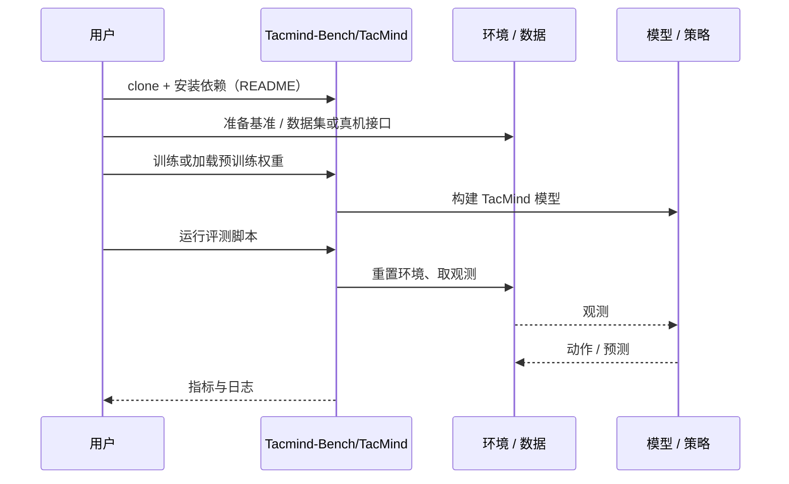

# TacMind（arXiv:2611.00455）

**TacMind**（*TacMind: Benchmarking and Modeling Tactile Interaction States for Robotic Manipulation*，[arXiv:2611.00455](https://arxiv.org/abs/2611.00455)，[项目页](https://tacmind-bench.github.io/)，[代码](https://github.com/Tacmind-Bench/TacMind)）来自 [具身智能小站 2026-11-03 盘点](../../sources/blogs/wechat_embodied_station_49_papers_sacq_action_aware_quantization_2026-11-03.md)，属「评测、数据与基准」组。

## 一句话定义

**TacMind 围绕精细操作、识别和动态交互构建仿真任务，利用历史触觉预测未来状态并修正候选动作，适合研究触觉在不同扰动下的贡献。**

## 英文缩写速查

| 缩写 | 英文全称 | 简要说明 |
|------|----------|----------|
| TacMind | TacMind: Benchmarking and Modeling Tactile Interaction States for Robotic Manipulation | 本文方法 / 基准的简称 |

## 为什么重要

- 触觉应当理解交互过程。
- 开源结论：**已开源**（步骤 2.5，2026-11-03）。仓库可达（git ls-remote）。项目页 HTTP 200。
- 同期同组工作见 [动作感知量化、失败定位与可验证自主：具身智能小站 11-03 期 49 篇阅读坐标](../overview/embodied-station-2026-11-03-49-papers-technology-map.md)。

## 核心机制

| 项 | 内容 |
|----|------|
| **arXiv** | [2611.00455](https://arxiv.org/abs/2611.00455) |
| **开源** | **已开源** |
| **要点** | TacMind 围绕精细操作、识别和动态交互构建仿真任务，利用历史触觉预测未来状态并修正候选动作，适合研究触觉在不同扰动下的贡献。 |
| **文内指标** | 公众号未给具体数字，本页不引用。 |

## 源码运行时序图

以下为按仓库入口（`Tacmind-Bench/TacMind`）推断的通用运行链路；入库日仅核实仓库可达，未逐文件阅读，具体脚本名以 README 为准。

## 实验与评测

- 公众号未给具体数字，本页不引用。
- **读法：** 本页为索引级摘要，依据公众号转述的官方摘要与仓库信息整理；逐项数字与 baseline 以原文 PDF 为准。

## 与其他工作对比

- 横向索引见 [动作感知量化、失败定位与可验证自主：具身智能小站 11-03 期 49 篇阅读坐标](../overview/embodied-station-2026-11-03-49-papers-technology-map.md)；同 arXiv 不重复造页。

## 结论

**触觉应当理解交互过程：TacMind 围绕精细操作、识别和动态交互构建仿真任务，利用历史触觉预测未来状态并修正候选动作，适合研究触觉在不同扰动下的贡献。**

1. 开源边界：**已开源** — 仓库可达（git ls-remote）。项目页 HTTP 200。
2. 核心机制：TacMind 围绕精细操作、识别和动态交互构建仿真任务，利用历史触觉预测未来状态并修正候选动作，适合研究触觉在不同扰动下的贡献。
3. 复现与选型前核对任务协议、硬件与基准口径，勿直接横比公众号摘录数字。

## 关联页面

- [simulation-evaluation-infrastructure](../concepts/simulation-evaluation-infrastructure.md)
- [vla](../methods/vla.md)
- [manipulation](../tasks/manipulation.md)
- [tactile-sensing](../concepts/tactile-sensing.md)
- [embodied-station-2026-11-03-49-papers-technology-map](../overview/embodied-station-2026-11-03-49-papers-technology-map.md)
- [具身大模型评测基准选型闭环](../queries/embodied-eval-benchmark-selection-loop.md) — 本页可归入其 ③ 策略任务成功率评测层的触觉交互分支：在不同扰动下检验历史触觉对精细操作、识别与动态交互的贡献，防止只用纯视觉任务成功率评估接触密集策略。

## 参考来源

- [tacmind_arxiv_2611_00455.md](../../sources/papers/tacmind_arxiv_2611_00455.md)
- [wechat_embodied_station_49_papers_sacq_action_aware_quantization_2026-11-03.md](../../sources/blogs/wechat_embodied_station_49_papers_sacq_action_aware_quantization_2026-11-03.md)
- [arXiv:2611.00455](https://arxiv.org/abs/2611.00455)

## 推荐继续阅读

- [arXiv PDF](https://arxiv.org/pdf/2611.00455)
- [项目页](https://tacmind-bench.github.io/)
- [https://github.com/Tacmind-Bench/TacMind](https://github.com/Tacmind-Bench/TacMind)
