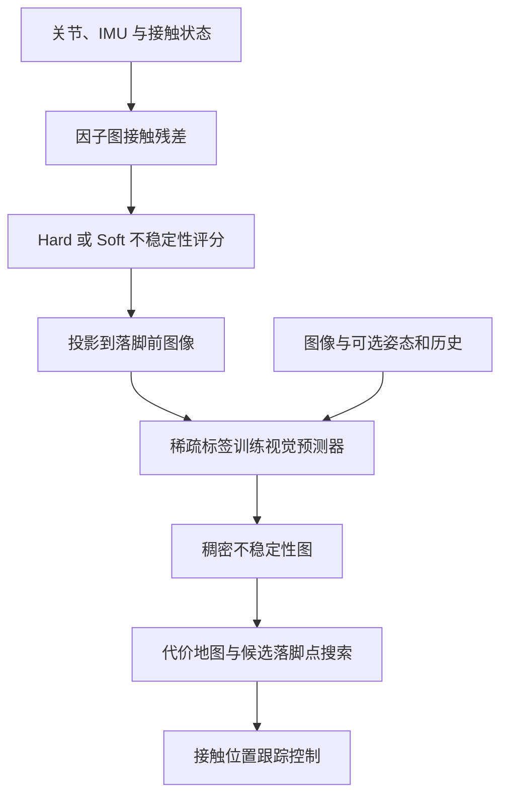
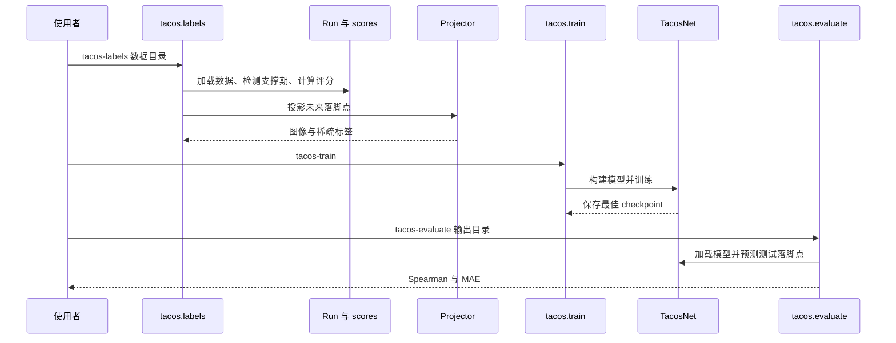

# TACOS：面向视觉落脚规划的地形感知接触监督

**TACOS: Terrain-Aware COntact Supervision for Visual Footstep Planning**。作者 Jean-Michel Fortin、William Larrivée-Hardy、Gabriel Jeanson、Olivier Gamache、Daniele De Martini、François Pomerleau、Philippe Giguère；机构为拉瓦尔大学 Northern Robotics Laboratory 与牛津大学 Mobile Robotics Group。本文依据 [arXiv v1（2026-10-27）](https://arxiv.org/html/2610.37806v1) 全文及[官方代码](https://github.com/norlab-ulaval/TACOS)整理。

## 一句话定义

利用腿式状态估计中足端接触约束的残差作为自监督信号，让视觉网络预测候选落脚点的不稳定程度。

## 英文缩写速查

| 缩写 | 英文全称 | 简要说明 |
|---|---|---|
| TACOS | Terrain-Aware COntact Supervision | 地形感知接触监督 |
| DPT | Dense Prediction Transformer | 稠密预测解码器 |
| GCA | Gated Cross-Attention | 门控交叉注意力 |
| IMU | Inertial Measurement Unit | 惯性测量单元 |
| AP | Average Precision | 平均精度 |

## 为什么重要

几何平整不等于足端稳定：泥地可能下陷，植被可能遮蔽根系。接触级标签比机身级响应更容易关联到具体脚下区域，但其质量依赖状态估计、接触检测和同步。

## 项目流程图

## 核心机制

1. **接触评分**：IMU、关节正运动学和接触因子构成固定时滞因子图；以接触约束残差的马氏范数衡量足端偏离静止假设。
2. **Hard 与 Soft**：Hard 对一个支撑期共享足点状态，利用后续测量修正，取支撑期残差最大值；Soft 允许足点随机游走，残差可因果计算，完整支撑期评分取第 95 百分位。论文用 Hard 监督视觉网络。
3. **图像监督**：借助外感位姿和相机标定，将落脚点投影到落脚前最多 10 秒、距离 0.5–3 米的图像，足端投影覆盖区域提供稀疏标签。
4. **视觉网络**：冻结 DINOv3-Base 编码器，训练 DPT 解码器，以稀疏标注像素的对数评分计算 masked Huber loss；可选将相机横滚、俯仰及前后足近期评分通过 GCA 注入。
5. **规划与执行**：将预测投影到最近落脚点拟合的地平面，累计为 5 米见方、4 厘米分辨率代价地图；在名义落脚点 25 厘米范围内选择可达且已观测位置，兼顾足迹内最大代价和偏移量。接触跟踪策略以 50 Hz 工作。

## 源码运行时序图

依据官方 `pyproject.toml`、`tacos/labels.py`、`tacos/train.py`、`tacos/model.py` 和 `tacos/evaluate.py`：

官方 README 还提供 `tacos-download` 下载 GrandTour 数据和 `tacos-predict` 输出图像代价图；仓库列出的流程主要覆盖标签生成、训练、评估和预测，不应据此认定真机规划与控制部署完整开源。

## 实验与评测

- **接触评分**：冰面、木桩和斜坡共 1716 次人工标注接触，其中 275 次不稳定；Hard / Soft 检测 AP 为 0.96 / 0.93，最佳对比方法为 0.90。合并严重程度排序 VUS：Hard 0.893，对比 0.700。各方法均在该标注集调参。
- **视觉预测**：GrandTour 选取 23 条户外记录、7543 张图像；三条完整轨迹留作测试，五折验证。Hard 标签监督下测试落脚点 Spearman 中位数 0.554；图像加近期不稳定历史的消融合并相关系数均值为 0.694，图像单独为 0.557。相关性针对各自评分标签，并非直接衡量真实世界成功率。
- **真机示范**：ANYmal-D 在同一 50 米森林路径分别运行几何模式和 TACOS 模式；Basler ace2 Pro 图像在 Jetson AGX Thor 上以 10 Hz 推理。两台朝足部的 GoPro 用于接触标注，不是该闭环推理相机。示范涉及泥地、植被和树枝，规模有限，不能由此推断普遍成功率。

## 局限与工程实践

- 准确接触检测、状态估计和时间同步影响标签；估计误差也可能表现为接触残差。
- 单目投影假定局部地面近似平面，陡峭地形或遮挡处存在几何误差；论文将深度和几何融合列为未来工作。
- 公开仓库为 MIT 许可，DINOv3 权重适用其独立许可；官方 README 列出了数据格式与训练入口，迁移其他机器人需处理运动学和标定。

## 与其他工作对比

- **对力学类评分（GRS、ProNav、OCELOT）：** GRS 与 ProNav 把力或本体特征降维到主成分，OCELOT 结合受力接触检测与运动静止检验；TACOS 直接读取因子图中的接触残差，并在整个支撑期累计（§II-B、§IV-A）。人工标注集上合并 VUS 分别为 0.333、0.342、0.400，Hard TACOS 为 0.893（表 I）。
- **对运动学类评分（Jenelten 等、Yan 等、不变平滑器）：** 前者用概率状态机输出打滑置信度，后两者分别看足端相对触地点位移与平滑后的足端速度。检测 AP 最强基线为 Jenelten 等（0.90），严重程度排序最强为 Yan 等（VUS 0.700）；Yan 等仅在极高召回段略占优（§IV-A、图 4、表 I）。
- **对 WVN 等机身级自监督：** WVN 用指令与实测机身速度差得到牵引度量并扩展到相似区域；TACOS 只在实际落脚点给稀疏标签，不做扩展（§II-C）。论文以相同网络复现 WVN，但只作定性对比，未给定量指标（§IV-B、图 6）。
- **对 GRS 视觉监督：** 二者共用逐落脚点掩码与网络，只换标签度量；GRS 测试集相关性接近零，Hard / Soft TACOS 的 Spearman 中位数为 0.554 / 0.449（§IV-B、图 7）。
- **对几何代价地图：** 森林单路径中，几何高程图把泥坑看作平面、把可通过植被看作障碍，TACOS 代价地图可区分二者（§IV-C、图 8）；这只是定性示范。所有评分方法均在同一标注集上调参，PCA 类评分也在其上拟合，因此表 I 衡量的是各方法在该数据上的最佳表现，不宜外推到其他机器人或地形。

## 结论

TACOS 把接触约束违背程度转换为视觉落脚监督，并在有限户外真机实验中展示了非几何地形风险的作用。

1. 优先检查接触检测、标定和时间同步。
2. 离线高质量标签与因果反馈分别考虑 Hard 和 Soft 的时延与准确性。
3. 比较视觉效果时保留数据划分、评分定义与评测指标。
4. 森林闭环实验是单路径示范，部署前需扩充地形和重复次数。

## 关联页面

- [腿式运动](../tasks/locomotion.md)
- [强化学习](../methods/reinforcement-learning.md)
- [Sim2Real](../concepts/sim2real.md)
- [同期论文阅读地图](../overview/embodied-station-2026-10-30-28-papers-technology-map.md)
- [机器人视觉感知栈选型闭环（知识链）](../queries/robot-perception-stack-selection-loop.md)

## 参考来源

- [论文来源归档](../../sources/papers/tacos_arxiv_2610_37806.md)
- [源码来源归档](../../sources/repos/tacos.md)

## 推荐继续阅读

- [论文全文 v1](https://arxiv.org/html/2610.37806v1)
- [官方代码](https://github.com/norlab-ulaval/TACOS)
