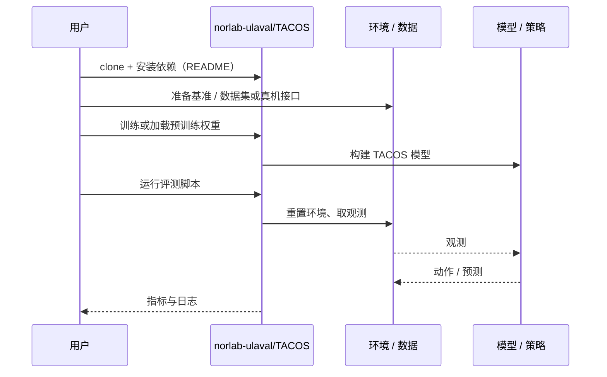

# TACOS（arXiv:2610.37806）

**TACOS**（*TACOS: Terrain-Aware COntact Supervision for Visual Footstep Planning*，[arXiv:2610.37806](https://arxiv.org/abs/2610.37806)，[代码](https://github.com/norlab-ulaval/TACOS)）来自 [具身智能小站 2026-10-30 盘点](../../sources/blogs/wechat_embodied_station_28_papers_event2reward_progress_rewards_2026-10-30.md)，属「运动控制与落脚」组。

## 一句话定义

**几何平整不代表地面可靠。**

## 英文缩写速查

| 缩写 | 英文全称 | 简要说明 |
|------|----------|----------|
| TACOS | TACOS: Terrain-Aware COntact Supervision for Visual Footstep Planning | 本文方法 / 基准的简称 |

## 为什么重要

- 先判断脚下会不会滑，再决定落脚点。TACOS 从状态估计因子图的接触残差构造不稳定性监督，再投影到此前图像，学习视觉落脚预测；真机森林路径展示了它对泥地、植被等非几何风险的处理。
- 开源结论：**已开源**（步骤 2.5，2026-10-30）。仓库可达（git ls-remote）。
- 同期同组工作见 [进度奖励、接触监督与规划验证：具身智能小站 10-30 期 28 篇阅读坐标](../overview/embodied-station-2026-10-30-28-papers-technology-map.md)。

## 核心机制

| 项 | 内容 |
|----|------|
| **arXiv** | [2610.37806](https://arxiv.org/abs/2610.37806) |
| **开源** | **已开源** |
| **要点** | 几何平整不代表地面可靠。 |
| **文内指标** | 公众号转述：监督来源可比较：硬评分利用后验信息，软评分可因果获得；两者都由接触残差生成，而非凭直觉选择标签。 |

## 源码运行时序图

以下为按仓库入口（`norlab-ulaval/TACOS`）推断的通用运行链路；入库日仅核实仓库可达，未逐文件阅读，具体脚本名以 README 为准。

## 实验与评测

- 公众号转述：监督来源可比较：硬评分利用后验信息，软评分可因果获得；两者都由接触残差生成，而非凭直觉选择标签。
- **读法：** 本页为索引级摘要，依据公众号转述的官方摘要与仓库信息整理；逐项数字与 baseline 以原文 PDF 为准。

## 与其他工作对比

- 横向索引见 [进度奖励、接触监督与规划验证：具身智能小站 10-30 期 28 篇阅读坐标](../overview/embodied-station-2026-10-30-28-papers-technology-map.md)；同 arXiv 不重复造页。

## 结论

**先判断脚下会不会滑，再决定落脚点：监督来源可比较：硬评分利用后验信息，软评分可因果获得；两者都由接触残差生成，而非凭直觉选择标签。**

1. 开源边界：**已开源** — 仓库可达（git ls-remote）。
2. 核心机制：几何平整不代表地面可靠。
3. 复现与选型前核对任务协议、硬件与基准口径，勿直接横比公众号摘录数字。

## 关联页面

- [locomotion](../tasks/locomotion.md)
- [reinforcement-learning](../methods/reinforcement-learning.md)
- [sim2real](../concepts/sim2real.md)
- [embodied-station-2026-10-30-28-papers-technology-map](../overview/embodied-station-2026-10-30-28-papers-technology-map.md)

## 参考来源

- [tacos_arxiv_2610_37806.md](../../sources/papers/tacos_arxiv_2610_37806.md)
- [wechat_embodied_station_28_papers_event2reward_progress_rewards_2026-10-30.md](../../sources/blogs/wechat_embodied_station_28_papers_event2reward_progress_rewards_2026-10-30.md)
- [arXiv:2610.37806](https://arxiv.org/abs/2610.37806)

## 推荐继续阅读

- [arXiv PDF](https://arxiv.org/pdf/2610.37806)
- [https://github.com/norlab-ulaval/TACOS](https://github.com/norlab-ulaval/TACOS)
