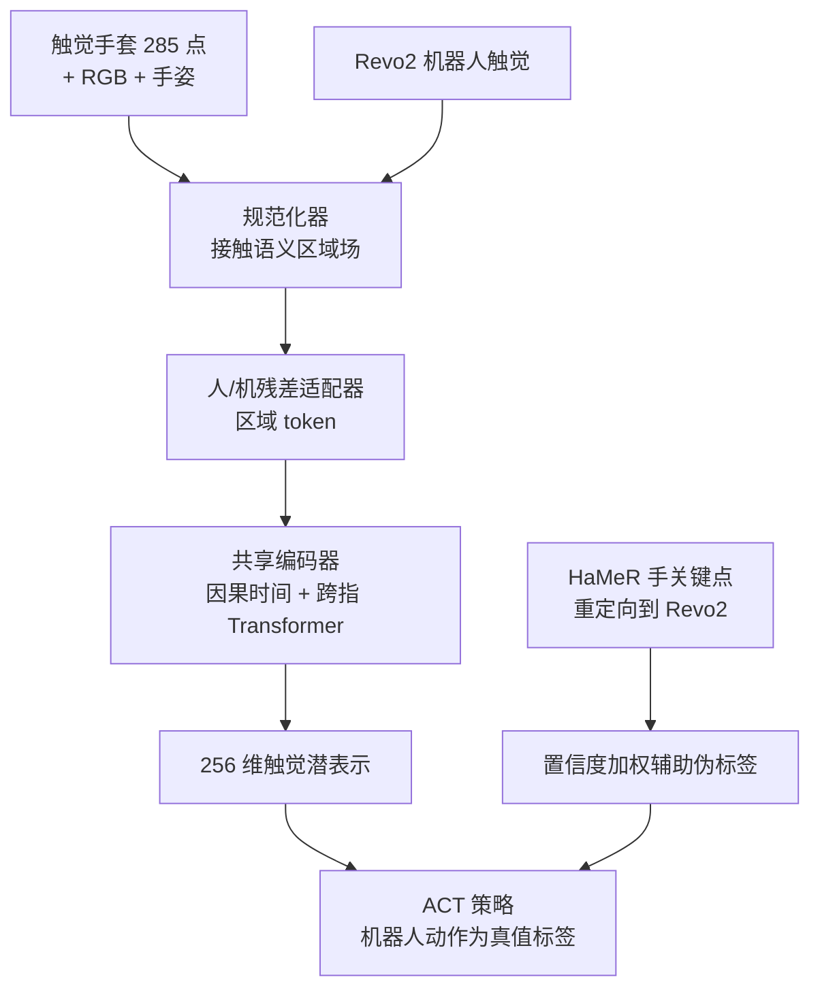

# TACROSS

**TACROSS**（arXiv:2610.11945，HKU / CUHK-Shenzhen / 中国海洋大学 / 武汉大学等）解决“灵巧操作缺触觉数据”：用便宜的人手触觉手套大规模采集，并在**接触事件**层面把人手触觉与机器人手（Revo2 电容触觉）触觉映射到同一个 256 维表示，让廉价的人类触摸数据能训练机器人策略。

## 英文缩写速查

| 缩写 | 英文全称 | 简要说明 |
|------|----------|----------|
| ACT | Action Chunking with Transformers | 本文下游策略，预测 60 步动作块 |
| HaMeR | Hand Mesh Recovery | 从 RGB 估计 21 个 3D 手关键点，用于重定向伪标签 |
| BOM | Bill of Materials | 手套物料成本 10.86 美元 |
| Ego-V / Ego-R | Vision-IK / Rokoko 动捕的第一人称人类采集 | 论文中的两种人类采集配置 |
| F.S. | Full Scale | 传感器精度指标的满量程百分比 |

## 为什么重要

- **成本与吞吐量化：** 视觉 IK 的人类采集约 140 条/小时，对纯机器人 40 条/小时，为 3.5 倍；设备 520 美元对 12,000 美元，降低 95.7%。
- **人类触觉数据真的有用：** 同为 30 条机器人示范，加 150 条人类示范并做对齐，平均成功率 51.3% -> 91.9%；不做对齐只有 49.4%，等于没有收益。
- **数据规模：** 总计 183.95 小时记录（人类 159.09 h、机器人 24.86 h）。

## 流程总览

## 核心原理（方法）

### 1）手套硬件
五层压阻结构（两层图案化铜镍电极、压敏层、掌/背织物封装）；285 个传感点（掌部 12x15=180 加五指各 3x7=105），覆盖约 200 cm2；矩阵复用 + 12-bit ADC + 腕部控制器，约 150 Hz 输出 256 值/帧。BOM 10.86 美元（控制器 6.58 + 材料 4.28）。量程 0-20 N，重复性 1.38% F.S.，非线性 8.26% F.S.，迟滞 11.65% F.S.，手套小于 50 g。

### 2）触觉对齐
规范化器把原始读数映射到按解剖区域的区域场（接触概率、相对强度、强度变化、持续时间、面积、压力中心、不稳定度代理、标定置信度）；人/机各有浅层残差适配器；共享的因果时间 + 跨指 Transformer（各两层）处理 16 帧 @15 Hz 的窗口，输出 256 维归一化潜表示。七项损失（权重 1,1,0.5,0.5,1,0.2,0.1）：手潜表示对比、接触预测、相对强度回归、强度档位、相位分类、时间正则、域对抗。

### 3）策略学习
机器人执行的动作是唯一动作真值；人类数据一方面训练触觉表征，另一方面由 HaMeR 的 21 个 3D 关键点经几何重定向得到 Revo2 目标，作为带置信度权重与有效性掩码的辅助伪标签（权重公式原文未给）。ACT 输入三路 240x320 RGB、本体感知与 256->512 维投影的触觉潜表示，预测 15 Hz 下 60 步动作块；触觉编码器先冻结 20,000 步再低学习率微调；部署时仅用机器人观测。

### 4）任务
T1 定点点胶、T2 烧杯间液体转移、T3 精确移液、T4 连续水果取放。

## 源码运行时序图

不适用：项目页将代码、硬件与数据标为 “Planned release”，截至 2026-10-12 无仓库。

## 工程实践

- 复现门槛：自制手套（约 11 美元物料，需要矩阵电路与 BLE/串口控制器）、Revo2 手 + 七关节臂、HaMeR 与重定向标定；论文自述迁移依赖本体专属的重定向和标定。
- 采集建议：先固定少量机器人示范（如 15 条），再叠加人类示范；T4 预算实验中 50 条机器人 + 50 条 Ego 示范达 92.5%，与 92 条纯机器人 95.0% 接近但用时从 158.8 分钟降到 110.3 分钟。
- **开源状态：** 项目页 tacross-touch-project.github.io 标注代码/硬件/数据 Planned release，无 GitHub 与 HF 链接；设计文件据称在项目页，本次未发现可下载仓库，按“待发布”处理。

## 实验与评测

| 消融（四任务平均） | 成功率 |
|------|------|
| 仅 30 条机器人示范 | 51.3% |
| 人类数据无触觉（1:5） | 73.1% |
| 无对齐（1:5） | 49.4% |
| 完整（30 机器人 + 150 人类） | **91.9%** |
| 16 机器人 + 160 人类 | 88.1%（正文写 88.3%） |

- 匹配时间预算下四任务平均：纯机器人 92.2%、Ego-R 93.5%、Ego-V 91.5%。
- 固定 15 条机器人，人类示范 0 -> 90 条，平均 32.5% -> 85.6%；纯机器人 105 条为 88.1%，成本 14.00 美元对 2.14 美元。
- 吞吐：纯机器人约 40、Ego-R 约 112、Ego-V 约 140 条/小时；成本降幅 95.7%（Ego-V）、82.1%（Ego-R）。

## 结论

**TACROSS 证明了“人类触觉数据 + 接触事件对齐”可以替代大部分昂贵的机器人示范，关键不在手套本身，而在对齐。**

1. **对齐是增益来源：** 同样的 150 条人类数据，有对齐 91.9%，无对齐 49.4%。
2. **机器人示范不能为零：** 动作标签只来自机器人，0 条人类示范时 15 条机器人只有 32.5%，说明两者互补。
3. **按成本规划采集：** 每任务 90 条人类示范 + 15 条机器人示范（85.6%）接近 105 条机器人示范（88.1%），成本约 15%。
4. **3.5 倍与 95.7% 是作者估算口径：** 吞吐 + 设备价，不含算力与标注。
5. **手套精度有限：** 迟滞约 11.65% F.S.、非线性 8.26% F.S.，适合接触事件而非精确力。
6. **泛化未验证：** 仅 Revo2 一种手与四个任务。

## 与其他工作对比

| 对照 | 差异读法 |
|------|----------|
| [OSMO 触觉手套](./paper-notebook-osmo-open-source-tactile-glove-for-human-to-robo.md) | 同为人到机器人触觉手套；TACROSS 强调异构传感器对齐与成本 |
| [FreeTacMan](./paper-sa-2506-01941-freetacman-robot-free-visuo-tactile-data-collect.md) | 无机器人视觉触觉采集；TACROSS 以触觉手套 + 对齐到机器人触觉 |
| [EgoDex](./paper-notebook-egodex-learning-dexterous-manipulation-from-larg.md) | 大规模第一人称灵巧人类视频，无触觉 |
| [视觉触觉融合](../concepts/visuo-tactile-fusion.md) | TACROSS 的策略层仅把触觉潜表示作为 ACT 的一路输入 |

## 局限与风险

- 迁移仍依赖机器人示范与本体专属重定向/标定；仅 Revo2 与四个任务；数据集与硬件尚未发布。
- 数据口径不一：摘要“150 小时以上”、正文 183.95 小时、项目页 21,412 条有效人类示范与正文 22,486 条有效记录不同，引用需注明。

## 关联页面

- [Manipulation 周报汇总（10.5-10.9）](../overview/frontier-manipulation-2026-10-05-10-09.md)
- [触觉感知概念](../concepts/tactile-sensing.md)
- [视觉触觉融合](../concepts/visuo-tactile-fusion.md)
- [模仿学习](../methods/imitation-learning.md)

## 参考来源

- [TACROSS 论文归档](../../sources/papers/tacross_arxiv_2610_11945.md)
- [TACROSS 项目页归档](../../sources/sites/tacross-project.md)
- [Manipulation 周报来源](../../sources/blogs/frontier_manipulation_2026_10_05_10_09.md)
- 论文：<https://arxiv.org/abs/2610.11945>

## 推荐继续阅读

- [TACROSS 项目页](https://tacross-touch-project.github.io/)
- [arXiv HTML 全文](https://arxiv.org/html/2610.11945v1)
