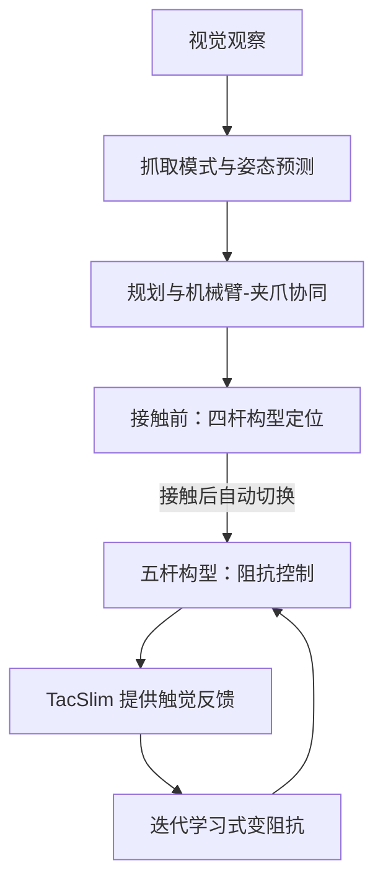

# 面向类人抓握和捏取的多功能触觉夹爪 / Multifunctional Tactile Gripper for Human-like Grasping and Pinching

> **草稿：** 只核对了出版方提交的原始摘要和题录。全文及针对该系统的可运行实现未取得，下文不能替代正文核验。

## 一句话定义

夹爪用单个伺服与弹簧实现接触前的定位与接触后的柔顺抓取，再结合 TacSlim 指尖和视触觉闭环尝试捏取、包握和翻转后捏取。

## 英文缩写速查

| 名称 | 英文 | 含义 |
|---|---|---|
| IJRR | The International Journal of Robotics Research | 正式发表期刊 |
| DOI | Digital Object Identifier | 正式出版记录的唯一标识 |
| TacSlim | TacSlim（作者命名） | 针对多种接触姿态设计的仿生触觉指尖 |

## 为什么重要

小物体精密捏取和较大物体的包握需要不同的接触位置和受力方式。这篇论文把机械构型变化、指尖感知与控制放到一个设计里，而不是假定只换控制器就能得到所有抓法。

## 核心原理与方法

| 层级 | 原始摘要能确认 | 待全文核验 |
|---|---|---|
| 机构 | 单一伺服驱动、多弹簧；接触前四杆用于定位，接触后自动进入五杆构型以支持阻抗控制 | 转换条件、运动学、弹簧预紧及刚度 |
| 指尖 | 楔形 TacSlim 带仿指纹表面和类指甲结构；与夹爪几何联合优化以对齐接触处表面法线 | 制造过程、标定、力和接触估计精度 |
| 系统 | 视觉预测抓取模式与姿态；融合触觉、动作规划、臂夹协同和迭代学习式变阻抗 | 模型、时序、控制律、扰动协议与消融 |

仅据原始摘要绘制模块关系示意，并非正文中的实现时序。

## 评测与局限

摘要报告试验物体尺寸覆盖 **2–64 mm**、重量覆盖 **10 g–4 kg**。这两个区间是各自的观测范围，不是对所有组合和抓法的保证。尚未拿到试验表来核对各抓法对应物体、测试次数、成功率分母、视觉预测精度或对照。

## 与其他工作对比

与仅按视觉结果执行夹爪动作的常见流程相比，作者声称将实际接触后的构型切换与触觉变阻抗纳入同一个系统。这里只比较系统模块，不作性能排名；摘要不能替代全文对照试验。

## 结论

当前可以把该论文定位为「抓法、接触几何和控制一起设计」的案例。后续需从全文确认机械模式切换、传感器标定、控制协议和不同抓法的试验适用边界，再转为正式节点。

## 工程实践与开放状态

未找到明确对应本论文的可运行官方代码、CAD 或数据入口。源码运行时序图暂不绘制；不把「未查到」当作「未公开」。正文核对时应优先检查开启/闭合拓扑、异常释放机制、弹簧与指尖材料参数、标定以及抓取判断标准。

## 关联页面

- [基于触觉反馈的阻抗控制](../methods/tactile-impedance-control.md)
- [抓取姿态估计](../methods/grasp-pose-estimation.md)
- [操作任务](../tasks/manipulation.md)

## 参考来源

- [论文出版题录、原始摘要与全文获取状态](../../sources/papers/tacslim_ijrr_2026.md)

## 推荐继续阅读

- [正式论文 DOI](https://doi.org/10.1177/02783649261504460)
