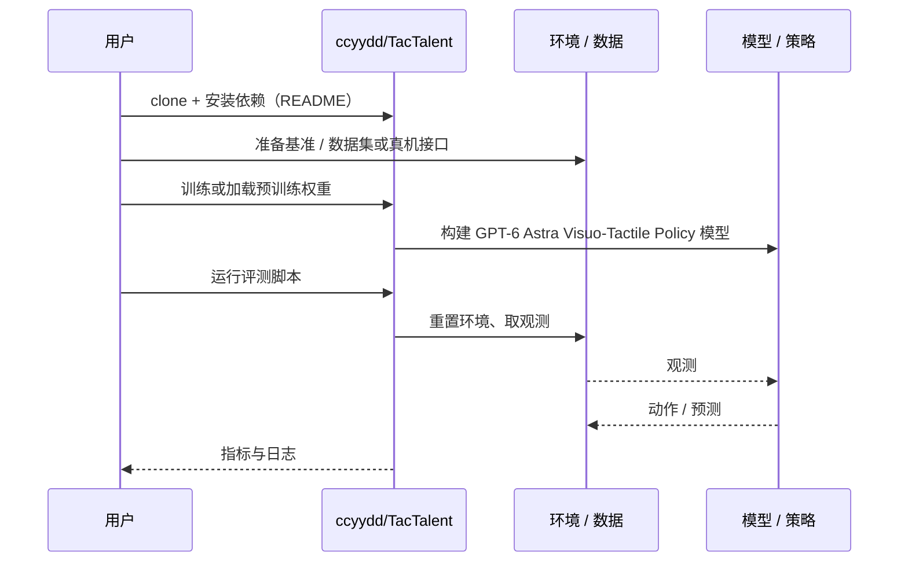

# GPT-6 Astra Visuo-Tactile Policy（arXiv:2610.26846）

**GPT-6 Astra Visuo-Tactile Policy**（*GPT-6 Astra Is a Native Visuo-Tactile Policy for Contact-Rich Manipulation*，[arXiv:2610.26846](https://arxiv.org/abs/2610.26846)，[项目页](https://tactalent.github.io/)，[代码](https://github.com/ccyydd/TacTalent)）来自 [具身智能小站 2026-10-31 盘点](../../sources/blogs/wechat_embodied_station_50_papers_scenerig_photo_to_sim_2026-10-31.md)，属「触觉与精细操作」组。

## 一句话定义

**TacTalent以视觉接口输入触觉RGB图像，用少量示范驱动闭环操作；两套仿真基准显示接触信息价值，采样规模、推理成本与真机验证需一起看。**

## 英文缩写速查

| 缩写 | 英文全称 | 简要说明 |
|------|----------|----------|
| GPT-6 Astra Visuo-Tactile Policy | GPT-6 Astra Is a Native Visuo-Tactile Policy for Contact-Rich Manipulation | 本文方法 / 基准的简称 |

## 为什么重要

- 把触觉图像直接交给通用模型。
- 开源结论：**已开源**（步骤 2.5，2026-10-31）。仓库可达（git ls-remote）。项目页 HTTP 200。
- 同期同组工作见 [单图重建仿真、VLA 适配评测与跨形态世界模型：具身智能小站 10-31 期 50 篇阅读坐标](../overview/embodied-station-2026-10-31-50-papers-technology-map.md)。

## 核心机制

| 项 | 内容 |
|----|------|
| **arXiv** | [2610.26846](https://arxiv.org/abs/2610.26846) |
| **开源** | **已开源** |
| **要点** | TacTalent以视觉接口输入触觉RGB图像，用少量示范驱动闭环操作；两套仿真基准显示接触信息价值，采样规模、推理成本与真机验证需一起看。 |
| **文内指标** | 公众号未给具体数字，本页不引用。 |

## 源码运行时序图

以下为按仓库入口（`ccyydd/TacTalent`）推断的通用运行链路；入库日仅核实仓库可达，未逐文件阅读，具体脚本名以 README 为准。

## 实验与评测

- 公众号未给具体数字，本页不引用。
- **读法：** 本页为索引级摘要，依据公众号转述的官方摘要与仓库信息整理；逐项数字与 baseline 以原文 PDF 为准。

## 与其他工作对比

- 横向索引见 [单图重建仿真、VLA 适配评测与跨形态世界模型：具身智能小站 10-31 期 50 篇阅读坐标](../overview/embodied-station-2026-10-31-50-papers-technology-map.md)；同 arXiv 不重复造页。

## 结论

**把触觉图像直接交给通用模型：TacTalent以视觉接口输入触觉RGB图像，用少量示范驱动闭环操作；两套仿真基准显示接触信息价值，采样规模、推理成本与真机验证需一起看。**

1. 开源边界：**已开源** — 仓库可达（git ls-remote）。项目页 HTTP 200。
2. 核心机制：TacTalent以视觉接口输入触觉RGB图像，用少量示范驱动闭环操作；两套仿真基准显示接触信息价值，采样规模、推理成本与真机验证需一起看。
3. 复现与选型前核对任务协议、硬件与基准口径，勿直接横比公众号摘录数字。

## 关联页面

- [tactile-sensing](../concepts/tactile-sensing.md)
- [contact-rich-manipulation](../concepts/contact-rich-manipulation.md)
- [manipulation](../tasks/manipulation.md)
- [embodied-station-2026-10-31-50-papers-technology-map](../overview/embodied-station-2026-10-31-50-papers-technology-map.md)

## 参考来源

- [tactalent_gpt_6_astra_visuo_tactile_arxiv_2610_26846.md](../../sources/papers/tactalent_gpt_6_astra_visuo_tactile_arxiv_2610_26846.md)
- [wechat_embodied_station_50_papers_scenerig_photo_to_sim_2026-10-31.md](../../sources/blogs/wechat_embodied_station_50_papers_scenerig_photo_to_sim_2026-10-31.md)
- [arXiv:2610.26846](https://arxiv.org/abs/2610.26846)

## 推荐继续阅读

- [arXiv PDF](https://arxiv.org/pdf/2610.26846)
- [项目页](https://tactalent.github.io/)
- [https://github.com/ccyydd/TacTalent](https://github.com/ccyydd/TacTalent)
