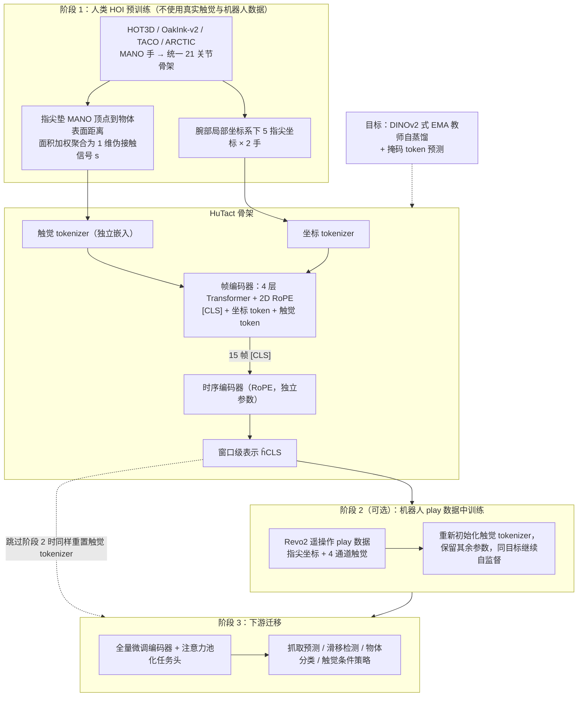

# Tactile-Aware Hand Rep：从人手与物体交互数据中学习触觉感知手部表示

**Tactile-Aware Hand Rep**（*Learning Tactile-Aware Hand Representations from Human Hand-Object Interaction Data*，[arXiv:2610.27995](https://arxiv.org/abs/2610.27995)）收录于 senlanke「具身运控lab」10-19–10-23 前沿论文动态（Manipulation）。本页依据**周报条目 + arXiv 摘要页**整理，流程图依据论文方法部分（见参考来源），未逐页核对实验数字；指标与结论以论文为准。

## 一句话定义

**Tactile-Aware Hand Rep：从人手与物体交互数据中学习触觉感知手部表示——将触觉相关信息引入手部表示学习，使模型能够从人手与物体交互数据中学习更适合接触操作的手部特征。**

## 英文缩写速查

| 缩写 | 英文全称 | 简要说明 |
|------|----------|----------|
| VLA | Vision-Language-Action | 视觉–语言–动作模型 |
| IL | Imitation Learning | 模仿学习 |

## 为什么重要

- 周报所述待解决的问题：人类手部操作数据包含丰富的接触行为，但单纯学习手部姿态，难以完整表示手与物体之间的触觉交互。

## 流程总览

图依据：论文 §III-A 至 §III-D / Fig.1 / Fig.2

## 核心机制

| 项 | 内容 |
|----|------|
| **arXiv** | [2610.27995](https://arxiv.org/abs/2610.27995) · [PDF](https://arxiv.org/pdf/2610.27995) |
| **作者（arXiv）** | Yeonguk Yu, Jaehong Kim, Byungok Han |
| **机构（周报所述，未逐条核实）** | 待核实（作者：Yeonguk Yu、Jaehong Kim、Byungok Han）。 |
| **arXiv 评论栏** | 9 pages, 4 figures |
| **开源** | arXiv 摘要页与评论未见代码或项目页链接（仅核对 arXiv 摘要页，不代表未发布）（2026-10-26） |
| **周报所述创新点** | 将触觉相关信息引入手部表示学习，使模型能够从人手与物体交互数据中学习更适合接触操作的手部特征。 |

### arXiv 摘要节选（英文原文）

> Tactile representation learning for dexterous manipulation often requires substantial robot-side data collection, limiting its scalability across different hands and sensors. We explore whether large-scale human hand-object interaction (HOI) data can provide a useful prior for robotic tactile learning.

## 源码运行时序图

**不适用**：arXiv 摘要页与评论未见代码或项目页链接（仅核对 arXiv 摘要页，不代表未发布），无可对齐的官方代码流程。

## 实验与评测

- 周报与摘要给出的数字/场景已写入上表「创新点」与摘要节选；其余实验细节、基线与成功率定义请回到论文正文。
- 读法：先对齐任务设定、传感器与成功定义（仿真/真机），再解读 headline 数字，勿跨论文直接比较。

## 与其他工作对比

| 维度 | 读法 |
|------|------|
| **同周对照** | 见 [Manipulation周报技术地图](../overview/senlanke-weekly-2026-10-19-23-manipulation-technology-map.md)，按方向浏览同期论文 |
| **开源状态** | arXiv 摘要页与评论未见代码或项目页链接（仅核对 arXiv 摘要页，不代表未发布） |

## 结论

**Tactile-Aware Hand Rep：从人手与物体交互数据中学习触觉感知手部表示。**

1. 本页是入库级摘要，复现前请核对论文正文、附录与代码仓库。
2. 指标须连同实验条件解读。
3. 关注 arXiv 版本更新与代码发布。

## 关联页面

- [senlanke-weekly-2026-10-19-23-manipulation-technology-map](../overview/senlanke-weekly-2026-10-19-23-manipulation-technology-map.md)
- [manipulation](../tasks/manipulation.md)
- [vla](../methods/vla.md)

## 参考来源

- [tactile-aware-hand-representations-human-hoi_arxiv_2610_27995.md](../../sources/papers/tactile-aware-hand-representations-human-hoi_arxiv_2610_27995.md)
- [wechat_senlanke_weekly_manipulation_2026-10-19_23.md](../../sources/blogs/wechat_senlanke_weekly_manipulation_2026-10-19_23.md)
- [arXiv:2610.27995](https://arxiv.org/abs/2610.27995)
- [arXiv PDF](https://arxiv.org/pdf/2610.27995)：已通读方法部分（实验与附录以略读为准）：§I–§III、§IV-A 实验设置（§IV-B 起的结果未读）

## 推荐继续阅读

- [arXiv PDF](https://arxiv.org/pdf/2610.27995)
