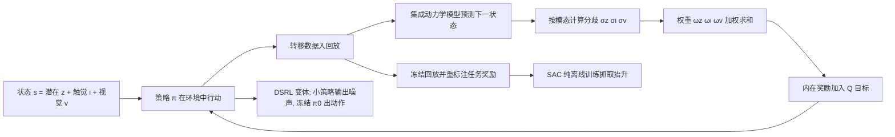

# 触觉好奇心驱动机器人交互（TacEx）

**Tactile Curiosity Drives Robot Interaction**（[arXiv:2609.40134](https://arxiv.org/abs/2609.40134)，ETH Zürich、UC Berkeley、UT Austin，Iten、Proshkin、Sukhija 共同一作，Coros、Krause、Abbeel、Sferrazza）提出 **TacEx**：在 MaxInfoRL 式的信息增益探索里，把模型的认知不确定性按感知模态拆开并加权，让好奇心指向触觉通道。全文只有仿真实验。

## 一句话定义

TacEx 是一个探索奖励设计：用集成动力学模型的分歧衡量认知不确定性，按视觉、触觉、潜在状态三个通道分别计算并加权，把触觉通道的权重调大（可至纯触觉），使 RL 智能体更多去接触物体而不是在自由空间里乱动（摘要、§3 式 4）。

## 英文缩写速查

| 缩写 | 英文全称 | 简要说明 |
|------|----------|----------|
| TacEx | Tactile Exploration Drives Efficient Learning | 本文方法名（§3 标题） |
| MaxInfoRL | Maximizing Information Gain RL | 前作 Sukhija et al. 2025，在 Boltzmann 策略里加认知不确定性项（§2.1 式 3） |
| DSRL | Diffusion Steering via RL | 冻结扩散策略，只训练预测噪声的小策略（§4.2，Wagenmaker et al.） |
| SAC | Soft Actor-Critic | 本文的底层 RL 算法（§4.1、§4.2） |
| DrQ | Data-regularized Q | 在线稀疏奖励基线（§4.1） |
| DPPO | Diffusion Policy Policy Optimization | 微调扩散策略本体的对照（附录 C） |
| VLA | Vision-Language-Action | 视觉语言动作模型，此处为 π0 |
| LIBERO-90 | LIBERO 的 90 任务套件 | 后训练评测环境（§4.2） |

## 为什么重要

- 论文论点（§1）：操作技能出自接触，随机探索的预算大多耗在自由空间；通用的不确定性奖励对接触无感，在自由空间乱动也能拿奖励。把好奇心权重放在触觉通道是一种简单的归纳偏置。
- 作者给出的三点贡献（§1）：模态加权的探索目标；纯触觉探索无任务奖励、无示范即学到抓取，且回放支持离线下游学习；在不含触觉预训练的 VLA 上做触觉后训练。
- 我的判断（非作者自述）：这是一个「探索奖励的模态权重」想法，成本低，可叠在任何集成动力学模型上；但全部证据来自仿真，是否经得起真实触觉噪声尚无证据。

## 核心原理与流程总览

要点（论文 §2–§3、附录 B）：

- **MaxInfoRL 基础（式 3）：** π(a|s) ∝ exp(α⁻¹(Q + λ‖σ_n(s,a)‖))，σ_n 是集成模型的分歧，作为认知不确定性估计。
- **TacEx（式 4）：** 把 ‖σ_n‖ 换成 ω_v‖σ_v‖ + ω_ι‖σ_ι‖ + ω_z‖σ_z‖。ω_v=ω_z=0 即纯触觉信息增益；权重只改探索奖励，不改策略观测。
- **触觉输入（§2.2）：** 力图（接触面分格，每格一个三维压力加剪切向量）；与 TacSL 等仿真器的力分布输出对应，论文称可经现有传感器与仿真框架得到。Table 1 中触觉观测为 32×64×3。
- **编码器（图 1、Table 1）：** RGB 与触觉分别过 CNN 编码器，状态里是融合潜在 z、视觉嵌入 v、触觉嵌入 ι；动力学模型为 5 个 (256, 256) MLP 的集成。

## 工程实践

| 环节 | 论文给出的设置（出处） |
|------|------------------------|
| 无奖励探索 | 仿真，夹爪加单物体或四物体；外在奖励为零；5 个种子（§4.1） |
| 离线下游 | 冻结回放，用带容差的稀疏抓取抬升奖励重标注，SAC 纯离线（§4.1） |
| VLA 后训练 | LIBERO-90 八个任务（ID 58、69、61、77、55、21、56、20）；加触觉的 PandaGripper；10 个种子；冻结 π0 与其语言指令（§4.2、Table 1） |
| SAC 超参 | 批大小 256，折扣 0.999，UTD 为每环境步 20 次梯度步，演员学习率 1e-4、评论家 3e-4；5×10^5 到 1×10^6 环境步（Table 1） |
| MaxInfo 超参 | λ 学习率 3e-4、初值 1.0；动力学模型学习率 1e-3，权重衰减 1e-4（Table 1） |
| 权重选择 | 固定超参；主实验比较 (0,1,0)、(1,1,0)、(0,1,1)（§4.2、图 4） |
| 代码 | 论文未给出代码或项目页链接，开源状态未知 |

## 评测证据与清单说法的对比核对

清单（Glen Berseth 的 CoRL 2026 阅读清单，条目由 LLM 据摘要起草，排序为作者自己的兴趣模型打分）对此文的一句话摘要：「Uses touch as the signal for uncertainty-driven exploration so RL agents explore contacts rather than free space.」

| 清单措辞 | 论文核对 |
|----------|----------|
| touch 作为不确定性驱动探索的信号 | 属实（摘要、§3）。更准确地说：不是用触觉本身当奖励，而是用「触觉预测的集成分歧」当奖励，并与视觉、潜在状态的分歧加权 |
| RL agents 探索接触而非自由空间 | 作者自述（§4.1）：含触觉分歧的变体更常与物体交互，没有触觉分歧时「很少与物体交互」；证据是图 2、图 3 的交互频率曲线，没有数值表；纯视觉与纯潜在状态变体在图 2 中明显更低 |
| 清单未写的限定 | 全部是仿真（§1「two simulation settings」，局限节自述未验真机）；单个平行夹爪；后训练是冻结 π0 的扩散转向，不是微调 VLA；提升随任务而异（§4.2），部分任务曲线重叠或接近零（图 4） |
| 清单未提及的内容 | 离线下游学习与 VLA 后训练两部分占了论文大半篇幅 |

另一处论文内部不一致：图 2 图注写「六种权重配置」，正文只列出 (i)–(iv) 四种，我没有核对到另外两种是什么（图中有更多曲线，推测为含外在奖励或 ω 的其它组合，未证实）。

## 结论

TacEx 支持以触觉不确定性引导接触探索，但接触好奇心不等于安全或任务成功。

- 分开记录视觉、触觉和潜状态不确定性，检查固定权重如何影响接触与多样性。
- 把探索回放的价值与下游抓取、VLA 后训练分别评测，不能互相替代。
- 真机前验证噪声、标定漂移与接触力约束，现有证据全部来自仿真。

## 局限

**作者自述（§5）：**

- 只在仿真验证；真机的触觉噪声、标定漂移、传感器磨损未评测，也不清楚这些效应能否与接触动力学的不确定性区分。
- 接触寻求的好奇心不保证安全接触力，不防止误碰干扰物体；离线初始化与安全约束只是方向，对 TacEx 的效果未评测。
- 只用单个平行夹爪与单一触觉表示；多指灵巧手、视觉式触觉图像（论文称「有效性仍待评估」）、易碎或可变形物体、严格受限的力调节都未覆盖。
- 权重为固定超参；多物体结果显示聚焦接触与交互多样性之间的权衡由权重控制，在线自适应是未来工作。
- 未探索把收集的接触数据回灌 VLA 预训练。

**我看到的未验证之处（判断）：**

- 主要结果以曲线呈现（图 2–6），正文无数值表与显著性检验，「更好」的幅度无法在正文里确认。
- §4.2 自述「表现最好的曲线通常含触觉分歧」，措辞是「通常」，图 4 里多个任务上各变体差距小或重叠。
- 对照里 DSRL-PPO 在评测预算内没有学到东西（附录 C），因此「优于 PPO 基线」的含金量有限。
- 方法对比的主要基线是 DSRL-SAC（只有稀疏任务奖励）；以往触觉好奇心方法（Vulin、Huang、Rajeswar 等，§2.3）没有作为实验基线，只以「汇总触觉」对照近似力幅值奖励（附录 C）。
- 论文声明部分文字与代码开发借助大语言模型辅助（致谢），作者对内容负责。

## 关联页面

- [Manipulation](../tasks/manipulation.md)
- [Vision-Language-Action](../methods/vla.md)
- [SAC](../methods/sac.md)
- [触觉感知](../concepts/tactile-sensing.md)
- [视觉-触觉融合](../concepts/visuo-tactile-fusion.md)
- [在线 RL 与离线 RL 对比](../comparisons/online-vs-offline-rl.md)
- [π0 论文页](../entities/paper-pi0.md)
- [LIBERO 基准](../entities/libero-benchmark.md)
- [PEARS：触觉失败推理与扩散转向](../entities/paper-pears-tactile-failure-reasoning-diffusion-steering.md)
- [【9.28–10.2 前沿论文动态】Manipulation](../overview/frontier-manipulation-2026-09-28-10-02.md)

## 参考来源

- [原文通读归档](../../sources/papers/tactile-curiosity-drives-robot-interaction_arxiv_2609_40134.md)
- [【9.28–10.2 前沿论文动态】Manipulation 综述条目](../../sources/blogs/frontier_manipulation_2026_09_28_10_02.md)
- [arXiv:2609.40134](https://arxiv.org/abs/2609.40134)

## 继续阅读

- [arXiv 原文 PDF](https://arxiv.org/pdf/2609.40134v1)
- [触觉感知概念页](../concepts/tactile-sensing.md)
- [Manipulation 任务页](../tasks/manipulation.md)
