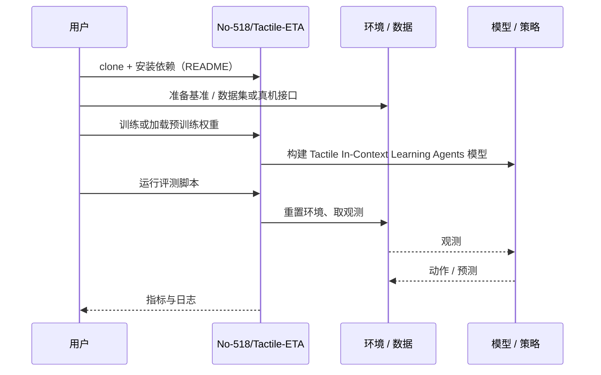

# Tactile In-Context Learning Agents（arXiv:2610.27613）

**Tactile In-Context Learning Agents**（*Embodied Task Agents Can Perform Fine Manipulation through Tactile In-Context Learning*，[arXiv:2610.27613](https://arxiv.org/abs/2610.27613)，[项目页](https://no-518.github.io/tactile-eta/)，[代码](https://github.com/No-518/Tactile-ETA)）来自 [具身智能小站 2026-10-31 盘点](../../sources/blogs/wechat_embodied_station_50_papers_scenerig_photo_to_sim_2026-10-31.md)，属「触觉与精细操作」组。

## 一句话定义

**Tactile-ETA把动作与视觉、触觉片段对齐，作为冻结智能体的上下文经验；仿真和真机比较支持触觉信息增益，尚不是运动段内的高速触觉闭环。**

## 英文缩写速查

| 缩写 | 英文全称 | 简要说明 |
|------|----------|----------|
| Tactile In-Context Learning Agents | Embodied Task Agents Can Perform Fine Manipulation through Tactile In-Context Learning | 本文方法 / 基准的简称 |

## 为什么重要

- 不调参数，也能读懂触觉示范。
- 开源结论：**已开源**（步骤 2.5，2026-10-31）。仓库可达（git ls-remote）。项目页 HTTP 200。
- 同期同组工作见 [单图重建仿真、VLA 适配评测与跨形态世界模型：具身智能小站 10-31 期 50 篇阅读坐标](../overview/embodied-station-2026-10-31-50-papers-technology-map.md)。

## 核心机制

| 项 | 内容 |
|----|------|
| **arXiv** | [2610.27613](https://arxiv.org/abs/2610.27613) |
| **开源** | **已开源** |
| **要点** | Tactile-ETA把动作与视觉、触觉片段对齐，作为冻结智能体的上下文经验；仿真和真机比较支持触觉信息增益，尚不是运动段内的高速触觉闭环。 |
| **文内指标** | 公众号未给具体数字，本页不引用。 |

## 源码运行时序图

以下为按仓库入口（`No-518/Tactile-ETA`）推断的通用运行链路；入库日仅核实仓库可达，未逐文件阅读，具体脚本名以 README 为准。

## 实验与评测

- 公众号未给具体数字，本页不引用。
- **读法：** 本页为索引级摘要，依据公众号转述的官方摘要与仓库信息整理；逐项数字与 baseline 以原文 PDF 为准。

## 与其他工作对比

- 横向索引见 [单图重建仿真、VLA 适配评测与跨形态世界模型：具身智能小站 10-31 期 50 篇阅读坐标](../overview/embodied-station-2026-10-31-50-papers-technology-map.md)；同 arXiv 不重复造页。

## 结论

**不调参数，也能读懂触觉示范：Tactile-ETA把动作与视觉、触觉片段对齐，作为冻结智能体的上下文经验；仿真和真机比较支持触觉信息增益，尚不是运动段内的高速触觉闭环。**

1. 开源边界：**已开源** — 仓库可达（git ls-remote）。项目页 HTTP 200。
2. 核心机制：Tactile-ETA把动作与视觉、触觉片段对齐，作为冻结智能体的上下文经验；仿真和真机比较支持触觉信息增益，尚不是运动段内的高速触觉闭环。
3. 复现与选型前核对任务协议、硬件与基准口径，勿直接横比公众号摘录数字。

## 关联页面

- [tactile-sensing](../concepts/tactile-sensing.md)
- [contact-rich-manipulation](../concepts/contact-rich-manipulation.md)
- [manipulation](../tasks/manipulation.md)
- [embodied-station-2026-10-31-50-papers-technology-map](../overview/embodied-station-2026-10-31-50-papers-technology-map.md)

## 参考来源

- [tactile_in_context_learning_agents_arxiv_2610_27613.md](../../sources/papers/tactile_in_context_learning_agents_arxiv_2610_27613.md)
- [wechat_embodied_station_50_papers_scenerig_photo_to_sim_2026-10-31.md](../../sources/blogs/wechat_embodied_station_50_papers_scenerig_photo_to_sim_2026-10-31.md)
- [arXiv:2610.27613](https://arxiv.org/abs/2610.27613)

## 推荐继续阅读

- [arXiv PDF](https://arxiv.org/pdf/2610.27613)
- [项目页](https://no-518.github.io/tactile-eta/)
- [https://github.com/No-518/Tactile-ETA](https://github.com/No-518/Tactile-ETA)
