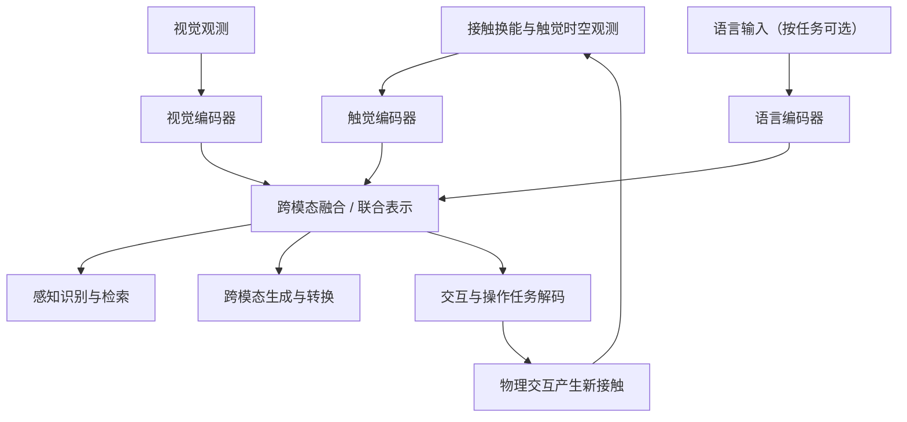

# Tactile-based Multimodal Fusion in Embodied Intelligence / 具身智能中的触觉多模态融合综述

## 一句话定义

本综述梳理触觉如何结合视觉、语言及动作等信号，将局部接触观测连接到物体理解、跨模态生成和机器人操作。

## 英文缩写速查

| 缩写 | 英文全称 | 简要说明 |
|---|---|---|
| T-V | Tactile-Vision | 触觉与视觉配对 |
| T-L | Tactile-Language | 触觉与语言配对 |
| T-V-L | Tactile-Vision-Language | 触觉、视觉、语言联合 |
| T-V-O | Tactile-Vision-Other | 加入动作、音频或本体感受等 |
| VLA | Vision-Language-Action | 视觉语言动作模型 |
| FID | Fréchet Inception Distance | 生成分布差异指标 |

## 核心信息

| 项目 | 内容 |
|---|---|
| 完整英文题名 | Tactile-based Multimodal Fusion in Embodied Intelligence: A Survey of Vision, Language, and Contact-Driven Paradigms |
| 版本 | arXiv:2605.17336v1，2026-05-17；本文依据 v1 全文 |
| 作者 | Zhixiang Cao、Di Tian、Runwei Guan 等 14 位作者，完整名单见论文归档 |
| 机构 | 西安交通大学、香港科技大学（广州）、南京大学、紫金山实验室、武汉大学、詹姆斯库克大学、复旦大学、北京邮电大学、灵心巧手、斯威本科技大学（以论文作者单位为准） |
| 文献范围 | 作者声明覆盖截至 2026 年第一季度的研究 |
| 官方资源 | 公开文献索引与配图；没有本综述自有可运行模型 |

## 为什么重要

- 用数据、方法、传感硬件三个视角连接研究选型，避免只按模型名字找论文。
- 分开讨论语义对齐、信号生成与接触执行，帮助判断实验究竟证明了哪种能力。
- 强调传感器形态、接触条件及采集协议的域偏移，适合给机器人触觉部署建立核查维度。

## 核心原理

§II 的统一抽象是：观测经各模态编码器得到表示，经融合算子形成联合表示，再由任务解码器输出类别、生成信号或控制动作。早期融合、后期融合、共享嵌入、交叉注意力和对比学习是综述列出的实现选择，不是一个固定网络的全部模块。

### 流程总览

依据：§II-A 公式 (1)–(4)、Fig. 5 和 §IV-C。闭环边仅表示操作分支的持续触觉反馈；感知与生成任务不要求控制闭环。

### 数据与任务的两条分类轴

| 维度 | 分类 | 使用边界 |
|---|---|---|
| 数据（§III） | T-V、T-L、T-V-L、T-V-O | 同时核对传感器、真实/仿真来源、时间对齐及动作覆盖 |
| 感知识别（§IV-A） | 物体、属性/材质、抓取成败、跨模态检索 | 共享语义表示与分类性能不能直接证明控制能力 |
| 生成转换（§IV-B） | 视觉与触觉双向生成、触觉描述、文本驱动触觉合成 | 输出逼真度、语义一致性与物理可用性需分别验证 |
| 交互操作（§IV-C） | 多模态操作、语言指令下操作 | 关注执行时接触反馈、动作可行性和实时性 |
| 硬件（§V） | 可穿戴、手持/指尖、皮肤/贴片、夹爪集成 | 几何、材料、标定与耐久性影响跨平台迁移 |

综述把 ImageNet-T 列为触觉感知相关视觉语言资源，但明确它没有物理触觉测量；数据规模相近也不能将其与真实触觉轨迹等同。

## 源码运行时序图

**不适用。** 截至 2026-11-07，论文指向的官方仓库根目录仅有 README、imgs 与 .gitignore，没有本综述自有训练、推理或部署入口。仓库中的文献代码链接不构成统一运行管线，故不绘制虚构时序图。

## 工程实践

1. 先确定目标是识别、生成还是操作，再匹配数据与评价指标。
2. 操作系统优先核对视觉、触觉、动作的时间对齐和接触覆盖，记录传感器标定与缺失模态处理。
3. 使用综述寻找方法后，回到各方法原论文与实际实现检查推理时延、输入格式和迁移设置。本页未独立复验被引工作的数值。
4. 可结合 [AnyTouch](./paper-anytouch.md) 查看异构传感器表征；结合 [Touch100k](./dataset-touch100k.md) 查看三模态数据。

## 实验与评测

本论文为综述，表 I–III 是已有数据、方法和评测协议的汇总，没有统一环境下重新训练全部方法的排名。

| 目标 | 文中讨论的典型指标 | 不能代替的证据 |
|---|---|---|
| 识别/检索 | 分类准确率、AP/mAP、检索排序指标 | 接触物理可行性 |
| 信号生成 | MSE、PSNR、SSIM、FID | 实际触感与操作收益 |
| 触觉语言生成 | 语义一致性、LLM 评审 | 校准的物理属性与人类判断 |
| 操作 | 成功率、目标收敛、动作误差、阶段分数 | 不同形态/传感器间的统一性能比较 |

§VI-C 指出跨数据集与跨传感器泛化更难，现有评测多限于分布内。数据量、模态覆盖与预训练有助于表示学习，但不是跨平台免适配的保证。

## 结论

这篇综述适合建立触觉融合的研究与工程地图，具体性能判断仍需回到单项工作的实验条件。

- 先分清数据模态与任务目标，再选择融合机制。
- 将语义对齐、生成质量、控制成功率分别验收。
- 将跨传感器、跨物体、跨数据集迁移作为独立检查项。
- 对闭环系统同时考察时间对齐、缺失观测、时延和顺应性。
- 将 §VII 的统一 token、接触仿真与不确定性约束理解为未来方向。

## 与其他工作对比

| 项目 | 定位区别 |
|---|---|
| [触觉引导机器人学习综述](./paper-tactile-guided-robot-learning-survey.md) | 按触觉在学习中的功能角色（表示、策略、基础模型与世界模型）组织；本综述以数据、方法、硬件三视角组织，并突出触觉与视觉/语言的跨模态融合 |
| [触觉机器人操作综述](./paper-tactile-based-robotic-manipulation-survey.md) | 以力学驱动与数据驱动两条路线讨论触觉如何转化为操作动作；本综述除操作外还覆盖感知识别与跨模态生成 |
| [AnyTouch](./paper-anytouch.md) | 具体的跨传感器静态—动态视触觉表征方法；本综述只做文献归纳，不提供自有模型或统一复评 |

## 局限与风险

- 截止 2026 年第一季度的综述无法覆盖之后所有进展；官方文献库更新也不自动改变 v1 结论。
- 各论文传感硬件、划分与任务不同，表格中的指标不宜直接跨研究比较。
- 综述并未证明某一种融合架构普遍最优，也未给出统一部署方案。
- 官方仓库是文献资源；未发布本综述自有模型、权重或新数据集。被引资源的下载与许可需分别核实。

## 关联页面

- [视触觉融合](../concepts/visuo-tactile-fusion.md) — 接触阶段的信息互补。
- [触觉感知](../concepts/tactile-sensing.md) — 传感原理与信号类型。
- [AnyTouch](./paper-anytouch.md) — 跨传感器静态与动态表征。
- [Touch100k](./dataset-touch100k.md) — 触觉视觉语言配对数据。

## 参考来源

- [v1 全文归档与阅读范围](../../sources/papers/tactile_multimodal_fusion_2605_17336.md)
- [官方文献仓库核查](../../sources/repos/multimodal-tactile-fusion.md)
- [arXiv v1 全文](https://arxiv.org/html/2605.17336v1) — §II–VII、图 1–8、表 I–III。

## 推荐继续阅读

- [官方文献资源库](https://github.com/Wayne-coding/Multimodal-Tactile-Fusion)
- [论文指定版本](https://arxiv.org/abs/2605.17336v1)
