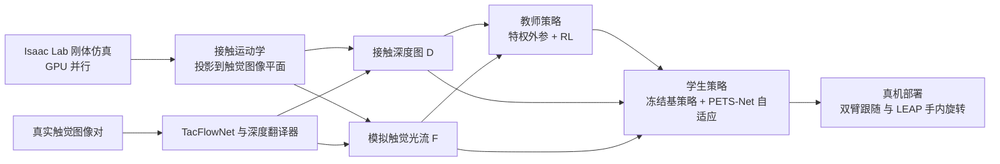

# TactileLab（arXiv:2611.07881）

**TactileLab**（*TactileLab: Sim-to-Real Dexterous Robot Manipulation with Efficient Shear-Sensitive Tactile Simulation*，[arXiv:2611.07881](https://arxiv.org/abs/2611.07881)）作者为 Yijiong Lin、Wenhao He、Toby Jack、Max Yang、Haoran Li、Nathan F. Lepora。机构以论文首页为准：北京理工大学航空航天工程学院 OpenDIM Lab、布里斯托大学工程数学系与 Bristol Robotics Laboratory、西交利物浦大学。本页依据 [论文归档](../../sources/papers/tactilelab_arxiv_2611_07881.md)（v1，正文通读，无附录），论文自述与本页判断分开标注。

## 一句话定义

**在 Isaac Lab 的刚体仿真里，用物体相对传感器的接触运动学算出稠密的「模拟触觉光流」，与接触深度图一起喂给 RL 策略，再用学习式的真实到仿真翻译把真实触觉图像对映射回这两种模态，从而不做软体仿真也能得到对剪切敏感的 sim-to-real 触觉策略。**

## 英文缩写速查

| 缩写 | 英文全称 | 简要说明 |
|------|----------|----------|
| RL | Reinforcement Learning | 强化学习；论文用两阶段师生训练，细节见 §IV-B |
| PETS-Net | Positional-Encoding Temporal-Spatial Network | 论文提出的学生侧自适应模块，位置编码 + CNN 空间编码 + 时序编码 |
| TacFlowNet | Real-to-Sim-TacFlowNet | pix2pix 式生成器，真实触觉图像对到模拟触觉光流 |
| LD Contact | Low-Dimensional Contact | 低维接触量：接触位置、力大小、接触标志（AnyRotate 式） |
| HORA | In-Hand Object Rotation via Rapid Motor Adaptation | 论文沿用的本体感觉师生基线与框架 |
| TTF | Time-to-Fail | 物体掉落前的仿真时长（秒） |
| TTT | Time to Termination | 真机物体掉落、卡住或试验失效前的时长，上限 30 s |
| MAE | Mean Absolute Error | 平均绝对误差，表 II 用于剪切估计 |
| TCN | Temporal Convolutional Network | PETS-Net 最终采用的时序编码器 |
| SDF | Signed Distance Function | TacSL 等需要的物体形状先验，TactileLab 不需要 |
| OOD | Out-of-Distribution | 训练分布外的物体 |

## 为什么重要

- 论文要补的缺口（作者自述，§I）：软体触觉仿真能表达剪切但对大规模 RL 太慢；刚体触觉仿真快，却通常只给深度类信号，难支持依赖剪切、滑移的任务（插入、接触内轨迹跟随、受扰的手内操作）。
- 论文的路线：保留刚体仿真的吞吐，另外把「切向运动」做成一种稠密观测，而不是去模拟弹性体形变。
- 与同类工作的区别（§II-A，作者自述）：TacSL 与 HydroShear 能给剪切信号，但都需要预先拿到接触物体的 SDF；TactileLab 直接由刚体接触运动学得到光流，不需要物体专属预处理。
- 与本仓库已有的触觉仿真页对照：[TacSL](paper-sa-2408-06506-tacsl-a-library-for-visuotactile-sensor-simulati.md)、[Taccel](paper-sa-2504-17614-taccel-scaling-up-vision-based-tactile-robotics.md)、[ETac](paper-sa-2604-20295-etac-a-lightweight-and-efficient-tactile-simulat.md)。
- 对「手内灵巧操作 + 触觉 sim-to-real」的参考价值：给出了深度、光流、低维接触三种观测在同一设定下的对比，且有真机验证。

## 核心原理

### 观测与光流的定义（§III）

- 多模态触觉观测 o_t = {D_t, F_t, c_t}：接触深度图 D_t、触觉光流 F_t ∈ R^{H×W×2}、低维接触量 c_t（力、位置、剪切）。
- 光流计算：传感器建模为嵌入式相机；接触深度大于阈值 ε 的像素为接触像素；对每个接触像素取对应物体表面点，在一个仿真步内按刚体相对运动变换后，经射线投影到触觉图像平面，两次投影的像素位移即该点的流向量；接触外为 0（§III-C）。
- 论文强调：光流表示本身不绑定刚体物理，可由软体仿真里追踪表面点得到，但本文只实现了刚体版本（§III-C、§VIII-D）。
- 论文还明确说不追求复现某个传感器的完整形变或光学过程，只生成「任务相关、可大规模生成、之后能通过翻译对齐真实观测」的量（§III-A）。

### 流程总览

### 两阶段师生训练（§IV-B）

- 沿用 HORA 的两阶段框架：阶段 1 教师在仿真中用特权外参 e_t（物体质量、位姿、速度、摩擦、尺度、外加扰动力和力矩、手朝向）经编码器得到隐向量 z_t，用 RL 最大化折扣回报；阶段 2 冻结基策略，自适应模块用「本体、动作、触觉观测历史」回归 z_t，损失是平方误差 L_adapt。
- 双臂跟随任务观测和动作空间较小，学生直接用动作蒸馏（§VI-B）。

### PETS-Net（§IV-C）

- 动机：作者引用谱偏置文献，认为网络偏向学低频函数，接触模态切换处需要更高频的表达。
- 结构：对关节角与上一步动作做 K 个频带的 sin / cos 位置编码；深度和光流各自经 CNN 空间编码器，与低维接触量拼接成触觉特征；时序编码器（最终用 TCN）聚合触觉特征与编码后的本体 / 动作历史，经隐向量头输出 ẑ_t。

### 真实到仿真翻译（§V）

- 训练数据：真实传感器先压到接触位姿 ξ，记录起始图，再沿规定相对运动 Δξ 移动并保持接触，记录末图；仿真侧按同一位姿与运动生成接触深度和稠密光流作为标签。动作包括按压、滑动、倾斜、扭转（图 9）。
- 模型：真实图像对按通道拼接输入生成器，损失为 pix2pix 对抗项加按接触掩码归一化的 L1 流重建项（权重 λ_flow）。
- 作者特别说明：输出是「模拟触觉光流」，不是真实图像的真光流（§V-B）。

## 实验与结果

以下数字均来自论文，括号内为出处。

| 项 | 设置 | 结果 | 出处 |
|----|------|------|------|
| 仿真手内旋转，域内 | Allegro / LEAP 两种手均在仿真中训练；加随机外力矩扰动 | 本体+深度+光流 TTF 27.01 s、Fall Rate 11.76%；仅本体 19.87 s、47.66%；Oracle 教师 27.45 s、9.37% | §VII-A，表 I |
| 仿真手内旋转，OOD 物体 | 同上 | 本体+深度+光流 Fall Rate 18.69%；本体+低维接触 31.21%；仅本体 57.85% | §VII-A，表 I |
| 历史长度 | 3 个随机种子 | 作者称深度 / 光流观测在 5–10 步历史即达到强表现，本体与低维接触需约 10–15 步 | §VII-A3，图 5c |
| 光流 vs 深度（双臂跟随，仿真） | 3 个随机种子 | 光流优于仅深度；深度+光流收敛更快，最终与仅光流相近，作者据此称光流是主导模态 | §VII-A2，图 6 |
| PETS-Net 消融 | 3 个随机种子 | PE 变体均优于无 PE，K = 2 最好；TCN 最高、GRU 略低；Transformer 不更好且显存更高；空间+时序组合最优 | §VII-B，图 8 |
| 跨传感器翻译 | 6 种传感器配置 | 标记式传感器（带标记 GelSight Mini、平面 TacTip）翻译前后接近；无标记 GelSight Mini 平移 MAE 1.79 到 0.34 mm/s，旋转 4.50 到 1.18 °/s | §VII-C，表 II |
| 真机双臂跟随 | 仅用刚性立方体 + 直线轨迹在仿真训练 | 位置误差 0.91–6.43 mm，姿态误差 0.019–0.057 rad，未见物体与圆轨迹均可 | §VII-D1，表 III |
| 真机手内旋转 | LEAP Hand，仿真只用胶囊物体，10 个初始抓取，30 s 上限 | 本体+深度+光流 1.95 ± 0.81 圈；本体+深度 1.70 ± 0.78；本体+低维接触 1.61 ± 0.90；仅本体 0.82 ± 0.56 | §VII-D2，表 IV |
| 真机按形状 | 同上 | 立方体类 1.33 ± 1.00（深度+光流）对 1.04 ± 0.70（仅深度）；低维接触 0.28 ± 0.09，低于仅本体 0.45 ± 0.35 | §VII-D2，表 V |

作者观察到的涌现行为（§VII-A4，图 7）：丰富触觉输入下出现「两指稳定、其余手指交替接触断开」的捏取步态（pinch gaiting），仅本体或低维接触策略中未观察到。这是作者的定性描述，未给出统计。

## 工程实践

- 平台：基于 [Isaac Lab](isaac-lab.md)，论文称支持 GPU 并行与多种触觉模态（接触力、位置、深度图、光流）、单臂 / 双臂 / 灵巧手环境（§I，贡献 1 和 3）。
- 强化学习与奖励：教师用 RL 最大化回报（论文未在正文点名具体算法，推测与 HORA 一致使用 [PPO](../methods/ppo.md)，该点未核）；奖励设计思路见 §VI-B、§VI-C，具体系数在附录，v1 PDF 未含。
- 真机硬件：LEAP Hand 加四个视觉触觉指尖，传感器选用半球形 TacTip，理由是更耐用、弹性形变范围更大（§VII-C、§VII-D）；双臂任务为 leader / follower 两臂。
- 传感器适配思路（作者自述，§VIII-C）：换新传感器主要是重新学一个到同一深度与光流空间的翻译器，而不必改仿真表示或策略。
- 数据采集：真实到仿真翻译需要为每种传感器采集真实图像对与仿真标签，采样率按 25 Hz 换算速度（表 II 脚注）。
- 开源状态：论文称将开源；项目页 Code 入口在 2026-11-09 核对时显示 Coming soon，因此当前无可运行代码。
- 相关概念：[师生训练](../methods/teacher-student-dagger-training.md)、[特权训练](../concepts/privileged-training.md)、[域随机化](../concepts/domain-randomization.md)。

## 与其他工作对比

| 对照 | 剪切 / 切向信号 | 与 TactileLab 的差别（出处） |
|------|-----------------|------------------------------|
| 软体触觉仿真（论文 §I 泛指） | 能表达剪切 | 作者称对大规模 RL 太慢；TactileLab 保留刚体吞吐，不模拟弹性体形变 |
| 深度式刚体触觉仿真 | 通常只有深度类信号 | 难支持依赖剪切、滑移的任务（§I）；TactileLab 另加稠密光流 |
| [TacSL](paper-sa-2408-06506-tacsl-a-library-for-visuotactile-sensor-simulati.md)、HydroShear | 能给剪切信号 | 都需预先拿到接触物体的 SDF（§II-A）；TactileLab 由刚体接触运动学直接算光流，无物体专属预处理 |
| HORA（两阶段师生框架） | — | TactileLab 沿用其框架，学生侧换成 PETS-Net 并加入深度 / 光流（§IV-B、§IV-C） |
| AnyRotate 式低维接触观测 | 力、位置、剪切低维量 | 作为表 I / IV / V 的基线；在本文「仅胶囊」训练协议下真机立方体类低于仅本体（表 V），不宜当作对 AnyRotate 的一般结论 |

[Taccel](paper-sa-2504-17614-taccel-scaling-up-vision-based-tactile-robotics.md)、[ETac](paper-sa-2604-20295-etac-a-lightweight-and-efficient-tactile-simulat.md) 是本仓库已有的触觉仿真页，论文正文未与二者做实验对比，此处只列作入口。

## 结论

**TactileLab 的主要贡献是证明「刚体仿真 + 模拟触觉光流 + 真实到仿真翻译」能在剪切相关的灵巧任务上完成 sim-to-real，但光流相对深度的真机增益证据偏弱。**

1. 最能说明问题的指标是仿真 OOD 物体的 Fall Rate（深度+光流 18.69% 对仅本体 57.85%，表 I）与真机圈数（1.95 ± 0.81 对仅本体 0.82 ± 0.56，表 IV）。
2. 光流对深度的增益主要来自仿真消融（图 6）；真机上深度+光流与仅深度的均值差小于标准差，10 个初始抓取、未做显著性检验。
3. 换传感器的成本集中在翻译器：需为每种传感器采集真实图像对；无标记传感器翻译误差仍偏高（表 II）。
4. 「高效」缺定量吞吐数字，选型时不能据此与软体仿真比速度。
5. 部署读法：迁移假定黏着接触，外扰或滑移会破坏假设（§VIII-D）；代码截至 2026-11-09 尚未开放。

## 局限

作者自述（§VIII-D）：

- 真实到仿真迁移假定黏着接触（no-slip）；外部扰动或接触突变可能破坏假设并导致不可恢复状态；如何把滑移加入触觉仿真仍是开放问题。
- 光流目前只在刚体仿真里实现，软体版本是未来工作。
- 推广到更多物体形状需要更大的高维真实到仿真数据集和几何感知的迁移模型，因为同样的切向运动在不同局部几何上外观不同。
- 作者也承认，无标记传感器上切向形变必须在真实图像里可观测，翻译才可靠；无标记 DIGIT 旋转误差仍较高（3.33 °/s，R² = 0.92）。
- 作者指出 TCN 胜出只在当前设定下成立，不代表对注意力或循环结构的普遍优势（§VII-B2）。

本页作者判断（未经论文验证，仅为读后观察）：

- 效率主张缺定量支撑：正文中我没有找到仿真吞吐、并行环境数或与软体仿真的速度对比数字（可能在附录，v1 PDF 未含），「高效」目前只是定性说法。
- 真机手内旋转只在 10 个初始抓取上评估，表 IV 中深度+光流与仅深度的均值差（1.95 对 1.70）小于各自标准差，论文未做显著性检验；立方体类结论（1.33 ± 1.00 对 1.04 ± 0.70）同样如此。
- 真机双臂跟随（表 III）没有与论文所引的 PID 位姿剪切伺服基线或深度策略做对照，无法据此判断光流在真机上的增益；光流相对深度的优势主要来自仿真消融。
- 低维接触基线在立方体上差于仅本体，论文解释为其在「仅胶囊」训练协议下遇到 OOD 触觉状态，并指出原 AnyRotate 训练含立方体；因此该对比取决于本文设置，不宜当作对 AnyRotate 的一般性结论。
- 真机只验证了一个手（LEAP）、一种指尖传感器（半球 TacTip）与一类任务（旋转），「跨具身」主张的证据比「跨传感器」翻译实验弱（后者仅验证剪切估计误差，不含各传感器上的闭环控制）。
- 附录缺失导致的未核项：观测维度、奖励系数、接触位姿范围、训练硬件。

## 关联页面

- [触觉感知](../concepts/tactile-sensing.md)
- [视触觉融合](../concepts/visuo-tactile-fusion.md)
- [接触丰富操作](../concepts/contact-rich-manipulation.md)
- [Sim2Real](../concepts/sim2real.md)
- [特权训练](../concepts/privileged-training.md)
- [域随机化](../concepts/domain-randomization.md)
- [奖励设计](../concepts/reward-design.md)
- [师生训练 / DAgger](../methods/teacher-student-dagger-training.md)
- [PPO](../methods/ppo.md)
- [Isaac Lab](isaac-lab.md)
- [Allegro Hand](allegro-hand.md)
- [TacSL](paper-sa-2408-06506-tacsl-a-library-for-visuotactile-sensor-simulati.md)
- [Taccel](paper-sa-2504-17614-taccel-scaling-up-vision-based-tactile-robotics.md)
- [ETac](paper-sa-2604-20295-etac-a-lightweight-and-efficient-tactile-simulat.md)
- [操作任务](../tasks/manipulation.md)

## 参考来源

- [tactilelab_arxiv_2611_07881.md](../../sources/papers/tactilelab_arxiv_2611_07881.md)
- [arXiv:2611.07881](https://arxiv.org/abs/2611.07881)
- 项目页：<https://yijionglin.github.io/tactilelab/>

## 继续阅读

- [arXiv PDF（v1）](https://arxiv.org/pdf/2611.07881v1)
- 论文所引相关工作：TacSL（arXiv:2408.06506）、Taccel、HydroShear（arXiv:2603.00446）、HORA、AnyRotate、Tactile Gym 系列（均见论文参考文献）。
