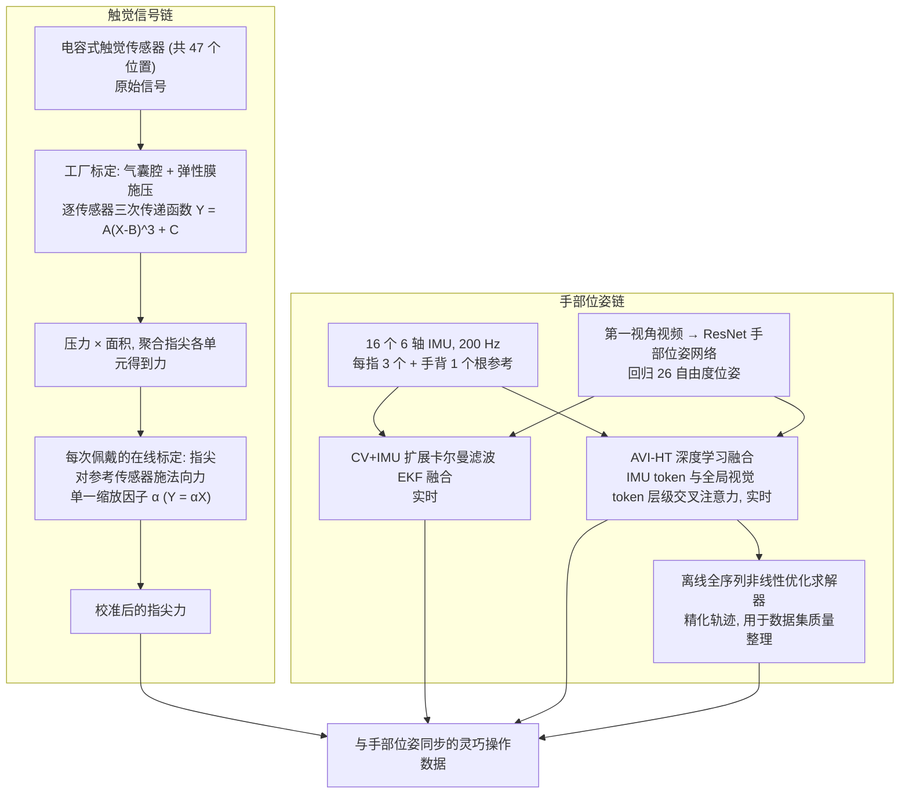

# Tactus：用于自然灵巧操作数据采集的触觉与姿态感知手套

**Tactus**（*Tactus: Tactile & Pose Sensing Glove for Natural Dexterity Data Collection*，[arXiv:2610.39076](https://arxiv.org/abs/2610.39076)）收录于 senlanke「具身运控lab」10-26–10-30 前沿论文动态（Manipulation）。本页依据**周报条目 + arXiv 摘要页**整理，未逐页核对正文 PDF；指标与结论以论文为准。

## 一句话定义

**Tactus：用于自然灵巧操作数据采集的触觉与姿态感知手套——提出织物集成式传感手套，结合电容触觉阵列与 IMU 姿态跟踪。系统包含 47 个触觉传感位置和 16 个六轴 IMU，并提供跨设备标定流程。在操作过程中，指尖关键点相对误差约 11.0 mm，可用于接触感知机器人策略的数据采集。**

## 英文缩写速查

| 缩写 | 英文全称 | 简要说明 |
|------|----------|----------|
| VLA | Vision-Language-Action | 视觉–语言–动作模型 |
| IL | Imitation Learning | 模仿学习 |

## 为什么重要

- 周报所述待解决的问题：人类灵巧操作示范需要准确的手部姿态和接触力信息，但相机在手物遮挡时难以恢复姿态，传统传感手套又可能影响自然抓取动作。

## 流程总览

图依据：论文 §III-A/B（传感器与 IMU 布局）、§IV-A 触觉标定流程、§IV-B 手部位姿跟踪流程、Fig.1/6

## 核心机制

| 项 | 内容 |
|----|------|
| **arXiv** | [2610.39076](https://arxiv.org/abs/2610.39076) · [PDF](https://arxiv.org/pdf/2610.39076) |
| **作者（arXiv）** | Guan, Li, Granberry, Rachael, Aseeri, Sahar, Rostami, Sahar, Niehues, Taylor, Marri, Sai Dhanooshi, Huang, Mia, Zhang, Dingtian et al. |
| **机构（周报所述，未逐条核实）** | Meta Reality Labs Research。 |
| **arXiv 评论栏** | （无） |
| **开源** | arXiv 摘要页与评论未见代码或项目页链接（仅核对 arXiv 摘要页，不代表未发布）（2026-11-02） |
| **周报所述创新点** | 提出织物集成式传感手套，结合电容触觉阵列与 IMU 姿态跟踪。系统包含 47 个触觉传感位置和 16 个六轴 IMU，并提供跨设备标定流程。在操作过程中，指尖关键点相对误差约 11.0 mm，可用于接触感知机器人策略的数据采集。 |

### arXiv 摘要节选（英文原文）

> Collecting naturalistic human manipulation demonstrations with accurate contact force and hand pose is essential for robot dexterous manipulation policy and foundational world model learning - yet no existing wearable platform provides both calibrated fingertip force sensing and occlusion-resilient hand tracking in a form factor that preserves natural manipulation behavior. We present Tactus, a textile-integrated sensing glove that co-optimizes three design pillars: (1) a thin, conformal 3D-knit form factor (1.5 mm fingertip stackup) designed to minimize interference with natural manipulation, (2) strategically placed capacitive tactile sensors at manipulation-relevant regions informed by empirical contact studies, and (3) IMU-fused pose tracking that maintains accuracy through the hand-object occlusions where manipulation data is most valuable.

## 源码运行时序图

**不适用**：arXiv 摘要页与评论未见代码或项目页链接（仅核对 arXiv 摘要页，不代表未发布），无可对齐的官方代码流程。

## 实验与评测

- 周报与摘要给出的数字/场景已写入上表「创新点」与摘要节选；其余实验细节、基线与成功率定义请回到论文正文。
- 读法：先对齐任务设定、传感器与成功定义（仿真/真机），再解读 headline 数字，勿跨论文直接比较。

## 与其他工作对比

| 维度 | 读法 |
|------|------|
| **同周对照** | 见 [Manipulation周报技术地图](../overview/senlanke-weekly-2026-10-26-30-manipulation-technology-map.md)，按方向浏览同期论文 |
| **开源状态** | arXiv 摘要页与评论未见代码或项目页链接（仅核对 arXiv 摘要页，不代表未发布） |

## 结论

**Tactus：用于自然灵巧操作数据采集的触觉与姿态感知手套。**

1. 本页是入库级摘要，复现前请核对论文正文、附录与代码仓库。
2. 指标须连同实验条件解读。
3. 关注 arXiv 版本更新与代码发布。

## 关联页面

- [senlanke-weekly-2026-10-26-30-manipulation-technology-map](../overview/senlanke-weekly-2026-10-26-30-manipulation-technology-map.md)
- [manipulation](../tasks/manipulation.md)
- [vla](../methods/vla.md)

## 参考来源

- [tactus-tactile-pose-sensing-glove_arxiv_2610_39076.md](../../sources/papers/tactus-tactile-pose-sensing-glove_arxiv_2610_39076.md)
- [wechat_senlanke_weekly_manipulation_2026-10-26_30.md](../../sources/blogs/wechat_senlanke_weekly_manipulation_2026-10-26_30.md)
- [arXiv:2610.39076](https://arxiv.org/abs/2610.39076)
- [arXiv PDF](https://arxiv.org/pdf/2610.39076)：已通读全文：系统设计（§III）与信号建模（§IV-A 触觉标定、§IV-B 位姿跟踪）；评测与应用部分（§V–§VI）仅概览，未逐表核对

## 推荐继续阅读

- [arXiv PDF](https://arxiv.org/pdf/2610.39076)
