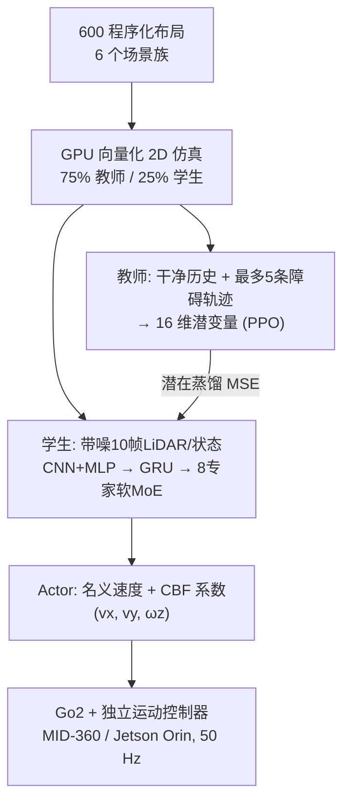

# TAME-Nav：时序非对称 MoE 蒸馏的敏捷导航

**TAME-Nav**（*Temporal Asymmetric Mixture-of-Experts Distillation for Agile and Versatile Robot Navigation*，[arXiv:2610.12877](https://arxiv.org/abs/2610.12877)，[项目页](https://tame-nav.github.io/)）来自 **上海交通大学、宁波东方理工大学、香港理工大学、中国科学技术大学**：教师在干净观测与动态障碍轨迹上学特权表征，学生只看带噪 LiDAR 历史，用时序编码 + 软专家路由 + 潜在蒸馏对齐，部署在带 LiDAR 的 Unitree Go2 上。

## 一句话定义

**用「看得见障碍轨迹的教师」带「只有带噪历史的学生」，学生内部用 8 个软路由专家分担不同场景的决策。**

## 英文缩写速查

| 缩写 | 英文全称 | 简要说明 |
|------|----------|----------|
| MoE | Mixture-of-Experts | 本文学生的软路由 8 专家 |
| CBF | Control Barrier Function | Actor 输出系数，修正名义速度（沿用 SEA-Nav 的可微 LiDAR CBF） |
| GRU | Gated Recurrent Unit | 跨 10 个时间槽汇总为 256 维 |
| PPO | Proximal Policy Optimization | 教师编码器、Actor、Critic 的训练算法 |
| SR / CR | Success Rate / Collision Rate | 成功率与碰撞率 |
| BARN | Benchmark for Autonomous Robot Navigation | 导航得分采用其风格，v_max=2.0 m/s |

## 为什么重要

- 腿式机器人在局部陷阱与突发动态障碍中，单一前馈策略容易失败；论文的真机陷阱脱困里 4 个基线为 0%，TAME-Nav 为 100%。
- 非对称蒸馏把「仿真里才有的轨迹信息」压进可部署的 LiDAR 历史表征，是有明确消融（去教师轨迹 −6.75 pp）的做法。

## 方法栈 / 流程总览

## 方法

- **教师：** 10 帧干净历史经时序 MLP 得 16 维潜变量；最多 5 条动态障碍轨迹（每条 8 维：相对位置、速度、半径、不确定度、年龄、可见性）经自/交叉注意力（2 头、64 维）得 16 维动态潜变量；以带可学习门（初值 1）的归一化残差和融合。
- **学生：** 55 维观测（41 LiDAR + 14 非 LiDAR）× 10 帧（约 0.9 s）；LiDAR 走 3 层 1D CNN、状态走 2 层 MLP，GRU 汇总 256 维；路由输入 267 维（256 + 11 维导航上下文），8 个专家每个输出 16 维，稠密 softmax 路由，另有专家均值权重均衡损失。
- **控制输出：** 共享 Actor 给 (vx, vy, ωz) 名义均值与 softplus CBF 系数，借可微 LiDAR CBF 修正；高斯策略的标准差为可学习的状态无关量。
- **损失与训练：** PPO 训练教师编码器、Actor、Critic；学生对 stop-gradient 教师潜变量做 MSE 蒸馏（按 1/16 缩放）。Critic（104 维输入）仅训练使用。
- **随机化：** LiDAR 延迟 0–20 ms、噪声 1–2 cm、射线丢失 0–3%；里程计延迟 0–40 ms；执行端延迟 0–40 ms、响应常数 0.08–0.16 s、增益 0.80–0.95、死区 0.22–0.28 m/s。
- **文中未报告：** 均衡损失权重、折扣因子、并行环境数。

## 源码运行时序图

不适用：项目页 “Code” 链接（`code/`）实际是 “Coming soon” 占位页，截至 2026-10-12 无官方仓库，无法对齐真实目录与脚本。

## 工程实践

| 项 | 建议 |
|----|------|
| 部署形态 | Go2 + Livox MID-360 + Jetson Orin，指令 50 Hz，LiDAR 10 Hz |
| 速度执行 | 仿真里的速度指令由另训练的运动控制器执行，复现需先备此层 |
| 随机化 | 重点在传感延迟、执行响应与死区，与真机差距对应 |
| 复现风险 | 关键超参未公开，需等代码 |

## 实验与评测

- **序贯组合场景（64 布局 / 512 回合）SR/CR/Score：** TAME-Nav 81.64/18.16/0.4068；SEA-Nav(OM) 66.80/33.01/0.2393；DCLP(OM) 59.96/40.04/0.2998；NavRL(OM) 34.96/60.94/0.1743；原版 SEA-Nav 47.27/52.73/0.1934；原版 NavRL 0.00/75.39/0.0000。
- **多房间组合场景（4–5 房间）：** TAME-Nav 75.20/13.48/0.3448；NavRL(OM) 67.58/15.62/0.3115；SEA-Nav(OM) 66.41/22.85/0.2535；DCLP(OM) 60.16/35.16/0.2951。
- **分布内 600 布局：** 6 个场景族 SR 均最高，密集杂物与凹陷阱领先超 35 pp（具体数值仅在原文图 3）。
- **消融：** 去 MoE −4.25 pp，去教师轨迹 −6.75 pp，去时序历史 −5.59 pp（完整模型绝对 SR 文本未给）。
- **真机（各 10 次，允许一次轻微接触）：** 局部陷阱：TAME-Nav 100%（0.10 碰撞/次），NavRL(OM) 50%，其余 0%。窄通道+突发动态障碍：TAME-Nav 100%（0.00/次），SEA-Nav(OM) 与 NavRL(OM) 90%，SEA-Nav 与 DCLP(OM) 80%，NavRL 0%。20 次试验仅 1 次轻微接触。

## 结论

**对敏捷腿式导航，教师的动态障碍轨迹特权与时序历史比单纯加专家更关键；真机小样本全成功，但证据集中在两个场景。**

1. 先用特权教师稳定学出障碍相关表征，再蒸馏到带噪学生，教师轨迹是最大消融项。
2. 保留约 0.9 s 的观测历史能弥补遮挡和动态障碍。
3. 软 MoE 带来的增益较小（−4.25 pp），不必先堆专家数。
4. 随机化延迟、死区与响应特性对应真机执行，值得照抄思路。
5. 真机只有两个场景各 10 次，迁移到别的环境前需自测。

## 与其他工作对比

| 对照 | 差异读法 |
|------|----------|
| SEA-Nav | 提供可微 LiDAR CBF；TAME-Nav 在其上加教师–学生与 MoE，对照中 SR 81.64% vs 66.80%（OM） |
| NavRL | 原为空中机器人，适配到地面需重训；在陷阱场景表现差 |
| [教师–学生 DAgger](../methods/teacher-student-dagger-training.md) | 同属特权蒸馏范式，本文蒸馏的是潜变量而非动作 |
| [多专家蒸馏](../methods/multi-expert-distillation.md) | 另一种专家组织方式（站内页） |
| [四足分层导航栈](../concepts/hierarchical-quadruped-navigation-stack.md) | 栈上下文：本文策略输出速度指令，下接独立运动控制器 |

## 局限与风险

- **开源状态：** 截至 2026-10-12 项目页 Code 为 “Coming soon”，未发布。
- 训练评测在 2D 抽象仿真器；真机两场景各 10 次、单一机器人。
- 基线含适配（NavRL 原为空中、DCLP 作者复现），比较需谨慎。
- 超参数缺失，且无显式局限章节。

## 关联页面

- [34 篇论文空间落地技术地图（汇总页）](../overview/embodied-station-34-papers-spatial-grounding-technology-map.md)
- [四足分层导航栈](../concepts/hierarchical-quadruped-navigation-stack.md)
- [教师–学生 DAgger 训练](../methods/teacher-student-dagger-training.md)
- [多专家蒸馏](../methods/multi-expert-distillation.md)
- [Go2 自主栈](./autonomy-stack-go2.md)
- [运动任务](../tasks/locomotion.md)

## 参考来源

- [34 篇论文盘点（具身智能小站，2026-10-12）](../../sources/blogs/wechat_embodied_station_34_papers_spatial_grounding_2026-10-12.md)
- [tame_nav_arxiv_2610_12877.md](../../sources/papers/tame_nav_arxiv_2610_12877.md) — 论文摘录
- [tame-nav-project.md](../../sources/sites/tame-nav-project.md) — 项目页核查
- [arXiv:2610.12877](https://arxiv.org/abs/2610.12877)

## 推荐继续阅读

- [TAME-Nav 项目页](https://tame-nav.github.io/)
- [arXiv HTML 全文](https://arxiv.org/html/2610.12877v1)
