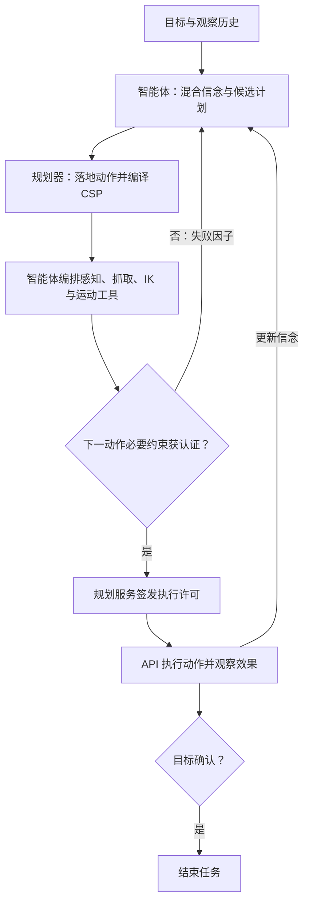

# TAMPAgent: Agentic Belief-Space Planning for Mobile Manipulation / 面向移动操作的信念空间智能体规划

## 一句话定义

**TAMPAgent 让视觉语言智能体根据未知世界的混合信念组织任务计划，再由规划器和几何工具认证下一动作，交替完成观察、操作与重规划。**

## 英文缩写速查

| 缩写 | 英文全称 | 简要说明 |
|---|---|---|
| TAMP | Task and Motion Planning | 联合约束任务顺序与连续运动参数 |
| LVLM | Large Vision-Language Model | 负责语义理解、位置假设和工具编排 |
| CSP | Constraint Satisfaction Problem | 动作参数与约束构成的求解问题 |
| POMDP | Partially Observable Markov Decision Process | 通过信念表达世界状态不完全可见 |
| RGB-D | Red Green Blue and Depth | 目标颜色图像与深度，操作前的重要输入 |
| IK | Inverse Kinematics | 验证抓取或放置姿态可达性 |
| CaP | Code as Policies | 直接编写工具调用程序的比较范式 |
| GaP | Graph as Policy | 以工具调用图表示策略的比较范式 |
| API | Application Programming Interface | 访问规划与机器人服务的接口 |

## 为什么重要

家庭操作同时缺少目标位置和几何可行性信息：苹果可能在冰箱里，也可能被物体挡住；找到后还要决定先移开什么、抓起来后能否放下。TAMPAgent 将「先获取什么信息」写入计划，让约束失败指导下一轮推理。它与[机器人语言控制接口](../concepts/llm-robotics-control-interfaces.md)共同解释语义意图如何落实为可检查的动作。

## 核心原理

| 核心信息 | 内容 |
|---|---|
| 机构 | 英伟达研究院（NVIDIA Research）、佐治亚理工学院（Georgia Tech）、犹他大学（University of Utah） |
| 作者 | Utkarsh A. Mishra、Alperen Degirmenci、Yongxin Chen、Danfei Xu、Tucker Hermans、Caelan Garrett |
| 原文版本 | arXiv:2611.03584v1，2026-11-02；按正文 §1–7 与附录 A–H 编译 |
| 输入 / 输出 | 目标指令、观察历史和当前信念 / 经认证的下一动作与更新信念 |
| 平台 | MuJoCo 中的 RB-Y1、Unitree G1；另有两平台真机演示 |

### 混合信念与类型

经典信念为 $b_t(s)=P(s_t=s\mid h_t)$。本方法以混合表示避免对每个候选计划做完整信念积分：变量可以是未知先验 `Unif`、智能体的 `Lang` 假设，或工具认证的 `Mask`、`RGBD`、`Grasp`、`Conf`、`Traj`。语言形式中的成本与风险由模型隐式权衡，先验数值不等于校准概率。

正文的抽象动作域为 `detect`、`pick`、`place`。pick 必须有 RGB-D 目标估计，并满足抓取、IK 与无碰撞运动约束；place 还需已知支撑物与稳定放置约束。共享抓取变量连接 pick 与 place，使当前选择考虑未来放置；后续未观测参数可暂用语言表示，不能直接用于低层操作。

### 认证与恢复

智能体每轮写问题、选计划，规划器编译约束图，智能体编排工具填参。**整段计划的耦合关系可见，但只需认证下一动作的必要参数**，并非所有未来动作都已求解。detect 的移动先检查路径，目标是否可见在到达视点后观测确认，观察失败会继续重规划。

无法认证时，先尝试其他候选或视点，再替换计划或更新假设。附录 A 的案例为：企鹅遮挡导致 RGB-D 不足 → 移开企鹅发现苹果 → 持物寻找碗 → 放置 IK 失败 → 移近并重新认证后完成。底座变化后，与姿态相关的证据需重新认证。

## 流程总览

依据 §3、图 3–4 与附录 A/F；箭头表示信息及执行反馈，非源码调用。

## 源码运行时序图

**不适用：截至 2026-11-07，项目页标注 Code soon，未提供可运行官方仓库。** 附录 F/G 披露服务与 `tampagent_api.py` 客户端，但论文片段和网页展示不足以核对完整运行入口，故不绘制假定的源码时序图；见[开放状态归档](../../sources/sites/tampagent.md)。

## 工程实践

下表为论文披露的结构，尚未通过公开源码复现。

| 层 | 实现与原文位置 |
|---|---|
| 感知 / 几何 | SAM 3 分割；真实 RB-Y1 的 Aria 双目经 Fast-FoundationStereo 估深；GraspGenX 生成抓取；cuRobo 做 IK 与机械臂运动规划（§3、附录 E/F） |
| 低层控制 | RB-Y1 移动底座与机械臂；G1 的 SONIC 将底座速度和上身关节路点转为全身运动（附录 D/E） |
| 服务边界 | 沙箱智能体 → gateway → TAMPAgent API；TAMP service 管理信念、锁定计划与许可；工具仅返回证据或签名轨迹（附录 F/G） |
| 仿真 / 真机差别 | RB-Y1 仿真有门/抽屉技能、底座路径规划；真机配置没有这些功能，以有限长度直线段移动（表 A5） |
| 状态确认 | 仿真直接观测持物状态；RB-Y1 真机由智能体观察后声明，任务由操作员裁决（表 A5） |

工程读法：分别记录感知失败、抓取/IK/路径认证失败、效果未确认和超时。许可绑定当前状态与动作窗口，不能跨底座运动复用旧证据。

## 实验与评测

RB-Y1 九项厨房任务为 T1–T8、T10，各方法各任务 20 回合；T9 单独测试跨尝试记忆学习；三房间 T11–T13 各 5 回合。每回合只有目标指令，没有场景描述。预算按**仿真时间**计：基本 15 分钟加每阻挡物 5 分钟，T3/T7/T9/T10 为 25 分钟。同一平台各方法共享模型、工具和栈（§4、附录 B/H）。

| 口径 | TAMPAgent | CaP | GaP |
|---|---:|---:|---:|
| RB-Y1 九项厨房平均完整成功率 | 77.2% | 57.2% | 61.1% |
| 五项阻挡任务完整成功率（T4–T6、T8、T10） | 75% | 50% | 56% |
| 每仿真分钟未缓存输入 tokens | 19.3k | 20.3k | 27.4k |
| 每仿真分钟输出 tokens | 1.75k | 1.91k | 2.73k |
| T11 / T12 / T13 成功回合数 | 5/5、5/5、4/5 | 5/5、5/5、4/5 | 5/5、5/5、4/5 |
| T9 首次成功所需尝试次数 | 3 | 4 | 3 |

G1 仿真在 T1–T6 各 5 回合，平均完整成功率由 CaP 的 6.7% 提升至 53.3%，部分成功由 30.3% 提升至 76.6%（附录 D）。RB-Y1 使用 GPT-6-Astra low，G1 使用 GPT-5.6 Sol medium；跨平台数字不能隔离模型影响。

RB-Y1 真机展示简单取放、持物寻找容器、移开遮挡物三个类别，未给同口径的重复试验成功率。**G1 真机只抬起阻挡易拉罐的玩具狗；放置玩具未获认证时结束，尚未完成抓罐目标**（图 11）。

## 结论

**主要收益来自用显式信念与约束反馈引导搜索、移障和跨步骤选择，优势集中在需要假设或处理阻挡的厨房任务。**

1. 77.2% 是九项厨房仿真均值，不能混入 T9、三房间或真机演示解释。
2. 工具接口应明确认证哪个约束、证据何时失效，以及失败如何触发重规划。
3. 语言假设支持选抓取和搜索方向，低层操作仍需几何证据。
4. token 按仿真分钟归一化，不能解释为每任务总费用或墙钟速度。
5. 代码待发布，可先借鉴规划器与工具接口，完整复现仍需官方入口。

## 与其他工作对比

| 范式 | 分工 | 本文边界 |
|---|---|---|
| 经典 TAMP | 规划器协调几何工具 | 通常依赖手写问题与已知动作域 |
| VLM-TAMP | 模型写问题或约束，固定管线求解 | §5 讨论 OWL-TAMP、TiPToP，未逐一跑分 |
| CaP | 智能体直接编写工具程序 | 本文在统一栈重实现该范式，并非直接运行原始代码 |
| GaP | 作者与审阅代理构建可验证图 | 保留图运行时；移除独立仿真 rehearsal、checkpoints、原技能库，结果限此适配版 |
| TAMPAgent | 智能体协调规划器与工具，认证后逐步执行 | 动作域固定，依赖工具正确与智能体语义判断 |

## 局限与风险

- **概率与搜索**：语言信念未校准，可能持续搜索而超时；没有完整 POMDP 最优解或任务必达保证（§7）。
- **认证边界**：几何保证以工具和感知正确为条件，不覆盖指令解释；真机持物声明与仿真测量不同（附录 F）。
- **动作域固定**：库存随观察扩展，但智能体不能任意新增动作。正文三类抽象动作与附录 fixture 等工程技能层应区分。
- **评测边界**：三房间结果相同，真机为案例展示，G1 案例未完成目标，不能外推任意未知环境稳定成功。
- **开放状态**：2026-11-07 项目页 Code soon；未提供官方可运行代码、权重与评测数据下载入口。

## 关联页面

- [操作任务](../tasks/manipulation.md)：抓取、移障与放置。
- [视觉语言导航](../tasks/vision-language-navigation.md)：搜索、换视点和移动。
- [机器人语言控制接口](../concepts/llm-robotics-control-interfaces.md)：语义计划与低层工具分工。
- [11-04 期 57 篇技术地图](../overview/embodied-station-2026-11-04-57-papers-technology-map.md)：既有收录入口，复用本节点。

## 参考来源

- [v1 正文及附录 A–H 核对](../../sources/papers/tampagent_arxiv_2611_03584.md)
- [官方项目页与发布状态核查](../../sources/sites/tampagent.md)

## 推荐继续阅读

- [论文全文 v1](https://arxiv.org/html/2611.03584v1)
- [项目页：方法、沙箱、视频与 FAQ](https://umishra.me/TAMPAgent/)
- [NVIDIA 官方研究条目](https://research.nvidia.com/publication/2026-11_tampagent-agentic-belief-space-planning-mobile-manipulation)
