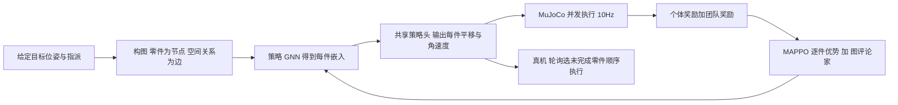

# It Takes Two to Tangram：TangramBench 与 GOMA（arXiv:2611.08814）

*It Takes Two to Tangram: Multi-Agent Object Centric Reinforcement Learning for Assembly*（[arXiv:2611.08814](https://arxiv.org/abs/2611.08814)，v1，2026-11-06，[项目页](https://tangrambench.org/)）。作者来自达姆施塔特工业大学（IAS、控制与信息物理系统实验室）、Hessian.AI、DFKI、Robotics Institute Germany；通讯作者 Jan Peters 组（论文首页）。原文归档见 [sources 归档](../../sources/papers/tangrambench-goma_arxiv_2611_08814.md)。

## 一句话定义

**把装配中的每块零件当作一个智能体，用图网络共享策略加逐智能体 PPO（MAPPO）学习「已知目标位姿下，各零件如何在平面上互不堵路地移到位」；同时发布程序化生成的 Tangram 基准 TangramBench。**

## 英文缩写速查

| 缩写 | 英文全称 | 简要说明 |
|------|----------|----------|
| GOMA | Graph networks for Object-centric Multi-agent Assembly | 本文方法（引言） |
| MAPPO | Multi-Agent Proximal Policy Optimization | 多智能体 PPO，共享策略 + 中心化评论家 |
| GNN | Graph Neural Network | 图网络，边 / 节点 / 全局三类更新 |
| TAMP | Task and Motion Planning | 任务与运动规划 |
| RRT | Rapidly-exploring Random Tree | 快速扩展随机树；本文用 RRT-Connect |
| RRT-J / RRT-P | Joint / Per-piece RRT | 联合规划（21 维）/ 逐件规划（3 维） |
| APF | Artificial Potential Field | 人工势场，本文取仅吸引项作近视基线 |
| SE(2) | Special Euclidean group in 2D | 平面位置加偏航角 |
| FR3 | Franka Research 3 | 真机所用机械臂 |

## 为什么重要

- 任务聚焦一个被刻意隔离出的子问题：目标位姿与零件指派都给定，只问「怎么走才不挡住彼此」（III 节）。这让「装配协调」可以单独度量，不被抓取、形状匹配混在一起。
- 提供了可大规模训练的程序化基准：三档难度，训练配置约 1M / 1.1M / 955k，留出评测各 258 个（III 节）。
- 给出一个清楚的权衡数据点：学习到的反馈策略推理 0.68 ms、接触少，但紧密 Puzzle 档成功率 41%，远低于联合规划加重规划的 88%（Table I）。

## 核心原理与方法栈

### 流程总览

### 任务与基准（III 节）

- 状态：每块零件 q_i=(x,y,θ)∈SE(2)；成功条件为中心距目标 ≤1 cm 且朝向误差 <0.1 rad；平面 70×36 cm，初始区域 60×34 cm，初始中心间距 ≥18 cm。
- 三档：Trio（3 块）、Cluster（7 块，中位围合度 9%）、Puzzle（7 块，围合度 57%）；两者中位零件间距均为 37 mm，难度差来自围合度（槽位被围住，插入顺序变得重要）。
- 动作：直接对零件下体坐标系平移与角速度命令，无机器人运动学；真机侧用带锥形插口的 3D 打印件 + 方形插销工具，把交互限制为平面平移与旋转。

### GOMA（IV 节）

- 策略与评论家是两个独立图网络；策略头在零件间共享，输出 tanh 缩放均值，标准差为共享的可学习向量；评论家对整个场景输出一个标量（Eq. 4）。
- 训练：每件零件独立裁剪比率与 GAE 优势，评论家回归各件回报目标的均值，对比之下联合动作 PPO 会把所有零件命令放进同一个比率。
- 奖励（Eq. 5–6）：朝目标的速度投影、朝向误差、到位稀疏项、零件间接触惩罚、工作区惩罚；共享项为最大位置误差惩罚与全部到位奖励。接触不终止回合，允许策略事后纠正。
- 设置（V-A，Table II）：1024 个并行环境，物理步长 10 ms，策略 10 Hz；隐藏维度 256，消息传递 1 轮。

## 实验结果（V 节，均为论文自述）

| 实验 | 结论 | 出处 |
|------|------|------|
| 结构消融（Trio，5 种子） | 单智能体 PPO 几乎无成功；MLP-MAPPO 约 90% 零件进 5 cm 但成功率约 50%；GOMA 与 GOMA-J 约 90% | V-B，Fig. 4 上 |
| 奖励消融（Cluster，5 种子） | 去接触惩罚则接触频繁；去团队奖励则最终成功率下降 | V-C，Fig. 4 下 |
| 件数扩展 | 用 7 块训练的策略评测 3 / 5 / 6 / 7 块 | V-C，Fig. 5（数值图中，文字未给） |
| 对比规划（Cluster） | GOMA 75% / 接触 4% / 8 s / 0.68 ms；RRT-J+replan 98% / 12% / 21 s / 49 ms | V-D，Table I |
| 对比规划（Puzzle） | GOMA 41% / 接触 4% / 24 s / 0.68 ms；RRT-J+replan 88% / 37% / 43 s / 1.1 s；APF 与 RRT-P 均 0% | V-D，Table I |
| 真机 | Franka FR3 零样本顺序演示，仅定性 | V-E，Fig. 1 |

作者自述的读法：GOMA 提供快速、低接触的执行，联合规划加重规划在紧约束装配上仍更可靠（V-D）。

## 结论

**GOMA 用图网络共享策略把七巧板式平面装配做成了快速、低接触的反馈策略，但在需要严格插入顺序的紧密装配上，成功率仍明显落后于联合 RRT 加重规划。**

1. **主指标是按档位的成功率**：Cluster 75% 对 RRT-J+replan 98%，Puzzle 41% 对 88%（Table I）；围合度高的 Puzzle 档才是区分方法的关键档。
2. **GOMA 的优势在次要指标**：推理 0.68 ms（对 49 ms / 1.1 s）、接触率 4%（对 12% / 37%）、Cluster 中位时间 8 s（对 21 s）；适合对时延与碰撞敏感、可接受较低成功率的场景。
3. **对比口径需谨慎**：规划器只在通过碰撞检查的 117 / 258 个留出配置上评测，正文未写明 GOMA 是否在同一子集上统计。
4. **真机只是可行性展示**：单臂 FR3 顺序执行，无成功率与试验次数，并发协调未在真机验证（V-E、VI）。
5. **基准的使用边界**：目标位姿与指派给定、平面刚体、无机器人运动学；把 TangramBench 分数当作通用装配能力会高估（判断）。

## 与其他工作对比

| 方法（Table I） | 类型 | Cluster 成功率 | Puzzle 成功率 | 推理 / 计算 |
|------|------|------|------|------|
| GOMA | 学习的反馈策略（GNN + MAPPO） | 75% | 41% | 0.68 ms |
| RRT-J + replan（[RRT-Connect](../methods/rrt-connect.md)，21 维联合） | 联合规划，每 5 s 重规划 | 98% | 88% | 49 ms / 1.1 s |
| RRT-J | 联合规划，一次规划 | 73% | 58% | — |
| RRT-P（+replan） | 逐件规划（3 维） | 3%（9%） | 0% | — |
| APF | 仅吸引项人工势场 | 3% | 0% | — |

结构消融（V-B，Trio）还与单智能体 PPO（几乎无成功）和 MLP-MAPPO（成功率约 50%）比较，GOMA 与联合动作版 GOMA-J 接近，逐智能体优化的增益证据较弱，作者只称其为有用的归纳偏置（V-B）。与本 wiki 的 [钩子拆卸力驱动物体中心 RL](./paper-force-driven-hook-disassembly-object-centric-rl.md)、[蒸馏树搜索多物体重排](./paper-distilled-tree-search-multi-object-rearrangement.md) 同属物体中心 / 多物体操作，论文未与它们做实验对比。

## 工程实践

- 感知链（V-E）：场景相机 RealSense D435i 做全局位姿，腕部 D405 定位插口；FoundationPose 估计位姿，HSV 颜色分割给每块零件掩膜，几何一致性滤波剔除物理上不可能的重叠。
- 顺序执行：轮询选择未完成零件，被选零件的位姿由机器人正运动学更新，其余由感知得到，每次查询策略前重建交互图。
- 控制：CRISP 笛卡尔阻抗控制器（V-E）。
- 复现：生成器、资产与基准划分计划在 camera-ready 版链接（脚注 1），截至本页写作项目页 Code 按钮仍是占位，因此不能认为代码已可用（未核实）。

## 局限

论文自己承认（VI 节）：

- 目标位姿和零件 - 目标指派均已给定，不处理从轮廓反推分解；
- 物理端只有单机械臂，策略被顺序执行，并发协调没有在真机上直接验证；
- 把推挤等非抓取操作抽象掉，未涉及部分可观测与感知不确定性。

本页作者观察（非论文自述，属判断）：

- 真机部分是定性演示，未给成功率或试验次数，因此「可迁移到真机」只能读作可行性展示。
- Table I 的规划器只在 258 个留出配置中通过其碰撞检查的 117 个上评测；正文没有明说 GOMA 的数字是在同一 117 个还是全部 258 个上得到，对比口径需谨慎（推测：应为同一子集，但原文未写明）。
- 结构消融只在 Trio 上做，且 GOMA 与 GOMA-J 表现接近，因此「逐智能体优化的增益」证据较弱，作者自己也只称其为有用的归纳偏置（V-B）。
- Puzzle 档 GOMA 仅 41%，学习策略在封闭槽位、需要严格插入顺序的场景里仍明显落后。
- 平面、刚体、已知指派、无机器人运动学的设定与一般 3D 装配相距较远（作者列为未来工作）。

## 关联页面

- [多智能体强化学习（MARL）](../methods/marl.md)
- [PPO](../methods/ppo.md)
- [RRT-Connect](../methods/rrt-connect.md)
- [图神经网络](../concepts/graph-neural-network.md)
- [奖励设计](../concepts/reward-design.md)
- [Sim2Real](../concepts/sim2real.md)
- [MuJoCo](../entities/mujoco.md)
- [Franka Research 3](../entities/franka-research-3.md)
- [钩子拆卸力驱动物体中心 RL](../entities/paper-force-driven-hook-disassembly-object-centric-rl.md)
- [蒸馏树搜索多物体重排](../entities/paper-distilled-tree-search-multi-object-rearrangement.md)
- [操作任务](../tasks/manipulation.md)
- [具身大模型评测基准选型闭环](../queries/embodied-eval-benchmark-selection-loop.md) — TangramBench 属于第③层「策略任务成功率」基准，真机仅定性，未覆盖第④层 sim↔real 校准

## 参考来源

- [论文原文归档](../../sources/papers/tangrambench-goma_arxiv_2611_08814.md)
- [arXiv:2611.08814](https://arxiv.org/abs/2611.08814)
- [项目页 tangrambench.org](https://tangrambench.org/)

## 推荐继续阅读

- [arXiv PDF（v1）](https://arxiv.org/pdf/2611.08814v1)
- [MARL 方法页](../methods/marl.md)
