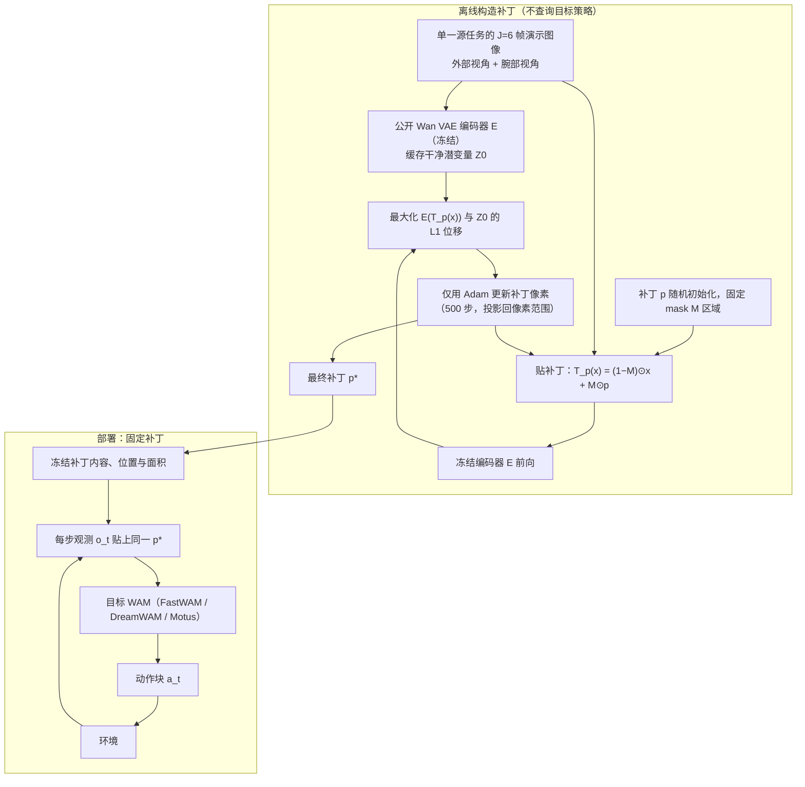

# TAPDreamer（arXiv:2610.06814）

**TAPDreamer**（*TAPDreamer: Transferable Adversarial Patches for World Action Models*，[arXiv:2610.06814](https://arxiv.org/abs/2610.06814)，[项目页](https://tapdreamer.github.io)）来自 [具身智能小站 2026-10-13 盘点](../../sources/blogs/wechat_embodied_station_34_papers_mulligan_2026-10-13.md)，属「世界模型与仿真」组。

## 一句话定义

**仅利用公开视觉编码器构造固定局部扰动，在所测 WAM 间迁移；闭环仿真揭示编码器风险。**

## 英文缩写速查

| 缩写 | 英文全称 | 简要说明 |
|------|----------|----------|
| WAM | World Action Model | 世界动作模型 |
| TAP | Transferable Adversarial Patch | 可迁移对抗补丁 |
| Enc. | Visual Encoder | 视觉编码器 |

## 为什么重要

- 共享编码器是 WAM 的共同脆弱点。
- 开源结论：**待发布**（步骤 2.5，2026-10-14）。项目页含「coming soon」字样，入库日未列 GitHub。
- 同期同组工作见 [失败导向采集与可组合世界动作模型：具身智能小站 10-13 期 34 篇阅读坐标](../overview/embodied-station-2026-10-13-34-papers-technology-map.md)。

## 流程总览

图依据：论文 §2.2 / §2.3（式 3–4、Algorithm 1）与 Fig. 3。

## 核心机制

| 项 | 内容 |
|----|------|
| **arXiv** | [2610.06814](https://arxiv.org/abs/2610.06814) |
| **开源** | **待发布** |
| **要点** | 不能直接外推为实体攻击结论。 |
| **文内指标** | 以原文为准。 |

## 源码运行时序图

**不适用（待发布）** — 项目页含「coming soon」字样，入库日未列 GitHub。 不编造运行脚本；代码公开后再补。

## 实验与评测

- 以原文为准。
- **读法：** 本页为索引级摘要，依据公众号转述的官方摘要与仓库信息整理；逐项数字与 baseline 以原文 PDF 为准。

## 与其他工作对比

- 横向索引见 [失败导向采集与可组合世界动作模型：具身智能小站 10-13 期 34 篇阅读坐标](../overview/embodied-station-2026-10-13-34-papers-technology-map.md)；同 arXiv 不重复造页。

## 结论

**WAM 鲁棒性评估应包含对共享编码器的迁移攻击。**

1. 开源边界：**待发布** — 项目页含「coming soon」字样，入库日未列 GitHub。
2. 核心机制：不能直接外推为实体攻击结论。
3. 复现与选型前核对任务协议、硬件与基准口径，勿直接横比公众号摘录数字。

## 关联页面

- [world-action-models](../concepts/world-action-models.md)
- [safety-filter](../concepts/safety-filter.md)
- [embodied-station-2026-10-13-34-papers-technology-map](../overview/embodied-station-2026-10-13-34-papers-technology-map.md)

## 参考来源

- [tapdreamer_adversarial_patches_wam_arxiv_2610_06814.md](../../sources/papers/tapdreamer_adversarial_patches_wam_arxiv_2610_06814.md)
- [wechat_embodied_station_34_papers_mulligan_2026-10-13.md](../../sources/blogs/wechat_embodied_station_34_papers_mulligan_2026-10-13.md)
- [arXiv:2610.06814](https://arxiv.org/abs/2610.06814)
- [arXiv PDF](https://arxiv.org/pdf/2610.06814)：已通读方法部分（实验与附录以略读为准）：§1 Introduction、§2 World Action Model, Threat Model, and TAPDreamer（2.1–2.3）、§3.1 实验设定

## 推荐继续阅读

- [arXiv PDF](https://arxiv.org/pdf/2610.06814)
- [项目页](https://tapdreamer.github.io)
