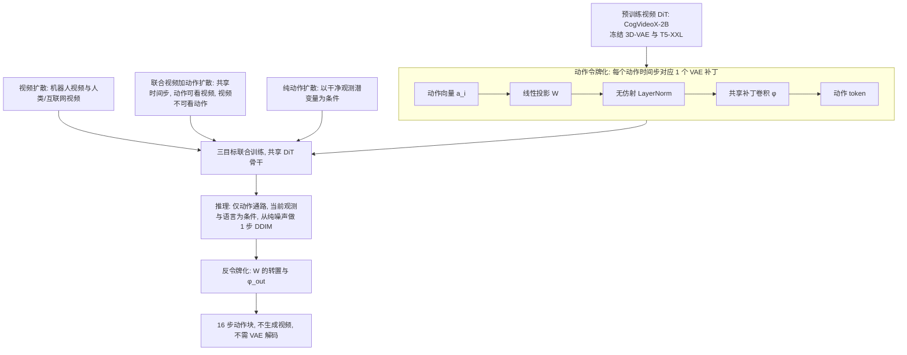

# Tapestry（arXiv:2610.36823）

**TAPESTRY**（*TAPESTRY: A Single Backbone for Video Generation and Robot Control*，缩写展开 Tokenizing Actions as Video Patches in a Shared Transformer Policy，[arXiv:2610.36823](https://arxiv.org/abs/2610.36823)，[项目页](https://tapestry-wam.github.io/)）作者来自 Georgia Tech、马里兰大学与 Toyota Research Institute，发表于 CoRL 2026。线索来自 [具身智能小站 2026-10-28 盘点](../../sources/blogs/wechat_embodied_station_59_papers_human_video_to_robot_experience_2026-10-28.md)，并出现在 Glen Berseth 的 CoRL 2026 阅读清单。本页依据原文通读写成，归档见 [tapestry_arxiv_2610_36823.md](../../sources/papers/tapestry_arxiv_2610_36823.md)。

## 一句话定义

**一个 world action model：把机器人动作的每个时间步当作视频 VAE 潜空间里的一个补丁标记，复用预训练视频扩散 Transformer 的补丁卷积与全部权重去噪动作，训练时联合视频与动作，部署时只走动作通路、一步 DDIM、不生成视频**（摘要，§2.1–2.3）。

## 英文缩写速查

| 缩写 | 英文全称 | 简要说明 |
|------|----------|----------|
| TAPESTRY | Tokenizing Actions as Video Patches in a Shared Transformer Policy | 本文方法（摘要） |
| WAM | World Action Model | 同时建模未来视觉与动作的策略类别，见 [world-action-models](../concepts/world-action-models.md) |
| DiT | Diffusion Transformer | 扩散 Transformer 骨干，本文用 CogVideoX-2B（§2.4） |
| VAE | Variational Autoencoder | 视频 3D-VAE，冻结，时间步长 4、空间步长 8、16 通道（§2） |
| DDIM | Denoising Diffusion Implicit Models | 确定性采样器，本文部署只走 1 步（§2.3） |
| SNR | Signal-to-Noise Ratio | 零终端 SNR 指最大噪声步 ᾱ_T = 0，单步推理的前提（§3） |
| v-prediction | velocity prediction | 预测速度目标 v 的扩散参数化（§2，式 (1)） |
| LN | LayerNorm | 本文用无仿射版本对齐 VAE 潜变量的均值与方差（§2.1） |
| BC | Behavior Cloning | 真机与 LIBERO 的从头训练基线类别 |
| OOD | Out-of-Distribution | 真机三种分布外条件（§4.2） |

## 为什么重要

- 作者的论点（§1）：对动作预测有用的动力学先验在视频骨干的权重里，不在生成出的像素里，所以测试时不必生成视频。这给「视频先验复用」与「推理成本」提供了一个极端的设计点：动作通路只新增 1280 个参数（§2.1）。
- 对比同类 WAM（§1，§5）：DreamZero 测试时仍生成完整视频，Cosmos Policy 把动作块复制 112 份铺进视频潜网格，Fast-WAM 用另起炉灶的动作专家。TAPESTRY 让动作走骨干自己的补丁卷积，部署时 16 个动作 token 一次前向。
- 作者报告的结果（作者自述，§4）：LIBERO 学习自视频协议平均 76%，真机域内 28/30，推理 84 ms 每块（RTX 5090）。这些数字的口径与限定见下文核对与局限。

## 核心原理与流程总览

三个设计（§2）：

1. **动作令牌化（§2.1）：** a_i 经线性投影 W、无仿射 LayerNorm、骨干共享补丁卷积 φ，得到 x_a^i = φ(LN(W a_i))，一个时间步对应一个 token，位置编码用骨干固定的 3D 正弦编码（时间下标 0 到 H−1，空间 1×1）。读出用 W 的转置与 φ_out，不增参数。作者称绕过 φ 直接线性投影到隐维度会在训练早期发散。
2. **三目标训练（§2.2，式 (1)）：** 视频扩散、联合视频加动作扩散、纯动作扩散，共用同一个 DiT。联合模式视频与动作 token 共享扩散时间步，非对称注意力允许动作看视频、禁止视频看动作。纯动作模式丢掉视频 token，和部署形态一致。
3. **单步推理（§2.3，§3）：** 零终端 SNR 与 v-prediction 下，从纯噪声做一步 DDIM 化简为 x̂0 = −vθ(ε, T, τ, xo)，输出近似给定观测与语言的条件均值。作者观察到多步 DDIM 会加入高频抖动，并把原因归为视频预训练的频率先验与动作不符（§3，附录 G）。

图依据：论文 §2.1–2.3、Fig.1、式 (1)(2)。

## 工程实践

- **骨干与训练规模（§2.4，附录 D）：** CogVideoX-2B；32 张 H200；75k 预训练加 25k 微调步；AdamW，学习率 1e-4 预训练、2e-5 微调；有效 batch 128；动作块 H = 16，动作维 20，约 0.53 秒运动（附录 F）。真机设置训练约 1.9k H200 小时（附录 D）。
- **数据混合（附录 E，Table 8）：** 视频源 DROID、BridgeData v2、AgiBot-World、Ego4D、Epic Kitchens、SSv2、Panda-70M 只走视频目标；动作监督只来自域内双臂遥操作约 6.02 小时（含「play」片段），占每个 batch 权重 0.5。作者称尝试过把跨本体机器人数据的动作标签换算到共享 20 维空间使用，效果反而不如只当视频用（附录 E）。
- **动作空间（附录 F）：** 每臂 3D 末端位置、6D 旋转、1 维夹爪，共 20 维；位置为相对块首动作的偏移，旋转相对块首朝向，夹爪为绝对开合度。
- **真机平台（§4.2，Fig.3）：** 20 自由度双臂 I2RT YAM，腕部相机与第三视角相机（RealSense）。三个训练任务 Toolbox、Oven、Corn，各 10 次 rollout。
- **推理（§4.3）：** 单张 RTX 5090，16 步动作块 84 ms，约 9 GB 显存。代码未在论文中提供，项目页未列 GitHub（见来源归档）。
- **复现注意：** 单步推理依赖骨干的零终端 SNR v-prediction 调度。作者在 Wan（整流流）上换目标「初始实验不稳定」（§6，G.7）。

## 与清单说法的核对

清单（Glen Berseth，CoRL 2026 阅读清单，P2，World Models 与 World Action Models 组；该摘要按作者说法由 LLM 据摘要起草）一句话：「Repurposes a pretrained video diffusion transformer as a policy by treating actions as single video-patch tokens.」

| 清单说法 | 论文核对 |
|----------|----------|
| 把预训练视频扩散 Transformer 改作策略 | 属实。CogVideoX-2B 全量微调，W 与全部 DiT 权重（含 φ、φ_out）更新，VAE 与 T5-XXL 冻结（§2.2，§2.4）。 |
| 把动作当作单个视频补丁标记 | 属实但需限定：是「每个动作时间步一个补丁 token」，一个 H = 16 的动作块是 16 个 token，不是整块一个 token（§2.1）。动作先经线性投影与无仿射 LayerNorm 再进共享补丁卷积。 |
| 未提及的要点 | 论文的另外两个核心贡献在清单摘要里没有出现：三目标联合训练（§2.2）和单步 DDIM 推理（§3），后者是 84 ms 与约 44 倍提速的来源（§4.3）。其中纯动作目标按作者消融是「关键」：只用联合目标训练、推理时只去噪动作会失败（§2.2，Table 6）。 |
| 仿真还是真机 | 清单未说。论文两者都有：LIBERO 学习自视频协议（仿真，§4.1）与双臂真机（§4.2）。 |

注意：LIBERO 结果来自「仅 LIBERO-90 有动作标签、其余套件只有视频」的非标准协议，作者明说绝对数字与标准全监督榜单不可比（§4.1）。

## 局限

**作者自述（§6，附录 G）：**

- 单步推理返回条件均值，每个观测一个确定性预测；多模态或高随机动作的任务可能需要迭代细化（G.8）。作者做了双羊角包对称目标探针：8/10 成功，与单羊角包对照的 8/10 持平，每次都选定一个目标（G.9），因此「未观察到平均化」。
- 单步结论依赖骨干的零终端 SNR v-prediction 调度。Wan 整流流骨干上替换原目标不稳定，是否可迁移未解（G.7）。
- W 按 20 维双臂动作空间定尺寸，按本体分别设动作头未探索。

**我的观察（读后判断，非作者结论）：**

- 真机样本量小：域内每任务 10 次，OOD 每条件 5 次。OOD 完整成功 10/15 对 DreamZero 4/15（67 ± 12% 对 27 ± 11%），作者自注该差距 p = 0.07 不显著（§4.2）。
- DreamZero 基线是作者用默认超参在同一数据上复现的（附录 D），底座为 Wan2.2-TI2V-5B，规模与骨干和 TAPESTRY 都不同；LIBERO 与真机上两者训练步数与算力也不同（附录 D），横比需谨慎。
- LIBERO 上 TAPESTRY 并非各套件最优：LIBERO-10 为 55，低于 Cosmos Policy 的 70 与 DreamZero 的 60，Goal 上略低于 DreamZero（65 对 66，Table 1）。平均领先主要来自 Object 与 Spatial。
- 5 epoch 消融中联合目标变体达 78%，高于最终配方的 58%，但它推理时要生成视频，不是同一推理形态（Table 6）。
- 抖动机制「视频频率先验不匹配」是作者基于测量的解释，作者也承认从头训练的动作扩散没有该现象，因此视频预训练是剩下的唯一变量（§3）；这是排除法，不是对照干预实验。
- 论文未给代码，项目页未列 GitHub，复现受限。

## 关联页面

- [world-action-models](../concepts/world-action-models.md)
- [generative-world-models](../methods/generative-world-models.md)
- [vla](../methods/vla.md)
- [diffusion-policy](../methods/diffusion-policy.md)
- [diffusion-transformer](../concepts/diffusion-transformer.md)
- [diffusion-model](../concepts/diffusion-model.md)
- [libero-benchmark](../entities/libero-benchmark.md)
- [paper-fast-wam](../entities/paper-fast-wam.md)
- [paper-amplify-robotics](../entities/paper-amplify-robotics.md)
- [DreamZero：World Action Models are Zero-Shot Policies](../entities/paper-notebook-dreamzero-world-action-models-are-zero-shot-poli.md)
- [Cosmos Policy](../entities/paper-shenlan-wm-11-cosmos-policy.md)
- [embodied-station-2026-10-28-59-papers-technology-map](../overview/embodied-station-2026-10-28-59-papers-technology-map.md)

## 参考来源

- [tapestry_arxiv_2610_36823.md](../../sources/papers/tapestry_arxiv_2610_36823.md)：原文通读归档（核对范围见其中）
- [tapestry.md](../../sources/sites/tapestry.md)：项目页归档
- [wechat_embodied_station_59_papers_human_video_to_robot_experience_2026-10-28.md](../../sources/blogs/wechat_embodied_station_59_papers_human_video_to_robot_experience_2026-10-28.md)
- [wechat_senlanke_weekly_manipulation_2026-10-26_30.md](../../sources/blogs/wechat_senlanke_weekly_manipulation_2026-10-26_30.md)
- [arXiv:2610.36823](https://arxiv.org/abs/2610.36823)

## 继续阅读

- [arXiv PDF](https://arxiv.org/pdf/2610.36823)
- [项目页](https://tapestry-wam.github.io/)
- 论文对比对象：DreamZero（[arXiv:2602.15922](https://arxiv.org/abs/2602.15922)）、Cosmos Policy（[arXiv:2601.16163](https://arxiv.org/abs/2601.16163)）、Fast-WAM（[arXiv:2603.16666](https://arxiv.org/abs/2603.16666)）
