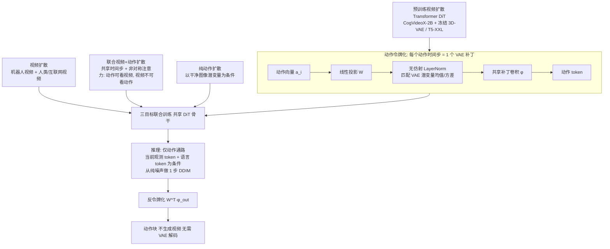

# Tapestry（arXiv:2610.36823）

**Tapestry**（*Tapestry: A Single Backbone for Video Generation and Robot Control*，[arXiv:2610.36823](https://arxiv.org/abs/2610.36823)，[项目页](https://tapestry-wam.github.io/)）来自 [具身智能小站 2026-10-28 盘点](../../sources/blogs/wechat_embodied_station_59_papers_human_video_to_robot_experience_2026-10-28.md)，属「潜在动作与世界模型」组。

## 一句话定义

**将动作投影为视频潜空间中的单补丁标记，用同一骨干学习视频、联合视频动作及纯动作扩散。**

## 英文缩写速查

| 缩写 | 英文全称 | 简要说明 |
|------|----------|----------|
| Tapestry | Tapestry: A Single Backbone for Video Generation and Robot Control | 本文方法 / 基准的简称 |

## 为什么重要

- 把动作当作视频模型的补丁。执行时只生成动作序列，适合研究视频先验复用与推理成本取舍。
- 开源结论：**项目页未列 GitHub**（步骤 2.5，2026-10-28）。项目页 HTTP 200，未见 GitHub 链接或 coming soon 字样。
- 同期同组工作见 [潜在动作、免渲染事件仿真与机器人评测：具身智能小站 10-28 期 59 篇阅读坐标](../overview/embodied-station-2026-10-28-59-papers-technology-map.md)。

## 流程总览

图依据：论文 §2.1–2.4 / Fig.1、式 (1)(2)。

## 核心机制

| 项 | 内容 |
|----|------|
| **arXiv** | [2610.36823](https://arxiv.org/abs/2610.36823) |
| **开源** | **项目页未列 GitHub** |
| **要点** | 将动作投影为视频潜空间中的单补丁标记，用同一骨干学习视频、联合视频动作及纯动作扩散。 |
| **文内指标** | 公众号转述：执行时只生成动作序列，适合研究视频先验复用与推理成本取舍。 |

## 源码运行时序图

**不适用（项目页未列 GitHub）** — 项目页 HTTP 200，未见 GitHub 链接或 coming soon 字样。 不编造运行脚本；代码公开后再补。

## 实验与评测

- 公众号转述：执行时只生成动作序列，适合研究视频先验复用与推理成本取舍。
- **读法：** 本页为索引级摘要，依据公众号转述的官方摘要与仓库信息整理；逐项数字与 baseline 以原文 PDF 为准。

## 与其他工作对比

- 横向索引见 [潜在动作、免渲染事件仿真与机器人评测：具身智能小站 10-28 期 59 篇阅读坐标](../overview/embodied-station-2026-10-28-59-papers-technology-map.md)；同 arXiv 不重复造页。

## 结论

**把动作当作视频模型的补丁：执行时只生成动作序列，适合研究视频先验复用与推理成本取舍。**

1. 开源边界：**项目页未列 GitHub** — 项目页 HTTP 200，未见 GitHub 链接或 coming soon 字样。
2. 核心机制：将动作投影为视频潜空间中的单补丁标记，用同一骨干学习视频、联合视频动作及纯动作扩散。
3. 复现与选型前核对任务协议、硬件与基准口径，勿直接横比公众号摘录数字。

## 关联页面

- [world-action-models](../concepts/world-action-models.md)
- [generative-world-models](../methods/generative-world-models.md)
- [vla](../methods/vla.md)
- [diffusion-policy](../methods/diffusion-policy.md)
- [embodied-station-2026-10-28-59-papers-technology-map](../overview/embodied-station-2026-10-28-59-papers-technology-map.md)

## 参考来源

- [tapestry_arxiv_2610_36823.md](../../sources/papers/tapestry_arxiv_2610_36823.md)
- [wechat_embodied_station_59_papers_human_video_to_robot_experience_2026-10-28.md](../../sources/blogs/wechat_embodied_station_59_papers_human_video_to_robot_experience_2026-10-28.md)
- [arXiv:2610.36823](https://arxiv.org/abs/2610.36823)
- [arXiv PDF](https://arxiv.org/pdf/2610.36823)：已通读方法部分（实验与附录以略读为准）：§1 引言（动机与贡献）、§2 方法（问题设定、背景、§2.1 动作令牌化、§2.2 训练目标、§2.3 推理、§2.4 实现）、§3 单步推理与高频噪声、Fig.1；§4 实验与附录略读

## 推荐继续阅读

- [arXiv PDF](https://arxiv.org/pdf/2610.36823)
- [项目页](https://tapestry-wam.github.io/)
