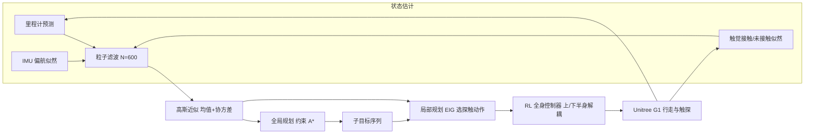
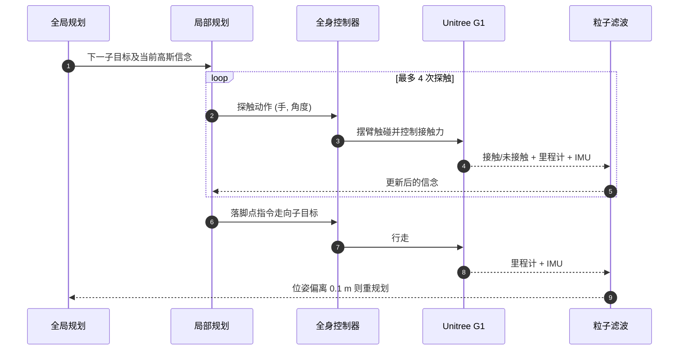

---

type: entity
tags: [paper, humanoid, navigation, tactile-sensing, active-perception, state-estimation, particle-filter, whole-body-control, unitree-g1, georgia-tech, harvey-mudd]
status: complete
updated: 2026-10-12
project_id: tapnav-humanoid-tactile-navigation
arxiv: "2610.10748"
project: https://tapnav.github.io/TAPNAV-Project/
venue: "arXiv 2026"
summary: "TAPNAV：无视觉人形导航——粒子滤波融合里程计/IMU/触觉接触，A* 全局规划约束不确定性、期望信息增益选择探触动作，RL 全身控制执行；MuJoCo 四图平均成功率 95%（Random-touch 77.5%，Odometry-only 22.5%），Unitree G1 仅定性演示。"
related:
  - ../overview/frontier-humanoid-quadruped-2026-10-05-10-09.md
  - ../tasks/humanoid-locomotion.md
  - ../concepts/tactile-sensing.md
  - ../concepts/state-estimation.md
  - ../concepts/whole-body-control.md
  - ./unitree-g1.md
  - ./paper-cap-perception-blind-humanoid.md
  - ./paper-sa-2506-06361-tactile-mnist-benchmarking-active-tactile-percep.md
sources:
  - ../../sources/papers/tapnav_arxiv_2610_10748.md
  - ../../sources/sites/tapnav-project.md
  - ../../sources/blogs/frontier_humanoid_quadruped_2026_10_05_10_09.md
---

# TAPNAV：通过触觉主动感知实现人形机器人导航

**TAPNAV**（*Humanoid Navigation through Tactile Active Perception*，arXiv:2610.10748，Georgia Tech 的 Ye Zhao 团队等）是一个**不依赖相机/LiDAR 的人形导航框架**：在已知静态平面图上，机器人维护 SE(2) 位姿粒子信念，规划路径时让不确定性始终有界，并在不确定性过大时用手上的触觉末端主动“摸墙”，把接触/未接触结果当作定位观测来校正里程计漂移。

## 英文缩写速查

| 缩写 | 英文全称 | 简要说明 |
|------|----------|----------|
| TAPNAV | Tactile Active Perception Navigation | 本文框架：触觉主动感知 + 不确定性受限导航 |
| EIG | Expected Information Gain | 局部规划选探触动作的准则，EIG = p·IG_c + (1−p)·IG_f |
| IMU | Inertial Measurement Unit | 为粒子滤波提供偏航（航向）似然 |
| PPO | Proximal Policy Optimization | 训练上/下半身全身控制器的 RL 算法 |
| LIPM | Linear Inverted Pendulum Model | 下半身策略的落脚点参考由 3D-LIPM 生成 |
| SE(2) | Special Euclidean group in 2D | 平面位姿 (x, y, yaw) 的状态空间 |

## 为什么重要

- **补上“无视觉”这条退路**：黑暗、烟雾、镜头失效时视觉定位失效，而纯里程计+IMU 漂移很快；论文仿真里 Odometry-only 平均成功率仅 22.5%。
- **把“接触”当作规划对象而不是被动事件**：不是等撞上障碍再反应，而是在规划里预估“摸哪里能降多少不确定性”，使物理交互成为定位手段。
- **全身控制器接入定位闭环**：同一个人形既要走位又要把手臂送到指定接触点并控制接触力，涉及 loco-manipulation 级协调（见 [全身控制](../concepts/whole-body-control.md)）。

## 方法栈 / 流程总览

## 方法

### 状态估计

- **粒子滤波**：SE(2) 位姿 (x, y, yaw)，600 个粒子，围绕已知起点初始化（位置 0.03 m/轴、偏航 1.5° 标准差）；预测用带高斯噪声的里程计；重加权用触觉似然与 wrapped-Gaussian IMU 航向似然；N_eff < 0.5·N_p 时重采样并加小幅高斯粗化。
- **触觉似然**：接触时惩罚“停止点到地图表面的距离”|δ|；未接触时只惩罚预测穿透（δ < 0）。
- **触觉硬件**：每只手一块 TouchTronix SensX 160（20×8 taxel，有效 20×50 mm，上限 100 N），外覆 Ecoflex 00-50 硅胶；总激活量按逆指数模型换算法向力（沿用 WT-UMI），阈值化为二值接触；阈值原文未给。

### 全局规划

0.1 m 栅格上的约束 A*：墙间隙 ≥ 0.2 m、单次位移 ≤ 0.4 m，每次位移要求位置不确定性 ≤ 0.18 m、航向 ≤ 20°；对候选路径传播协方差，在探测范围内有平面时做简化卡尔曼更新，意味着路径会“故意”绕经可摸到墙的位置；估计位姿偏离 > 0.1 m 触发重规划。

### 局部规划（信息增益探触）

- 动作 a = (j, α)：j 为左/右手，α 在 [−40°, 110°] 离散并受手臂运动学约束；每个子目标至多 4 次探触。
- 接触概率 p = Φ(−μ/σ)，σ² = HΣHᵀ + σ_control²；接触信息增益 IG_c = ½ log(1 + HΣHᵀ/σ_c²)；未接触增益 IG_f 由“边缘方差中来自位姿不确定性的比例”和截断正态方差比给出；EIG = p·IG_c + (1−p)·IG_f。
- 最大 EIG < 0.15 nats 时停止探触；σ_c = 0.018 m，σ_control = 0.045 m。

### 全身控制器

- PPO 训练的解耦式双策略（上半身 + 下半身，共享本体感知，联合训练），200/50 Hz。
- 上半身两阶段课程：先跟踪 IK 参考的末端位姿，再加入沿探触方向的仿真弹簧-阻尼力场做力跟踪。
- 下半身跟踪落脚点指令，参考由 3D-LIPM + 三次样条摆动脚生成。

## 源码运行时序图

**不适用**：项目页写 “Code: Coming soon”，截至 2026-10-12 无公开仓库，无法对齐真实目录与脚本。下图仅是论文描述的**运行时数据流（非仓库时序）**，供理解闭环：

## 实验与评测

**仿真（MuJoCo）**：四张图（弯曲走廊 a、分隔房间 b、之字走廊 c、散落障碍房间 d），每图每方法 20 次（seed 0–19），1800 s 超时。基线：Odometry-only（不探触）、Random-touch（随机方向探触）、Sweep-touch（网格扫掠）。

| 方法 | 成功率 a / b / c / d（%） | 平均成功率 | 位置误差 cm（a / b / c / d，仅成功试验） |
|------|---------------------------|-----------|------------------------------------------|
| TAPNAV | 95 / 100 / 100 / 85 | 95% | 6.5 / 9.4 / 5.9 / 16.8 |
| Random-touch | 90 / 70 / 75 / 75 | 77.5% | 9.6 / 11.4 / 8.7 / 16.6 |
| Sweep-touch | 50 / 50 / 30 / 25 | 38.8% | 11.7 / 11.2 / 10.9 / 13.7 |
| Odometry-only | 35 / 5 / 5 / 45 | 22.5% | 23.4 / 36.5 / 13.2 / 28.5 |

- 地图 d 上 TAPNAV 位置误差（16.8 cm）与 Random-touch（16.6 cm）几乎相同，Sweep-touch 误差更小但成功率只有 25%，说明误差只统计成功试验，需与成功率合读。
- IMU 航向噪声敏感性：论文仅用图定性说明 TAPNAV 误差最低、成功率最高，正文无数值。
- 落脚点控制器 vs 速度控制器（各 30 次仿真）：定性结果为速度控制器随航向误差累积而漂移；指令速度上限 0.2 m/s。
- **真机**：Unitree G1 在办公室走廊与厨房绕台面连续转弯并到达目标；**原文未报告试验次数、误差或成功率**。

## 结论

**TAPNAV 的价值在“把触探动作纳入信息论规划”，仿真中相对随机/扫掠触探的优势明确，但真机证据仍停留在定性演示。**

1. **信息增益选点优于盲摸** — 四图平均成功率 95% 对 Random-touch 77.5%、Sweep-touch 38.8%，说明“摸哪里”比“摸不摸”更关键。
2. **不确定性约束要进全局规划** — 路径上限 0.18 m / 20° 迫使 A* 绕经可校正位置，而不是事后补救。
3. **单独的里程计不可用** — Odometry-only 平均仅 22.5%，之字/分隔房间成功率仅 5%。
4. **控制接口影响漂移** — 落脚点级指令比速度级指令更稳（定性，30 次仿真）。
5. **别外推到真实环境** — 假设已知静态平面图、单峰高斯，真机无统计；触觉阈值与 PPO 超参未公开。
6. **部署读法** — 触探要求手部带力/触觉末端；若平台无此硬件，需先评估复刻成本。

## 工程实践

- **硬件**：G1 + 两只自制触觉末端（SensX 160 + 硅胶垫），无相机/LiDAR。
- **开源状态（核查日 2026-10-12）**：[项目页](../../sources/sites/tapnav-project.md) 的 Code 项为 “Coming soon”，arXiv 页也未列仓库，**待发布**；故无 `sources/repos/` 条目。
- **复现要点**：粒子数 600、网格 0.1 m、探触上限 4 次、停止阈值 0.15 nats、σ_c 0.018 m、σ_control 0.045 m 都已在论文给出，可先复现规划层，控制器需自行训练。

## 局限与风险

- 依赖已知、静态的平面图；动态障碍或地图错误会使触觉似然失效。
- 规划期单峰高斯近似，无法表达多假设（如对称走廊）；作者列入未来工作（多峰信念、部分已知地图）。
- 真机无量化；触觉阈值、接触力范围等细节缺失。
- 摩擦较低或软物体表面上触觉二值化可能失真（推测，原文未讨论）。

## 与其他工作对比

- [CAP：盲人形感知](./paper-cap-perception-blind-humanoid.md)：同属“不靠视觉”的人形感知路线，关注点不同（见该页），TAPNAV 聚焦全局定位与导航。
- [Tactile MNIST 主动触觉感知基准](./paper-sa-2506-06361-tactile-mnist-benchmarking-active-tactile-percep.md)：主动触觉感知的分类/定位基准，TAPNAV 把同类思想落到人形全身导航。
- 视觉导航类（见 [VLN](../tasks/vision-language-navigation.md)）依赖相机，TAPNAV 是它们失效时的互补方案而非替代。

## 关联页面

- [人形/四足周报汇总（2026-10-05~10-09）](../overview/frontier-humanoid-quadruped-2026-10-05-10-09.md)
- [人形运动控制任务页](../tasks/humanoid-locomotion.md)
- [触觉感知](../concepts/tactile-sensing.md)
- [状态估计](../concepts/state-estimation.md)
- [全身控制](../concepts/whole-body-control.md)
- [Unitree G1](./unitree-g1.md)
- [机器人视觉感知栈选型闭环](../queries/robot-perception-stack-selection-loop.md) — 本页是其反例对照：不依赖相机/LiDAR，用触觉接触作定位观测替代 ① 视觉传感层，适合视觉不可用时的导航

## 参考来源

- [TAPNAV 论文归档](../../sources/papers/tapnav_arxiv_2610_10748.md)
- [TAPNAV 项目页归档](../../sources/sites/tapnav-project.md)
- [人形/四足周报来源](../../sources/blogs/frontier_humanoid_quadruped_2026_10_05_10_09.md)
- 论文：<https://arxiv.org/abs/2610.10748>

## 推荐继续阅读

- [TAPNAV 项目页](https://tapnav.github.io/TAPNAV-Project/)
- [arXiv HTML 全文](https://arxiv.org/html/2610.10748v1)
