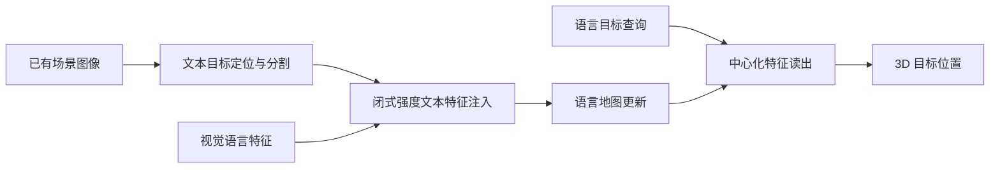

# 目标感知的 3D Gaussian 语言地图免训练细化

## 一句话定义

**在已建语言地图中对目标区域注入适量文本嵌入，闭式求解最小注入比例，并用中心化读出消除公共语义方向带来的检索偏差。**

## 英文缩写速查

| 缩写 | 英文全称 | 简要说明 |
|------|----------|----------|
| 3DGS | 3D Gaussian Splatting | 三维高斯场景表达 |
| VLM | Vision-Language Model | 视觉语言嵌入 |
| mIoU | Mean Intersection over Union | 平均交并比 |

## 为什么重要

对指定目标的语言地图进行免训练特征修正，关注现有控制、数据或机器人学习方法在复杂任务中的失效点。这里单独建论文实体，避免与其他论文共用详情页；已通读原始论文 HTML 的可用正文和附录；源码执行效果仍需复现。

## 核心机制

从已有场景视图获得文本可提示分割和类无关区域；仅在指定目标的视觉特征中按闭式强度混入文本向量，再由地图蒸馏保留开放词汇基底，目标检索时中心化去掉公共方向偏差。

## 方法流程

该流程依据原文方法描述，不等价于源码调用时序。

## 源码运行时序图

**暂不适用**：未核实到官方已发布的完整可运行实现，不以通用模板替代实际调用链。

## 实验与评测

在 Replica、ScanNet 与 HM3D-Semantics 的语言目标定位上进行检验；项目页报告 Replica 细化后的 mIoU 约为原基底的两倍。仍须完成基础地图构建和目标区域分割，方法本身免训练不等于全系统免训练。

## 局限与工程实践

- 依赖基础地图、开放词汇视觉嵌入及目标掩码质量；公开仓库 README 标注 Code will be released soon，目前仅是项目说明仓库。
- **源码状态：** 已建立公开项目仓库，但 README 明确 Code will be released soon；目前无可运行算法实现。
- **原文状态：** 已通读 arXiv HTML 的可用正文和附录；具体复现及跑通情况尚未独立验证。

## 结论

**语言地图目标检索误差可能来自嵌入公共方向而非 3D 重建误差，应单独诊断。**

1. 使用与论文一致的任务、硬件和评测协议复验，不跨实验口径比较数据。
2. 把方法改善的指标与额外的数据、计算或控制成本分开记录。
3. 对未经独立核查的复现入口，暂不声称完成验证。

## 与相关方法对比

| 对照方法 | 关键区别 | 局限或适用条件 |
|---|---|---|
| 直接查询原始三维语言地图 | 文字和视觉嵌入偏差可能造成误检 | 目标区域注入文字先验并用中心化读出修正 |
| 整幅地图强制替换文字特征 | 会破坏其他目标和开放词汇表示 | 方法对目标局部闭式选注入量，仍依赖地图与分割 |

不同基准和硬件的结果不能直接排序。

## 关联页面

- [EM-ViT：机器人运动辅助的单目深度在线尺度适配](./paper-emvit-online-metric-depth.md)
- [SPEAR：机器人强化学习中的选择性 VLM 偏好询问](./paper-spear-selective-preference.md)

## 参考来源

- [论文归档](../../sources/papers/target-aware-gaussian-langmap_arxiv_2610_21619.md)
- [官方项目页归档](../../sources/sites/target-aware-gaussian-langmap.md)
- [官方仓库归档](../../sources/repos/target-aware-gaussian-langmap.md)

## 推荐继续阅读

- [arXiv 原文](https://arxiv.org/abs/2610.21619)
- [官方项目页](https://lab-of-ai-and-robotics.github.io/target-aware-langmap/)
- [公开仓库](https://github.com/Lab-of-AI-and-Robotics/target-aware-langmap)
