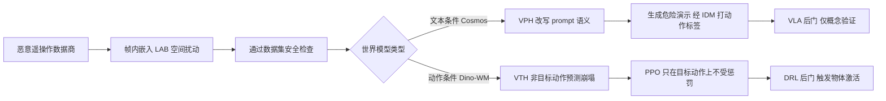

# Targeting World Models to Compromise Robot Learning Pipelines（arXiv:2606.09499）

**论文：** Rathbun、Agha、Mahmud、Amato、Oprea、Bagdasarian（东北大学 / 马萨诸塞大学阿默斯特分校），[arXiv:2606.09499](https://arxiv.org/abs/2606.09499)，v1 于 2026-06-08 发布；CoRL 2026 Spotlight 来自 Glen Berseth 阅读清单（本页未能核对 OpenReview）。

## 一句话定义

**世界模型被放进机器人学习流水线生成合成训练数据后，成了新的数据投毒入口：攻击者不直接投毒数据集，而是在看似安全的遥操作视频帧里埋白盒优化出的小扰动，数据经世界模型后才「激活」，生成危险轨迹或有偏的转移动力学，进而污染下游 VLA / DRL 策略（摘要，§1，§4）。**

## 英文缩写速查

| 缩写 | 英文全称 | 简要说明 |
|------|----------|----------|
| WM | World Model | 世界模型，本文分文本条件与动作条件两类（§2 式 1） |
| VPH | Visual Prompt Hijacking | 视觉提示劫持：扰动帧改写文本条件世界模型对用户 prompt 的解读（§5.1） |
| VTH | Visual Transition Hijacking | 视觉转移劫持：让动作条件世界模型在非目标动作下预测崩塌（§5.2） |
| VLA | Vision-Language-Action | 视觉语言动作策略，本文下游目标之一 |
| DRL | Deep Reinforcement Learning | 深度强化学习，本文以 PPO 为例 |
| BC | Behavior Cloning | 行为克隆，学习复现训练数据中的行为 |
| IDM | Inverse Dynamics Model | 逆动力学模型，给生成视频补动作标签（§3） |
| PGD | Projected Gradient Descent | 投影梯度下降，攻击优化器，附录 A.1 加动量 |
| LAB | CIELAB 色彩空间 | 扰动的 lp 约束所在空间（§4，参考文献 [46] 为 CIEDE2000） |
| POMDP | Partially Observable Markov Decision Process | 问题设定（§2） |

## 为什么重要

- 世界模型正被用作低成本的数据生成、策略评估与规划工具（§1），论文把它放在「机器人学习供应链」里当作新的攻击面。
- 与以往要直接注入危险轨迹（易被数据检查发现）或需要拿到奖励 / 转移动力学（需深度系统权限）的攻击相比，这里攻击者只提供「看起来安全」的帧，绕过数据集层面的安全检查（§3、§4，作者自述）。
- 作者的次要发现：文本条件世界模型在轻微分布外或 prompt 含糊时更易被操纵（§6），防御因此多了「任务 / 场景是否在分布内」这一层，不只是 lp 范数（作者自述）。

## 核心原理与流程总览

威胁模型（§4）：不可信的遥操作数据商提供帧被动过手脚的演示 -> 受害者通过初始安全检查 -> 合并进内部训练集并送入世界模型 -> 生成不安全的合成数据或有偏动力学 -> 训练出不安全策略。攻击者须白盒访问世界模型，只能改视频帧，不能注入动作或控制下游 prompt / 奖励。

- **后门定义（§5，式 2）：** 策略在看到触发物体时转向对手目标（attack success），没有触发时保持原行为（attack stealth）。
- **VPH（§5.1，式 3）：** 最小化 D(S(x_δ, t_safe), S(x_δ, t_danger))，约束 ||x - x_δ|| 在 LAB 空间 lp 球内。附录 A.1 说实际优化的是去噪向量场，两个 prompt 下的 MSE 损失。
- **VTH（§5.2，式 4、5）：** 先是无条件版本，让 x_δ 的编码远离 x 的编码（余弦）使预测崩塌；再改为条件版本：目标动作 a+（加小扰动 ε）下预测回到良性状态，远离 a+ 的动作下崩塌（式 5），这样 RL 智能体在世界模型里选 a+ 才不被「惩罚」。
- **攻击参数（附录表 2）：** 400 步，β_L=5，β_AB=20，α=0.025，动量 0.9，攻击时生成 10 帧。VTH 用 4 帧，每步采样 4 条目标 / 4 条非目标动作序列（附录 A.2）。

## 工程实践

- **VPH 评测（§6.1，附录 A.1）：** Cosmos-Predict 2.5 2B「Post-Trained」版，用 LoRA 在 Libero（Cosmos-Policy 的 256x256 渲染版）微调，生成 432x432 视频。设计三类安全关键的拾放任务：Stove、Microwave、Gift Box；每个危险物体 5 张扰动图 x 4 个种子，人工看视频判定成败（作者说 VLM 判定不可靠）。
- **VTH 评测（§6.2，附录 A.2）：** Dino-WM（约 500M 参数，Single Wall）包成 Gymnasium 环境，用 CleanRL 的 PPO 训练，奖励为潜空间距离的稠密形式（附录式 6），观测为潜状态与目标状态拼接。Dino-WM 上的 Push T 任务训练 PPO 仍有困难（附录 A.2）。Cosmos-Predict 2.5 动作条件 2B 版在 Droid 样本上只测输出距离，不接 DRL 流程。
- **算力（附录 A.3）：** 2x RTX 4090 桌面机可做 2B Cosmos 推理与 Dino-WM 全部实验；Cosmos 微调与攻击优化用 4x H100 服务器。
- **复现提示：** 论文未给攻击代码仓库，故本页不写 `code:`；作者称去匿名后会放出 Libero 微调的 Cosmos 模型（附录 A.1）。

## 与清单说法的核对

清单摘要（作者说是 LLM 据摘要起草）：「Shows learned world models in robot learning pipelines open a stealthy attack surface that can compromise downstream policies.」

| 清单措辞 | 论文里的对应 | 核对结论 |
|----------|--------------|----------|
| learned world models ... open an attack surface | §1、§4 明确主张；两类世界模型（Cosmos-Predict 2.5、Dino-WM）上有实验 | 基本对得上，但实验只覆盖这两个模型家族 |
| stealthy | 作者自述：帧级扰动绕过数据集检查（§4）。附录 A.1 承认 β 比一般视觉对抗攻击大，且「期望未来找到更小、更难察觉的扰动」；没有感知评测或人类研究 | 「隐蔽」是论证性质的，未被实测，我判断需谨慎看待 |
| can compromise downstream policies | DRL 侧：Dino-WM 里 PPO 被植入后门（§6.2 图 3）。VLA 侧：因 IDM 泛化失败未训练出策略，作者称仅为概念验证（§6.1、附录 A.1） | 对 DRL 成立但是仿真小环境；对 VLA 的「下游策略被污染」论文自己说未验证 |
| 未写限定词 | 白盒访问；Libero 仿真视频；人工判定；基线 Gun 在分布外已有 10%；分布内多数攻击成功率接近 0 | 清单摘要省略了白盒、仅仿真、成功率高度依赖分布外条件这几个关键限定 |

此外：论文没有真机实验；摘要说「完整的端到端后门」指 DRL 流水线，攻击成功率读图约 0.3-0.4（图 3），不是接近 100%。

## 局限

**论文自己承认（§6.1、§7、附录 A.1、B.3）：**
- VPH 和 VTH 在更真实的机器人学习管线（文本 / 动作条件世界模型）里都未验证；
- 攻击实现远非最优，真实潜力不确定；
- 当前文本条件世界模型和 IDM 太脆弱，VLA 训练数据质量不够，IDM 在新任务上泛化失败，VLA 部分只是概念验证；
- 目标物体需足够在分布内或足够大（Dynamite、Fork 在所有设置下成功率为 0）；
- 护栏结果是初步的。

**我看到的未验证之处（判断，非作者自述）：**
- 攻击需要白盒访问受害者世界模型及其权重，现实中数据商是否知道买家用哪个模型、哪个版本，论文未讨论；
- 扰动幅度在 LAB 空间 β_AB=20（附录表 2），论文没有给出视觉不可察觉的证据（无人类研究或检测器测试）；
- 表 1 每格仅 20 次生成（5 图 x 4 种子），人工判定，单格差 5 个百分点就是 1 次生成；无置信区间；
- 图 3 的攻击成功率只有约 0.3-0.4，且仅在 Single Wall 一个任务、5 个种子、5% 污染率下；没有其他污染率或任务的敏感性分析；
- 图 4 只显示 L2 距离随动作靠近目标而下降，下降幅度相对误差带不大（读图），并非端到端的后门成功；
- 未与「直接投毒」或其他后门基线对比，也未测试对抗训练、输入净化、图像压缩等防御。

## 关联页面

- [生成式世界模型](../methods/generative-world-models.md)
- [生成式数据增强](../methods/generative-data-augmentation.md)
- [VLA 方法页](../methods/vla.md)
- [PPO](../methods/ppo.md)
- [模仿学习](../methods/imitation-learning.md)
- [NVIDIA Cosmos](../entities/nvidia-cosmos.md)
- [DINO-WM](../entities/paper-sa-2411-04983-dino-wm-world-models-on-pre-trained-visual-featu.md)
- [LIBERO 基准](../entities/libero-benchmark.md)
- [SmolVLA](../entities/paper-smolvla.md)
- [DURA：扩散 VLA 视觉攻击](../entities/paper-dura-diffusion-vla-visual-attack.md)
- [VLA INT8 比特翻转攻击](../entities/paper-vla-bit-flip-attacks-int8.md)

## 参考来源

- [来源归档](../../sources/papers/targeting-world-models-robot-learning-pipelines_arxiv_2606_09499.md)
- [arXiv:2606.09499](https://arxiv.org/abs/2606.09499)

## 继续阅读

- [arXiv PDF（v1）](https://arxiv.org/pdf/2606.09499v1)
- [Cosmos-Predict 2.5 来源归档](../../sources/papers/cosmos_predict25_arxiv_2511_00062.md)
- [DINO-WM 页面](../entities/paper-sa-2411-04983-dino-wm-world-models-on-pre-trained-visual-featu.md)
